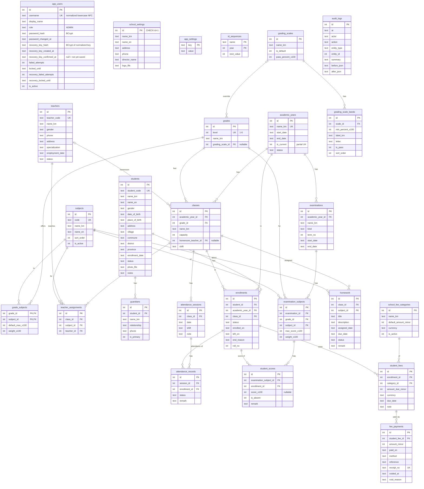

# Phase 0 — Architecture & Plan
**Offline Khmer Primary School Management System (Windows desktop)**
Status: **APPROVED (2026-10-30): Spring Boot 4.1.x on Java 21, and all nine defaults in §12. Phase 1 in progress — see `docs/PHASE1-PROGRESS.md`.**
Date: 2026-10-30

**Changes in revision 4** (your approval message)
- **D1 decided: Spring Boot 4.1.x on Java 21** (option B). Newest stable 4.1 patch is **4.1.2** today (no 4.1.3; 4.2 is only at RC1); Phase 1 re-resolves it before any code (§13).
- **S2 (SQLite persistence + migrations) is now a hard gate**: no backend scaffolding until it passes on the then-latest 4.1.x patch (§11).
- Clarified that internet is used **only at build time on the developer PC**; the installed app has no internet dependency (§8).
- **The nine defaults (§12) are explicitly NOT yet approved.**

**Changes in revision 3** (your review requests)
- **D1 re-opened → §2A**: official support status, dependency comparison, a compatibility probe run on both Spring Boot lines, and a recommendation. **You need to pick the line.**
- **Windows**: Windows 11 64-bit is the recommended production OS; Windows 10 22H2 is a compatibility test target with stated limits → §4C.1a, D22, R19.
- **§12**: the nine defaults are numbered, each with its reason.
- **Probe-driven corrections** (true on either Boot line): `transaction_mode=IMMEDIATE` is required (§5.1, R3); type converters are mandatory (§5.1, R2); **my earlier `defer_foreign_keys` table-rebuild pattern was wrong and is replaced** (§5.4, R4); SQLite constraint errors need a custom translator (§6.1); UTF-8 stdout flags (§4C.3).

**Changes in revision 2**: D8 resolved into the full account / recovery-key design (§4A); first-launch wizard (§4A.3); health check (§4B); hardware, budgets and JVM configuration (§4C); ERD, endpoints, data dir, preload API, restore behaviour, risks, checklist and open questions updated.

---

## 0. How to read this document

| § | Content |
|---|---------|
| 1 | Environment inspection (what exists, what is missing) |
| 2 | **Decisions & deviations from the master prompt** — read this first |
| 2A | **Spring Boot version decision — decided: 4.1.x** |
| 3 | Repository structure |
| 4 | Electron + Nuxt + Spring Boot integration |
| 4A | **Authentication, first-launch wizard, recovery key** *(new)* |
| 4B | **Application health check** *(new)* |
| 4C | **Target hardware, performance budgets, configuration** *(new)* |
| 5 | SQLite design (ERD, constraints, conventions) |
| 6 | API contracts |
| 7 | Local data directory |
| 8 | Windows packaging strategy |
| 9 | Khmer language strategy |
| 10 | Technical risks |
| 11 | Implementation checklist |
| 12 | Decisions recorded, defaults you can veto, what is still open |
| 13 | **Approval request** |

Anything marked **[verify]** is a hypothesis that will be proven by a Phase 1 spike. Nothing in this document has been tested yet.

---

## 1. Environment inspection

### 1.1 Findings (dev machine)

| Item | State | Note |
|---|---|---|
| OS | Windows 11 Pro 10.0.26200, x64, 31.7 GB RAM | `D:` has 134 GB free |
| Project dir | `D:\My Own Project\sms-offline` — empty (only `.qodo/`) | **Not a git repo** — `git init` in Phase 1 |
| Node | 24.22.1 (via nvm4w; also 22.x, 26.x available) | Nuxt 4.6 needs `^22.22.3 \|\| ^24.15.0 \|\| >=26` → OK |
| npm / pnpm / yarn | 11.19.1 / 12.15.0 / yarn 1.x | Proposal: **npm workspaces** (no extra tool) |
| Java | **Not on PATH, `JAVA_HOME` unset** | But **Corretto 21.0.6 exists** at `C:\Users\pnak\.jdks\corretto-21.0.6` with `jlink`, `jdeps`, `jmods` ✔ |
| Maven / Gradle | Not on PATH | Use the **Maven Wrapper** (`mvnw`) — nothing to install. IntelliJ's bundled Maven 3.9.x can generate the wrapper once |
| Git | 2.48.1 | |
| Khmer fonts | Dozens installed incl. Noto Sans Khmer, Khmer OS family | ⚠ **Masks font-bundling bugs** — see R14 |
| Printers | Epson WF-7830, Canon (network), Microsoft Print to PDF | Enough to test real + virtual printing |
| Winget | Present | Could install a system JDK/Maven if wanted — not required |

### 1.2 Actions needed on the dev machine
1. Set user env var `JAVA_HOME=C:\Users\pnak\.jdks\corretto-21.0.6` (one line; build scripts will also fall back to that path).
2. Nothing else to install. No Docker, no global Maven.
3. For Phase 6 testing: a **clean Windows environment without Khmer fonts, Java, or Node and with networking disabled** (Windows Sandbox if the feature is enabled, otherwise a Hyper-V VM).

### 1.3 Current library versions (looked up 2026-10-30, to be pinned exactly in Phase 1)

| Area | Choice | Version |
|---|---|---|
| Frontend | Nuxt / Vue / Bootstrap / BootstrapVueNext | 4.6.3 / 3.5.x / 5.3.8 / 1.2.2 |
| State, forms | Pinia (+`@pinia/nuxt` 1.0.3), vee-validate, **zod** | 4.1.0, 4.15.1, **3.x (not 4)** — see D2 |
| Other FE | Day.js (has `km` locale ✔), Iconify, ApexCharts + vue3-apexcharts, `@nuxtjs/i18n` | 1.11.23, 5.0.4, 8.6.0 / 1.11.3, 10.6.0 |
| Fonts (bundled) | `@fontsource/noto-sans-khmer`, `noto-serif-khmer`, `battambang`, `moul` (all OFL) | 5.3.0 |
| Desktop | Electron / electron-builder / esbuild | 45.1.0 / 26.18.0 / 0.28.2 |
| Backend | **Spring Boot 4.1.x (decided, D1 = B)** — newest stable today 4.1.2: Spring Framework 7.0.10, Hibernate 7.4.13, Flyway 12.4.0 | §2A |
| SQLite | `org.xerial:sqlite-jdbc` — managed by Boot 4.1.2 at **3.53.4.0** (no override needed) | 3.53.4.0 |
| Excel | Apache POI (`poi-ooxml`) | 5.5.1 (6.0.0 is out; choose in spike) |

TypeScript 7.0.2 is the newest on npm; **pin to whatever `vue-tsc`/Nuxt's template supports** rather than `latest` [verify].

---

## 2. Decisions & deviations from the master prompt

These are the places where I either refine the prompt or recommend against a literal reading. **D1 is decided (Boot 4.1.x, §2A); D8 is resolved; D17–D22 are new. The nine review defaults are in §12.**

| # | Decision | Why |
|---|---|---|
| **D1** | **Decided 2026-10-30: Spring Boot 4.1.x on Java 21** — newest stable 4.1 patch at Phase 1 start (4.1.2 today) | Only line with free support today (to 2027-07-31); the Phase 0 probe passed 12/12 on both 3.5.16 and 4.1.2; migration debt is cheapest on an empty repository (§2A). |
| D2 | **zod 3.x, not zod 4** | `@vee-validate/zod@4.15.1` (latest) has peer `zod ^3.24.0`. Zod 4 would break form validation. Schemas shared with `toTypedSchema`. |
| D3 | **PDF and printing use Chromium (Electron), not a Java PDF library** | Khmer needs complex-script shaping (coeng/subscript consonants, vowel reordering) and dictionary-based word breaking. Chromium has HarfBuzz + ICU for this; OpenPDF/iText/PDFBox/OpenHTMLtoPDF do not shape Khmer reliably. Reports are Vue "print" pages → `webContents.printToPDF` / `webContents.print`. Spring only supplies JSON data, so *Spring remains the only DB accessor*. Proven in spike S1 before anything depends on it. |
| D4 | **Random loopback port + per-launch secret**, not a fixed port | A fixed port can collide, and any web page in a browser can fire requests at `127.0.0.1:<port>`. The backend picks port `0`, reports the real port to Electron, and rejects any request lacking the secret that Electron injects (§4.4). A fixed port remains available via `config/app.json`. |
| D5 | **Decimals as scaled integers; dates as ISO text** | SQLite has no true DECIMAL/DATE. Scores stored ×100 (`INTEGER`), money in minor units (`INTEGER` + `currency`). Dates `YYYY-MM-DD`, timestamps ISO-8601 UTC. Averages/ranks computed in Java with `BigDecimal`, never SQL floats. JPA `AttributeConverter`s. |
| D6 | **History hangs off `enrollments`, not `students`** | Attendance, scores and fees reference the *enrollment* (student × academic year × class). Promotion creates a new enrollment; old records are never touched. A mid-year class change = close old enrollment + open new one. |
| D7 | **Student "grade / class / academic year" live on the enrollment**, shown as part of the student profile | Normalised; the prompt's field list is satisfied in the UI and API (`currentEnrollment`). |
| **D8** | **Decided & specified in §4A**: user-created admin (own username + password) via a first-launch wizard; one-time recovery key, stored only as a hash, rotated on every use; no default or universal credentials | With no email/online auth, a forgotten password otherwise means a locked-out school. |
| D9 | **Backup history stored outside the database** (`config/backup-history.json`) | A restore replaces `school.db`; history inside it would be overwritten by the very backup being restored. |
| D10 | **Restore is applied at next backend start**, before the DB is opened | Never swap a DB file under a live connection pool. Flow in §4.7. |
| D11 | **Spring writes backups only into the managed `backups/` dir**; Electron's main process copies to/from the USB/folder the user picked | Keeps arbitrary filesystem paths out of the REST API. Renderer never sends paths to Spring. |
| D12 | **Load Nuxt through a custom `app://` protocol**, not `file://` | Absolute asset URLs and history-mode routing just work; gives a stable origin for CORS/CSP. |
| D13 | **Client-side Khmer sorting** (`Intl.Collator('km')`) for lists/rosters; server paginates only large tables (logs, history) | JDK `Collator` has no reliable Khmer tailoring and SQLite sorts by code point. A small school's lists are tiny. Verified in S1 [verify]. |
| D14 | **Walking-skeleton installer in Phase 1**, not Phase 6 | Packaging bugs (JRE paths, process spawn from `resources/`, AV, install dir) are cheapest to find on day one. Phase 6 then hardens, not discovers. |
| D15 | **Maven (wrapper), npm workspaces, esbuild for Electron main/preload** | Fewest moving parts. Sandboxed preload scripts must be one bundled CJS file. |
| D16 | **Vue i18n via `@nuxtjs/i18n`**, locale `km` default, single `km.json` tree | Meets "centralised translations, English later". Backend returns error *codes*; the frontend owns all Khmer text. |
| D17 | **The setup wizard gates the whole app** until the admin account exists; setup progress is stored in the DB, not browser storage | Nobody can configure or read data before an owner exists; an interrupted wizard resumes after login (§4A.3). |
| D18 | **Recovery key = 25 chars Crockford Base32 (125 bits, `SecureRandom`), BCrypt-hashed**; using it rotates it in the same transaction | Unguessable, easy to copy by hand (no `I L O U`), invalid the instant it is used (§4A.2). |
| D19 | **Password max 72 UTF-8 bytes** (BCrypt's limit) with a clear Khmer message, instead of silent truncation | A Khmer character is 3 bytes in UTF-8, so ≈ 24 Khmer characters; ASCII gives 72. |
| D20 | **Health check in three layers with no background polling** (§4B) | Needed for "friendly startup error" and for support, without adding timers or services. |
| D21 | **JVM memory configurable** through `config/app.json`, RAM-tiered defaults, validated bounds; no Windows service, tray, auto-start, updater or timers (§4C) | Unknown target PC; measure, then tune without rebuilding. |
| D22 | **Windows 11 64-bit is the recommended production OS; Windows 10 22H2 is a compatibility test target** with documented limits (§4C.1a) | Windows 10 is outside regular Microsoft support since 2025-10-14, and Chromium's Windows 10 plans are unconfirmed. It stays supported on a best-effort, VM-tested basis because older i3 PCs often cannot run Windows 11. |

---

## 2A. Spring Boot version decision (D1 — decided: option B, 4.1.x)

You asked me to verify the support status and recommend the best line — not simply the newest patch. This section is evidence first, recommendation last.

### 2A.1 Official support status
Source: Spring's own project API, `https://api.spring.io/projects/spring-boot/generations`, fetched 2026-10-30 (the data behind spring.io's support table). Latest releases checked on Maven Central the same day.

| Generation | Released | **Free (OSS) support ends** | Paid (commercial) support ends | Status today |
|---|---|---|---|---|
| 3.5.x | 2025-05-31 | **2026-06-30** | 2032-06-30 | **Free support ended four months ago.** 3.5.16 is the newest 3.5 on Maven Central. |
| 4.0.x | 2025-11-30 | 2026-12-31 | 2027-12-31 | Ends in two months — not a sensible target. |
| **4.1.x** | 2026-06-30 | **2027-07-31** | 2028-07-31 | **The supported line today.** 4.1.2 is the newest. |
| 4.2.x | 2026-11-30 (planned) | 2027-12-31 | 2028-12-31 | Only `4.2.0-RC1` on Maven Central — not yet released. |

### 2A.2 What each line brings (read from the published Boot BOMs)
| | Boot **3.5.16** | Boot **4.1.2** |
|---|---|---|
| Java | baseline 17; **21 ✔** | baseline 17; **21 ✔** |
| Spring Framework / Security | 6.2.19 / 6.5.11 | 7.0.10 / 7.1.2 |
| Hibernate ORM | 6.6.53.Final | 7.4.13.Final |
| `hibernate-community-dialects` (SQLiteDialect) at that version | exists ✔ | exists ✔ |
| Flyway; SQLite support inside `flyway-core` | 11.7.2 ✔ | 12.4.0 ✔ |
| sqlite-jdbc | 3.49.1.0 — override needed for 3.53.x | **3.53.4.0 managed** |
| HikariCP / Tomcat | 6.3.3 / 10.1.55 | 7.0.2 / 11.0.27 |
| Jackson | 2.21.x | 3.1.x (new package names) |
| Flyway dependency | `flyway-core` | `spring-boot-starter-flyway` (Boot 4 splits starters into modules) |

### 2A.3 Compatibility probe (throwaway, outside your project; not Phase 1 code)
One small Maven project, identical sources and tests, built twice (Boot 3.5.16 and Boot 4.1.2) on Corretto 21.0.6 with sqlite-jdbc 3.53.4.0, Hibernate's community `SQLiteDialect` and Flyway. It lives in my scratchpad; I can copy it to `docs/evidence/` if you want it kept.

| Result | Boot 3.5.16 | Boot 4.1.2 |
|---|---|---|
| Tests passed | **12 / 12** | **12 / 12** |
| Flyway V1 + V2 (table rebuild with data and a referencing table) | ✔ | ✔ |
| `IDENTITY` ids, Khmer round-trip (23 code points), `LIKE` search | ✔ | ✔ |
| `foreign_keys=1`, `journal_mode=wal`, `busy_timeout=5000` on all 4 pooled connections | ✔ | ✔ |
| `VACUUM INTO` backup: `integrity_check = ok`, data present | ✔ | ✔ |
| Spring context start (one run, includes test infrastructure — **not a benchmark**) | 5.5 s | 5.9 s |

**Four findings that apply to either line** (they changed this document — §5.1, §5.4, §6.1):
1. **Default date storage is unsafe.** Without a converter, a `LocalDate` was stored as an INTEGER of epoch milliseconds shifted by the PC's time zone (`1525107600000` for 2018-05-01 on UTC+7). With explicit converters: `TEXT '2018-05-01'`, `TEXT '2026-10-30T08:15:30Z'`, `INTEGER 725`.
2. **Concurrency needs `transaction_mode=IMMEDIATE`.** Four threads running read-then-write transactions: default (deferred) mode failed **72 and 78 of 100** with `SQLITE_BUSY` despite `busy_timeout`; IMMEDIATE failed **0**.
3. **My earlier Flyway rebuild pattern was wrong.** `PRAGMA defer_foreign_keys=ON` + drop/rename of a *referenced* table failed at commit (`FOREIGN KEY constraint failed`) on both lines. What passed: Flyway on its own connection with foreign keys OFF, plus a pure-SQL assertion at the end that aborts the migration on any violation (proved on a deliberate orphan row).
4. **SQLite enforces UNIQUE / FOREIGN KEY / RESTRICT, but Spring does not recognise the codes** — it throws `JpaSystemException` / `UncategorizedSQLException`, not `DataIntegrityViolationException`. The app needs a small translator.

*Not covered by the probe:* Spring MVC/Jackson, Spring Security, validation, Apache POI, jlink packaging. S2/S3 will exercise those on whichever line you choose.

### 2A.4 Options
| Option | For | Against |
|---|---|---|
| **A. Boot 3.5.16** | Your earlier preference; most field time; probe 12/12 | **No free fixes since 2026-06-30** and none coming; a later move to 4.x means Jackson 3, Security 7, Hibernate 7, modular starters across a *finished* codebase; needs a sqlite-jdbc override |
| **B. Boot 4.1.x** (recommended) | Free support to **2027-07-31**; probe 12/12 — same functional result as A; managed sqlite-jdbc 3.53.4.0; greenfield is the cheapest moment to be on 4.x; a later 4.1 → 4.2 bump is a *minor* upgrade | 4.1 is four months old and Hibernate 7's SQLite dialect has less field time (it passed our probe, but I have not seen it under real load); fewer answers online; needs a yearly minor-version bump to stay in support |
| C. Boot 4.2.x | Longest support (to 2027-12-31) | Not released yet — start on B and bump after 4.2 GA |

### 2A.5 Recommendation and decision
**Choose B: Spring Boot 4.1.x on Java 21** — the newest 4.1 patch at Phase 1 start, moving to 4.2 after its release.

Why, in order of weight:
1. **It is the only line with free support today** (3.5: ended; 4.0: ends in two months).
2. **The "stability" argument for 3.5 is not borne out where it matters here**: the same tests pass identically on both, for exactly the SQLite/Hibernate/Flyway combination this project depends on.
3. **Migration debt is cheapest now.** The repository is empty; moving later costs far more than choosing 4.x today.
4. Java 21 works on both; Flyway's SQLite support is unchanged; sqlite-jdbc 3.53.4.0 comes managed.

This is a **judgement, not a test result** — both options pass. A is a defensible choice if you prefer the older, longer-proven line and accept that it will never get a free fix; the loopback-only design keeps its practical exposure low. **Decision (2026-10-30): B — Spring Boot 4.1.x on Java 21, newest stable 4.1 patch when Phase 1 begins.** The rest of this document is now consistent with it; a yearly minor bump (4.1 → 4.2 → …) is part of the maintenance plan (R10).

---

## 3. Repository structure

```
sms-offline/
├── docs/                          PHASE0-ARCHITECTURE.md, RELEASE.md, PHASE*-PROGRESS.md, CODE-TOUR.md, FINAL-SCHOOL-ACCEPTANCE.md
├── release/                       release.json (the one identity and version), acceptance.json (what is still pending)
├── backend/                       Spring Boot 4.1.x (Maven, Java 21)
│   ├── .mvn/wrapper/ · mvnw · mvnw.cmd · pom.xml
│   └── src/
│       ├── main/java/kh/school/sms/
│       │   ├── SmsApplication.java
│       │   ├── config/            DataSource+SQLite pragmas, Security, CORS, Jackson, paths
│       │   ├── common/            ApiError, exceptions, converters (Decimal/Date), KhmerText
│       │   ├── security/          LaunchSecretFilter, SessionTokenFilter, SessionRegistry, AuthService
│       │   ├── bootstrap/         RestoreBootstrap, ParentWatchdog, ReadySignal, PreMigrationBackup
│       │   ├── settings/ · academic/ (years, grades, classes, subjects) · people/ (students, teachers, guardians)
│       │   ├── enrollment/ · attendance/ · exam/ (examinations, scores, grading) · homework/
│       │   ├── fees/ · reports/ (data + xlsx) · dashboard/ · backup/ · audit/ · files/
│       │   └── (each module: api (controller+DTO) / service / domain (entity) / repo)
│       ├── main/resources/{application.yml, db/migration/V*.sql, seed/}
│       └── test/                  unit + integration tests on a real temp SQLite file
├── frontend/                      Nuxt 4 SPA (ssr:false) → static `nuxt generate`
│   └── app/
│       ├── pages/ · layouts/ (default, auth, print) · components/ (ui/, forms/, domain/)
│       ├── composables/ · stores/ (Pinia) · services/ (API clients, one per module)
│       ├── schemas/ (zod 3) · i18n/km.json · utils/ (khmer.ts, date.ts, money.ts)
│       ├── assets/scss/ (Bootstrap theme via CSS variables) · assets/fonts (via @fontsource)
│       └── plugins/ (desktop bridge, bootstrap-vue-next, dayjs km)
├── desktop/                       Electron
│   ├── src/main/                  index.ts, backend-process.ts, protocol.ts, ipc/*.ts, windows.ts, security.ts
│   ├── src/preload/index.ts       exposes `window.desktop` (bundled to one CJS file)
│   ├── src/splash/ (static HTML)  src/error/ (static HTML, Khmer)
│   ├── build/                     icon.ico, installer assets; `jre/` generated by jlink (git-ignored)
│   └── electron-builder.yml
├── scripts/                       build-backend, build-jre (jdeps+jlink), build-all, dev, clean
├── package.json                   npm workspaces: frontend, desktop; root scripts
├── .gitignore · .editorconfig · README.md
```

Rules: no module reaches into another's `repo`; DTOs never expose entities; frontend components never call `fetch` directly (only `services/*`).

---

## 4. Electron + Nuxt + Spring Boot integration

### 4.1 Runtime picture

```
┌───────────────────────── Electron main process ──────────────────────────┐
│ single-instance lock · splash · spawn/monitor backend · IPC allow-list    │
│ app:// protocol serves the Nuxt build · injects launch-secret header      │
└──────┬────────────────────────────────────────────────┬───────────────────┘
       │ spawn (env: SMS_DATA_DIR, SMS_LAUNCH_SECRET)   │ BrowserWindow
       ▼                                                ▼ (sandbox, contextIsolation, no node)
┌──────────────────────────────┐  HTTP 127.0.0.1:<port>  ┌────────────────────────────┐
│ Spring Boot on bundled JRE   │◀────────────────────────│ Nuxt SPA (Pinia, Bootstrap)│
│ /api/v1 · Flyway · JPA       │  Bearer token + secret  │ talks only to services/*   │
└──────────────┬───────────────┘                         └────────────────────────────┘
               ▼
   %LOCALAPPDATA%\RuralSchoolManagement\  (school.db in WAL mode, uploads, backups, logs)
```

### 4.2 Startup sequence
1. `requestSingleInstanceLock()`; a second launch just focuses the first window.
2. Resolve data dir, create subfolders, redirect Electron `userData` to `<data>/config/electron`.
3. Show **splash window** (static, offline).
4. Kill a stale backend if `config/backend.pid` points at a live `java` from our install dir.
5. Generate a 32-byte random **launch secret**. Spawn `resources/jre/bin/java.exe` with `windowsHide`, JVM options from `config/app.json` (RAM-tiered defaults, §4C.3) followed by `-jar resources/backend/sms-backend.jar`, with `server.address=127.0.0.1`, `server.port=0`. Secret and data dir go in **environment variables, not argv** (argv is visible in the process list). Stdin is a pipe.
6. Backend boots: `RestoreBootstrap` (apply pending restore) → pre-migration auto-backup if migrations pending → Flyway → JPA → Tomcat → on `ApplicationReadyEvent` prints `SMS_READY {"port":N}` to stdout.
7. Electron parses the port, confirms with `GET /internal/health`, then opens the main window at `app://school/` (dev: Nuxt dev server). Timeout 60 s or early exit → **error window** (Khmer): reason, "retry", "open logs folder", "restore a backup".
8. Renderer asks preload for `{backendBaseUrl}` → `GET /api/v1/auth/status` → setup wizard (first run) or login.

### 4.3 Shutdown & process hygiene (Windows has no SIGTERM)
- Normal exit: Electron calls `POST /internal/shutdown` (secret-protected) → Spring closes Hikari (WAL checkpoint) → process exits; Electron waits ≤ 10 s, then `taskkill /PID <pid> /T /F`.
- **Electron crash/kill**: backend reads **stdin**; EOF ⇒ backend shuts itself down. No orphan JVM, no polling.
- Backend crash while running: Electron shows the error window with retry (restart backend without restarting UI).
- Dev override: `SMS_EXTERNAL_BACKEND=http://127.0.0.1:8089` skips spawning so the backend can run from IntelliJ.

### 4.4 Backend protection (defence in depth)
1. Bound to `127.0.0.1` only (`server.address`); verified with `netstat` in tests.
2. **Launch secret** header `X-SMS-Launch-Secret` required on *every* request (constant-time compare). Electron adds it in `session.webRequest.onBeforeSendHeaders`, filtered to `http://127.0.0.1:<port>/*` on the app's session. The renderer's JS never sees it; a browser tab or other local program cannot call the API.
3. CORS allows only origin `app://school`.
4. **App login** (BCrypt cost 12; details in §4A). On success the backend issues an **opaque random session token** held in server memory (not JWT): revocable, idle timeout (default 30 min, configurable), explicit logout, "lock" requires password re-entry. Token lives in Pinia memory only — never `localStorage`.
5. Login and recovery **throttling persisted in the DB** (survives app restarts): 5 consecutive failures → 1 min, 10 → 5 min, 15+ → 15 min cap. Never a permanent lockout.
6. Bean Validation on all request DTOs; no entity exposure; path-traversal-safe file service (UUID filenames; DB stores filename only).
7. Images are fetched with the token and shown via blob URLs (an `` cannot carry the Bearer token).
8. **Limitation, stated honestly:** the login protects the *application*, not the files. `school.db` and backup ZIPs are plain SQLite/ZIP, readable by anyone with access to the Windows account or the disk/USB stick. Mitigation: a Windows account password and BitLocker on her PC; encrypted backups are an optional Phase 5 decision (R22). The UI never claims more than this.

### 4.5 Electron hardening
`contextIsolation: true`, `nodeIntegration: false`, `sandbox: true`, `webSecurity: true`, no `remote`, DevTools disabled in production, `setWindowOpenHandler → deny`, block `will-navigate` away from `app://school`, deny all permission requests, CSP (`default-src 'self'; connect-src 'self' http://127.0.0.1:*; img-src 'self' data: blob:; font-src 'self'`).

### 4.6 Preload API — the *entire* privileged surface (`window.desktop`)
Every handler checks `event.senderFrame.url` starts with `app://school` and validates arguments with zod. There is **no** generic `invoke(channel, …)`.

| Method | Purpose |
|---|---|
| `getInfo()` | `{ version, backendBaseUrl }` (never the secret) |
| `onBackendStatus(cb)` / `restartBackend()` | health / retry |
| `printCurrentPage(opts)` | `webContents.print()` for the *calling* window (system dialog → Windows printers) |
| `savePdfOfCurrentPage({ defaultName })` | `printToPDF({pageSize:'A4', printBackground:true})` → save dialog |
| `saveFile({ defaultName, bytes })` | save dialog + write; extension whitelist `.xlsx .pdf .zip` (used for Excel) |
| `backup.copyToFolder({ backupId })` | folder dialog → copy managed backup zip to USB/folder |
| `backup.pickForRestore()` | open dialog → copy chosen zip to `backups/incoming/`, return its name |
| `openLogsFolder()` / `openBackupsFolder()` | fixed targets only |
| `quit()` / `relaunch()` | used after restore |
| `printers.list()` | printer names + default flag via `getPrintersAsync()` (health page, print hint) |
| `metrics.get()` | Electron process memory totals via `app.getAppMetrics()` (health page) |
| `config.get()` / `config.update(partial)` | **whitelisted** keys of `config/app.json` only (JVM preset, GPU flag, idle-lock minutes); zod-validated; restart required |
| `health.exportDiagnostics(report)` | save dialog → writes the scrubbed diagnostics file |

### 4.7 Backup & restore (design)
- **Create**: `VACUUM INTO '<data>/backups/tmp.db'` (consistent snapshot, safe under WAL; no raw file copy) → zip `{school.db, uploads/, manifest.json}` as `SchoolBackup_YYYY-MM-DD_HH-mm-ss.zip` → manifest holds app version, Flyway schema version, SHA-256 per entry → **validate** (re-open zip, verify hashes, run `PRAGMA integrity_check` on the extracted DB) → record in `backup-history.json`. Success/failure surfaced in Khmer.
- **Copy to USB**: renderer → preload → main copies the zip, then re-verifies the copy's SHA-256.
- **Restore**: user picks a zip → `incoming/` → Spring *validates and stages* it into `restore-pending/` (rejects if schema newer than this app) → UI asks confirmation → Electron restarts the backend → `RestoreBootstrap` runs *before the DB opens*: takes a **pre-restore safety backup** of the current DB, swaps files, deletes WAL/SHM, then Flyway migrates forward if the backup is older.
- **Credentials travel with the backup**: `app_users` (password hash, recovery-key hash, recovery state) lives in the DB, so every backup contains it — as required. **Consequence:** restoring a backup also restores *that backup's* password and recovery key. The restore confirmation says so in Khmer; the pre-restore safety backup keeps the credentials you had before. A restore is also possible from the setup wizard's first screen (new PC / reinstall) — see §4A.3.
- **Auto safety nets**: pre-migration backup on every upgrade; rotating auto-backup in `backups/auto/` (keep last N). *Note: same-disk backups don't protect against disk loss* — dashboard shows a reminder when the last **external** backup is older than 7 days, and the app can prompt on exit.

### 4.8 Reports, printing, Excel
- **PDF/print**: Vue pages under layout `print` (`/print/report-card`, `/print/attendance-sheet`, …) using `@page { size: A4 }`, bundled Khmer fonts, `page-break-inside: avoid`. Preview in-app → "Print" or "Save PDF". Batch report cards for a class = one document, one card per page.
- **Excel**: Spring (Apache POI/SXSSF) returns bytes → renderer → `saveFile`. Cells use a Khmer-capable font. Khmer content checked in S1.

### 4.9 Dev workflow
`npm run dev` = Nuxt dev server (HMR) + Electron (spawns backend from `backend/target` using the Corretto JDK, data in `.dev-data/`). Backend can instead run from the IDE with `SMS_EXTERNAL_BACKEND`.

---

## 4A. Authentication, first-launch wizard & recovery key

### 4A.1 Account model
- **No default credentials anywhere.** Until the wizard creates the admin, the database has no user row.
- One account to start (`app_users.role = 'ADMIN'`); the schema already allows more users later without a migration.
- **Username**: chosen by the user, 3–32 chars, Unicode letters/digits and `. _ -`; stored normalised (NFC, lowercase) with a unique index.
- **Password**: ≥ 8 characters and ≤ 72 UTF-8 bytes (BCrypt's limit; D19) with a clear Khmer message. No composition rules; instead a small bundled weak-password list, "not equal to the username", and a strength hint. **BCrypt cost 12** (≈ 0.25–0.4 s on an i3 — to be measured; the cost is embedded in the hash, so it can be raised and rehashed at next login).
- **Throttling** (`failed_attempts`, `locked_until` in the DB, so restarting the app does not reset it): 5 failures → 1 min, 10 → 5 min, 15+ → 15 min cap. Recovery attempts have their own counters. A failed attempt never reveals whether the username exists.
- **Sessions**: opaque 256-bit token in server memory. The UI **locks** itself after an idle period (default 10 min; the screen keeps unsaved form state and needs the password to unlock); the server **expires** the token after 30 min idle / 12 h absolute (both configurable) — after that a full login is needed. Logout and password change revoke tokens.
- Every security event (setup, login failure burst, password change, recovery used, key regenerated) goes to `audit_logs` — **never** containing passwords or keys.

### 4A.2 Recovery key
| Aspect | Design |
|---|---|
| Generation | 25 characters from Crockford Base32 (no `I L O U`), 125 bits from `SecureRandom`, shown as `XXXXX-XXXXX-XXXXX-XXXXX-XXXXX`. Unique per installation; nothing is hardcoded or shared. |
| Storage | **Only `BCrypt(normalised key)`** in `app_users.recovery_key_hash` (+ `recovery_key_created_at`, `recovery_key_confirmed_at`). Input is normalised (case-insensitive; dashes/spaces ignored; `0/O`, `1/I/L` mapped). |
| Display | Exactly once, after creation (wizard), after a recovery, or after "regenerate". The plaintext exists only in that one HTTP response (`Cache-Control: no-store`) and in renderer memory while the screen is open. A logging test asserts it never reaches `backend.log`, `desktop.log` or `audit_logs`. |
| Saving it | **Print / Save as A4 PDF** through the normal print pipeline: a clean Khmer page (key in a large monospaced block, date, "keep it somewhere safe, away from this computer"). No "copy to clipboard" button (clipboard history). The user must tick *"I have saved it"* **and** retype the first group before continuing. |
| Unconfirmed key | If the app closes before confirmation, the next login is forced through "create a new recovery key" (the unconfirmed one is replaced), so a never-seen key can't silently become the only way back in. |
| **Reset flow** | `POST /auth/recover { recoveryKey, newPassword }` — works fully offline. With a single admin the key alone identifies the account (a user who forgot the password may also have forgotten the username); on success the screen tells them their username. In **one transaction**: verify key (throttled) → set new password hash → **replace recovery-key hash with a freshly generated key** (`confirmed_at = NULL`) → clear throttling → revoke all sessions → audit entry. The **old key is invalid the moment the transaction commits**; the new key is displayed once for printing. |
| Regenerate | Settings → Security: needs the current password; invalidates the old key immediately. |
| Change password | Needs the current password; revokes other sessions; recovery key unchanged. |
| Backups | The hashes live in `app_users`, so they are inside every backup. Restoring a backup restores that backup's credentials (§4.7, R21). |
| No backdoor | The shipped app has **no universal or master key and no reset-without-proof path**. If *both* password and key are lost, the app cannot help. As the developer you can still reset using a small offline CLI kept **in the repo, not in the installer** — it needs file access to the data folder, which already means full control of the data (§4.4 item 8). |

### 4A.3 First-launch setup wizard (`/setup`, layout `auth`, all text Khmer)
**Gate:** `GET /auth/status` → `{ setupRequired, authenticated, recoveryKeyPending, setupCompleted }`. `setupRequired` is true while no user exists; in that state the backend accepts only `/auth/status`, `/auth/setup`, `/internal/*`, quick health and the restore endpoints — everything else returns `401 SETUP_REQUIRED`. `POST /auth/setup` is atomic and returns `409` if a user already exists (no race, no second admin by replay).

| Step | Content | Backend |
|---|---|---|
| 1 Welcome & checks | Short Khmer intro; runs the quick health check (data folder writable, free disk, DB opened and migrated, Khmer font loaded). Link **"Restore from a backup"** for a new PC / reinstall. | `GET /system/health`; restore stage/apply |
| 2 Administrator | Display name, **username**, password + confirm, strength hint | `POST /auth/setup` → creates user, issues session, returns recovery key |
| 3 Recovery key | Show once → Print / Save PDF → confirm (§4A.2). *Cannot be skipped.* | `POST /auth/recovery-key/confirm` |
| 4 School profile | Khmer name, English name (optional), address, phone, director, logo (optional) | `PUT /settings/school` |
| 5 Academic year | Name + start/end dates; Grades 1–6 shown (pre-seeded); tick which default subjects to start with | `POST /academic-years`, `PUT /subjects/…` |
| 6 Backup & preferences | Choose USB/folder for backups (optional), reminder interval (default 7 days), idle-lock minutes | `PUT /settings/app` |
| 7 Finish | Summary + health result → *Start* | `POST /setup/complete` |

Steps 2–3 are mandatory. Steps 4–6 may be deferred: the dashboard shows a persistent "complete your school profile" task, because the school name is only strictly needed once report cards are printed. Progress (`setup.step`, `setup.completed_at`) is stored in `app_settings` — **in the DB, not browser storage** — so an interrupted wizard resumes after the next login, and a restored backup arrives with its own completed state.

---

## 4B. Application health check

Three layers, **all on demand — no heartbeat timers or background polling** (D20, §4C).

| Layer | Where | Auth | Purpose |
|---|---|---|---|
| 1 Liveness / readiness | `GET /internal/health` → `{ status, appVersion, schemaVersion, startedAt, startup: { jvmMs, restoreMs, flywayMs, jpaMs, tomcatMs } }` | launch secret only | Electron's startup gate; startup-phase timings feed the performance log (§4C). After startup Electron relies on the child-process `exit` event and a health call only when a request fails. |
| 2 Startup self-check | `StartupChecks` inside the backend, before `SMS_READY` | — | Fails fast with a **specific code** that the Electron error window turns into a Khmer message and the right recovery options. |
| 3 System Health page | `GET /system/health` (quick) · `POST /system/health/deep` · diagnostics export | session | Khmer status page for the user; same results shown in wizard steps 1 & 7 and as a small chip on the dashboard **only when something is WARN/FAIL** (no alert fatigue, R24). |

Result shape: `{ id, status: OK | WARN | FAIL | INFO, code, params, durationMs }`; the page shows `km.json` text for `code`. Overall status = the worst item.

| Check | Runs | Severity |
|---|---|---|
| `DATA_DIR_WRITABLE` (create + delete a temp file) | startup, quick | FAIL → blocks start |
| `DISK_SPACE` (< 1 GB WARN, < 200 MB FAIL) | startup, quick | WARN / FAIL |
| `DB_OPEN`, `FOREIGN_KEYS_ON`, `JOURNAL_WAL` | startup, quick | FAIL → blocks start |
| `SCHEMA_VERSION` (Flyway clean; DB not newer than the app) | startup, quick | FAIL → "install the newer version / restore" |
| `DIRTY_SHUTDOWN` (`config/running.lock` left behind) → runs `quick_check` + `foreign_key_check` | startup, only if lock found | WARN / FAIL → offers restore |
| `DB_INTEGRITY` (full `integrity_check` + `foreign_key_check`) | deep, on demand | FAIL |
| `UPLOADS_CONSISTENCY` (DB-referenced photos exist; orphan files counted) | deep | WARN |
| `LAST_BACKUP_AGE`, `LAST_EXTERNAL_BACKUP_AGE`, `BACKUP_FOLDER_REACHABLE` (USB inserted?) | quick | WARN beyond the reminder interval |
| `MEMORY` (JVM heap/non-heap; Electron total working set) | quick | WARN if heap > 85 % |
| `CLOCK_SANITY` (system date before the latest audit entry or before the build date) | quick | WARN — attendance and report dates depend on it |
| `ACADEMIC_YEAR_CURRENT` (exists and contains today) | quick | WARN |
| `FONTS` (renderer: bundled Khmer font actually loaded, not substituted) | quick | WARN |
| `PRINTERS` (at least one printer; default set) | quick, via preload | INFO / WARN |
| `LOG_SIZE`, `APP_VERSIONS` (app, backend, schema, Electron, Chromium, JRE) | quick | INFO / WARN |

**Diagnostics export** saves a text/JSON file with versions, check results, memory figures and the tail of the logs. **Logging rule enforced by tests:** logs and diagnostics contain IDs and codes, never student/teacher names, request bodies, passwords or keys. There is no automatic repair of data; a failed integrity check leads to a guided "restore latest valid backup".

---

## 4C. Target hardware, performance budgets & configuration

### 4C.1 Target profile
| Item | Target |
|---|---|
| OS | **Windows 11 64-bit — recommended production OS.** **Windows 10 22H2 64-bit — compatibility test target**, with the limitations in §4C.1a. x64 only. |
| CPU / RAM | Core i3-class, **8 GB recommended**; 4 GB is best-effort with a smaller heap |
| Storage | SSD; installed ≈ 0.5–0.7 GB; data usually < 500 MB with photos |
| Display | ≥ 1366×768. Verified at 1366×768 @100 %, 1536×864 (1080p @125 %), 1280×720 (1080p @150 %), 1920×1080 @100 %. **Minimum window 880×440 CSS px since 2026-11-05 (it was 1200×650; `docs/PHASE6-PROGRESS.md`)**; collapsible sidebar; tables scroll inside their card, never the whole page. |
| Printing | Any Windows-installed **A4** printer through the standard print dialog; A4, ~15 mm margins; no vendor-specific code. If a driver mangles Khmer glyphs: *Save PDF → print from Edge/Adobe* (R20). |
| Sizing assumption | ≤ 1,000 students, ≤ 40 classes, ~10 years of history ≈ 0.5 M attendance rows — to be confirmed with your sister. |

### 4C.1a Operating-system support policy

| Level | Operating system | What it means |
|---|---|---|
| **Recommended (production)** | **Windows 11 64-bit**, a version still in Microsoft servicing | The primary platform: installer, upgrade, print, Khmer and performance tests run here first; performance budgets (§4C.2) are measured and promised here. |
| **Compatibility target** | **Windows 10 22H2 64-bit** | Full functional test pass in a VM during S4 and Phase 6. Defects are fixed when the fix is reasonable and does not harm Windows 11; **no performance guarantee and no Windows-10-only code paths**. |
| Not supported | Windows 7 / 8 / 8.1, any 32-bit Windows, Windows on ARM, Windows Server | Electron itself dropped 7/8/8.1 at v23 ([Electron releases doc](https://github.com/electron/electron/blob/main/docs/tutorial/electron-timelines.md)); the others are simply untested. |

**Windows 10 limitations, stated plainly**
1. **Microsoft ended mainstream support for Windows 10 on 2025-10-14.** Only the Extended Security Updates programme still delivers security fixes, and the sources I found disagree on the consumer ESU end date (2026-10-13 vs 2027-10-12; see this [Microsoft Q&A thread](https://learn.microsoft.com/en-ca/answers/questions/5805066/windows-esu-does-enrollment-end-on-13-oct-2026-or)) — **confirm on Microsoft's own Windows 10 ESU page** before advising your sister. A Windows 10 PC without ESU gets no OS security patches; this adds to the at-rest exposure in §4.4 item 8 / R22.
2. **Chromium (inside Electron) on Windows 10 is unconfirmed.** Google has published no consumer end date for Windows 10 support (a [Chrome Enterprise forum post](https://support.google.com/chrome/a/thread/332420301/support-for-chrome-and-windows-10-update) says ESU-enrolled devices stay supported to October 2028); I found nothing about Electron specifically. Precedent: Chrome kept Windows 7/8.1 until v109, years after Microsoft's end of support. Policy: pin one Electron major; because the app has no auto-update, a *future* Chromium that drops Windows 10 cannot break an installed copy; each Electron upgrade is re-tested on Windows 10 first.
3. **Hardware is the usual reason to stay on Windows 10**: Windows 11 needs TPM 2.0 and a supported CPU. If her PC cannot run Windows 11, Windows 10 22H2 is the fallback — but replacing or upgrading the PC is the recommended path.
4. Verified separately on both: Windows Khmer keyboard input, Khmer fonts, printing, the VC++ runtime needed by the bundled JRE (Corretto ships `vcruntime140.dll` / `msvcp140.dll` in its `bin` — to be confirmed in a clean VM in S4).

### 4C.2 Performance budgets (proposed — validated by measurement, then adjusted with evidence)
| Metric | Budget | How measured |
|---|---|---|
| Cold start: icon click → login screen | ≤ 15 s on i3/SSD (≤ 8 s on this dev PC) | `desktop.log` markers + Spring phase timings from `/internal/health` |
| Warm start (second launch) | ≤ 10 s | same |
| Idle memory, all processes together | ≤ 800 MB working set; JVM heap committed ≤ 200 MB | `Get-Process` after 60 s idle; JVM figures from `/system/health` |
| Peak during a 40-card report-card PDF | ≤ 1.2 GB total, no OOM | scripted run |
| Student list/search (1,000 rows) | < 200 ms API | integration test on seeded DB |
| Save attendance for 50 students | < 500 ms | integration test |
| Idle CPU | ≈ 0 % (no timers) | 5-minute sample |

**Measurement harness:** `scripts/measure.ps1` plus a dev-only `perf` seed profile (600 students, 24 classes, a year of attendance) write dated results — machine spec, Windows build, numbers — to `docs/PERF-LOG.md`. Order: (1) baseline on this PC in Phase 1; (2) a constrained VM (2 vCPU, 4–8 GB) as an i3/8 GB stand-in; (3) your sister's real PC once confirmed. I will report measured numbers, not estimates.

### 4C.3 JVM and app configuration (`config/app.json`, validated by Electron before spawn)
- **Defaults by installed RAM**, chosen at first launch: ≤ 4 GB → `-Xmx256m`; 6–8 GB → `-Xmx384m`; ≥ 12 GB → `-Xmx512m`. Always: `-Xms64m -XX:MaxMetaspaceSize=160m -XX:ReservedCodeCacheSize=64m -Xss512k -XX:+UseSerialGC -XX:TieredStopAtLevel=1 -XX:+ExitOnOutOfMemoryError -Dfile.encoding=UTF-8 -Dstdout.encoding=UTF-8 -Dstderr.encoding=UTF-8`. **`TieredStopAtLevel=1` (C1 only) cut cold start by 52 % in measurement** (docs/PERF-LOG.md). On OOM the JVM exits cleanly and Electron offers a restart (no heap dumps — they would contain student data). The backend ships in the **extracted layout** (thin jar + `lib/`), which alone is 25 % faster than the fat jar. (The Phase 0 text about the console printing `?` is explained: the Windows console code page is not UTF-8; data is intact.)
- **Overrides**: `backend.jvm { maxHeapMb, initialHeapMb, extraArgs[] }`. Bounds: 192 MB ≤ max heap ≤ min(2 GB, 50 % of RAM); `extraArgs` accepts only `-XX:` and `-D` options from an allow-list (no `-javaagent`, `-cp`, `-jar`, `--add-*`). Restart required. Phase 1: file only; Phase 5: a Settings → *Performance* page with presets (Low memory / Standard / High).
- Other keys: `backend.port` (0 = automatic), `desktop.disableGpu` (off; for old integrated-graphics drivers), `session.idleLockMinutes`, `session.expireMinutes`, `logging.level`.
- **Spring trimmed for footprint**: no Actuator/DevTools, JMX off, banner off, `open-in-view=false`, `ddl-auto=none`, explicit Hibernate dialect + `hibernate.boot.allow_jdbc_metadata_access=false` (skips start-up metadata probing), Tomcat `threads.max=8`, Hikari `max≤4 / minIdle=1`, explicit component-scan packages. Lazy initialisation decided by measurement, not assumption.
- **No unnecessary background services (D21):** no Windows service, tray icon, auto-start with Windows, updater, telemetry or scheduled jobs. Session expiry is lazy, backup reminders are computed when the dashboard loads, health checks are on demand. Electron runs one window; spellcheck is off.
- **Startup optimisation — measured, not assumed** (docs/PERF-LOG.md): extracted layout −25 %, C1-only JIT a further −36 %. **AppCDS gave no gain** (and `AutoCreateSharedArchive` cost a 105 s first run) — my Phase 0 expectation that it would be the biggest win was wrong for this app, and it is dropped. Spring's start-up trace shows Hibernate's `EntityManagerFactory` (~3.4 s) is the dominant remaining cost. Further levers (Phase 6, only with measurement): overlap Electron window creation with the backend start, fewer entities at start, selective lazy beans.

---

## 5. SQLite database design

### 5.1 Conventions
- `INTEGER PRIMARY KEY` surrogate keys; human-facing codes (`student_code`, `teacher_code`, `receipt_no`) are separate `UNIQUE` columns generated from `id_sequences` **inside the creating transaction** (no gaps, no duplicates).
- Dates: `TEXT 'YYYY-MM-DD'`; timestamps: `TEXT` ISO-8601 UTC. Every table has `created_at`, `updated_at` (JPA auditing) and, where users edit rows, `version` (optimistic locking).
- Money: `*_minor INTEGER` + `currency TEXT CHECK IN ('KHR','USD')`. Scores: `*_x100 INTEGER` (7.25 → 725). No floating point stored.
- `CHECK` constraints for every enum-like column (`status IN (...)`).
- **Connection settings (verified by the probe, §2A.3):** application URL `jdbc:sqlite:<file>?foreign_keys=on&journal_mode=WAL&busy_timeout=5000&synchronous=NORMAL&transaction_mode=IMMEDIATE`. `foreign_keys=1`, WAL and the busy timeout were present on all four pooled connections. **`transaction_mode=IMMEDIATE` is required**: in default deferred mode 72–78 of 100 concurrent read-then-write transactions failed with `SQLITE_BUSY`; with IMMEDIATE, none. Open-in-view off; short transactions; pool ≤ 4. `synchronous=FULL` if S2 shows no cost.
- **Dates, timestamps and decimals use explicit `AttributeConverter`s — mandatory.** Without one, the driver stored a `LocalDate` as epoch milliseconds shifted by the machine's time zone (§2A.3 finding 1). With converters: `TEXT 'YYYY-MM-DD'`, `TEXT` ISO-8601 UTC, `INTEGER` ×100 for scores.
- FK policy: `ON DELETE RESTRICT` for all academic/financial history. `CASCADE` only for pure owned children (e.g. a student's guardians).
- **Deletion policy**: students/teachers/classes with history can only be *deactivated*. Hard delete is allowed only if no dependents exist, and the FKs enforce that even if the UI is bypassed. Payments are *voided*, never deleted.
- Khmer text: stored as UTF-8; names normalised on save (NFC, trim, collapse spaces, strip U+200B); free text kept as typed. Search queries normalised the same way.

### 5.2 ERD



### 5.3 Key constraints and indexes
| Rule | Mechanism |
|---|---|
| One current academic year | partial unique index on `academic_years(is_current) WHERE is_current=1` |
| A student has at most one **active** enrollment per year | partial unique `enrollments(student_id, academic_year_id) WHERE status='ACTIVE'` |
| Class name unique within year+grade | `UNIQUE(academic_year_id, grade_id, name_km)` |
| No duplicate attendance | `UNIQUE(class_id, date, shift)` on sessions; `UNIQUE(session_id, enrollment_id)` on records |
| One score per student per exam-subject | `UNIQUE(examination_subject_id, enrollment_id)` |
| One exam-subject per grade | `UNIQUE(examination_id, grade_id, subject_id)` |
| One teacher per class+subject | `UNIQUE(class_id, subject_id)` |
| Unique codes | `students.student_code`, `teachers.teacher_code`, `fee_payments.receipt_no`, `subjects.code` |
| Search/list speed | `students(name_km)`, `students(status)`, `enrollments(class_id)`, `attendance_records(enrollment_id)`, `student_scores(enrollment_id)`, `attendance_sessions(date)`, `audit_logs(at)`, `audit_logs(entity_type, entity_id)` |
| Cross-row rules (score ≤ max, enrollment grade = exam grade, capacity) | service layer + tests (SQLite CHECK can't see other rows) |

### 5.4 Notes
- **Promotion** (one transaction): close selected enrollments with outcome `PROMOTED | REPEATED | GRADUATED`, open new enrollments in next year's classes; idempotent via the partial unique index; capacity violations warn, not block.
- **Attendance corrections** update the record and write before/after to `audit_logs` — the original is never lost.
- **Outstanding balance** is *computed* (`due − Σ non-voided payments`), never stored, so it cannot drift.
- `audit_logs` has no FKs on purpose, so history survives any deletion.
- **Flyway** is forward-only. One migration per phase: V1 (users, settings, sequences, audit) → V2 (academic core, people, enrollments) → V3 (attendance, exams, grading, homework) → V4 (fees). SQLite `ALTER` is limited: column changes use the *create-new / copy / drop / rename* pattern. **Corrected after the probe:** `PRAGMA defer_foreign_keys=ON` does **not** work when the rebuilt table is referenced by another table — the commit failed with `FOREIGN KEY constraint failed` on both Boot lines. The pattern that passed: Flyway runs on **its own connection with `foreign_keys` off** (`spring.flyway.url` without the `foreign_keys` parameter), and every rebuild migration ends with a pure-SQL assertion — `CREATE TEMP TABLE _fk_assert(violations INTEGER NOT NULL CHECK (violations = 0)); INSERT INTO _fk_assert SELECT count(*) FROM pragma_foreign_key_check; DROP TABLE _fk_assert;` — which aborted and rolled back the migration on a deliberate orphan row. Every migration is tested against a seeded DB. Seeds (grades 1–6, subjects, default scale) are inserted by migration but fully editable.
- Settings: identity fields in the single-row `school_settings`; everything else (attendance shifts, report options, `fees_enabled`, `homework_enabled`, Khmer numerals on/off) in key/value `app_settings`. Setup progress (`setup.step`, `setup.completed_at`) lives here too — in the DB, never in browser storage — so it survives restarts and is carried inside backups.

---

## 6. API contracts

### 6.1 Conventions
- Base `/api/v1`, JSON UTF-8, `Authorization: Bearer <token>` (+ launch-secret header added by Electron).
- Request/response **DTOs only** (`XxxRequest`, `XxxResponse`, `XxxSummary`); entities never leave the service layer.
- IDs are numeric. Dates `yyyy-MM-dd`. Timestamps ISO-8601 UTC. Scores/money in the API are **decimal strings/numbers** (`"7.25"`); scaling is internal.
- **Errors** = RFC 9457 `ProblemDetail` + `code` + `fieldErrors[]`:
  ```json
  { "status": 422, "code": "VALIDATION_FAILED", "title": "…",
    "fieldErrors": [ { "field": "nameKm", "code": "REQUIRED" } ] }
  ```
  Codes (e.g. `STUDENT_HAS_HISTORY`, `ATTENDANCE_DUPLICATE`, `CLASS_FULL`, `BACKUP_SCHEMA_TOO_NEW`, `INVALID_CREDENTIALS`, `SESSION_EXPIRED`, `OPTIMISTIC_LOCK`) map to Khmer text in `km.json`. The backend never emits user-facing Khmer.
- **Constraint errors need our own translator.** Spring does *not* map SQLite codes to `DataIntegrityViolationException` (the probe saw `JpaSystemException` and `UncategorizedSQLException`). A small `SqliteConstraintTranslator` walks the cause chain for `SQLiteException` (error code 19) and maps UNIQUE, FOREIGNKEY, TRIGGER (RESTRICT), CHECK and NOTNULL to our codes (e.g. `STUDENT_CODE_DUPLICATE`, `STUDENT_HAS_HISTORY`), using the column name in the message when present. Hibernate also logs these expected violations at ERROR; that logger is set to a quieter level.
- Lists: filters via query params (`q`, `gradeId`, `classId`, `yearId`, `status`, `gender`). Small lists return full arrays; large ones (`audit`, histories) use `page`, `size`, `sort` → `{ items, total, page, size }`.
- Updates use `PUT` with `version` (optimistic locking); `409 OPTIMISTIC_LOCK` if stale.

### 6.2 Endpoints

| Module | Endpoints |
|---|---|
| Internal | `GET /internal/health` (liveness/readiness + startup timings) · `POST /internal/shutdown` (launch secret only, no session) |
| Auth | `GET /auth/status` → `{ setupRequired, authenticated, recoveryKeyPending, setupCompleted }` · `POST /auth/setup` (first run only; `409` if a user exists; returns session + recovery key once) · `POST /auth/login` · `POST /auth/logout` · `POST /auth/unlock` · `POST /auth/change-password` · `POST /auth/recover` (`recoveryKey`, `newPassword` → username + **new** recovery key once) · `POST /auth/recovery-key/confirm` · `POST /auth/recovery-key/regenerate` (needs current password) · `GET /auth/session` |
| Setup wizard | `GET /setup/progress` · `POST /setup/complete` |
| Settings | `GET/PUT /settings/school` · `POST/DELETE /settings/school/logo` · `GET/PUT /settings/app` (key/values) |
| Academic years | `GET/POST /academic-years` · `PUT /academic-years/{id}` · `POST /academic-years/{id}/set-current` · `POST /academic-years/{id}/close` |
| Grades & subjects | `GET /grades` · `PUT /grades/{id}` · `GET/PUT /grades/{id}/subjects` · `GET/POST /subjects` · `PUT /subjects/{id}` · `POST /subjects/{id}/activate\|deactivate` |
| Classes | `GET/POST /classes` · `GET/PUT /classes/{id}` · `GET /classes/{id}/students` · `PUT /classes/{id}/homeroom` |
| Teachers | `GET/POST /teachers` · `GET/PUT /teachers/{id}` · `POST /teachers/{id}/deactivate` · `GET/PUT /classes/{id}/teachers` (assignments) |
| Students | `GET/POST /students` · `GET/PUT /students/{id}` · `POST/DELETE /students/{id}/photo` · `POST /students/{id}/status` (inactive/graduated) · `DELETE /students/{id}` (only if no history) |
| Enrollment | `GET /students/{id}/enrollments` · `POST /enrollments` · `POST /enrollments/{id}/transfer` (class or out) · `POST /enrollments/promote` (bulk, preview via `?dryRun=true`) |
| Attendance | `GET /attendance/sheet?classId&date&shift` (creates nothing) · `PUT /attendance/sheet` (upsert session + records, one tx) · `POST /attendance/mark-all-present` · `GET /attendance/history?studentId\|classId&from&to` · `GET /attendance/summary` |
| Exams | `GET/POST /examinations` · `PUT /examinations/{id}` · `GET/PUT /examinations/{id}/subjects` · `GET /examinations/{id}/scores?classId&subjectId` · `PUT /examinations/{id}/scores` (bulk) · `GET /examinations/{id}/results?classId` (totals/avg/%/rank/pass) · `GET /students/{id}/results` |
| Grading | `GET/POST /grading-scales` · `PUT /grading-scales/{id}` · `PUT /grading-scales/{id}/bands` · `POST /grading-scales/{id}/set-default` |
| Report cards | `GET /report-cards/data?studentId\|classId&yearId&term` (JSON for the print page) |
| Homework | `GET/POST /homework` · `PUT /homework/{id}` · `POST /homework/{id}/status` |
| Fees (if enabled) | `GET/POST /fee-categories` · `PUT /fee-categories/{id}` · `GET/POST /student-fees` · `POST /student-fees/{id}/payments` · `POST /payments/{id}/void` · `GET /payments/{id}/receipt-data` |
| Reports | `GET /reports/{name}` (JSON for print pages) · `GET /reports/{name}/export.xlsx` |
| Dashboard | `GET /dashboard` (counts, today's attendance, recent exams, events, quick actions) |
| Backup | `GET /backups` (history, latest date) · `POST /backups` (create+validate) · `POST /backups/restore/stage` (`{ fileName }` from `incoming/`) · `POST /backups/restore/apply` (schedules restore; Electron then restarts backend) · `DELETE /backups/{id}` |
| Audit | `GET /audit-logs` (paged) |
| Health (§4B) | `GET /system/health` (quick checks) · `POST /system/health/deep` (full `integrity_check`, `foreign_key_check`, uploads consistency) · `GET /system/info` (versions, JVM memory) |
| Files | `GET /files/students/{name}` · `GET /files/school/{name}` |

**Setup mode:** while no admin exists, every endpoint except `/auth/status`, `/auth/setup`, `/internal/*`, `/system/health` (quick) and the backup restore endpoints answers `401 SETUP_REQUIRED` (§4A.3).

"Upcoming school events" on the dashboard needs a small `school_events` table (V2) — it is in the prompt but not in the suggested table list; I'll add it unless you object.

---

## 7. Local data directory

```
%LOCALAPPDATA%\RuralSchoolManagement\
├── database\   school.db  (+ school.db-wal / -shm while running)
├── backups\    SchoolBackup_*.zip · auto\ (rotating) · incoming\ · restore-pending\ · tmp\
├── uploads\    students\<uuid>.jpg · school\logo-<uuid>.png      (DB stores filename only)
├── logs\       backend.log (rolling) · desktop.log · diagnostics\ (exported reports, no personal data)
└── config\     app.json (JVM memory, port, GPU flag, idle-lock — §4C.3) · backup-history.json · backend.pid · running.lock (dirty-shutdown marker) · electron\ (Electron userData)
```
Never inside the install directory. The installer and uninstaller **never touch this folder**. Uploaded photos are resized/re-encoded to JPEG on upload (e.g. max 512 px) to bound size.

---

## 8. Windows packaging strategy

**Build pipeline**
1. `backend`: `mvnw package` → `sms-backend.jar` (Boot fat jar).
2. **Runtime**: `jdeps --print-module-deps` on the jar, then `jlink` from Corretto 21 → minimal JRE (expected modules: `java.base, java.sql, java.naming, java.management, java.logging, java.xml, java.desktop` (POI/ImageIO, headless), `jdk.unsupported, jdk.crypto.ec, java.instrument`…; final list from jdeps) with `--strip-debug --no-header-files --no-man-pages --compress=zip-6`.
3. `frontend`: `nuxt generate` → static `.output/public`.
4. `desktop`: esbuild bundles main + preload; electron-builder packs.

**electron-builder (NSIS, x64 only)**: `oneClick: true`, `perMachine: false` (installs to `%LOCALAPPDATA%\Programs\…`, **no admin prompt**), desktop + Start-menu shortcuts, `deleteAppDataOnUninstall: false`, app icon `.ico`. `extraResources`: `jre/`, `backend/sms-backend.jar`, `web/` (Nuxt build) — **outside asar** because `java.exe` must run from real files.

**Upgrades**: run the new installer over the old one; data dir untouched; Flyway migrates forward after an automatic pre-migration backup. Downgrade is unsupported; a backup from a *newer* schema is refused with a clear message.

**No updater, no telemetry, no network calls.** (Libraries are downloaded from Maven Central / npm only on the developer PC at build time; the installer bundles everything and the installed app makes no internet requests.) An automated test greps the built renderer for `http(s)://` hosts other than `127.0.0.1`.

**Measured size (S4, 2026-10-30):** installer **208 MB**, **476 MB** on disk after install (Electron 45 ≈ 280 MB, jlink JRE 49.6 MB / 21 modules, backend ≈ 66 MB, UI). My Phase 0 estimate of 150–200 MB was slightly low. Built per-user and one-click (no administrator prompt) into `%LOCALAPPDATA%\Programs\school-management`; shortcuts on the desktop and in the Start menu; uninstall removes the program but **never touches `%LOCALAPPDATA%\RuralSchoolManagement`** (tested: install → run → uninstall → reinstall, data intact). **Electron fuses** are flipped in the shipped exe (`runAsNode`, `NODE_OPTIONS`, `--inspect` off; asar integrity on), so the installed app ignores `ELECTRON_RUN_AS_NODE` — tested. The jlink JRE carries its own Visual C++ runtime DLLs; whether a clean PC needs anything else is still to be confirmed on a clean VM.

**Signing**: unsigned ⇒ Windows SmartScreen shows "unknown publisher" on first install. Acceptable for a one-PC install (click *More info → Run anyway*); a code-signing certificate is optional.

**Startup performance & memory**: see §4C — budgets, measurement harness, configurable JVM settings, AppCDS only if measurements justify it.

---

## 9. Khmer language strategy

- **Fonts** bundled via `@fontsource`: *Noto Sans Khmer* (UI/body), *Battambang* (alt. body, closest to the Khmer OS look schools are used to), *Moul* (formal titles on report cards). All SIL OFL; license files shipped. `font-display: block`, `lang="km"` on `<html>`, generous `line-height` (≈1.6–1.7; Khmer stacks are tall).
- **Word wrapping**: `lang="km"`, `word-break: normal`, `overflow-wrap: anywhere` only for narrow table cells; Chromium's ICU Khmer dictionary does the line breaking. Names/headers use `white-space: nowrap` + ellipsis only where full text is shown in a tooltip.
- **Input normalisation**: shared `KhmerText` util (frontend + backend) — NFC, trim, collapse spaces, strip U+200B in names; accept Khmer digits `០–៩` in phone/number/search fields and convert to ASCII for storage. Option to **display** numerals in Khmer on reports.
- **Dates**: Day.js with `km` locale; Khmer month names; `ថ្ងៃទី … ខែ … ឆ្នាំ …` for formal documents.
- **Sorting**: `Intl.Collator('km')` client-side (D13).
- **Translations**: single `app/i18n/km.json`, namespaced (`common`, `nav`, `student`, `attendance`, `exam`, `report`, `backup`, `error.*`, `validation.*`). I draft natural Khmer; **you or your sister review wording** before release — I won't claim machine-drafted Khmer is final.
- **Reports**: PDF via Chromium (D3), Excel via POI with a Khmer-capable cell font. Verified only after spike S1 on a machine *without* Khmer fonts installed.
- Optional on report cards: Kingdom of Cambodia national header and MoEYS-style layout — depends on your sister's template (§12).

---

## 10. Technical risks

| ID | Risk | Impact | Mitigation | Proven by |
|---|---|---|---|---|
| R1 | Khmer shaping/line-breaking wrong in PDF, print or Excel | High | Chromium print pipeline; bundled fonts; Excel font choice | S1 |
| R2 | Hibernate SQLite community dialect quirks (dates, decimals, identity) | Med | **Probe:** IDENTITY ✔, Khmer ✔, converters ✔; the default date mapping is time-zone-shifted epoch ms → converters mandatory. Integration tests on a **real SQLite file**, not H2 | S2 |
| R3 | `SQLITE_BUSY` / long transactions | Med | **Probe:** deferred mode failed 72–78 / 100 concurrent tx; `transaction_mode=IMMEDIATE` failed 0. WAL, `busy_timeout`, pool ≤ 4, open-in-view off, short tx | S2 |
| R4 | Flyway + SQLite `ALTER` limits; FK pragma cannot change inside a transaction | Med | **Probe:** `defer_foreign_keys` rebuild **fails** on referenced tables. Use Flyway-on-its-own-FK-off-connection + SQL assertion (§5.4); migration tests V1→latest on seeded data | S2 |
| R5 | Windows process lifecycle: no SIGTERM, orphan JVM, stale pid | High | Shutdown endpoint + stdin-EOF watchdog + `taskkill /T` + single-instance lock + stale cleanup | S3 |
| R6 | Backup/restore corruption (live WAL DB, swap under open pool) | High | `VACUUM INTO`, manifest + SHA-256, integrity check, restore-at-startup, pre-restore safety backup | Phase 5 tests |
| R7 | **Single-PC data loss** (disk failure, theft, reinstall) | High | External-backup reminders, exit prompt, auto pre-migration + rotating local backups; local backups alone are not safety | Phase 5 |
| R8 | JVM + Spring + Hibernate + Flyway cold start on an i3-class PC | Med | Budgets and measurement harness (§4C.2); splash; phase timings; AppCDS if needed; measure on a constrained VM, then on her PC | S3 / Phase 6 |
| R9 | Installer size, antivirus false positives (Java spawned from AppData), SmartScreen | Med | Per-user install, test with Defender; note work-network AV (Kaspersky) already blocks some dev tooling | S4/Phase 6 |
| R10 | Spring Boot 4.1 leaves free support on 2027-07-31; 4.1 is a young line | Low–Med | Plan the 4.1 → 4.2 minor bump after 4.2 GA (free support to 2027-12-31); keep Boot-specific code thin; loopback + launch secret limit exposure; re-run the compatibility probe on every bump | Phase 6 / yearly |
| R11 | Version incompatibilities (zod 4 vs vee-validate; TS 7 vs vue-tsc; ApexCharts 8) | Low–Med | Exact pins, lockfile, D2, resolve in Phase 1 scaffold | Phase 1 |
| R12 | Forgotten password → lockout | High | Recovery key (D8) | Phase 1 |
| R13 | Khmer search/sort inconsistencies (equivalent Unicode sequences, ZWSP) | Med | `KhmerText` normaliser, client collator | S1 |
| R14 | **Dev PC has Khmer fonts installed → font-bundling bugs are invisible** | Med | Test on clean Windows w/o Khmer fonts; assert via `document.fonts.check()` | S4/Phase 6 |
| R15 | Grading/report rules differ from my assumptions | Med | Configurable engine; confirm real rules with your sister before Phase 3 | §12 |
| R16 | Other local software calling the API | Low | Random port, launch secret, CORS | Phase 1 tests |
| R17 | Schema upgrade/downgrade mismatch | Med | Forward-only; schema version in backup manifest; refuse newer | Phase 5 |
| R18 | Memory on 8 GB (or 4 GB) machines — Electron + JVM together | Med | RAM-tiered heap defaults, configurable (§4C.3), no background services, measured figures replace my estimate | Phase 1 baseline, Phase 6 |
| R19 | Windows 10 22H2 is outside regular Microsoft support, and Chromium's Windows 10 stance is unconfirmed (§4C.1a) | Med | Windows 11 is the recommended production OS; Windows 10 is a tested-in-a-VM compatibility target with no performance guarantee; pin the Electron major and re-test Windows 10 first on every bump | S4 / Phase 6 |
| R20 | A printer driver mishandles Khmer glyphs (device-font substitution or driver rasterising) | Med | Test on the physical printers; fallback *Save PDF → print from Edge/Adobe*; raster-print option only if needed | S1 / Phase 6 |
| R21 | Restoring a backup reverts the password and recovery key to that backup's; user holds only a newer key | Med | Explicit Khmer warning in the restore dialog; pre-restore safety backup; key sheet carries its creation date; wizard-time restore documented | Phase 5 |
| R22 | DB and backup ZIPs are unencrypted (anyone with disk/USB access can read them) | Low–Med | Windows password + BitLocker advice, honest UI text; optional encrypted backups decided in Phase 5 | Phase 5 |
| R23 | BCrypt's 72-byte limit silently truncating long Khmer passwords | Low | Enforce ≤ 72 bytes with a clear message (D19); recovery key is ASCII | Phase 1 tests |
| R24 | Health-check noise (alert fatigue) or false alarms | Low | Only WARN/FAIL surfaced; thresholds in config; on-demand deep checks | Phase 1 / 5 |

---

## 11. Implementation checklist

### Phase 1 — Foundation *(starts with four time-boxed spikes)*
- [ ] `git init`, `.gitignore`, `.editorconfig`, root npm workspaces, `JAVA_HOME` helper
- [ ] **S1 Khmer**: bundled font renders in Electron; Khmer typed with the Windows Khmer keyboard; `printToPDF` + real print to a physical printer; Excel with Khmer cells; `Intl.Collator('km')` order; PDF fonts confirmed *embedded* (not substituted) and the PDF opens correctly in two viewers; all checked with Khmer system fonts hidden
- [ ] **S2 DB**: SQLite + Hibernate + Flyway + FK/WAL pragmas + converters; duplicate/FK tests; migration V1; concurrent read/write behaviour — **gate: must pass before any backend scaffolding.** Step 0: resolve the newest stable 4.1.x patch and re-run the Phase 0 compatibility probe against it (Java 21 × sqlite-jdbc × Hibernate × Flyway). Then repeat on the real V1 schema and add MVC, Security, validation and POI. *(The Phase 0 probe already passed 12/12 on 4.1.2.)*
- [ ] **S3 Lifecycle**: spawn/ready/health/shutdown; kill Electron → JVM exits; kill JVM → error window; second launch; startup-phase timing markers and the first `PERF-LOG.md` baseline
- [ ] **S4 Skeleton installer**: jlink JRE + NSIS installer that launches a hello-world stack; run in a clean env, network off, **on Windows 11 (primary) and Windows 10 22H2 (compatibility)**
- [ ] Backend (only after S2 passes): Spring Boot 4.1.x scaffold (newest stable patch), security filters (launch secret, session token), `V1` migration, logging (no personal data), error model
- [ ] **Auth & recovery**: setup (`409` replay-safe), login, logout, lock/unlock, change password, recover, regenerate/confirm recovery key, persisted throttling, session expiry; BCrypt with 72-byte rule
- [ ] **Setup wizard** (7 steps, resumable, restore-from-backup entry) + Khmer login / lock / recovery screens + recovery-key print page
- [ ] **Health**: `/internal/health` with phase timings, `StartupChecks`, `running.lock`, quick checks, System Health page, scrubbed diagnostics export
- [ ] **Config**: `config/app.json` loader with validation, RAM-tiered JVM defaults, allow-listed overrides
- [ ] **Performance**: `scripts/measure.ps1`, `perf` seed profile, baseline numbers in `docs/PERF-LOG.md`
- [ ] Frontend: Nuxt 4 SPA, Bootstrap theme + CSS variables, layout (sidebar/header) usable at 1366×768 and at 125 %/150 % scaling, i18n `km`, school settings page
- [ ] Desktop: `app://` protocol, CSP, preload, IPC allow-list, splash + error windows
- [ ] Tests: recovery key never stored/logged in plaintext; old key rejected after use; new key issued; sessions revoked on recovery; throttle survives restart; setup endpoint rejects a second admin; backup contains the hashes
- [ ] **Exit criteria**: installer builds; installs; first launch runs the wizard end to end; login, lock and recovery work offline; settings persist across restart; health page is green; backend dies with the app; baseline measurements recorded

### Phase 2 — Core school management
- [ ] V2 migration; academic years, grades, classes, subjects, teachers, students, guardians, enrollments, photos, student ID generation
- [ ] Search/filters, Excel student list, student profile/print, promotion & transfer, deactivation rules
- [ ] Tests: unique/FK/deletion rules, promotion idempotency, capacity

### Phase 3 — Academic operations
- [ ] V3 migration; attendance sheet + history + audit; examinations, score entry, calculations, ranking, pass/fail; grading scales; report cards (A4); homework
- [ ] Tests: calculation edge cases (absent vs zero, ties, rounding), duplicate attendance, report-card data

### Phase 4 — Reports & administration
- [ ] Dashboard; all listed reports as PDF + Excel; print layouts; optional fees (V4) with receipts

### Phase 5 — Reliability
- [ ] Backup/validate/restore/history; reminders; audit viewer; log rotation; deep health check; Performance presets page; restore dialog warns that credentials revert (R21); decision on optional encrypted backups (R22); restore tests (corrupt zip, newer schema, interrupted restore)

### Phase 6 — Production packaging
- [ ] Hardened electron-builder config; installer/uninstaller/upgrade/reinstall-with-data tests; Windows-restart test; network-disabled full pass; AV check; size/startup/memory measured against the §4C.2 budgets on Windows 11 — on a constrained i3/8 GB-like VM and on her real PC; full functional pass on Windows 10 22H2; 1366×768 layout pass at 100/125/150 % scaling; final Khmer print test on her printer

Each phase ends with: tests green, built app run, results written to `docs/TEST-LOG.md` — a feature is only called "working" once it appears there.

---

## 12. Decisions recorded, defaults you can veto, and what is still open

### Resolved (your decisions, 2026-10-30)
1. **Spring Boot 4.1.x on Java 21 (option B)** — approved 2026-10-30; newest stable 4.1 patch when Phase 1 begins (4.1.2 today). Also confirmed: keep the Electron + Nuxt + Spring Boot architecture; no cloud services or internet dependencies.
2. **Recovery key** — implemented as specified in §4A.2 (no default credentials, user-created admin, secure random key shown once, hash only, offline reset, old key invalid immediately, new key issued, included in backups, no hardcoded universal key).
3. **Hardware profile** — **Windows 11 64-bit recommended; Windows 10 22H2 as a compatibility target** (§4C.1a), i3-class, 8 GB recommended, SSD, ≥ 1366×768, A4 printing (§4C). Exact PC and printer models still unconfirmed → everything is measured, JVM memory is configurable, printing uses the standard Windows dialog.
4. **Extra requirements** — first-launch wizard (§4A.3), secure local admin auth (§4A.1), password recovery (§4A.2), application health check (§4B).

### The nine defaults — **approved by you on 2026-10-30**
| # | Proposed default | Reason |
|---|---|---|
| 1 | **One admin account; the recovery key alone resets the password**, then the screen shows the username (§4A.2) | One user; a person who forgot the password may also have forgotten the username; fewer fields to get wrong. More users can be added later without a schema change. |
| 2 | **Password: 8 characters minimum, 72 UTF-8 bytes maximum; no composition rules** — only a weak-password list and "not equal to the username" (§4A.1) | 8 blocks trivial passwords; composition rules push people toward predictable patterns. 72 bytes is BCrypt's limit (≈ 24 Khmer characters), so we reject clearly instead of silently truncating. |
| 3 | **No backdoor in the installed app.** A developer-only offline reset tool stays in the repo, outside the installer (§4A.2) | Honours "no universal recovery key". Anyone with file access already controls the data, so the tool adds no new exposure — and it lets *you* rescue her if both password and key are lost. |
| 4 | **UI locks after 10 min idle; server session expires after 30 min idle / 12 h absolute**; all configurable (§4A.1) | A school office PC is often left unattended with student data on screen. The lock keeps half-typed forms; the longer server limit avoids constant re-logins. |
| 5 | **Performance budgets**: cold start ≤ 15 s on i3/SSD (≤ 8 s on this dev PC), idle ≤ 800 MB for all processes, list/search < 200 ms at 1,000 students (§4C.2) | Her exact PC is unknown, so I need concrete numbers to measure against; they are *proposals* and will be changed by measured evidence, not defended. |
| 6 | **Minimum window 1200×650 CSS px; collapsible sidebar** (§4C.1) | A 1366×768 screen leaves ≈ 1366×728 after the taskbar, and 1080p at 125 %/150 % scaling gives 1536×864 / 1280×720 CSS px — the UI must fit all of them. **Superseded 2026-11-05 at the owner's request (the school laptop is a 14-inch Full HD screen): the minimum window is 880×440, the window follows the screen and starts maximised on a laptop, and the sidebar collapses by itself below 1100 px (`docs/PHASE6-PROGRESS.md`).** |
| 7 | **8 GB RAM is the design point; 4 GB is best-effort with a smaller heap** (§4C.3) | 8 GB is your stated target. Electron plus the JVM may swap on 4 GB, so I will only promise what I have measured. |
| 8 | **Add a small `school_events` table** for the dashboard's "upcoming school events" (§6.2) | The dashboard requirement needs a data source, but the table was missing from your suggested list. It is tiny and purely additive. |
| 9 | **Setup wizard: steps 2–3 (admin + recovery key) are mandatory; steps 4–6 (school profile, academic year, backup folder) can be deferred** (§4A.3) | Skipping the account or the key risks an unprotected app or a later lock-out. The other steps may need information she doesn't have at hand during installation; a dashboard task keeps reminding her. |

### Still open — needed only by the phase that uses it
- *Phase 2*: morning/afternoon **shifts**? — **answered 2026-11-01**: the timetable changes, so the sessions of the day are configurable (§14.4); the actual schedules are still pending the owner's sister
- *Phase 3*: the real **grading rules** — year layout (months/semesters), score scale per subject, how monthly/semester/annual averages combine, pass mark, grade bands, ranking and ties. A photo of a current report card settles most of this.
- *Phase 3/4*: Kingdom of Cambodia / MoEYS header on report cards? Khmer numerals or Arabic digits?
- *Phase 4*: fee currency (KHR, USD, both) if fees are used.
- *Phase 6*: accept the unsigned-installer SmartScreen warning?
- *When known*: your sister's actual PC and printer models → final measurements and print tests.

---

## 13. Approval status and next step

**Approved (2026-10-30)**
- Spring Boot **4.1.x** with **Java 21**, newest stable 4.1 patch when Phase 1 begins (4.1.2 today; 4.2 is only a release candidate).
- Keep the Electron + Nuxt + Spring Boot architecture; no cloud services or internet dependencies.

**Also approved (2026-10-30):** all nine defaults in §12, without changes.

**Order of work for Phase 1**
1. (done) You reviewed and approved the nine defaults.
2. Phase 1 opens by re-resolving the newest stable 4.1.x patch and re-running the compatibility check (Boot 4.1.x × Java 21 × SQLite JDBC × Hibernate × Flyway) before any backend code.
3. **S2** (SQLite persistence + migration spike) must pass before the backend scaffold is built; S1, S3 and S4 follow the order in §11.

---

## 14. Change round after Phase 5 (approved 2026-11-01)

The owner asked for five changes before Phase 6: a checklist that keeps the school's pending items honest, flexible attendance sessions, a screen that uses the whole window, a system identity with version management, and a configurable report card. All 26 decisions in that list were approved on 2026-11-01. Evidence and what was not verified: `docs/CHANGE-ROUND-PROGRESS.md`. The release rules: `docs/RELEASE.md`.

**Migration numbering as built** (the plan in §5 predates it): V1 foundation · V2 academic basics · V3 people and classes · V4 academic operations (attendance, grading, exams, homework) · V5 reports and fees · **V6 acceptance sign-offs** · **V7 attendance periods**. A migration is never edited once it has run.

### 14.1 The screen is used in full
The cause of "it stays in the middle" was not the window: `.page-container` had `max-width: 1100px; margin: 0 auto` on 27 pages. Normal pages now have no cap and are not centred; a form page adds `is-form` (960 px from the left) and a narrow one `is-narrow` (720 px). Measured in the real shell at 1200×650, 1366×768, 1920×1080 and maximised.

### 14.2 System identity and version
One file, `release/release.json`, holds the name, short name, developer, version, channel and copyright. Everything else is derived (`docs/RELEASE.md` §1–§3): the Spring Boot jar reads it from the classpath (`ProductInfo`, `GET /api/v1/system/about`), the Nuxt title and the Electron window titles are built from it, `desktop/scripts/package.mjs` writes it into the installer name and the Windows file properties, and `node scripts/version.mjs check | sync | set` keeps `package.json` ×3, the lock file and `backend/pom.xml` in step (the build runs the check first). The application id `kh.school.sms` and the data folder `RuralSchoolManagement` are deliberately unchanged so an upgrade finds the school's data. The database schema number (the last migration) is a separate number from the program version.

### 14.3 Five distinct states, and who may set the last one
`release/acceptance.json` ships the list of items still pending (information the school must give, checks on real hardware). A developer may write only `development` (COMPLETED / IN_PROGRESS) and `pending` (CONFIGURATION / OFFICIAL_INFORMATION / PHYSICAL_TESTING). **Final school acceptance** is a row in `acceptance_signoffs` (V6) written by the administrator through the program (audited, withdrawable, only when development is COMPLETED); `scripts/lib/version.mjs` rejects a registry that tries to claim it. The About page shows the five counts; the screens that depend on unconfirmed information show a "not official yet" notice (`DraftNotice`) and printed report cards a small "draft rules" line until the grading rules are signed off.

### 14.4 Flexible attendance sessions (V7)
In the program a session of the school day is an **attendance period** (`attendance_period`): the word "session" already means one class's sheet for one day (`attendance_sessions`).
* `attendance_periods`: per academic year; Khmer name (unique in the year); optional `start_time` / `end_time` (`HH:mm`, both or neither, **information only: nothing is ever refused because of the clock or because sessions overlap**); `sort_order`; `enabled`; `confirmed_at` / `confirmed_by`; `version`.
* A year starts with one period, **ពេញមួយថ្ងៃ (the whole day), no times**; nothing is invented. Morning, afternoon or any other session is added by the administrator, and a year can take over another year's list (the copies start unconfirmed).
* A sheet (`attendance_sessions`) references its period and keeps a **snapshot of the period's name and times** from the first save, so renaming or re-timing never rewrites history. A record (`attendance_records`) carries `student_id`, `date` and `period_id`; `UNIQUE (student_id, date, period_id)` makes the **database** refuse a student twice in one session and day, even across classes; `UNIQUE (class_id, date, period_id)` does the same for sheets. The service answers `ATTENDANCE_ALREADY_RECORDED` before the constraint is reached.
* A period that has sheets can be renamed, re-timed or switched off, never deleted. A switched-off period cannot start new sheets but its existing sheets stay readable and correctable. The last enabled period of a year cannot be switched off or deleted (`LAST_ENABLED_PERIOD`). A closed year freezes its periods.
* A timed period shows "not confirmed" until the administrator confirms it; any later edit takes the confirmation back. Confirming a period is not the same as signing the `attendance-sessions` readiness item off.
* **Counting rule (decided 2026-11-01, built 2026-11-04, see §15.2):** the owner approved supporting **both** days and sessions, with a configurable official method. Every screen can count both ways; the dashboard and the report card use the official one (`attendance.officialBasis`, days until the school chooses) and every figure says its unit. Until 2026-11-04 only sheets (sessions) were counted.
* The V7 migration rebuilds both attendance tables with the pattern proven in the persistence spike (Flyway on a connection with foreign keys off, `pragma_foreign_key_check` asserted at the end): the whole day for every year, morning / afternoon only where old sheets used them, ids kept, an old duplicate resolved by keeping the newest record and writing the other to the audit trail. `MigrationV7Test` runs it against a school built by V1–V6.
* API: `/api/v1/attendance-periods` (list, create, update, enable, reorder, confirm, copy, delete); `/api/v1/attendance/sheet` takes `periodId` (default: the year's first enabled period) and answers the period, the sessions already taken that day and the rows.

### 14.5 Configurable report card
Settings → Report card keeps the layout as settings (`card.*` keys, defaults equal the card as it was): logo, national header (still needs the global switch), photo (new, off), attendance, rank, comment, 0–3 signature boxes with captions, a closing note, subject order. The printed page and the preview are one component (`ReportCardSheet`), so the preview is what prints. It stays marked "official sample pending" until the school gives a real report card; the 12-subject A4 check (P3-36b, and the worst case with every block on in `e2e-changes.mjs`) must keep passing.

### 14.6 Still open after this round
The real session schedules (the owner's sister) · which counting method (days or sessions) is the school's official one (both are to be supported, §15.2) · the real grading rules and report-card sample · the fee currency choice · the national header wording · a native speaker's review of `frontend/i18n/REVIEW.md` (§1–§12) · every real-hardware check in `docs/FINAL-SCHOOL-ACCEPTANCE.md` · all of Phase 6, which needs its own explicit approval.

---

## 15. The owner's decisions of 2026-11-01 (second round) and the preparation for Phase 6

Written 2026-11-01 at the owner's request. **Phase 6 has NOT started and needs the owner's explicit "approved".** Nothing in this section claims that a physical test was done: none was. The checks that need real equipment are listed in `docs/FINAL-SCHOOL-ACCEPTANCE.md` and stay "physical testing pending" until someone does them on that equipment.

### 15.1 What the owner decided, and where each decision stands today
| # | Decision (owner, 2026-11-01) | Where it stands in the program |
|---|---|---|
| 1 | **Attendance: support BOTH day-based and session-based reporting**, with the rules in §15.2 | **Built 2026-11-04** (the owner chose to build it with the rules D1–D8 as proposed). Both counts everywhere, the official method is a setting (days until the school chooses), tested in the backend, the frontend and the real shell. |
| 2 | **Flexible sessions**; names and times are configured later by the owner's sister; no official schedule is hard-coded | **Built** (V7, Settings → Attendance sessions). The program ships **no** schedule: a year starts with one session, the whole day, with no times. The real sessions are still pending. |
| 3 | **Report card layout and grading rules stay configurable** until a real sample is given; no official rules invented | **Built** (Settings → Report card and Settings → Grading, both with a "not official yet" notice). The grading defaults are the approved placeholders from Phase 3, not official rules. |
| 4 | **Fee currency: KHR and USD**, the school configures its preferred currency; never combine currencies without an explicit conversion | **Built, and verified 2026-11-01 (see below).** One gap: there is no separate *preferred* currency when both are allowed (new categories default to KHR). Proposed: D9. |
| 5 | **National header wording** stays pending an official document | **Pending.** The two header lines are editable and **off by default**; the text in them was typed from memory and has not been checked against any document. |
| 6 | **Native Khmer review** stays pending; `frontend/i18n/REVIEW.md` is the checklist | **Pending.** `REVIEW.md` §1–§12. |
| 7 | **Identity: Khmer Primary School Management System · KPSMS · developer/reference "PHEA NAK" (changed from "Nak" by the owner on 2026-11-06) · 1.0.0 · © 2026 PHEA NAK. All rights reserved.** | **Applied** in `release/release.json` on 2026-11-01; the sign-in screen, sidebar, About page, window titles, logs, backup manifests and the installer / Windows file properties follow it (checked: `node scripts/version.mjs check`, backend, frontend and desktop tests, the real-shell test, and the file properties of the unpacked `KPSMS.exe` show company "Nak"). The first round's text said "PHEA NAK"; the owner's instruction of this round replaces it. |
| 8 | **Do not start Phase 6**; first update the documents, list the remaining decisions, separate approved from pending, list the exact Phase 6 steps, name the risks | This section (§15.3–§15.6). |

**How fee currencies are handled today (read from the code and the tests, 2026-11-01).** The school sets `fees.currencies` to riel, dollars or both. A fee category has one currency; a charge takes its category's currency; a payment has no currency of its own, it is always in the currency of the charge it pays (a number typed as 15,000 against a dollar charge is read as dollars and refused as an overpayment). Amounts are whole riel or cents, never floating point. **Every total is per currency**: the student ledger, the class overview, the fee report (one column set per currency, a class total per currency) and the dashboard (one still-due figure per currency). Nothing converts and nothing adds riel to dollars, because no exchange rate exists in the program. Evidence: `BackendFlowTest` order 58 (new: a dollar charge and a part payment for a student who also owes riel; the riel totals do not move, the dollar totals move by exactly that, two entries and never a combined one, the dashboard and the ledger agree) and the real-shell check P4-43 (riel and dollar columns and a class total of 26,000 riel and 12.5 dollars). **Not built:** any conversion or combined total, and a preferred-currency setting.

### 15.2 Attendance by days and by sessions — approved and built (2026-11-04)
**The owner's requirements (approved):**
1. Keep an individual attendance record for each configured session (already true).
2. Provide session-based summaries (exists, to be labelled).
3. Provide daily summaries.
4. A student present in the morning session and absent in the afternoon is **not** two school days.
5. The daily status supports **Present, Absent, Partial, Late and Leave** as appropriate.
6. The **official reporting method is configurable**.
7. Historical attendance is preserved when session configurations change.
8. Days and sessions are **clearly distinguished** in dashboards, reports and report cards.

**The design (decisions D1–D8 of §15.4, approved as proposed on 2026-11-04 and built that day):**
* **Nothing new is stored.** A day's status is computed on request from the records that exist (`attendance_records` already hold student, date and period), the same way results and ranks are computed. No migration is needed; the official method is one new whitelisted setting, `attendance.officialBasis` = `DAY` or `SESSION`.
* **Day status of one student on one date**, from the statuses of that student's records on that date (one per session the class took):

| Their records that day | Day status | Why |
|---|---|---|
| all Present | **Present** | |
| Present and/or Late, at least one Late | **Late** | attended every session, late at least once |
| all Leave | **Leave** | |
| all Absent | **Absent** | |
| at least one attended (Present or Late) and at least one not attended (Absent or Leave) | **Partial** | the morning-present / afternoon-absent case |
| none attended, a mix of Absent and Leave | **Absent** | an unexcused absence is not hidden by a leave |
| only one session was taken that day | that session's status | |
| no record that day | the day is not counted for that student | not entered is not absent |

* **A school day is counted once.** For a student, each date with at least one record is one day; for a class, each date with at least one sheet is one day. The day figures are Present days, Late days, Partial days, Absent days, Leave days and Days recorded (their sum). **Partial days are shown in their own column and are never added to Present or to Absent**: how a school weighs a half-attended day is its decision, not mine.
* **Sessions stay available**: Present, Absent, Late, Leave and Sessions recorded, as today.
* **Official method.** `attendance.officialBasis` decides what the dashboard, the report card and the default view of the printed summary and the Excel file use. The history and the reports offer both, with a switch that starts on the official one. Proposed default: `DAY`. With one session a day the two methods give identical numbers, so nothing changes for the school until it uses a second session.
* **Labels.** Every figure carries its unit in its heading or column label: **ថ្ងៃ (days)** or **វគ្គ (sessions)**; the dashboard card says which; the report card uses the official method only (a card has one set of numbers) and says which in its heading; the printed summary and the Excel file say it in the title line.
* **History is preserved.** Day statuses are derived, never stored. A record keeps its date and its period; a sheet keeps the snapshot of its session's name and times. Renaming, re-timing, switching off or adding a session, or changing the official method, changes which numbers are shown and never a record. (A report card's attendance is computed up to the day it is printed, as before.)
* **What was built (Batch 4, 2026-11-04):** the pure `DayStatus` rule with a table-driven test of every combination of two sessions; `AttendanceService` counting each student, each class by date (`GET /attendance/days`) and each student's history both ways; the dashboard and the report-card data counted by the official method and carrying its name (`basis`); the whitelisted setting `attendance.officialBasis` (`DAY` default, `SESSION`) with a card on Settings → Attendance sessions; a readiness item `attendance-counting` ("configuration pending" until the administrator signs it off); the history with a days / sessions switch that starts on the official one, the printed summary, the Excel file and the reports page with the method chosen on the page, the dashboard tile, the student profile and the report-card block, every count column naming its unit; Khmer wording (`REVIEW.md` §12). No migration was needed. Tests: `DayStatusTest`, a backend scenario of eight students over two sessions (every case of the table, the class by date, one student's history, the same numbers after a session is renamed and switched off, the setting's validation), the dashboard and report-card checks for both methods, frontend unit tests, and the real-shell checks CH-25 to CH-29 (a partial day is one day; the same records counted both ways; the dashboard, report card and history follow the setting; the sign-off notice).

### 15.3 Approved requirements, kept apart from the school-specific information still pending
**Approved by the owner (the program's requirements):**
* The architecture: Electron + Nuxt + Spring Boot 4.1.x (Java 21) + SQLite; offline; Windows 11 recommended, Windows 10 22H2 a compatibility target; the nine §12 defaults; Phases 0–5 as built.
* The approved 26 decisions of the change round (identity and version, readiness list and sign-off, flexible sessions, full-width layout, configurable report card) — built and tested (`docs/CHANGE-ROUND-PROGRESS.md`).
* Today's decisions of §15.1: day **and** session attendance reporting with a configurable official method (approved and built 2026-11-04); sessions configured by the owner's sister, never hard-coded; report card and grading configurable until a real sample; fees in KHR and USD with a configurable currency and no combined totals without conversion; the national header and the Khmer review pending; the identity with developer "Nak" (since 2026-11-06: "PHEA NAK").

**School-specific information still pending (nothing is invented while it is missing):**
* The real attendance **sessions** (names, times) — the owner's sister.
* Which counting method is the school's **official** one (days or sessions) — the school.
* The real **grading rules** (bands, pass mark, weights) and a **real report card sample**.
* The **national header** wording, checked against an official document.
* The school's **preferred fee currency** (and whether it uses riel, dollars or both).
* A **native Khmer speaker's review** of the interface (`REVIEW.md` §1–§12).
* The **school PC and printer models**, and access to them for the final tests.
* Everything on real hardware: a real USB stick, Windows 10 22H2, a clean PC, physical printing, real Excel, a real Khmer keyboard, the school-sized data.

### 15.4 The remaining decisions (each with a proposed value and the reason; none is taken until the owner says so)
**Update 2026-11-05: the owner answered D9–D22 (D9, D10, D11, D12, D13, D16, D17, D18, D20, D21 approved; D14, D15 and D19 pending; D22 conditional on the owner's explicit final confirmation). The answers and what was done about each are in `docs/PHASE6-PROGRESS.md`.**
**Attendance by days and sessions: D1–D8 were approved as proposed on 2026-11-04 and are built (§15.2); D9–D20 below are still open**
* **D1. Build it before Phase 6.** Proposed: yes (a "Batch 4"). Reason: it changes the dashboard, the history, the printed summary, the Excel file and the report card, so building it after the packaging tests would repeat them.
* **D2. The daily status rule** of §15.2. Proposed: as in the table. Reason: five statuses, explainable to a teacher in one sentence each; an unexcused absence outranks a leave so it is never hidden.
* **D3. Which sessions make up a day.** Proposed: only the sessions in which that student has a record that day. Reason: a session the school did not hold, or a sheet without that student, must not create absences, and a later change to the configuration must not change the past.
* **D4. How a day is counted.** Proposed: once per date, per student and per class. Reason: the owner's rule (morning present and afternoon absent is not two days).
* **D5. Partial days in the official numbers.** Proposed: their own column, never added to Present or Absent. Reason: any weighting (for example half a day) would be a school policy I do not know.
* **D6. The official method: default and place.** Proposed: setting `attendance.officialBasis`, default `DAY`, on Settings → Attendance sessions, with a new readiness item `attendance-counting` pending until signed off. Reason: `DAY` follows the owner's rule; both views are always available; with one session a day both agree.
* **D7. Labels.** Proposed: the unit (ថ្ងៃ / វគ្គ) in every heading or column of the dashboard, history, printed summary, Excel and report card; the report card uses the official method only. Reason: the owner asked for the two to be clearly distinguished; a printed card needs one set of numbers.
* **D8. The report card block under `DAY`.** Proposed: Present / Late / Partial / Absent / Leave / Days recorded (days); under `SESSION` the five session columns as today, labelled as sessions. Reason: the card must show exactly what the official method counts.

**Fees**
* **D9. A preferred currency.** Proposed: a setting `fees.defaultCurrency` (KHR or USD, used only when both are allowed, default KHR) that pre-selects the currency of a new fee category and puts that currency first in lists and reports. Reason: the owner asked for a preferred currency; today KHR is always first. It changes no stored money.
* **D10. Conversion and combined totals.** Proposed: never combine, and build no exchange-rate feature now. Reason: the owner's rule; if the school one day wants a single total it must also say which rate (per day? per payment?) and how to round.

**Phase 6**
* **D11. Signing the installer.** Proposed: unsigned for the first school install, with a one-page instruction for the SmartScreen warning. Reason: a certificate costs money and identity checks; it can be added later without changing the program.
* **D12. The app icon.** Proposed: the owner supplies a logo (PNG or SVG, at least 512 px), or approves a simple "KPSMS" monogram I draw; it becomes an `.ico` with the sizes 16–256. Reason: the current icon is a placeholder.
* **D13. Installer pages and language.** Proposed: keep the one-click installer (no wizard pages, no administrator prompt); shortcuts named KPSMS; the Khmer interface starts with the first launch. Reason: a one-click installer has almost no text, and translating an installer wizard buys nothing for one PC.
* **D14. A clean test environment.** Proposed: the owner provides one of: a spare PC with a clean Windows 11, or permission to enable **Windows Sandbox** on this PC (it needs administrator rights, a restart and virtualisation in the BIOS); and a Windows 10 22H2 PC or VM image. I will not change this PC's Windows features myself. Reason: this PC has Khmer fonts, Java and development tools, neither Windows Sandbox nor Hyper-V, and is Windows 11, so a clean-PC or Windows 10 result cannot come from it.
* **D15. The school PC and printer, and a test day.** Proposed: the owner or the owner's sister gives the models and one session with them for the printing, timing and Khmer-typing checks. Reason: those checks cannot be done on any other equipment. Without it the items stay "physical testing pending".
* **D16. The Low-memory preset.** Proposed: keep it until it is measured on the school PC; the page already says its effect is small. Reason: removing it now loses a switch for no gain, and a short-of-memory PC is the one case it might help.
* **D17. "Eight heavy requests at once can answer 500".** Proposed: leave as it is and keep it documented. Reason: one user on one PC; three simultaneous requests never failed; the fix changes the transaction mode of the whole program, which was set to `IMMEDIATE` because deferred mode failed under concurrent writers.
* **D18. Spring Boot 4.1 (free support ends 2027-07-31).** Proposed: schedule the move to 4.2 after the school has accepted Phase 6, not inside it. Reason: a framework bump during acceptance would invalidate the tests being accepted.
* **D19. The native Khmer reviewer.** Proposed: the owner names who and by when; the corrections are text-only changes in `km.json` and need a rebuild, so they should be done before the installer that goes to the school is made. Reason: the wording is on every screen and printed page.
* **D20. A hand-over page (optional).** Proposed: one Khmer page: how to open the program, sign in, take attendance, print a report card, make and copy a backup, and where the recovery key is. Reason: the recovery key and the backup habit are the two things that lose data if they are forgotten. Needs the owner's yes, and D19's review.

### 15.5 Phase 6 — the exact steps (nothing here has been started)
**Update 2026-11-05: Phase 6 started; the status of each step and its evidence are in `docs/PHASE6-PROGRESS.md`.**
Each step ends with a PASS or FAIL written next to the command and its output; a step that needs equipment I do not have stays "physical testing pending". **[dev PC]** = can be done here; **[clean env]**, **[Win 10]**, **[school PC]**, **[printer]**, **[owner]** = needs that.

*Gate:* the owner approves Phase 6 and answers D9–D20 (D1–D8 were answered on 2026-11-04 and Batch 4, §15.2, is built and tested, so the packaging tests will run on the final numbers and labels).

1. **Installer tooling** [dev PC]. Build the installer once (`node desktop/scripts/package.mjs nsis`). The electron-builder cache that holds NSIS is **not** on this PC (checked), so the first build probably needs a one-time download: confirm it works, or find another way to get the tools. Evidence: `KPSMS-Setup-1.0.0.exe`, its size and SHA-256.
2. **Icon and file properties** [dev PC, D12]. Real `.ico`; installer, shortcuts, window and Windows file properties checked.
3. **Hardening review** [dev PC, D11/D13]. Per-user install, no administrator prompt (`asInvoker`), no data deleted on uninstall, Electron fuses, asar integrity, no network calls (the grep of the built renderer), signing as decided.
4. **Install, run, uninstall, reinstall** [dev PC, with the owner's OK because it installs into the real profile]. `scripts/test-installer.ps1` for the current build (it passed 16/16 in Phase 1 for the old build; it had a defect since the rename, fixed 2026-11-01). Expected: data kept across uninstall and reinstall.
5. **Upgrade over an existing install** [dev PC]. Install 1.0.0, make school data, install a 1.0.1 build over it: data intact, version shown, no `PRE_MIGRATION` backup when the schema did not change. Never tested before.
6. **Upgrade with a migration** [dev PC]. A scratch build with a throw-away migration, to prove the pre-upgrade backup, Flyway and the refusal of a newer database through the installed program. The scratch build is never released.
7. **Anti-virus** [dev PC]. Windows Defender scan of the installer and the installed folder, and the first launch (Java is started from the user's AppData). Record what the work-network antivirus does, if it is in use.
8. **Windows restart and power loss** [dev PC]. Install, sign in, restart Windows, open again: data and settings intact. Kill the program during use: the next start reports a dirty shutdown and recovers.
9. **Layout** [dev PC]. 1366×768 at 100 %, 125 % and 150 % scaling, maximised, and the 1200×650 minimum, on every main page and on the printed pages.
10. **Network disabled, a full pass** [owner or clean env]. A whole session (wizard to report card to backup and restore) with the network adapter disabled; `scripts/check-no-network.ps1` sampling alongside. Only sampled so far.
11. **Clean PC** [clean env, D14]. No Java, no Visual C++, no Khmer fonts, network off: install, wizard, a year, a class, students, attendance, an examination, a report card as PDF, a backup and a restore, and `document.fonts.check()` for the bundled Khmer font.
12. **Windows 10 22H2** [Win 10, D14]. The same functional pass.
13. **Performance on target** [school PC or an i3 / 8 GB-like VM, D15]. `scripts/measure-app.mjs`, `measure-startup.mjs`, `measure-reports.mjs` against the §4C.2 budgets; decide D16 on the numbers.
14. **Physical printing** [printer, D15]. A default report card, a 12-subject card with every block on and a photo, a report, a receipt and the recovery-key sheet on the school's printer; Khmer glyphs checked; the fallback "Save PDF, then print".
15. **USB and disk** [school PC or any PC with a stick]. A backup copied to a real stick and proved; unplugged mid-copy; a read-only stick; a full stick; a full disk during a backup and a restore.
16. **Excel** [any PC with Excel]. The exported files opened in real Excel, Khmer text intact.
17. **Khmer typing** [a PC with the Khmer keyboard layout]. Every form typed with it.
18. **Release build** [dev PC]. `node scripts/build-all.mjs` (version check, all tests, jar, JRE, UI, installer); record the installer's size and SHA-256; write `docs/PHASE6-PROGRESS.md`; update `CHANGELOG.md`.
19. **Acceptance with the owner** [owner]. The About page item by item; the administrator signs off only what was checked. Items without real-hardware evidence stay pending.

### 15.6 Risks and technical blockers (checked on this PC, 2026-11-01)
**Update 2026-11-05: the school laptop is a Dell Latitude, Intel Core i5 11th generation, 8 GB RAM, 512 GB SSD, 14-inch Full HD (1920×1080). Its Windows version, display scaling and printer are still unconfirmed, and nothing physical is marked passed. The measurements below are from the development PC (i5-10400F, 16 GB), not from this laptop.**
**Blockers for particular steps (not for starting Phase 6):**
* **No clean Windows environment here.** Windows Sandbox is disabled and `WindowsSandbox.exe` is not present; there is no Hyper-V module. This PC has Khmer fonts, Java and the development tools. Steps 10–12 need D14.
* **No Windows 10 here.** This PC is Windows 11 (build 22631).
* **No physical printer here.** Only "OneNote (Desktop)" and "Microsoft Print to PDF" exist. Step 14 needs the school's printer.
* **The installer tooling cache is not on this PC** (no `%LOCALAPPDATA%\electron-builder\Cache`, `ELECTRON_BUILDER_CACHE` unset), although an installer was built in Phase 1. Building the installer may need a one-time download of NSIS from the internet; the work network's antivirus has blocked development tools before (Phase 0, R9). Unverified until step 1 is tried.
* The school's PC and printer models are unknown, so every number so far is from an i5-10400F with 16 GB.

**Risks:**
* **Day/session reporting** was built before Phase 6 (2026-11-04), so the dashboard, reports and report cards will not change after the packaging tests. What is still open is the school's own choice of the official method (the program counts days until it chooses).
* **Unsigned installer** (D11): a SmartScreen warning on first install and a higher chance of an antivirus false positive (Java is started from AppData).
* **Windows 10 22H2** is out of regular Microsoft support and Chromium's stance on it is unconfirmed (R19); no performance guarantee.
* **Spring Boot 4.1** leaves free support on 2027-07-31 (R10, D18).
* **Database concurrency** (D17): eight heavy requests at once can answer 500; one user never does that.
* **Backups are not encrypted** (advice is shown; a real USB stick is untested), and the program holds the school's only copy of its data on one PC until a backup is copied elsewhere.
* **The V7 migration was tested on synthetic data**, not on a real school database (there is none yet). The automatic pre-upgrade backup is the protection for the first real upgrade.
* **Scale**: classes of about 40 and a school of about 1,000 students were measured through the API and the PDF, but the entry screens were only exercised with three students.
* **Shipped text that is not verified**: the national-header lines typed from memory (off by default, with a notice), and all Khmer wording (AI-drafted, `REVIEW.md`).
* **`scripts/test-installer.ps1` installs into the real user profile.** It refuses to run when the program or its data folder already exist; run it only with the owner's OK on a PC with no school data. (Its first lines had a defect after the rename — `param` was not the first statement — found and fixed on 2026-11-01; the fix was checked by running it against an installer path that does not exist, which stops before touching anything, and it has not yet been run end to end.)

**Technical blockers to starting:** none. Steps 1–9, 18 and the preparation can be done on this PC; the rest wait for the equipment above.

## 16. Subjects with sub-subjects, and assessment components — PROPOSAL for the owner's review (2026-11-05)

**Status (2026-11-05): the owner approved the merged decisions of §16.10 as proposed, and stage 1 (migration V8) is BUILT and tested (§16.11 and `docs/CHANGE-ROUND-PROGRESS.md`, sixth round). Stage 2 (the quiz components of §16.5, V9) is NOT built: it waits for the school's real score record. Phase 6 has not started.** Every name, maximum and number below is an invented illustration of the mechanism, never a school rule.

### 16.1 What the owner approved (2026-11-05) and what is still pending from the school
Approved design direction: (1) exactly two subject levels, main and sub; (2) a main subject may have no sub-subjects; (3) scores are entered at the lowest applicable level; (4) the initial default is sum-based: a main subject's maximum is the sum of its sub-subjects' maxima and its score the sum of their scores, with the calculation policy kept configurable; (5) monthly examination papers follow the same structure; (6) total, average and ranking use main subjects only; (7) report cards show main subjects, sub-subject detail optional; (8) sub-subjects inherit their main subject's grading rules; (9) subjects and sub-subjects may differ by grade; (10) an examination's subject structure is frozen when its first score is entered, and historical examinations and report cards never change.
Clarification: **no assumption about how quizzes contribute** to a monthly or final subject score. The design lets the school configure the components and their contribution; the real policy waits for a real score record.
Still pending from the school: one grade's real main subjects and sub-subjects with maxima, which have quizzes, one worked student example, and the real quiz / monthly / final calculation. Nothing official is invented.

### 16.2 What the code does today (read on 2026-11-05)
* `subjects` is a flat catalogue (V2); `grade_subjects (grade_id, subject_id)` says which grades study which (V3); `class_teachers` and `homework` point at a subject.
* An examination keeps its own rows, `examination_subjects (examination_id, grade_id, subject_id, max_score_x100, weight_x100)`, and `student_scores` holds one score per row and student. `Grading.outcome` adds up **every** `examination_subjects` row of the grade, so a sub-subject placed in that table would be counted on top of its main subject: the exact thing decision 6 forbids.
* Creating an examination copies **every active subject of every grade** from `grade_subjects` at maximum 100, weight 1 (a placeholder the school edits).
* Names and order are read **live** from `subjects` (`ResultsService`, `ExaminationService.subjects`): renaming a subject today changes the subject names on old report cards.
* After scores exist the structure is only partly protected: removing a subject is refused, a maximum may be edited (not below the highest score), but **adding** a subject is still allowed. Only the grading scale is truly frozen (V5, `examinations.grading_scale_id`, set when the first score is stored; V5 back-filled it for old examinations).

### 16.3 The subject hierarchy
```
catalogue (subjects)                          one examination, one grade (examination_subjects + examination_sub_subjects)
  Main subject M1 (parent_id NULL)              M1 row   max = sum of its sub maxima, score = sum of sub scores (derived, read-only)
    Sub-subject S1a (parent_id = M1)              S1a row  max 10, scores typed here
    Sub-subject S1b (parent_id = M1)              S1b row  max 20, scores typed here
  Main subject M2 (no sub-subjects)             M2 row   max 20, scores typed here (as today)
```
Two levels only. A sub-subject is studied in a grade only if its main subject is (`grade_subjects` stays the one table; it already allows a different set per grade). Class-teacher assignment and homework stay at the main-subject level, unchanged.

### 16.4 Proposed schema: migration V8 (additive; no table is rebuilt, nothing is dropped)
```sql
-- the catalogue: a sub-subject points at its main subject
ALTER TABLE subjects ADD COLUMN parent_id INTEGER REFERENCES subjects (id);
CREATE INDEX idx_subjects_parent ON subjects (parent_id);
-- two levels only (SQLite cannot CHECK another row, so two triggers; the service validates first, because Spring does not classify SQLite's errors)
CREATE TRIGGER trg_subjects_parent_insert BEFORE INSERT ON subjects WHEN NEW.parent_id IS NOT NULL
BEGIN SELECT RAISE(ABORT, 'SUBJECT_PARENT_INVALID') WHERE NOT EXISTS (SELECT 1 FROM subjects p WHERE p.id = NEW.parent_id AND p.parent_id IS NULL); END;
CREATE TRIGGER trg_subjects_parent_update BEFORE UPDATE OF parent_id ON subjects WHEN NEW.parent_id IS NOT NULL
BEGIN SELECT RAISE(ABORT, 'SUBJECT_PARENT_INVALID') WHERE NEW.parent_id = NEW.id
    OR NOT EXISTS (SELECT 1 FROM subjects p WHERE p.id = NEW.parent_id AND p.parent_id IS NULL)
    OR EXISTS (SELECT 1 FROM subjects c WHERE c.parent_id = NEW.id); END;

-- an examination keeps its own copy of what it was set up with (name, order), and says how a main subject's score comes about
ALTER TABLE examination_subjects ADD COLUMN name_km TEXT;                 -- back-filled below, always written for new rows
ALTER TABLE examination_subjects ADD COLUMN sort_order INTEGER;           -- same
ALTER TABLE examination_subjects ADD COLUMN score_source TEXT NOT NULL DEFAULT 'DIRECT'
    CHECK (score_source IN ('DIRECT', 'SUB_SUBJECTS', 'COMPONENTS'));      -- 'COMPONENTS' is reserved for V9 so that V9 needs no table rebuild
ALTER TABLE examination_subjects ADD COLUMN combine_policy TEXT NOT NULL DEFAULT 'SUM'
    CHECK (combine_policy IN ('SUM', 'WEIGHTED_PERCENT'));                 -- only SUM is accepted by the service until the school confirms another
ALTER TABLE examinations ADD COLUMN structure_frozen_at TEXT;             -- set with grading_scale_id, when the first score of any kind is stored

-- the sub-subject rows of an examination: a separate table on purpose, so every existing query on examination_subjects keeps meaning "the main subjects"
CREATE TABLE examination_sub_subjects (
    id                      INTEGER PRIMARY KEY AUTOINCREMENT,
    examination_subject_id  INTEGER NOT NULL REFERENCES examination_subjects (id),   -- the main-subject row of this examination and grade
    subject_id              INTEGER NOT NULL REFERENCES subjects (id),               -- the catalogue sub-subject
    name_km                 TEXT    NOT NULL,
    sort_order              INTEGER NOT NULL,
    max_score_x100          INTEGER NOT NULL CHECK (max_score_x100 > 0),
    score_source            TEXT    NOT NULL DEFAULT 'DIRECT' CHECK (score_source IN ('DIRECT', 'COMPONENTS')),
    created_at              TEXT    NOT NULL,
    UNIQUE (examination_subject_id, subject_id)
);
CREATE TABLE sub_subject_scores (                                           -- the same shape and rules as student_scores
    id                           INTEGER PRIMARY KEY AUTOINCREMENT,
    examination_sub_subject_id   INTEGER NOT NULL REFERENCES examination_sub_subjects (id),
    enrollment_id                INTEGER NOT NULL REFERENCES enrollments (id),
    score_x100                   INTEGER CHECK (score_x100 IS NULL OR score_x100 >= 0),
    is_absent                    INTEGER NOT NULL DEFAULT 0 CHECK (is_absent IN (0, 1)),
    remark                       TEXT,
    created_at                   TEXT    NOT NULL,
    updated_at                   TEXT    NOT NULL,
    UNIQUE (examination_sub_subject_id, enrollment_id),
    CHECK (NOT (is_absent = 1 AND score_x100 IS NOT NULL))
);
CREATE INDEX idx_sub_subject_scores_enrollment ON sub_subject_scores (enrollment_id);

-- back-fill, the way V5 did for the grading scale: what an old examination shows today becomes what it keeps
UPDATE examination_subjects SET name_km    = (SELECT s.name_km    FROM subjects s WHERE s.id = examination_subjects.subject_id),
                                sort_order = (SELECT s.sort_order FROM subjects s WHERE s.id = examination_subjects.subject_id);
UPDATE examinations SET structure_frozen_at = (SELECT min(sc.created_at) FROM student_scores sc JOIN examination_subjects es ON es.id = sc.examination_subject_id WHERE es.examination_id = examinations.id)
WHERE EXISTS (SELECT 1 FROM student_scores sc JOIN examination_subjects es ON es.id = sc.examination_subject_id WHERE es.examination_id = examinations.id);
```
Relationships: `subjects` 1—n `subjects` (parent); `examinations` 1—n `examination_subjects` (main rows, as today) 1—n `examination_sub_subjects` 1—n `sub_subject_scores`; `student_scores` still belongs to a main row that has no sub-subjects. A main row with `score_source = 'SUB_SUBJECTS'` has no `student_scores` and its `max_score_x100` is kept equal to the sum of its sub maxima by the service (a CHECK cannot do it) until the structure is frozen.

### 16.5 Assessment components (quizzes, the monthly paper): designed now, built only after the school's real record (proposed V9)
```sql
CREATE TABLE assessment_components (
    id                          INTEGER PRIMARY KEY AUTOINCREMENT,
    examination_subject_id      INTEGER REFERENCES examination_subjects (id),       -- exactly one of the two: a main subject without sub-subjects ...
    examination_sub_subject_id  INTEGER REFERENCES examination_sub_subjects (id),   -- ... or a sub-subject
    class_id                    INTEGER REFERENCES classes (id),                    -- NULL = every class of the grade; set = that class's own (not assumed: pending)
    kind                        TEXT NOT NULL CHECK (kind IN ('QUIZ', 'EXAM', 'OTHER')),
    name_km                     TEXT NOT NULL,
    assessed_on                 TEXT,
    max_score_x100              INTEGER NOT NULL CHECK (max_score_x100 > 0),
    weight_x100                 INTEGER NOT NULL DEFAULT 100 CHECK (weight_x100 > 0),
    sort_order                  INTEGER NOT NULL,
    created_at                  TEXT NOT NULL,
    CHECK ((examination_subject_id IS NULL) <> (examination_sub_subject_id IS NULL))
);
CREATE TABLE component_scores (          -- same shape and rules as student_scores; UNIQUE (component_id, enrollment_id)
    ...
);
```
One formula, with the weights set by the school, covers every rule I could think of, so no rule has to be hard-coded: **score of the scored row = its maximum x sum(weight x score / component maximum) / sum(weights)**, over the components. "Sum of points" is weight = component maximum, "average of percentages" is equal weights, "quizzes 40 % and paper 60 %" is weights 20, 20, 60. The program ships **no preselected policy** and shows "not confirmed by the school" until the school chooses; a row stays `DIRECT` (as today) until components are switched on for it.

### 16.6 Example calculations (invented numbers)
**Sub-subjects, the approved sum rule.** Main A has sub-subjects A1 (max 10), A2 (max 10), A3 (max 20): the main maximum is 40. One student scores 8, 7.5 and 15, so main A = 30.5 / 40. Main B has no sub-subjects: 17 / 20. Main C: 8 / 10. All weights 1. The examination total is 55.5 / 70 = **79.29 %** (hundredths, half-up, as today), the average on the ranking list is 7.93, and the rank is by that percentage. The three sub-subject scores never appear in the total on their own.
* A3 not entered: main A is incomplete, so the student has no total, percentage or rank and is listed last on the ranking list (the existing rule).
* A2 absent: it counts 0 and its maximum still counts; the student is flagged absent in A2.

**Components, to show why the school's record is needed.** Sub-subject A1 (max 10) has quiz 1 = 6/10, quiz 2 = 9/10 and the monthly paper 14/20. The same marks give three different scores:
| Policy (weights) | Working | A1 |
|---|---|---|
| sum of points (10, 10, 20) | (6 + 9 + 14) / 40 = 72.5 % | 7.25 |
| average of percentages (1, 1, 1) | (60 + 90 + 70) / 3 = 73.33 % | 7.33 |
| quizzes 40 %, paper 60 % (20, 20, 60) | 0.4 x 75 + 0.6 x 70 = 72 % | 7.20 |

### 16.7 How historical examinations are preserved
1. **An examination carries its own copy of everything its results depend on**: the rows (`examination_subjects`, `examination_sub_subjects`), their names and order (`name_km`, `sort_order`), maxima, weights, how each main subject is combined (`score_source`, `combine_policy`) and the grading scale (already frozen). Results and report cards read **only** those rows and never join the live catalogue for structure, name or order (today they do; that changes).
2. **Freeze:** `structure_frozen_at` is set in the same statement that freezes the grading scale, when the first score of any kind is stored. From then on no row is added, removed, reordered or moved to another main subject and no `score_source` or policy changes; the service refuses it with a conflict, the way `EXAM_SUBJECT_HAS_SCORES` does today.
3. **Catalogue changes cannot reach the past:** renaming a subject changes only examinations created afterwards; moving a subject to another parent, or turning a main into a sub, is refused once any examination uses it; subjects are deactivated, never deleted; changing which grades study a subject affects only examinations created afterwards.
4. **V8 changes nothing already stored:** every existing examination becomes all-`DIRECT` main rows with their current names copied; the back-fill uses what the report cards show today, so no report card changes by even a character.
5. **Proof, not promise:** a golden test builds an examination, records its results and report-card data, then renames, adds sub-subjects, deactivates, narrows the grades and tries to re-parent, and asserts the recorded output is identical. A migration test (like `MigrationV7Test`) runs V8 over a copy of a V7 database with several examinations and asserts every result is identical before and after.

### 16.8 Migration risks for existing records
1. **The flat-list assumption is in many places.** Once sub-subjects live in `subjects`, anything that lists the catalogue or `grade_subjects` sees them as if they were main subjects. The worst is `ExaminationService.create`, whose `INSERT ... FROM grade_subjects` would make a main row for every sub-subject and double count it. Also: `SubjectService.create` (offers a new subject to every grade), the Settings subject lists, the grade-subject matrix, the first-launch wizard step, the class-teacher editor and the homework form. Each needs an explicit "main subjects only" filter and its own test. This is the largest risk.
2. **Names and order become frozen.** Report cards of old examinations read live names today; after V8 they read the copy. The copy is taken at migration time, so nothing visible changes, but a later rename will no longer reach old cards (intended).
3. **Behaviour is tightened.** Adding a subject after the first score is allowed today and will be refused; the rule for editing a maximum or weight after scores is a decision (§16.10, item 1).
4. **Back-fill must be complete.** The snapshot columns are nullable (SQLite cannot add NOT NULL without a rebuild); the back-fill fills every row and the service always writes them, and a test asserts none is NULL. Rebuilding `examination_subjects` was rejected: `student_scores` references it and the V7 rebuild showed how delicate that is.
5. **SQLite specifics to prove on a copy of a real V7 database:** `ADD COLUMN` with `NOT NULL DEFAULT` and `CHECK`; the two triggers; Flyway's FK-OFF connection followed by the `pragma_foreign_key_check` assertion; trigger errors arrive as `UncategorizedSQLException`, so the service must validate before it writes.
6. **Old months cannot gain sub-subjects.** Scored examinations stay on one score per main subject, so old and new months will show different detail. By design (decision 10); the school should know before it enters real data.
7. **A V8 database cannot be opened by the V7 program** (a newer schema is refused, as designed). V8 is forward-only, so the upgrade needs the backup taken first; this belongs in the Phase 6 upgrade test.
8. **Name uniqueness changes.** Today `existsByNameKm` makes every subject name unique across the catalogue; sub-subject names may repeat under different mains, so uniqueness becomes (parent, name). Existing main subjects are unaffected.
9. **Student history and the Excel results** call the results code for every examination of every year; the derived main score adds one query per examination. Fine at school size, but it is measured, not assumed.
10. **Components and "the month is final".** Components (quizzes) are added throughout the month, so "frozen at the first score" cannot apply to them; they need their own end point (an administrator locks the month). Not designed further until the school says how it works.

### 16.9 What would change when it is built (for estimating; none of it is started)
Backend: `Subject` / `SubjectService` / `GradeService` (parent rules), `ExaminationService` (create, rows, freeze), `ScoreService` (a subject id may now be a main or a sub-subject; the API keeps its shape; sets `structure_frozen_at`), `ResultsService` (derive main scores, read snapshots), `ReportCardService` (optional sub-subject detail). Frontend: the subject lists and matrix, `ExamSubjectsEditor` (a tree), `ScoreEntry` (sub-subjects grouped under their main), `ExamResults`, `ReportCardSheet` and its Settings switch (off by default), `reportTables`, i18n, types. **No change** to the ranking list, the roll of honour or the totals, because they read main-subject totals; an end-to-end test proves it. Tests: `MigrationV8Test`, a backend flow test, unit tests, a real-shell run, and the golden test of §16.7.

### 16.10 Decisions to merge and approve (each with a proposed value; none is taken until the owner says so)
**Approved by the owner on 2026-11-05 ("approved") as proposed for items 1–6; items 7–9 stay open (needed from the school).**

1. **After the first score, what may still change?** Proposed: only a row's maximum and weight, as today (not below the highest score, audited); nothing else of the structure. Reason: it keeps today's way of fixing a typo; the alternative, freezing maxima and weights too, is stricter and needs a "start again" path.
2. **Sub-subject weight.** Proposed: none; only the main subject's weight counts in the total. Reason: decision 6.
3. **Default maximum of a new sub-subject.** Proposed: the same placeholder as a main subject today (100), editable until the first score, with a warning that the maxima are not confirmed. Reason: no invented maxima; the real ones come from the school's record.
4. **Class-teacher assignment and homework.** Proposed: stay at the main-subject level. Reason: a class teacher teaches the whole main subject.
5. **Report card detail.** Proposed: sub-subjects indented under their main subject, off by default (a Settings → Report card switch). Reason: decision 7.
6. **Staging.** Proposed: V8 (hierarchy, snapshots, freeze) is built first, after the owner's approval; V9 (components) waits for the school's real record. Reason: the hierarchy is decided, the quiz rule is not.
7. **Quizzes per class or per grade.** Not assumed: the schema allows both (`class_id` nullable). Needed from the school.
8. **Excused students** (joined after a quiz). Not assumed. Needed from the school.
9. **Who locks the month, and when.** Not assumed (§16.8, item 10). Needed from the school.

### 16.11 What was built (2026-11-05) and where it differs from the proposal
The owner approved the merged decisions of §16.10 as proposed (items 1–6) and stage 1 was built: migration `V8__subjects_with_sub_subjects.sql` is the DDL of §16.4 as written. Evidence, the things that went wrong and what was NOT verified are in `docs/CHANGE-ROUND-PROGRESS.md` (sixth round). Differences and additions, so that nothing is hidden:
* **No API moves a sub-subject.** §16.7 item 3 said a move is refused once an examination uses it; V8 offers no move at all (the database triggers still guard the two-level rule). A wrongly placed sub-subject is deactivated and created again.
* **New endpoints:** `POST /examinations/{id}/sub-subjects`, `PUT` and `DELETE /examinations/{id}/sub-subjects/{rowId}`. `GET /examinations/{id}/subjects` returns the main rows with `scoreSource` and a nested `subSubjects`; an examination reports `frozen`; a score sheet reports `subSubject`; results carry `subScores` and, per main subject, `scoreSource` and `subSubjects`; report cards carry `subSubjects` under each subject. The score API itself keeps its shape: `subjectId` is a main subject typed directly or a sub-subject.
* **New codes:** `EXAM_STRUCTURE_FROZEN`, and the field codes `SUB_WITHOUT_MAIN`, `DERIVED_MAXIMUM`, `ENTER_AT_SUB_SUBJECTS`, `MAIN_NOT_IN_EXAMINATION`; the audit trail has three `EXAMINATION_SUB_SUBJECT_*` actions.
* **Decision 1 as built:** after the first score only a maximum or weight can change (a maximum not below a score entered); adding or removing a row is refused, also for the rows of a grade that has no score yet.
* **Decision 3 as built:** a new examination gives every sub-subject the placeholder maximum 100, and the examination's Subjects tab warns until the first score.
* **Decision 5 as built:** the report card setting `card.showSubSubjects` (off by default).
* **Not built:** the quiz components (§16.5, V9), excused pupils, locking the month. The CHECK constraints of V8 already allow `COMPONENTS` so that V9 needs no table rebuild. Nothing about how quizzes count is assumed.
* **A known limit:** a result's `absentCount` counts main subjects, so a pupil absent from one of three sub-subjects is not "absent" in the main subject (the sub-subject detail still says so).

## 17. Proportional main-subject scoring from the sub-subjects that were assessed — PROPOSAL for the owner's review (2026-11-05)

**Status: a proposal only. Nothing in §17.2 to §17.15 is built, no migration (V9 or later) is written, and no calculation code was changed.** It waits for the owner's review and an explicit "approved" on the decisions of §17.16. What IS built is the sample data of §17.17 (a development tool, not part of the program's logic) and the removal of unused subjects. **Phase 6 has not started.** Every name, mark and number below is an invented illustration of the mechanism, never a school rule.

### 17.1 What the owner described (two messages, 2026-11-05)
1. **A fixed main maximum divided among sub-subjects.** Each main subject has a fixed maximum (example: Khmer Language 10, split into sub-subjects of 4, 3, 2 and 1). The sum of the sub-subject maxima must never exceed the main maximum; a sub-subject score is between 0 and its own maximum; the main subject score is the sum of its sub-subject scores and never exceeds its maximum; a main subject with no sub-subjects is typed directly; the same rules for every grade and every configurable main subject. The monthly subject score is that sum. Some sub-subjects have quizzes and others do not: quizzes are optional, per sub-subject, are **not** extra marks on top of the main maximum, and how they relate to the monthly examination stays configurable until the school confirms it. **No weighted quiz / examination percentages unless the school confirms them.**
2. **Automatic proportional calculation** (the more specific message). The main subject's final score uses only the sub-subjects that were actually assessed: **final = (earned marks of the assessed sub-subjects / maximum marks of the assessed sub-subjects) x main maximum.** Example: Reading 3/4, Writing 2/3, Dictation skipped, Grammar 1/1 gives (6 / 8) x 10 = 7.5 / 10. Each sub-subject assessment has a status: ASSESSED, SKIPPED (left out of both sums), ABSENT (recorded separately, "do not automatically treat as skipped"), PENDING (not entered yet: the examination is not complete). If nothing was assessed the screen says "Not Assessed", not zero. Earned marks never exceed the sub-subject maximum, the assessed maximum never exceeds the main maximum, the final score never exceeds the main maximum, no final result while a required assessment is pending, rounding is defined and documented with **unrounded values used for totals and ranking**, the original scores and statuses are preserved for audit and history. Reports show the final score, the main maximum, the number of assessed sub-subjects, the skipped ones and an optional breakdown, and never count a sub-subject on top of its main subject in totals, averages or rankings.

The two messages agree: when every sub-subject is assessed and the sub-subject maxima add up to the main maximum, the proportional formula is exactly "the sum of the sub-subject scores" (3/4 + 2/3 + 2/2 + 1/1 = 8 of 10 gives (8 / 10) x 10 = 8).

### 17.2 How this differs from what is built (V8), so no conflict is hidden
| Topic | V8 as built and approved (§16) | This proposal |
|---|---|---|
| Main maximum | **derived**: the sum of the sub-subject maxima, read-only, kept equal by `ExaminationService.syncMain` | **fixed and typed**; the sub-subject maxima must add up to **at most** that |
| Main score | the **sum** of the sub-subject scores (decision 4 of §16.1, "sum-based as the initial default") | **proportional** to the assessed sub-subjects; identical to the sum when everything is assessed and the maxima add up to the main maximum |
| A sub-subject not assessed | none: not entered makes the main subject and the result incomplete | **SKIPPED**: left out of the earned and the assessed maximum |
| ABSENT | counts 0, its maximum still counts | a **separate status**; how it enters the formula is decision 1 of §17.16 (proposed: as V8, 0 with its maximum counted) |
| Nothing assessed | not possible | **Not Assessed**, never 0 |
| Rounding and ranking | scores are stored in hundredths; the percentage is rounded to 2 decimals and **ranks use the rounded percentage** | exact (unrounded) values for totals and ranks; rounding only for display |
| Quizzes | not built | optional records under a sub-subject, **no formula** until the school confirms one |
The approved decision "keep the calculation policy configurable" (§16.1, item 4) is kept: the proportional method becomes the rule of a **new version of the scoring rules** (`scoring_version` 2, §17.9); examinations that exist, and any that already have scores, stay on the V8 rules (version 1) and never change.

### 17.3 Vocabulary and the data each rule works on
A **main subject** has a fixed maximum `M` (> 0). Under it are sub-subjects with maxima `m1 ... mn` (each > 0). For one pupil each sub-subject has a **status**: `ASSESSED` (with `earned`, 0 <= earned <= m), `SKIPPED`, `ABSENT`, or `PENDING` (nothing entered). A main subject with no sub-subjects is typed directly (`ASSESSED` with a score, `ABSENT`, or `PENDING` when blank), exactly as today.

### 17.4 The calculation (version 2 of the scoring rules)
For one pupil and one main subject with sub-subjects:
1. If any sub-subject is `PENDING`: the main subject is **PENDING**: no final score, and the pupil's result is incomplete (no total, percentage or rank), exactly as an unentered score is today.
2. Otherwise let `E` = the sum of `earned` over the `ASSESSED` sub-subjects, and `D` = the sum of the maxima of the **assessed** sub-subjects (plus the maxima of the `ABSENT` ones if decision 1 is accepted as proposed).
3. If `D` = 0 (nothing assessed): the main subject is **NOT ASSESSED**. It is shown as "Not Assessed", never as 0, and (decision 2) it is left out of the pupil's total, total maximum and percentage.
4. Otherwise **final = E / D x M**. Because every `earned` is at most its maximum, `E <= D`; because the maxima add up to at most `M`, `D <= M`; so **final <= M** always.
5. The pupil's **total** is the sum of the finals of the main subjects that have one, the **total maximum** the sum of their `M`, and the **percentage** is the weighted sum of finals over the weighted sum of maxima (the weights of main subjects work as today). A sub-subject's marks are never added to a total on their own.

### 17.5 Rounding
* Earned marks and maxima are stored in hundredths (two decimals), as today.
* **Totals and ranks use exact values**: the final of a main subject is the fraction `E x M / D`, kept as an exact fraction (two integers), never as a rounded decimal, and totals and percentages are sums and quotients of those fractions. Ranks compare these exact values, so two pupils whose exact totals are equal tie, and one who is better by a fraction of a hundredth is ranked better. (A decimal with a fixed number of digits would turn 1/3 x 3 into 0.999...9 and break a true tie.)
* **Display only is rounded:** a score, a total, a percentage and an average are shown with **2 decimals, rounded half up**, once, from the exact value. A displayed total can therefore differ by 0.01 from the sum of the displayed subject scores (three subjects of exactly 3.3333... show 3.33 each and a total of 10.00, not 9.99); the report card says so in a small note.
* **Today** (V8 and before) the percentage is rounded to 2 decimals and ranks use that rounded value. That stays for the examinations that exist (scoring version 1) so no old rank or report card changes; only version 2 examinations use exact values.

### 17.6 Validation rules (where each is enforced)
| # | Rule | Enforced | Code |
|---|---|---|---|
| C1 | the sub-subject maxima of a main subject add up to **at most** its maximum | service when a maximum is saved (not only at the screen); the screen shows the room left | `SUB_MAXIMA_EXCEED_MAIN` |
| C2 | every maximum is greater than 0 | service and DB `CHECK` (today) | `INVALID_NUMBER` |
| C3 | a maximum cannot be lowered below a score already entered; the main maximum cannot be lowered below the sum of its sub-subjects' | service | `OUT_OF_RANGE`, `SUB_MAXIMA_EXCEED_MAIN` |
| C4 | the structure (which sub-subjects exist) freezes at the first stored score, as built | service (`structure_frozen_at`) | `EXAM_STRUCTURE_FROZEN` |
| E1 | an earned mark is between 0 and the sub-subject's maximum | service and the screen | `OUT_OF_RANGE` |
| E2 | `ASSESSED` has a score; `SKIPPED`, `ABSENT` and `PENDING` have none | service and DB `CHECK` | `INVALID` |
| E3 | a typed main subject (no sub-subjects) is between 0 and its maximum | service (today) | `OUT_OF_RANGE` |
| E4 | `SKIPPED` is not allowed in a version 1 examination | service | `INVALID` |
| K1 | no final score while any sub-subject is `PENDING` | the calculation | (a status, not an error) |
| K2 | the assessed maximum cannot exceed the main maximum | follows from C1 and is asserted by the calculation | |
| K3 | the final score cannot exceed the main maximum | follows from E1 and K2; asserted by the calculation | |
| K4 | the original scores and statuses are never overwritten by a calculation | nothing is stored by a calculation; every correction is audited | |

### 17.7 Examples (invented numbers)
**Khmer Language, main maximum 10, sub-subjects Reading 4, Writing 3, Dictation 2, Grammar 1.**
| Case | Reading | Writing | Dictation | Grammar | Working | Final |
|---|---|---|---|---|---|---|
| all assessed | 3/4 | 2/3 | 2/2 | 1/1 | E = 8, D = 10 | **8 / 10** |
| one skipped | 3/4 | 2/3 | skipped | 1/1 | E = 6, D = 8, 6/8 x 10 | **7.5 / 10** |
| one absent (decision 1, proposed) | 3/4 | **absent** | 2/2 | 1/1 | E = 6, D = 10 (the absent maximum counts), 6/10 x 10 | **6 / 10** |
| the same, if absent were left out like skipped | 3/4 | absent | 2/2 | 1/1 | E = 6, D = 7, 6/7 x 10 | 8.57 / 10 |
| one pending | 3/4 | 2/3 | pending | 1/1 | no calculation | **pending**: the pupil's result is incomplete |
| nothing assessed | skipped | skipped | skipped | skipped | D = 0 | **Not Assessed** (not 0), left out of the total |
| maxima add up to less than the main maximum (4 + 3 + 2 = 9 of 10) | 3/4 | 2/3 | 2/2 | none | E = 7, D = 9, 7/9 x 10 | 7.777... shown **7.78** |
**Rounding.** Three main subjects of 10 each, a pupil assessed on 1 of 3 marks in each: each final is exactly 10/3 = 3.3333..., shown 3.33; the total is exactly 10 and is shown **10.00** (not 9.99); the rank uses the exact 10.
**The Grade 3 sample (§17.17).** Khmer Language (demo, main maximum 40): Reading 7/10, Writing 8/10, Dictation skipped, Grammar 6/10 gives E = 21, D = 30, 21/30 x 40 = **28 / 40**. If Science (30) is Not Assessed for that pupil and Mathematics is 30 / 40, the total is 58 of 80 = 72.5 % (Science is left out of both).

### 17.8 Quizzes (optional, under a single sub-subject): recorded, never counted until the school confirms
* A quiz belongs to **one sub-subject** of an examination (some sub-subjects have quizzes and others do not), optionally to one class, with a name, a date and its own maximum. A pupil's quiz result has the same four statuses.
* **Quiz marks are not marks of the main subject** and are never added to its maximum.
* **How quizzes and the monthly examination relate is a setting of the sub-subject, `quiz_contribution`, and the only value that exists is `NONE`: the quizzes are shown and kept, and the sub-subject's score is still the one typed for it.** Nothing about weights, averages or percentages is built or assumed; a future value is added only when the school confirms the exact rule. While it is `NONE` a pending quiz blocks nothing.
* The report breakdown may list the quizzes under their sub-subject.

### 17.9 Database proposal: migration V9 (statuses and scoring version) and V10 (quizzes). **Not written.**
**Numbering moved (2026-11-05): homework marks took migration V9 (§18), so the two migrations proposed below as V9 and V10 would be V10 and V11 if the owner approves §17. Nothing below is written.**
V8 stays as it is (complete, never edited). Everything below is a proposal.
```sql
-- V9: statuses, a version of the scoring rules per examination, and the grade's default marks
-- 1. the version of the rules an examination is scored with: 1 = V8 and before (sum, rounded percentage), 2 = this proposal. Every existing examination is 1 and stays so;
--    only an examination created after V9 starts as 2. It cannot change once a score is stored (it freezes with the structure); an examination with no score yet may be switched.
ALTER TABLE examinations ADD COLUMN scoring_version INTEGER NOT NULL DEFAULT 1 CHECK (scoring_version IN (1, 2));

-- 2. sub_subject_scores gets a status. Nothing else references this table (it is new in V8), so it is rebuilt, which SQLite needs to add a cross-column CHECK:
CREATE TABLE sub_subject_scores_v9 (
    id                          INTEGER PRIMARY KEY AUTOINCREMENT,
    examination_sub_subject_id  INTEGER NOT NULL REFERENCES examination_sub_subjects (id),
    enrollment_id               INTEGER NOT NULL REFERENCES enrollments (id),
    status                      TEXT    NOT NULL CHECK (status IN ('ASSESSED', 'SKIPPED', 'ABSENT', 'PENDING')),
    score_x100                  INTEGER CHECK (score_x100 IS NULL OR score_x100 >= 0),
    remark                      TEXT,
    created_at                  TEXT    NOT NULL,
    updated_at                  TEXT    NOT NULL,
    UNIQUE (examination_sub_subject_id, enrollment_id),
    CHECK ((status = 'ASSESSED') = (score_x100 IS NOT NULL))
);
-- copy: is_absent = 1 -> ABSENT; a score -> ASSESSED; a row with neither (a remark only) -> PENDING. Then DROP the old table, RENAME, recreate idx_sub_subject_scores_enrollment.

-- 3. the marks a grade starts an examination with, so that no maximum is hardcoded in the program (today the program starts every row at the placeholder 100)
CREATE TABLE grade_marks (
    grade_id        INTEGER NOT NULL REFERENCES grades (id),
    subject_id      INTEGER NOT NULL REFERENCES subjects (id),   -- a main subject (its fixed maximum) or a sub-subject (its part of it)
    max_score_x100  INTEGER NOT NULL CHECK (max_score_x100 > 0),
    PRIMARY KEY (grade_id, subject_id)
);
-- a new examination copies these into its own rows (where a grade has none the program says "not configured" and uses the placeholder, with a warning); the sum rule C1 is checked when they are saved.

-- V10 (quizzes, after V9): record-only, no formula
ALTER TABLE examination_sub_subjects ADD COLUMN quiz_contribution TEXT NOT NULL DEFAULT 'NONE';   -- validated by the service: only NONE exists until the school confirms a rule
CREATE TABLE sub_subject_quizzes (
    id INTEGER PRIMARY KEY AUTOINCREMENT, examination_sub_subject_id INTEGER NOT NULL REFERENCES examination_sub_subjects (id),
    class_id INTEGER REFERENCES classes (id), name_km TEXT NOT NULL, assessed_on TEXT, max_score_x100 INTEGER NOT NULL CHECK (max_score_x100 > 0),
    sort_order INTEGER NOT NULL, created_at TEXT NOT NULL
);
CREATE TABLE quiz_scores (        -- same statuses and CHECK as sub_subject_scores
    id INTEGER PRIMARY KEY AUTOINCREMENT, quiz_id INTEGER NOT NULL REFERENCES sub_subject_quizzes (id), enrollment_id INTEGER NOT NULL REFERENCES enrollments (id),
    status TEXT NOT NULL CHECK (status IN ('ASSESSED', 'SKIPPED', 'ABSENT', 'PENDING')), score_x100 INTEGER CHECK (score_x100 IS NULL OR score_x100 >= 0),
    created_at TEXT NOT NULL, updated_at TEXT NOT NULL, UNIQUE (quiz_id, enrollment_id), CHECK ((status = 'ASSESSED') = (score_x100 IS NOT NULL))
);
```
What stays: `examination_subjects` and `student_scores` as they are (a typed main subject keeps its absent flag and blank = pending); `examination_subjects.max_score_x100` becomes the **typed** main maximum in a version 2 examination and stays the **derived** sum in version 1; `score_source`, `combine_policy` (ignored by version 2) and every V8 trigger stay. Nothing is dropped except the V8 table that is rebuilt.

### 17.10 What would change in the program (for estimating; none of it is started)
Backend: `ExaminationService` (typed main maximum and rule C1 in version 2; a new examination takes its marks from `grade_marks`), `ScoreService` (a sheet row carries a status; bulk "skip for the whole class"), `ResultsService` (the version 2 calculation with exact fractions, `PENDING` / `NOT_ASSESSED` main subjects), a small exact-fraction type, `ReportCardService` (final, maximum, assessed count, skipped names, breakdown). Frontend: the score entry (a status choice per pupil and sub-subject), the examination subjects editor (the room left under the main maximum), Settings → Academic (the grade's marks), the results table ("Not Assessed", pending), the report card (breakdown option), i18n. **No change** to the monthly ranking list, the roll of honour or the dashboard logic: they read main-subject totals and ranks.

### 17.11 Reporting
For each main subject: the **final score** (display rounded), the **main maximum**, the **assessed sub-subject count**, the **skipped sub-subjects** by name, the absent ones, the status (scored, pending, not assessed) and, optionally, the **calculation breakdown** (each sub-subject: status, earned / maximum; then "E of D assessed, x M"). Totals, averages, percentages, ranks and the dashboard use the main-subject final once; a sub-subject is never added on top.

### 17.12 History and audit
* An examination's scoring version, structure, names and maxima are its own and frozen (§16.7); a calculation stores nothing, so the same stored rows always give the same result.
* Every sub-subject score keeps its **original value and status**; a correction is audited with the old and the new score **and status** (hundredths and a status code, never a name), as score corrections are today.
* Examinations that exist stay on version 1: their percentages, ranks and report cards cannot change, and a test compares them before and after V9 byte for byte.

### 17.13 Migration risks
1. **Two sets of rules side by side.** `max_score_x100` of a main subject is derived (version 1) or typed (version 2); ranks use rounded or exact values. Every code path that touches either must branch on `scoring_version`, and both are tested.
2. **The rebuild of `sub_subject_scores`.** Safe because nothing references it, but a V8 school that already has sub-subject scores must come through with the same scores (a migration test with such a school, like `MigrationV8Test`).
3. **V8 examinations that already have sub-subject rows** keep version 1 (sum, derived maximum). One with no score yet may be switched to version 2 by the administrator; one with scores may not.
4. **Fairness of the percentage.** With version 2 pupils in one class can have different sets of assessed sub-subjects, and a Not Assessed main subject is left out of a total; their percentages are over different maxima. That is the consequence of "only what was assessed counts"; the school should confirm it (decisions 2 and 3).
5. **A displayed total can differ by 0.01** from the sum of the displayed subject scores (exact values are used underneath).
6. **No downgrade:** a V9 database cannot be opened by the V8 program; the upgrade needs the backup first.
7. **More screens to learn:** a status per pupil and sub-subject. The default is ASSESSED once a score is typed, and "skip for the whole class" is one action.
8. **The program still has a placeholder** (100) for a grade with no configured marks, until the school's marks are entered.

### 17.14 What the owner's other requirements map to
| Requirement | Today | Proposal |
|---|---|---|
| edit, add, disable and remove subjects and sub-subjects before official use | edit, add, disable were built; **removal of a subject nothing uses is built now** (§17.17) | unchanged |
| no subjects or marks hardcoded in the program | the starting subjects are editable data; the placeholder maximum 100 is a program constant | `grade_marks` (§17.9) |
| different subjects for different grades | supported (`grade_subjects`; a sub-subject needs its main subject in the grade) | the marks per grade as well |
| do not assume quiz / examination weighting | nothing built | quizzes recorded only (§17.8) |

### 17.15 What is NOT assumed
How quizzes count towards a sub-subject or the monthly score; whether quizzes are per class or per grade; the real subject names, maxima and sub-subject marks; whether a Not Assessed main subject belongs in a total; the effect of ABSENT on the formula (proposed, to be confirmed); the schedule of the school's year.

### 17.16 Decisions to approve (each with a proposed value and the reason; none is taken until the owner says so)
1. **ABSENT in the formula.** Proposed: the pupil earns 0 for it **and its maximum counts** in the assessed maximum (as the program counts absent today), recorded as ABSENT so it is never confused with SKIPPED. Alternative: leave it out like SKIPPED (the example above gives 8.57 instead of 6). Reason: the owner said not to treat it as skipped; counting it as 0 is the existing rule. **The owner has not said which, so this needs an answer.**
2. **A main subject that is Not Assessed** (every sub-subject skipped). Proposed: shown as "Not Assessed" and left out of the pupil's total, total maximum and percentage. Alternative: make the pupil's result incomplete. Reason: the same principle as the sub-subjects, only what was assessed counts.
3. **Skipping is per pupil.** Proposed: a status per pupil and sub-subject, with one action "skip for the whole class" that sets it for every pupil. Reason: history stays explicit and a single pupil can be handled alone.
4. **The main maximum is typed and fixed, and the sub-subject maxima add up to at most it** (C1). Proposed: yes; a smaller sum is allowed and the formula scales it up (example 7/9 x 10). Reason: the owner's rule, and V8's derived maximum is replaced only for version 2 examinations.
5. **What "required" means for the pending rule.** Proposed: every sub-subject of the examination for that pupil must be ASSESSED, SKIPPED or ABSENT; a blank one is PENDING and blocks the final. Reason: "no final result while a required assessment remains pending".
6. **Rounding.** Proposed: exact fractions for totals, percentages and ranks; 2 decimals half up for display only, rounded once. Reason: the owner asked for unrounded values for totals and ranking; decimals with fixed digits break true ties.
7. **The scoring version.** Proposed: existing examinations stay on version 1 (V8 rules) forever; new examinations start on version 2; an examination with no score yet may be switched. Reason: history must never change (§16.7).
8. **Quizzes.** Proposed: recorded under a sub-subject, never counted, `quiz_contribution = NONE` is the only value, a pending quiz blocks nothing; built in V10 after V9. Reason: the owner said the relationship stays configurable until the school confirms it.
9. **The grade's default marks.** Proposed: a `grade_marks` table that a new examination copies, instead of the program's 100. Reason: "do not hardcode maximum marks" and "different grades may differ".
10. **A typed main subject (no sub-subjects).** Proposed: unchanged (a score, ABSENT counted 0, blank = pending); no SKIPPED for a whole typed subject for now. Reason: not asked for.
11. **Report card.** Proposed: the existing sub-subject option grows into "show the calculation breakdown" (off by default), and the card always shows the final, the maximum, the assessed count and the skipped names when the option is on. Reason: "display sub-subject details optionally".
12. **Staging.** Proposed: V9 (statuses, scoring version, grade marks) after the owner's approval; V10 (quizzes) later. Reason: keep each review small; quizzes wait for the school.

### 17.17 Built now: the Grade 3 demo configuration and the removal of unused subjects
* **Sample data** (`scripts/sample-data/grade3-demo-subjects.json`, read by `scripts/seed-sample-data.mjs`): the owner's sample hierarchy for Grade 3 (7 main subjects, 17 sub-subjects, marks as given) with `mainMax` = the sum of the sub-subject marks. **It is demo / test data only**: the file says so, every name is labelled "(គំរូ)" in Khmer and "[DEMO]" in English, it goes in through the program's own API into the **fictional sample school only** (`.sample-data`, or a folder given with `--dir`), never into a real school's data, it is **not** inserted as the school's curriculum, it is **not in the program's logic** (the program has no built-in subjects or marks beyond its own editable starting list), it configures **no quiz** and assumes no weighting, and only Grade 3 studies it (the other grades keep their own list: grades may differ). The Khmer names are an AI-drafted translation of the English names and have not been reviewed. After building the school the script **checks** the demo and fails if it is wrong (labelled, Grade 3 only, the marks of the file, every main subject counted once, every pupil complete and within the maximum).
* **Removal:** an administrator can now remove a subject or sub-subject that nothing uses (Settings → Academic; after a confirmation; a main subject only after its sub-subjects; not one an examination, a class's teachers or homework refer to, which is switched off instead): `DELETE /api/v1/subjects/{id}`, `SUBJECT_IN_USE` and `SUBJECT_HAS_SUB_SUBJECTS`. This does not touch scoring or the schema.

## 18. Homework marks — an independent module (the owner's decisions of 2026-11-05; BUILT, migration V9)

**The school's real practice, confirmed by the owner: homework marks are never part of monthly or final examination scores, totals, averages, rankings or the report card's examination results.** Homework is its own module: assignments, an optional maximum mark per assignment, each student's submission status, mark and remark, a history, and its own reports. The owner approved the 14-item list ("approved", 2026-11-05). This section records what was built.

### 18.1 Schema V9 (additive only: one column, one table, no rebuild, no row changed)
* `homework.max_score_x100` — NULL = a homework without marks (every existing homework stays so); otherwise above zero. Marks are whole hundredths like every score.
* `homework_records (homework_id, enrollment_id, status, score_x100, remark, created_at, updated_at)` — `UNIQUE (homework_id, enrollment_id)`; `status` NULL or one of SUBMITTED, LATE, NOT_SUBMITTED, EXCUSED; a mark only with SUBMITTED or LATE (written so that a missing status fails the CHECK: a NULL inside a CHECK would pass); a record with no status, no mark and no remark cannot exist (the service deletes it instead). An enrollment is "the student in that class", so a student who changes class keeps the records of the first.
* Nothing touches `examinations`, `examination_subjects`, `student_scores`, `sub_subject_scores`: **no result, rank, report card or dashboard figure reads the new tables.** `MigrationV9Test` runs V9 over a V8 school that has homework and examination scores.

### 18.2 The 14 decisions as built
1. **Independent module.** New tables only; `HomeworkService` never names an examination table. Proof: `BackendFlowTest` order 65 enters homework marks in every way and then compares the examination's results, the report-card data, the examination list and the score row counts **byte for byte** with what they were before; `HomeworkIndependenceTest` keeps the source clean (nothing in `exam/`, `report/`, `dashboard/` mentions homework); a frontend test does the same for the examination, report-card, ranking and roll-of-honour code.
2. **The maximum is set on each assignment** by a "has a score" switch (off by default = a record only), required when on, typed by the teacher, no default. **Deviation from the approved wording ("whole or half numbers"):** marks and maxima take up to **two decimals** like every examination score, so a mark such as 8.75 is never refused; the limit is above 0 and at most 100,000, as for an examination subject.
3. **Each student has a record: a status, an optional mark and an optional remark.** The sheet opens from a "កត់ត្រាសិស្ស" button on every assignment; the mark column shows only when the assignment has a maximum, so statuses and remarks work without marks.
4. **Four statuses** — SUBMITTED, LATE, NOT_SUBMITTED, EXCUSED; no record = not recorded. The teacher chooses; the program never works out "late" from the clock. A mark needs SUBMITTED or LATE (the backend answers `records:INVALID` otherwise); typing a mark on a blank row sets SUBMITTED in the form, and choosing a status that cannot have a mark clears it. A mark cannot exceed the maximum; an empty mark is never 0.
5. **Remarks** are free text, at most 500 characters, per student.
6. **The subject link is a main subject or a sub-subject** (one grouped picker, shown as "main subject › sub-subject"). **This replaces §16.10 decision 4 for homework only**; the class teachers' assignments stay at main-subject level. A subject filter on the list and the reports includes the sub-subjects of a main subject.
7. **History:** a "Homework" card on the student's profile (every assignment of the classes they were in, newest first, with the status, the mark out of the maximum and the remark; cancelled assignments are shown but not counted); the list's filters (year, class, subject, status); and the audit entries `HOMEWORK_RECORDS_SAVED`, `HOMEWORK_RECORD_CORRECTED` (the old and new status and hundredths only, no names, no free text) and `HOMEWORK_RECORD_CLEARED`. A save that changes nothing writes nothing.
8. **Three separate homework reports** (their own group on the Reports page, each titled as homework and saying it is not part of the examination result; they use the same one-table mechanism, so the preview, the A4 page and the Excel file agree): the homework of a class in a period (subject, due date, maximum, students, the four statuses, marked, class average), the marks of one homework (status, mark, percentage, remark), and the summary of the students of a class over a period (counts, not recorded, marks earned out of possible, percentage).
9. **The student summary figure** = marks earned ÷ marks possible, over the assignments that were **marked** only. A student who did not hand something in is shown in the counts and is **never added as 0**; a student with nothing marked has no marks and no percentage (an empty cell). The class average of one assignment is the mean of the marks entered as a percentage of the maximum. The summary leaves cancelled assignments out.
10. **The report card shows nothing about homework** (and no examination code mentions it). A separate homework line on the card would be a new request.
11. **Protective rules:** a closed academic year freezes the assignment and its records (reading still works); a maximum may be corrected but not below a mark already entered (`maxScore:OUT_OF_RANGE`); scoring cannot be switched off once a mark exists (`maxScore:HOMEWORK_HAS_MARKS`; cancel the homework instead); an assignment with records keeps its class (`classId:HOMEWORK_HAS_RECORDS`); homework is never deleted, it is cancelled; a student who leaves a class keeps their records in the history; a student who joins later simply has blanks for earlier homework. Clearing a record (blank status, no mark, no remark) deletes it and keeps the old value in the history.
12. **Migration V9** — §17's unwritten V9 / V10 become V10 / V11.
13. **Proof:** the backend tests, the migration test, the real-shell test `e2e-homework.mjs`, pictures. What was not verified is listed in `docs/CHANGE-ROUND-PROGRESS.md`.
14. **The new Khmer wording is my own translation** and is on the review list (`frontend/i18n/REVIEW.md` §17).

### 18.3 The API (all need a session)
`GET /homework?classId&status&from&to&subjectId` · `POST /homework` and `PUT /homework/{id}` (now with `maxScore`, null = no marks) · `PUT /homework/{id}/status` · `GET /homework/{id}/records` and `PUT /homework/{id}/records` (the whole sheet; an empty entry clears) · `GET /homework/by-student/{studentId}` · `GET /homework/summary?classId&from&to&subjectId`. The list items carry the counts (`studentCount`, `submittedCount`, `lateCount`, `notSubmittedCount`, `excusedCount`, `markedCount`) and `scoreSum`.

### 18.4 Still open
Whether homework should ever count in any figure (the school says no); a separate homework line on the report card; a "set everyone to submitted" shortcut; printing a blank marks sheet for a teacher to fill by hand; the real wording of the four statuses (mine, unreviewed).

## 19. Backups: local backups on the laptop are the primary method (the owner's decision of 2026-11-05)

The owner decided that KPSMS uses **local backups on the laptop's SSD as its primary backup method**, with ten requirements. The current implementation (Phase 5) was inspected first; most of it already did what was asked and was **not changed**. This section says which point was already met and what was added.

| # | Requirement | Before | Now |
|---|---|---|---|
| 1 | Automatic backup when the program closes normally, if the latest backup is older than 24 hours | Already built: one is made on a normal close when the newest backup is 24 hours old or more, or there is none. It counted the newest backup of any kind, even one found damaged. | **Kept.** One small correction: it now goes by the newest GOOD backup (read back whole and not found damaged since), so a damaged newest file cannot keep a fresh backup away. |
| 2 | Pre-upgrade and pre-restore backups | Already built | **Unchanged** |
| 3 | All backups stored locally on the SSD | Already so (the folders `backups` and `backups/auto` inside the program's data folder) | **Unchanged** |
| 4 | Keep the retention policy | 10 on close, 5 before an upgrade, 3 before a restore; manual ones and the last good one never removed | **Unchanged** |
| 5 | Keep the Manual Backup action | Already built | **Unchanged** |
| 6 | Visible backup status on the dashboard and the Backup & Restore page | The page had summary cards; the dashboard showed a banner only for the USB reminder | **Added:** the dashboard shows the state of the backups on this laptop in every state (green, or a warning); the Backup page has a status box at the top. **Presentation changed 2026-11-06 (owner: a big green box that never changes is noise):** the green state is a quiet one-line status (a small check mark, the title, the message, a link to the Backup page and an information button) with no coloured box; the complete note of what a backup kept only on the laptop cannot protect against (a failed SSD, theft or loss of the laptop, physical damage) opens from that button, closed by default and kept in memory only; the warning box is unchanged (the note always visible, the "back up now" button); the Backup page and the hand-over guide still state the limits in full. No backup logic, 24-hour rule, retention, trigger or storage location changed. |
| 7 | A warning if no successful backup exists or the latest is older than 24 hours | Not built: the only warning was about a copy on a USB stick | **Added:** the health check `BACKUP_AGE` is now about the backups on this laptop: OK (a good backup under 24 hours old), WARN `BACKUP_OLD` (24 hours or more), WARN `NO_SUCCESSFUL_BACKUP` (none that was checked and is good). On the dashboard the warning has a "back up now" button. |
| 8 | No scheduled background timers, no automatic USB copying | Already so | **Unchanged, and now guarded:** `BackupPolicyTest` scans the backend source and fails if a scheduler or timer appears, if the backup code touches a network class, or if a second place creates an automatic backup. A copy to a USB stick is only ever made by the person pressing the button. |
| 9 | USB backup stays an optional manual feature, not required for normal operation | It was nagged: a reminder after 7 days without a copy (a banner on the dashboard, a warning on the health page, and a question when the window is closed) | **Optional now:** the reminder is a setting that is **off (0) by default**; the copy has its own health check `EXTERNAL_COPY` that is only information unless the school switches the reminder on. A school that had already saved 7 days keeps 7 until it changes it (nothing stored is changed). |
| 10 | No cloud or internet backup | Already so | **Unchanged, and guarded** by the same source scan |

**The limits, said plainly (shown on the dashboard, on the Backup page, in the preferences and in the hand-over guide):** a backup kept on the laptop's own SSD helps when something is deleted or changed by mistake, or the data is damaged. **It does not protect the data if the SSD fails, if the laptop is stolen or lost, or if it is physically damaged (dropped, water, fire).** Copying a backup to a USB stick is an optional extra that helps in those cases; backups are not encrypted, so a USB stick holding one must be kept safe.

**What was changed:** `BackupStore` (`localStatus()`, `autoDue()` by the newest good backup, a reminder limit of 0 = off), `BackupService` (the overview carries `localState` and `localAgeHours`), `HealthService` (`BACKUP_AGE` is local, `EXTERNAL_COPY` is new), the setting `backup.reminderDays` (0–90, default 0), the dashboard banner, the Backup page, the preferences form (the "choose a backup folder" block, which said backups would come in a later version, is replaced by one true sentence), the Khmer wording (`frontend/i18n/REVIEW.md` §18, my own translation), and tests (`BackupStoreTest`, `BackupPolicyTest`, `BackendFlowTest` orders 13, 53 and 60, the frontend unit tests, `e2e-backup`, `e2e-app`).

**Not verified:** the real Dell laptop (its SSD, a real close of the program, the real clock); a real USB stick; whether the readiness list on the About page needs an item for the local backups (it has `usb-backup`, which is the optional feature and still waits for a physical test).

## 20. The weekly timetable (the owner approved the plan on 2026-11-05; BUILT 2026-11-06, migration V10)

The design, the API, the validation rules, the UI and the migration review are in `docs/TIMETABLE-PLAN.md` (§1–§7) with the owner's decisions (§8) and what the build changed from the plan (§9). In short: additive migration V10 (three tables, three triggers, no row created and no existing row touched: `MigrationV10Test` compares every table of a V9 school with data before and after); school-defined days and slots, never invented; one lesson = class + day + slot + one subject + one teacher; a teacher in one place at a time; a copy is previewed before it is made and only reads its source; a closed year is read-only; every change is audited by the signed-in user; the timetable is independent of results, attendance, homework and fees (source scans in both halves). §17's unwritten scoring migrations move to V11 and V12.

## 21. The premium dashboard (the owner approved a 20-item list on 2026-11-06; BUILT 2026-11-06, no migration)

**What.** The dashboard keeps its figures and gains a hero (brand blue with gold accents, three quick links) and six charts: students by grade, gender, attendance over the last 14 recorded days, class fill against capacity, the latest examination, and fees collected over six months (only when fees are on). **Today's lessons were NOT approved for this release**: the timetable stays independent of the dashboard.

**How.** One read-only endpoint, `GET /api/v1/dashboard/charts` (`DashboardChartsService`), loaded by the page **after** the existing figures (`GET /dashboard`), so a slow chart never delays them. No migration, no table, no stored figure: everything is counted when the page opens, from the same sources as the rest of the program: head counts from enrolments, attendance by the school's chosen method (`AttendanceService.dayTotalsOn` for days, the per-date status sums for sessions), examination figures from `ResultsService.results` (so they cannot differ from the report cards), fees from `fee_payments` (voided ones excluded) in minor units per currency. The charts are drawn by hand as SVG (no library: nothing to download, nothing to license, nothing to load offline).

**Rules (each is tested).** A student whose gender is not recorded stays in the totals. A day with no attendance record is a gap in the line, drawn as a hatched band, never as zero. A class capacity is shown only when one is stored; none is invented. The grading notice stays while the grading rules are unsigned. Fees are one block per currency; nothing is added across currencies or converted. Every chart has an empty state that says what is missing. The endpoint changes nothing (a test compares the row count of every table before and after).

**Accessibility and performance.** One keyboard tab stop per chart (arrow keys, Home, End), a sentence per bar or day (read out), "show as table", touch-friendly selection by a tap; animation is off for `prefers-reduced-motion` and on the Low-memory preset; the layout was measured at Full HD and 1366×768 at 100 / 125 / 150 % (no sideways scrolling).

**Evidence and what is not verified:** `docs/CHANGE-ROUND-PROGRESS.md` (ninth round) and `docs/PHASE6-PROGRESS.md`. Not verified: the real laptop's display, a native speaker's reading of the wording (`frontend/i18n/REVIEW.md` §20), printing (the dashboard is not printed).
