<!-- KPSMS user guide in Khmer: the SINGLE SOURCE of USER-GUIDE-KM.pdf. Edit this file, then run: node docs/user-guide/tools/check-guide.mjs && node docs/user-guide/tools/build.mjs (see README.md). «…» marks a label as it appears on the screen. -->

# ជំពូកទី១៖ សេចក្ដីណែនាំអំពីប្រព័ន្ធ KPSMS

## ១.១ ប្រព័ន្ធនេះជាអ្វី

KPSMS ជាកម្មវិធីសម្រាប់ជួយសាលាបឋមសិក្សាគ្រប់គ្រងការងារប្រចាំថ្ងៃ។ ឈ្មោះពេញជាភាសាខ្មែររបស់វាគឺ «ប្រព័ន្ធគ្រប់គ្រងសាលាបឋមសិក្សា»។ កម្មវិធីនេះជួយអ្នកក្នុងការងារទាំងនេះ៖

- កត់ត្រាព័ត៌មានសិស្ស គ្រូបង្រៀន និងថ្នាក់រៀន
- កត់ត្រាវត្តមានសិស្សរាល់ថ្ងៃ
- រៀបចំកាលវិភាគមេរៀនប្រចាំសប្តាហ៍
- បញ្ចូលពិន្ទុប្រឡង ហើយព្រីនសន្លឹកពិន្ទុ
- កត់ត្រាកិច្ចការផ្ទះ និងថ្លៃសិក្សា (ថ្លៃសិក្សាជាជម្រើស)
- បម្រុងទុកទិន្នន័យ ហើយស្តារវិញពេលចាំបាច់

**ចំណុចសំខាន់ៗដែលត្រូវដឹងពីដំបូង៖**

- ប្រព័ន្ធនេះ**ដំណើរការដោយគ្មានអ៊ីនធឺណិត**។ ទិន្នន័យទាំងអស់ស្ថិតនៅលើកុំព្យូទ័រ Windows មួយគ្រឿងរបស់សាលា។ ប្រព័ន្ធមិនផ្ញើទិន្នន័យទៅកន្លែងណាផ្សេងទេ ហើយក៏មិនមានការធ្វើសមកាលកម្មតាមអ៊ីនធឺណិតដែរ។
- ប្រព័ន្ធមាន**គណនីអ្នកគ្រប់គ្រងតែមួយ**ប៉ុណ្ណោះ។ អ្នកដែលចូលប្រើបានគឺអ្នកដែលដឹងឈ្មោះអ្នកប្រើប្រាស់ និងពាក្យសម្ងាត់។ មិនមានគណនីដាច់ដោយឡែកសម្រាប់គ្រូ ឬសិស្សទេ។
- ប្រសិនបើបាត់ទាំងពាក្យសម្ងាត់ និងកូនសោស្តារ គ្មាននរណាអាចជួយបានទេ (សូមមើលជំពូកទី២)។

## ១.២ របៀបអានសៀវភៅនេះ

រាល់ការងារសំខាន់ៗក្នុងសៀវភៅនេះ ត្រូវបានសរសេរតាមទម្រង់តែមួយ ដើម្បីឱ្យអ្នកអានងាយ៖

- **គោលបំណង៖** អ្នកចង់ធ្វើអ្វី
- **ជំហានទី១៖** សកម្មភាពទីមួយ
- **ជំហានទី២៖** សកម្មភាពទីពីរ (ហើយបន្តតាមលំដាប់)
- **លទ្ធផល៖** អ្វីដែលអ្នកគួរឃើញនៅលើអេក្រង់
- **ចំណាំ៖** ការព្រមាន ឬគន្លឹះសំខាន់ៗ

ពាក្យដែលស្ថិតក្នុងសញ្ញាបែបនេះ «ផ្ទាំងគ្រប់គ្រង» គឺជាអក្សរដែលអ្នកឃើញនៅលើអេក្រង់ ដូចជាឈ្មោះប៊ូតុង ឈ្មោះម៉ឺនុយ ឬឈ្មោះប្រអប់បំពេញ។ ក្នុងរូបភាព លេខក្រហមត្រូវនឹងលេខដែលបានពន្យល់នៅក្រោមរូបភាព។

ឈ្មោះសិស្ស គ្រូ សាលា និងលេខទូរស័ព្ទទាំងអស់ក្នុងសៀវភៅនេះ**ជាឈ្មោះគំរូ (មិនពិត)**។ រូបភាពទាំងអស់ត្រូវបានថតពីកម្មវិធីពិត ប៉ុន្តែប្រើទិន្នន័យសាលាគំរូ។ នៅពេលអ្នកប្រើកម្មវិធី អ្នកនឹងឃើញព័ត៌មានរបស់សាលាអ្នកផ្ទាល់ ដូច្នេះតួលេខអាចខុសពីក្នុងរូបភាព។

> **ចំណាំ៖** សៀវភៅនេះជាឯកសារព្រាង។ អត្ថបទភាសាខ្មែរក្នុងកម្មវិធី និងក្នុងសៀវភៅនេះ មិនទាន់ត្រូវបានអ្នកជំនាញភាសាខ្មែរពិនិត្យទាំងស្រុងនៅឡើយទេ។ ប្រសិនបើអ្នកឃើញពាក្យណាមិនសមរម្យ សូមប្រាប់អ្នកទទួលបន្ទុក ដើម្បីកែតម្រូវ។

## ១.៣ ម៉ឺនុយ និងរបារខាងលើ

ពេលចូលប្រើរួច អ្នកនឹងឃើញ «ផ្ទាំងគ្រប់គ្រង»។ ខាងឆ្វេងជាម៉ឺនុយមេ។ ខាងលើជារបារដែលបង្ហាញឈ្មោះសាលា និងម៉ឺនុយអ្នកប្រើប្រាស់។

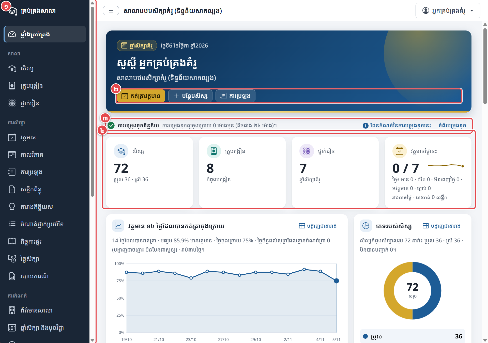

ម៉ឺនុយមេមានក្រុមដូចខាងក្រោម (ចុចលើឈ្មោះណាមួយ ដើម្បីបើកទំព័រនោះ)៖

| ក្រុម | ធាតុក្នុងម៉ឺនុយ |
|---|---|
| (គ្មានក្បាលក្រុម) | «ផ្ទាំងគ្រប់គ្រង» |
| «សាលា» | «សិស្ស» · «គ្រូបង្រៀន» · «ថ្នាក់រៀន» |
| «ការសិក្សា» | «វត្តមាន» · «កាលវិភាគ» · «ការប្រឡង» · «សន្លឹកពិន្ទុ» · «តារាងកិត្តិយស» · «ចំណាត់ថ្នាក់ប្រចាំខែ» · «កិច្ចការផ្ទះ» · «ថ្លៃសិក្សា» (បង្ហាញតែពេលបើកមុខងារថ្លៃសិក្សា) · «របាយការណ៍» |
| «ការកំណត់» | «ព័ត៌មានសាលា» · «ឆ្នាំសិក្សា និងមុខវិជ្ជា» · «វគ្គវត្តមាន» · «ម៉ោងកាលវិភាគ» · «មាត្រដ្ឋានពិន្ទុ» · «របាយការណ៍ និងការព្រីន» · «គំរូសន្លឹកពិន្ទុ» · «ការកំណត់ថ្លៃសិក្សា» · «ការកំណត់ទូទៅ» · «ការបម្រុងទុកទិន្នន័យ» · «សុវត្ថិភាព» · «ប្រវត្តិសកម្មភាព» · «ល្បឿន និងអង្គចងចាំ» · «សុខភាពប្រព័ន្ធ» · «អំពីប្រព័ន្ធ» |

**ការប្រើម៉ឺនុយនៅលើអេក្រង់តូច៖** ប្រសិនបើបង្អួចតូចជាង ១១០០ ភីកសែល ម៉ឺនុយនឹងបង្រួមឱ្យនៅសល់តែរូបតូចៗដោយខ្លួនឯង។ អ្នកអាចចុចប៊ូតុង «បង្រួមម៉ឺនុយ» ឬ «ពង្រីកម៉ឺនុយ» ដើម្បីប្តូរដោយខ្លួនឯងបាន។

### ម៉ឺនុយអ្នកប្រើប្រាស់ និងការចាក់សោអេក្រង់

**គោលបំណង៖** ចាក់សោអេក្រង់ ប្តូរពាក្យសម្ងាត់ ឬចាកចេញ។

**ជំហានទី១៖** ចុចលើឈ្មោះរបស់អ្នកនៅជ្រុងខាងលើខាងស្តាំ។

**ជំហានទី២៖** ជ្រើសរើស «ចាក់សោអេក្រង់» «ប្តូរពាក្យសម្ងាត់» ឬ «ចាកចេញ»។

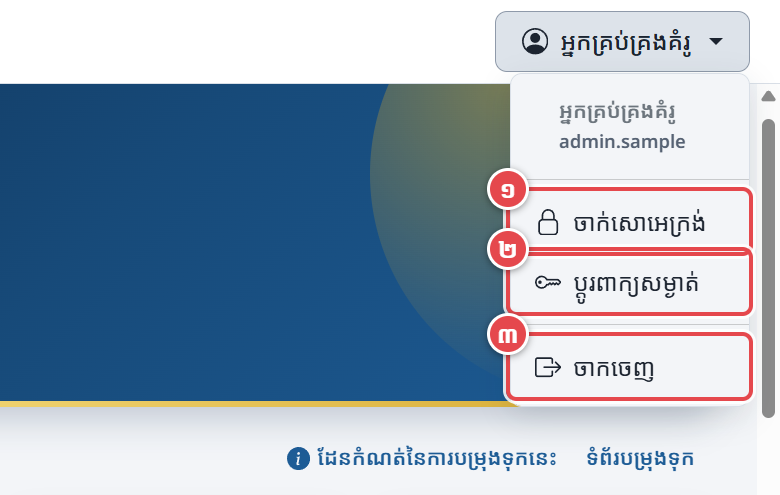

**លទ្ធផល៖** ពេលអ្នកចុច «ចាក់សោអេក្រង់» អេក្រង់នឹងបង្ហាញប្រអប់ឱ្យវាយពាក្យសម្ងាត់។ អ្វីដែលអ្នកកំពុងវាយនៅទំព័រខាងក្រោយនៅដដែល មិនបាត់ទេ។ វាយពាក្យសម្ងាត់ រួចចុច «ដោះសោ» ដើម្បីបន្តការងារ។

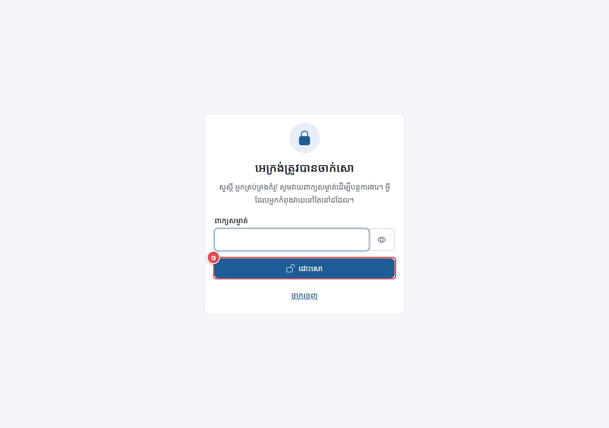

**ចំណាំ៖** ប្រសិនបើអ្នកមិនប៉ះកុំព្យូទ័រយូរ អេក្រង់នឹងចាក់សោដោយខ្លួនឯង។ ក្នុងការកំណត់ដើម វាចាក់សោក្រោយ ១០ នាទី។ អ្នកអាចប្តូរបាននៅ «ការកំណត់ទូទៅ» (ជំពូកទី១៧)។ ពេលអ្នកចុច «ចាកចេញ» អ្នកត្រូវចូលម្តងទៀតជាមួយឈ្មោះអ្នកប្រើប្រាស់ និងពាក្យសម្ងាត់។

## ១.៤ ផ្ទាំងគ្រប់គ្រង

«ផ្ទាំងគ្រប់គ្រង» ជាទំព័រដំបូងដែលអ្នកឃើញក្រោយចូលប្រើ។ វាបង្ហាញសេចក្ដីសង្ខេបនៃសាលា។ ទំព័រនេះមានតែការមើលប៉ុណ្ណោះ គឺមិនប្តូរទិន្នន័យអ្វីឡើយ។ ផ្នែកនីមួយៗមានដូចខាងក្រោម៖

- **ផ្នែកខាងលើ (ពណ៌ខៀវ)៖** បង្ហាញឆ្នាំសិក្សាបច្ចុប្បន្ន កាលបរិច្ឆេទថ្ងៃនេះ ឈ្មោះសាលា និងប៊ូតុងរហ័សបី គឺ «កត់ត្រាវត្តមាន» «បន្ថែមសិស្ស» និង «ការប្រឡង»។ ប្រសិនបើការពិនិត្យលឿននៃប្រព័ន្ធមានការព្រមាន ឬបញ្ហា ប្រអប់តូចមួយ «ប្រព័ន្ធមានការព្រមាន» ឬ «ប្រព័ន្ធមានបញ្ហា» បង្ហាញនៅទីនេះ ហើយចុចវាដើម្បីទៅទំព័រ «សុខភាពប្រព័ន្ធ» (ជំពូកទី១៧)។
- **ស្ថានភាពនៃការបម្រុងទុក៖** បន្ទាត់ ឬប្រអប់តូចមួយ។ ប្រសិនបើមានការបម្រុងទុកល្អក្នុងរយៈពេលតិចជាង ២៤ ម៉ោង អ្នកឃើញបន្ទាត់ស្ងប់ស្ងាត់មួយ។ ប្រសិនបើមិនទាន់មាន ឬចាស់ជាង ២៤ ម៉ោង អ្នកឃើញប្រអប់លឿង។ សូមមើលជំពូកទី១៥។
- **តួលេខសំខាន់ៗ៖** ចំនួនសិស្ស ចំនួនគ្រូ ចំនួនថ្នាក់ និងវត្តមានថ្ងៃនេះ។ ចុចលើប្រអប់នីមួយៗដើម្បីបើកទំព័រពាក់ព័ន្ធ។
- **កិច្ចការដែលត្រូវបំពេញ៖** បង្ហាញតែពេលមានអ្វីខ្វះ ដូចជាមិនទាន់មានឈ្មោះសាលា ឬមិនទាន់មានឆ្នាំសិក្សា។
- **កាតខាងក្រោម៖** «ឆ្នាំសិក្សាបច្ចុប្បន្ន» (ឈ្មោះ និងកាលបរិច្ឆេទ) «ការប្រឡងថ្មីៗ» (ការប្រឡង ៣ ចុងក្រោយក្នុងឆ្នាំនេះ ចុចដើម្បីបើក) «ព្រឹត្តិការណ៍សាលា» (សូមមើលខាងក្រោម) និង «ថ្លៃសិក្សាដែលនៅជំពាក់» (បង្ហាញតែពេលបើកមុខងារថ្លៃសិក្សា)។
- **ក្រាហ្វិក និងស្ថិតិ៖** ក្រាហ្វិកប្រាំមួយ គឺវត្តមាន ១៤ ថ្ងៃចុងក្រោយ ភេទសិស្ស សិស្សតាមកម្រិតថ្នាក់ ចំនួនសិស្សធៀបនឹងចំណុះ ការប្រឡងថ្មីបំផុត និងថ្លៃសិក្សា (ថ្លៃសិក្សាបង្ហាញតែពេលបើកមុខងារនេះ)។ ក្រាហ្វិកនីមួយៗមានប៊ូតុង «បង្ហាញជាតារាង» ដើម្បីមើលជាតារាងលេខ។

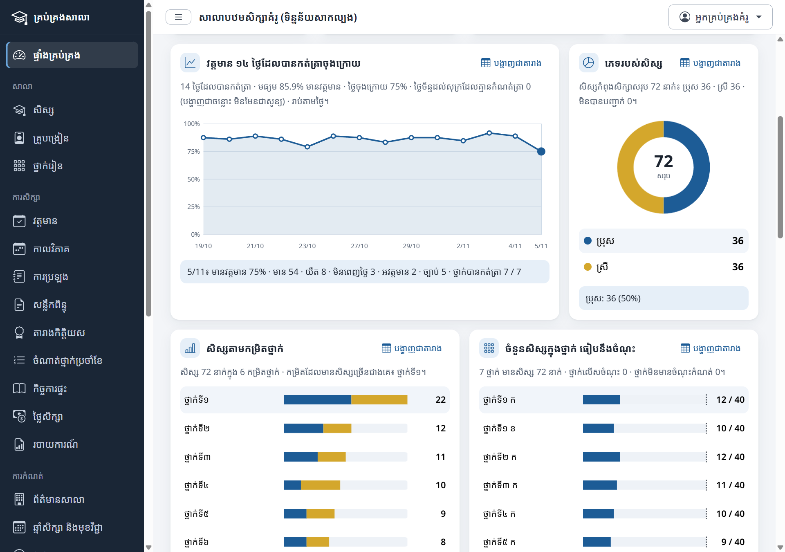

**ចំណាំ៖** ក្នុងក្រាហ្វិកវត្តមាន ថ្ងៃដែលគ្មាននរណាកត់ត្រាវត្តមាន ត្រូវបានបង្ហាញជាចន្លោះ (គូសជាបន្ទាត់ទ្រេត) មិនមែនជា ០% ទេ។ ក្រាហ្វិក «ការប្រឡងថ្មីបំផុត» មានសារពណ៌លឿង «មិនទាន់ជាផ្លូវការ» រហូតដល់សាលាបញ្ជាក់ច្បាប់ពិន្ទុពិតប្រាកដ (ជំពូកទី១០)។

### ព្រឹត្តិការណ៍សាលា

កាត «ព្រឹត្តិការណ៍សាលា» ក្នុងផ្ទាំងគ្រប់គ្រង បង្ហាញព្រឹត្តិការណ៍ខាងមុខរបស់សាលា រហូតដល់ ៥ ដូចជាថ្ងៃប្រជុំ ឬថ្ងៃប្រកួតកីឡា។ ប្រសិនបើគ្មាន កាតប្រាប់ថា «មិនមានព្រឹត្តិការណ៍ខាងមុខទេ។»។

**គោលបំណង៖** កត់ត្រាព្រឹត្តិការណ៍មួយរបស់សាលា ដើម្បីឱ្យបង្ហាញក្នុងផ្ទាំងគ្រប់គ្រង។

**ជំហានទី១៖** ក្នុងកាត «ព្រឹត្តិការណ៍សាលា» ចុច «បន្ថែមព្រឹត្តិការណ៍»។

**ជំហានទី២៖** បំពេញ «ឈ្មោះព្រឹត្តិការណ៍» (ចាំបាច់ វែងបំផុត ១៥០ តួអក្សរ) «ថ្ងៃចាប់ផ្តើម» (ចាំបាច់) «ថ្ងៃបញ្ចប់» (មិនចាំបាច់ ទុកទទេ ប្រសិនបើមានតែមួយថ្ងៃ) និង «កំណត់ចំណាំ» (មិនចាំបាច់ វែងបំផុត ៥០០ តួអក្សរ)។

**ជំហានទី៣៖** ចុច «រក្សាទុក»។

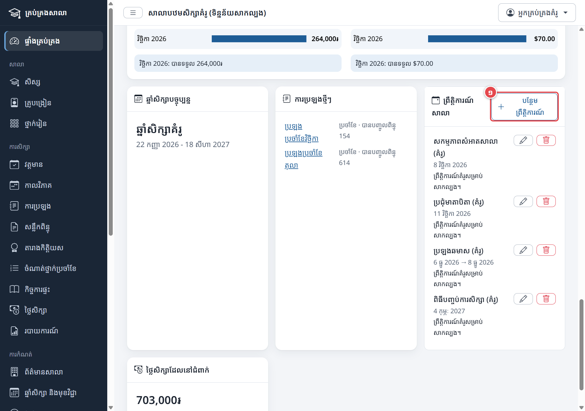

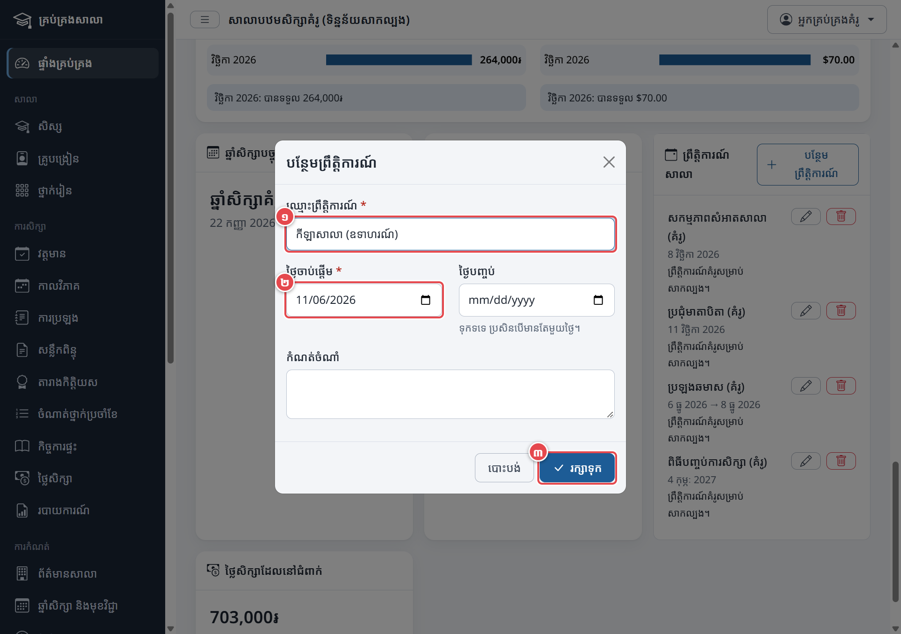

**លទ្ធផល៖** សារ «បានបន្ថែមព្រឹត្តិការណ៍។» ហើយព្រឹត្តិការណ៍បង្ហាញក្នុងកាត។

**ចំណាំ៖** ប្រសិនបើថ្ងៃបញ្ចប់មិននៅក្រោយថ្ងៃចាប់ផ្តើម កម្មវិធីថា «ថ្ងៃបញ្ចប់ត្រូវនៅក្រោយថ្ងៃចាប់ផ្តើម»។ ដើម្បីកែ ចុចរូបខ្មៅដៃក្នុងជួរព្រឹត្តិការណ៍ ហើយរក្សាទុក (សារ «បានរក្សាទុកព្រឹត្តិការណ៍។»)។ ដើម្បីលុប ចុចរូបធុងសំរាម រួចបញ្ជាក់ក្នុងប្រអប់ «លុបព្រឹត្តិការណ៍?» (សារ «បានលុបព្រឹត្តិការណ៍។»)។

## ១.៥ ពាក្យសំខាន់ៗដែលប្រើក្នុងកម្មវិធី

| ពាក្យ | អត្ថន័យ |
|---|---|
| ឆ្នាំសិក្សា | ឆ្នាំរៀនមួយ ដូចជា ២០២៦-២០២៧ ដែលសាលាកំណត់ថ្ងៃចាប់ផ្តើម និងថ្ងៃបញ្ចប់។ ថ្នាក់ និងវត្តមានទាំងអស់ជាកម្មសិទ្ធិរបស់ឆ្នាំសិក្សាមួយ។ |
| ថ្នាក់ទី | កម្រិតរៀន ពី «ថ្នាក់ទី១» ដល់ «ថ្នាក់ទី៦»។ ប្រព័ន្ធមានកម្រិតទាំងប្រាំមួយនេះស្រាប់ ហើយមិនអាចបន្ថែម ឬលុបបានទេ។ |
| ថ្នាក់រៀន | ក្រុមសិស្សមួយក្នុងកម្រិតមួយ ក្នុងឆ្នាំសិក្សាមួយ ដូចជា «ថ្នាក់ទី៣ ក»។ |
| មុខវិជ្ជា និងផ្នែករង | មុខវិជ្ជាចម្បង ដូចជា «ភាសាខ្មែរ» អាចមានផ្នែករងក្រោមវា។ ពិន្ទុមុខវិជ្ជាចម្បងអាចមកពីផលបូកនៃផ្នែករង។ |
| វគ្គ | ផ្នែកមួយនៃថ្ងៃសិក្សា ដូចជាព្រឹក ឬរសៀល ក្នុងការកត់ត្រាវត្តមាន។ |
| សន្លឹកពិន្ទុ | ឯកសារលទ្ធផលប្រឡងរបស់សិស្សម្នាក់ (បណ្ណរបាយការណ៍សិក្សា)។ ម៉ឺនុយប្រើឈ្មោះ «សន្លឹកពិន្ទុ»។ |
| និទ្ទេស | អក្សរ និងពាក្យតាមភាគរយពិន្ទុ ដូចជា A ល្អប្រសើរ។ |
| ការបម្រុងទុក | ឯកសារចម្លងទិន្នន័យទាំងអស់របស់សាលា សម្រាប់ស្តារវិញពេលមានបញ្ហា។ |
| កូនសោស្តារ | លេខកូដ ២៥ តួអក្សរ សម្រាប់កំណត់ពាក្យសម្ងាត់ថ្មី ពេលភ្លេចពាក្យសម្ងាត់។ |

## ១.៦ អ្វីដែលប្រព័ន្ធនេះមិនទាន់មាន

ដើម្បីកុំឱ្យអ្នកចំណាយពេលស្វែងរកមុខងារដែលមិនមាន សូមដឹងថាកម្មវិធីកំណែនេះ**មិនមាន**ដូចខាងក្រោម៖

- ការប្រើតាមអ៊ីនធឺណិត ការធ្វើសមកាលកម្មតាមអ៊ីនធឺណិត ឬការបម្រុងទុកតាមអ៊ីនធឺណិត
- អ្នកប្រើប្រាស់ច្រើននាក់ ឬតួនាទីផ្សេងៗ (មានតែអ្នកគ្រប់គ្រងម្នាក់)
- ការលុបឆ្នាំសិក្សា ឬការចម្លងថ្នាក់ពីឆ្នាំមួយទៅឆ្នាំមួយទៀត
- ការនាំចូលបញ្ជីសិស្សពីឯកសារ Excel (មានតែការនាំចេញទៅ Excel)
- ការមើលកូនសោស្តារម្តងទៀត (អាចបង្កើតកូនសោថ្មីបានតែប៉ុណ្ណោះ)
- ការបម្រុងទុកដែលបិទដោយពាក្យសម្ងាត់ (ការបម្រុងទុកមិនត្រូវបានអ៊ិនគ្រីបទេ)
- ការបម្រុងទុកតាមកាលកំណត់ដោយខ្លួនឯង ឬការចម្លងទៅ USB ដោយស្វ័យប្រវត្តិ
- ផ្នែក មេរៀនថ្ងៃនេះ ក្នុងផ្ទាំងគ្រប់គ្រង (កាលវិភាគមិនពាក់ព័ន្ធនឹងផ្ទាំងគ្រប់គ្រងទេ)

មុខងារដែលមិនទាន់មានជាក់លាក់ទៅលើជំពូកណាមួយ ត្រូវបានចែងនៅជំពូកនោះផងដែរ។

# ជំពូកទី២៖ ការចាប់ផ្ដើមប្រើប្រាស់ប្រព័ន្ធលើកដំបូង

នៅពេលបើកកម្មវិធីលើកដំបូង (ពេលមិនទាន់មានទិន្នន័យ) កម្មវិធីនឹងបង្ហាញទំព័រណែនាំការដំឡើង (អ្នកដំឡើង) ដែលមាន ៧ ជំហានខ្លីៗ។ នៅពេលដំឡើងរួច លើកក្រោយៗអ្នកគ្រាន់តែចូលប្រើប្រាស់។

## ២.១ មុនចាប់ផ្ដើម

សូមរៀបចំរបស់ទាំងនេះជាមុន៖

- កុំព្យូទ័រ Windows ដែលបានដំឡើងកម្មវិធី KPSMS រួចរាល់ (ដោយអ្នកបច្ចេកទេស)
- ម៉ាស៊ីនព្រីន ឬយ៉ាងហោចណាស់ត្រូវដឹងរបៀបរក្សាទុកឯកសារជា PDF ដើម្បីរក្សាទុក «កូនសោស្តារ»
- ឈ្មោះអ្នកប្រើប្រាស់ និងពាក្យសម្ងាត់ដែលអ្នកនឹងប្រើ ហើយកន្លែងសុវត្ថិភាពសម្រាប់ទុកក្រដាសកូនសោស្តារ
- ឈ្មោះសាលា និងកាលបរិច្ឆេទចាប់ផ្តើម និងបញ្ចប់នៃឆ្នាំសិក្សា (អ្នកអាចបំពេញនៅពេលក្រោយបាន)

**ចំណាំ៖** ជំហានទី២ និងទី៣ ចាំបាច់ត្រូវធ្វើ។ ជំហានផ្សេងទៀតអាចរំលង ហើយបំពេញនៅពេលក្រោយបាន។

## ២.២ ជំហានទី១ ការពិនិត្យកុំព្យូទ័រ

**គោលបំណង៖** ឱ្យកម្មវិធីពិនិត្យថាកុំព្យូទ័រនេះអាចដំណើរការបានល្អ។

**ជំហានទី១៖** អានបញ្ជី «ការពិនិត្យកុំព្យូទ័រនេះ»។ ធាតុដែលមានសញ្ញាធីកពណ៌បៃតងគឺល្អ។ សញ្ញាព្រមានពណ៌លឿងគ្រាន់តែជាការរំលឹក មិនឃាត់ទេ។ ឧទាហរណ៍ ពេលមិនទាន់មានការបម្រុងទុក វានឹងព្រមាន ដែលជារឿងធម្មតាសម្រាប់សាលាថ្មី។

**ជំហានទី២៖** ចុចប៊ូតុង «បន្ទាប់»។

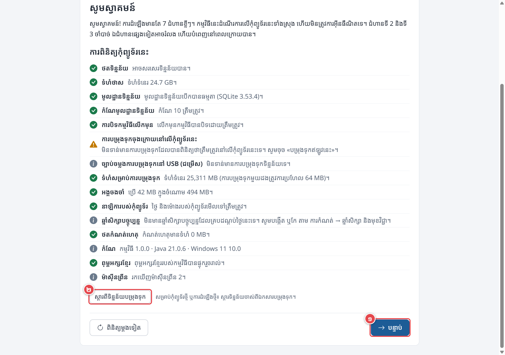

**លទ្ធផល៖** ទំព័របង្កើតគណនីអ្នកគ្រប់គ្រងបើកឡើង។

**ចំណាំ៖** ប្រសិនបើមានបញ្ហាធ្ងន់ធ្ងរ (សញ្ញាក្រហម) ប៊ូតុង «បន្ទាប់» នឹងមិនអាចចុចបានទេ។ សូមហៅអ្នកបច្ចេកទេស។ ប្រសិនបើអ្នកកំពុងដំឡើងលើកុំព្យូទ័រថ្មី ហើយមានឯកសារបម្រុងទុកពីកុំព្យូទ័រចាស់ សូមចុច «ស្តារពីទិន្នន័យបម្រុងទុក» (សូមមើលជំពូកទី១៥)។

## ២.៣ ជំហានទី២ បង្កើតគណនីអ្នកគ្រប់គ្រង

**គោលបំណង៖** បង្កើតឈ្មោះអ្នកប្រើប្រាស់ និងពាក្យសម្ងាត់សម្រាប់ចូលប្រើកម្មវិធី។

**ជំហានទី១៖** បំពេញប្រអប់ទាំងបួន។

- «ឈ្មោះពេញ (សម្រាប់បង្ហាញ)» គឺឈ្មោះដែលបង្ហាញនៅជ្រុងខាងលើ។
- «ឈ្មោះអ្នកប្រើប្រាស់» ត្រូវមាន ៣ ដល់ ៣២ តួអក្សរ ជាអក្សរ លេខ ឬសញ្ញា . _ - ប៉ុណ្ណោះ។ មិនប្រកាន់អក្សរធំ ឬតូចទេ។
- «ពាក្យសម្ងាត់» ត្រូវមានយ៉ាងតិច ៨ តួអក្សរ។ ត្រូវមិនវែងជាង ៧២ បៃ (ប្រហែល ២៤ តួអក្សរខ្មែរ)។ ត្រូវមិនដូចឈ្មោះអ្នកប្រើប្រាស់។ ហើយមិនត្រូវជាពាក្យសម្ងាត់ដែលងាយស្មានពេក ដូចជា 12345678។
- «បញ្ជាក់ពាក្យសម្ងាត់» វាយឡើងវិញឱ្យដូចខាងលើ។

**ជំហានទី២៖** ចុចប៊ូតុង «បង្កើតគណនី»។

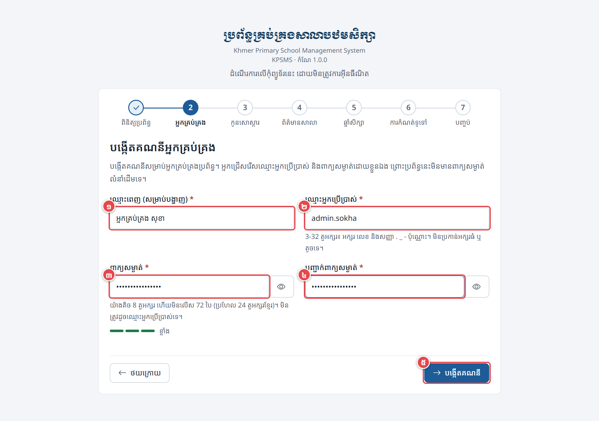

**លទ្ធផល៖** ទំព័រ «កូនសោស្តារ» បើកឡើង។

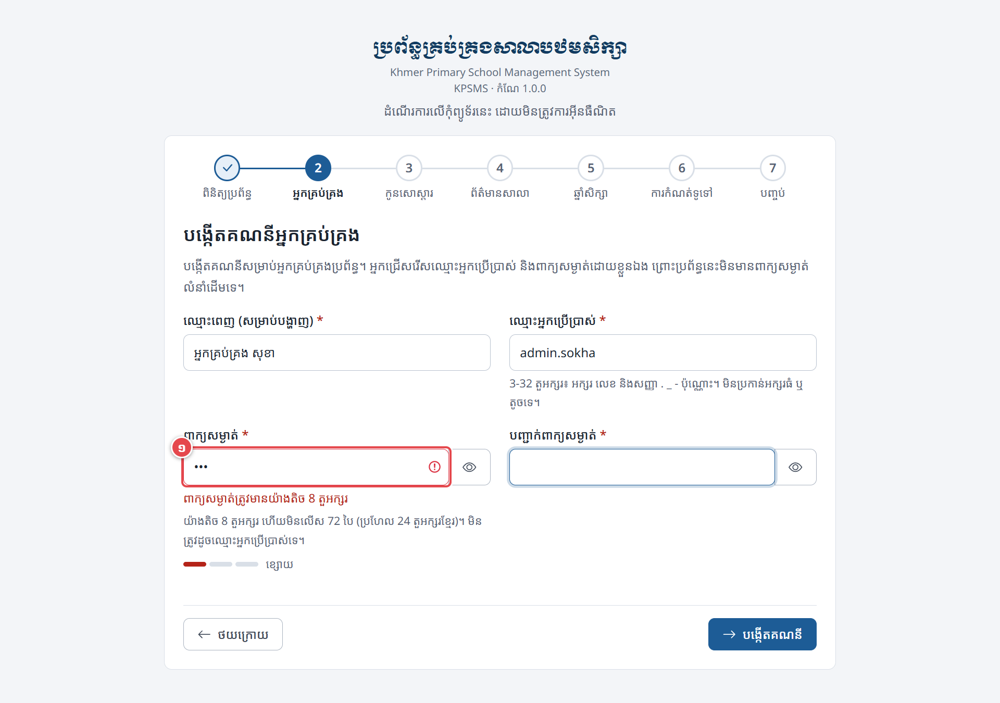

**ចំណាំ៖** មិនមានពាក្យសម្ងាត់លំនាំដើមទេ។ អ្នកជាអ្នកជ្រើសរើសខ្លួនឯង។ របារតូចក្រោមប្រអប់បង្ហាញថាពាក្យសម្ងាត់ខ្សោយ មធ្យម ឬខ្លាំង ជាគន្លឹះប៉ុណ្ណោះ វាមិនឃាត់អ្នកទេ។ ពាក្យសម្ងាត់ដែលមានដកឃ្លា នៅដើម ឬចុងនឹងមិនត្រូវបានកាត់ចេញទេ។

## ២.៤ ជំហានទី៣ កូនសោស្តារ

កូនសោស្តារគឺជាលេខកូដ ២៥ តួអក្សរ ដែលជួយអ្នកឱ្យចូលប្រើឡើងវិញ ប្រសិនបើអ្នកភ្លេចពាក្យសម្ងាត់។ **វាបង្ហាញតែម្តងគត់ ហើយមិនអាចមើលម្តងទៀតបានទេ។**

**គោលបំណង៖** ព្រីន ឬរក្សាទុកកូនសោស្តារទុកក្នុងកន្លែងសុវត្ថិភាព រួចបញ្ជាក់ថាបានរក្សាទុករួចហើយ។

**ជំហានទី១៖** មើលកូនសោដែលបង្ហាញលើអេក្រង់ (ជាក្រុមតួអក្សរ ៥ ក្រុម)។ ចុចប៊ូតុង «ព្រីន / រក្សាទុកជា PDF» ដើម្បីបើកសន្លឹកសម្រាប់ព្រីន។ មិនមានប៊ូតុងចម្លងទេ ដោយចេតនា។

**ជំហានទី២៖** ព្រីនសន្លឹកនោះ ឬរក្សាទុកជា PDF រួចទុកក្នុងកន្លែងសុវត្ថិភាព ឆ្ងាយពីកុំព្យូទ័រនេះ។ ចុច «ថយក្រោយ» ដើម្បីត្រឡប់មកទំព័រដំឡើង។

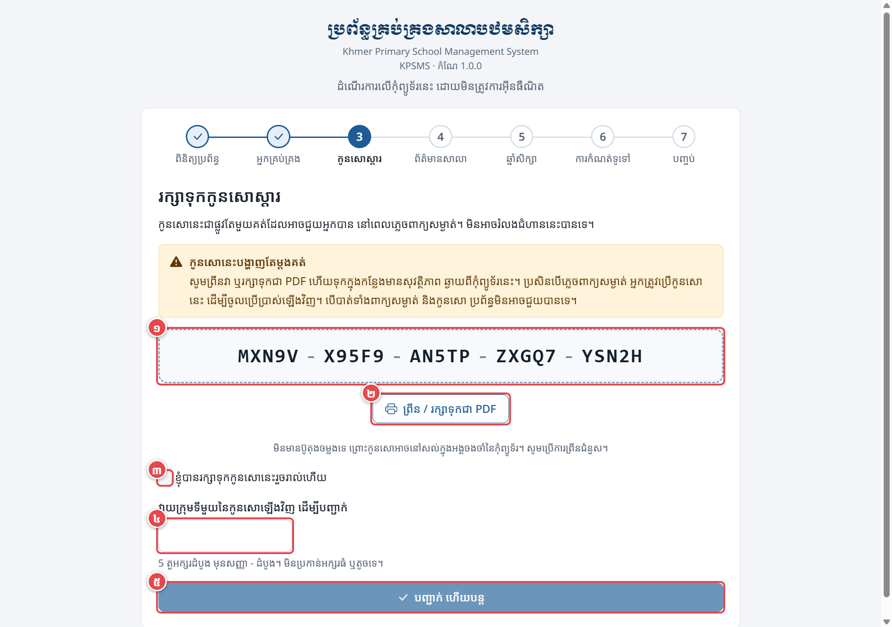

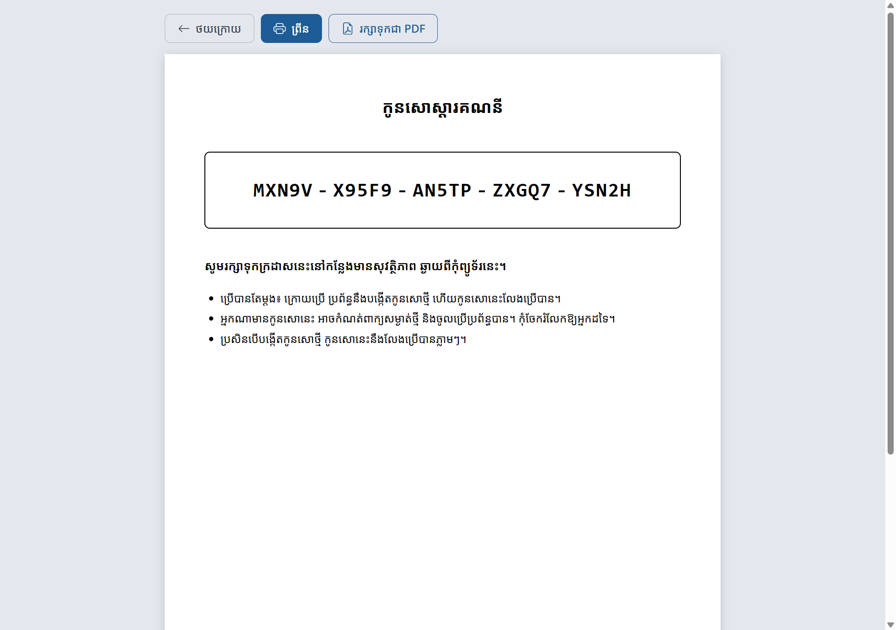

**ជំហានទី៣៖** ធីកប្រអប់ «ខ្ញុំបានរក្សាទុកកូនសោនេះរួចរាល់ហើយ»។

**ជំហានទី៤៖** វាយក្រុមទីមួយនៃកូនសោ (៥ តួអក្សរដំបូង) ក្នុងប្រអប់ដែលនៅខាងក្រោម។ មិនប្រកាន់អក្សរធំ ឬតូចទេ។ ពេលត្រូវ អ្នកឃើញសញ្ញាធីកពណ៌បៃតង។

**ជំហានទី៥៖** ចុច «បញ្ជាក់ ហើយបន្ត»។

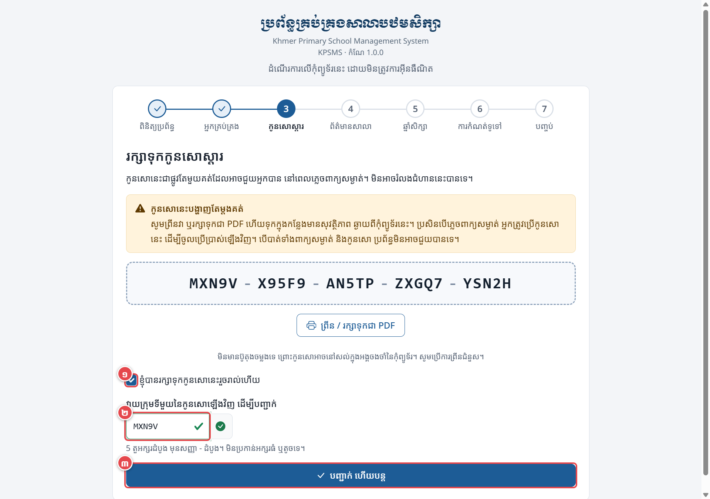

**លទ្ធផល៖** ទំព័រ «ព័ត៌មានសាលា» បើកឡើង។

**ប្រុងប្រយ័ត្ន៖** អ្នកណាមានកូនសោនេះ អាចកំណត់ពាក្យសម្ងាត់ថ្មី ហើយចូលប្រើប្រព័ន្ធបាន។ កុំចែករំលែកឱ្យអ្នកដទៃ។ បើបាត់ទាំងពាក្យសម្ងាត់ និងកូនសោ ប្រព័ន្ធមិនអាចជួយបានទេ។

**ចំណាំ៖** ប្រសិនបើអ្នកបិទកម្មវិធីមុនពេលបញ្ជាក់ ពេលចូលប្រើលើកក្រោយ កម្មវិធីនឹងបង្ខំឱ្យអ្នកបង្កើតកូនសោស្តារថ្មី នៅទំព័រ «ត្រូវរក្សាទុកកូនសោស្តារថ្មី»។ អ្នកត្រូវវាយពាក្យសម្ងាត់បច្ចុប្បន្ន រួចចុច «បង្កើតកូនសោថ្មី» ហើយរក្សាទុកវាឱ្យរួច។

## ២.៥ ជំហានទី៤ ដល់ទី៧

- **ជំហានទី៤ «ព័ត៌មានសាលា»៖** បំពេញឈ្មោះសាលា (សូមមើលជំពូកទី៣)។ អាចចុច «រំលងសិន» បាន។
- **ជំហានទី៥ «ឆ្នាំសិក្សា និងមុខវិជ្ជា»៖** បង្កើតឆ្នាំសិក្សាដំបូង (សូមមើលជំពូកទី៤)។ អាចរំលងបានតែពេលមិនទាន់មានឆ្នាំសិក្សា។
- **ជំហានទី៦ «ការកំណត់ទូទៅ»៖** ប្រអប់ពីរមានតម្លៃដើមត្រឹមត្រូវស្រាប់។ គ្រាន់តែចុច «រក្សាទុក ហើយបន្ត»។ អ្នកអាចប្តូរនៅពេលក្រោយបាន (ជំពូកទី១៧)។
- **ជំហានទី៧ «រួចរាល់ហើយ»៖** មើលសេចក្ដីសង្ខេប រួចចុច «ចាប់ផ្តើមប្រើប្រាស់»។

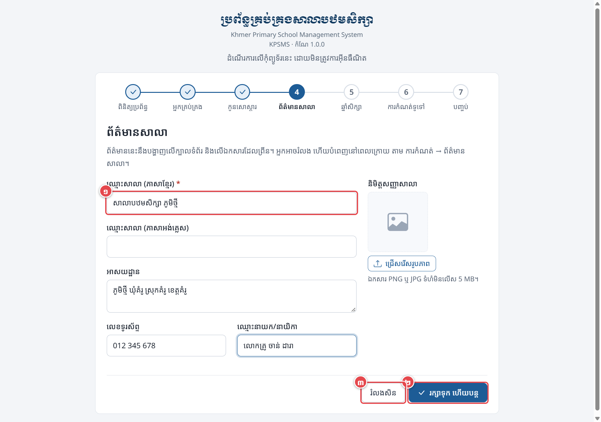

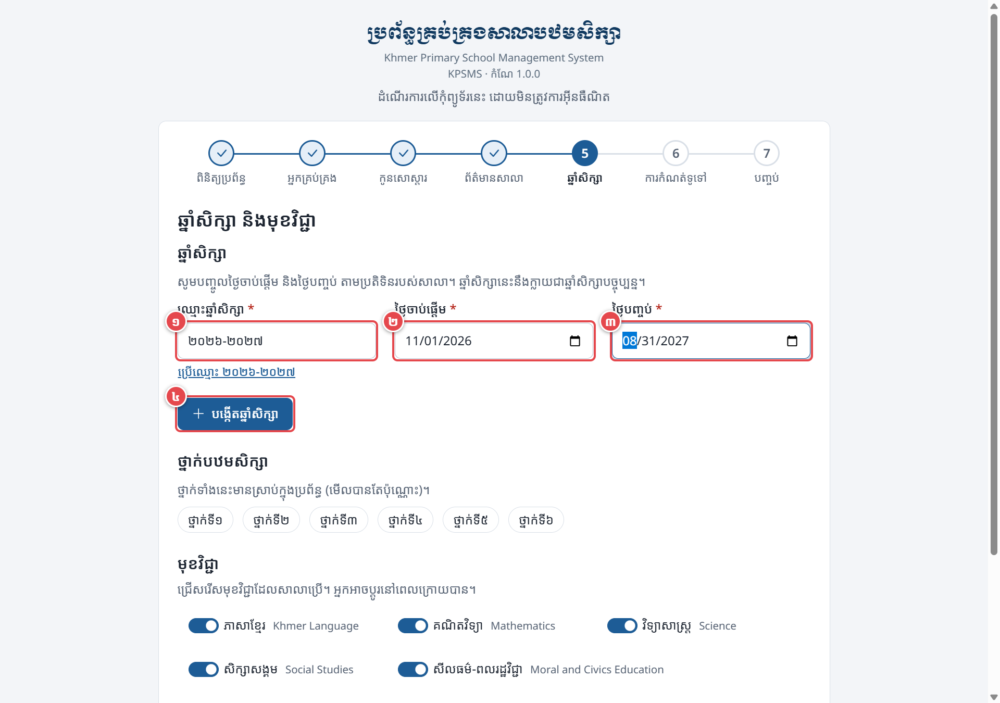

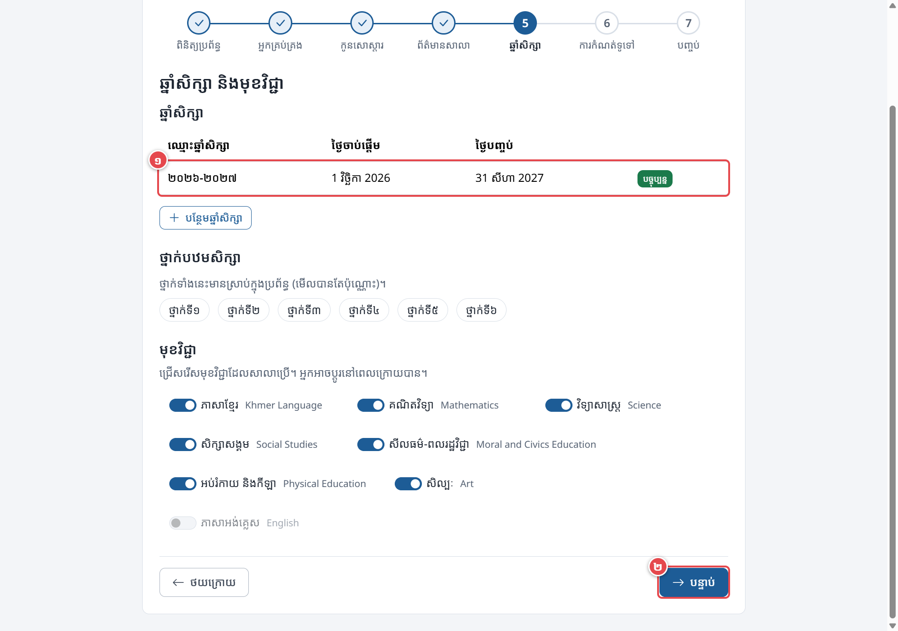

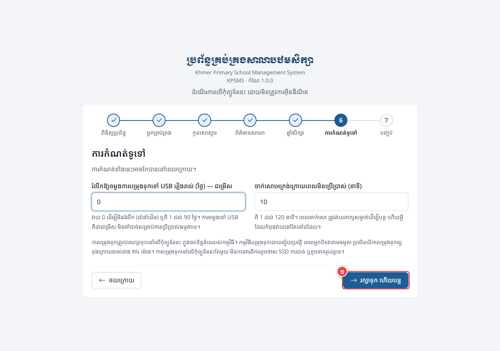

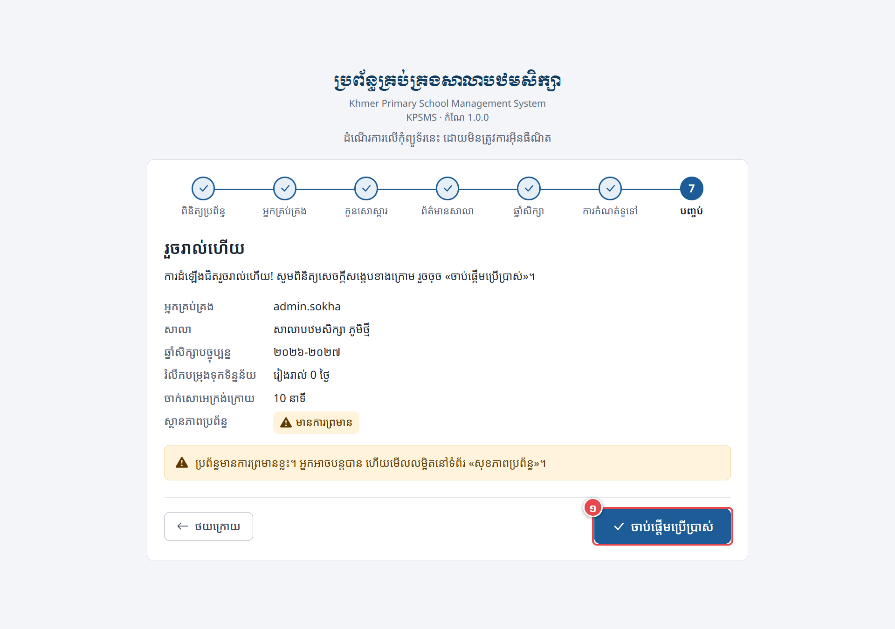

**លទ្ធផល៖** កម្មវិធីបង្ហាញសារ «ការដំឡើងបានបញ្ចប់។ សូមស្វាគមន៍!» ហើយបើក «ផ្ទាំងគ្រប់គ្រង»។ ព័ត៌មានណាដែលអ្នករំលង នឹងបង្ហាញជា «កិច្ចការដែលត្រូវបំពេញ» នៅលើផ្ទាំងគ្រប់គ្រង។

**ចំណាំ៖** ប្រសិនបើអ្នកបិទកម្មវិធីពាក់កណ្តាលការដំឡើង ក្រោយបង្កើតគណនីរួច ពេលចូលប្រើលើកក្រោយ ការដំឡើងនឹងបន្តពីកន្លែងដែលអ្នកឈប់។ ប្រសិនបើគណនីមិនទាន់ត្រូវបានបង្កើត ការដំឡើងចាប់ផ្តើមពីដើមវិញ។

## ២.៦ ការចូលប្រើប្រាស់ប្រចាំថ្ងៃ

**គោលបំណង៖** ចូលប្រើកម្មវិធីរាល់ពេលបើក។

**ជំហានទី១៖** បើកកម្មវិធី KPSMS។

**ជំហានទី២៖** វាយ «ឈ្មោះអ្នកប្រើប្រាស់» និង «ពាក្យសម្ងាត់» រួចចុច «ចូលប្រើប្រាស់»។

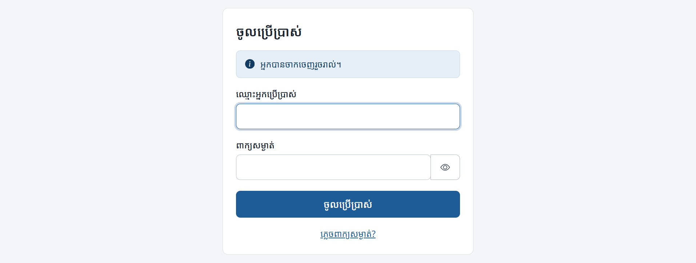

**លទ្ធផល៖** «ផ្ទាំងគ្រប់គ្រង» បើកឡើង។

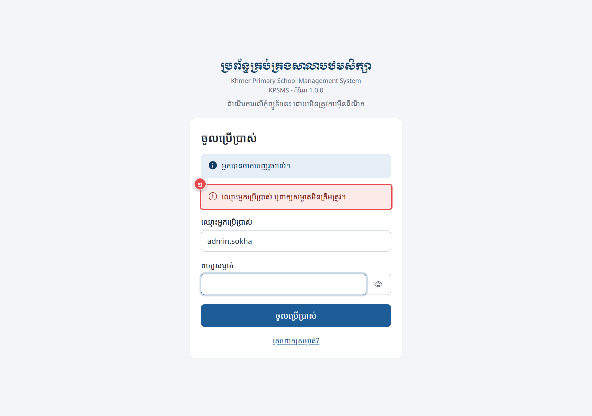

**ចំណាំ៖** ប្រសិនបើអ្នកវាយខុស កម្មវិធីប្រាប់ថា «ឈ្មោះអ្នកប្រើប្រាស់ ឬពាក្យសម្ងាត់មិនត្រឹមត្រូវ។» វាមិនប្រាប់ថាមួយណាខុសទេ។ ប្រសិនបើអ្នកវាយខុសច្រើនដងពេក ប្រព័ន្ធនឹងផ្អាកការចូលជាបណ្តោះអាសន្ន ហើយបង្ហាញប្រអប់លឿង «ការចូលត្រូវបានផ្អាកជាបណ្តោះអាសន្ន» ជាមួយនាឡិកាថយក្រោយ។ ក្បួនគឺ៖ ខុស ៥ ដង ផ្អាក ១ នាទី ខុស ១០ ដង ផ្អាក ៥ នាទី ខុស ១៥ ដងឡើងទៅ ផ្អាក ១៥ នាទី។ ការផ្អាកមិនអចិន្ត្រៃយ៍ទេ ហើយការបិទបើកកម្មវិធីមិនកំណត់ឡើងវិញទេ។ ពេលវាយត្រូវ ការរាប់ត្រូវកំណត់ឡើងវិញ។

## ២.៧ ភ្លេចពាក្យសម្ងាត់

**គោលបំណង៖** កំណត់ពាក្យសម្ងាត់ថ្មី ដោយប្រើកូនសោស្តារ។

**ជំហានទី១៖** នៅទំព័រចូលប្រើប្រាស់ ចុចតំណ «ភ្លេចពាក្យសម្ងាត់?»។

**ជំហានទី២៖** វាយ «កូនសោស្តារ» ទាំង ២៥ តួអក្សរ។ អ្នកអាចវាយ ឬបិទភ្ជាប់។ កម្មវិធីដាក់សញ្ញា - ឱ្យដោយខ្លួនឯង ហើយមិនប្រកាន់អក្សរធំ ឬតូចទេ។

**ជំហានទី៣៖** វាយ «ពាក្យសម្ងាត់ថ្មី» និង «បញ្ជាក់ពាក្យសម្ងាត់» (ក្បួនដូចពេលបង្កើតគណនី)។

**ជំហានទី៤៖** ចុច «កំណត់ពាក្យសម្ងាត់ថ្មី»។

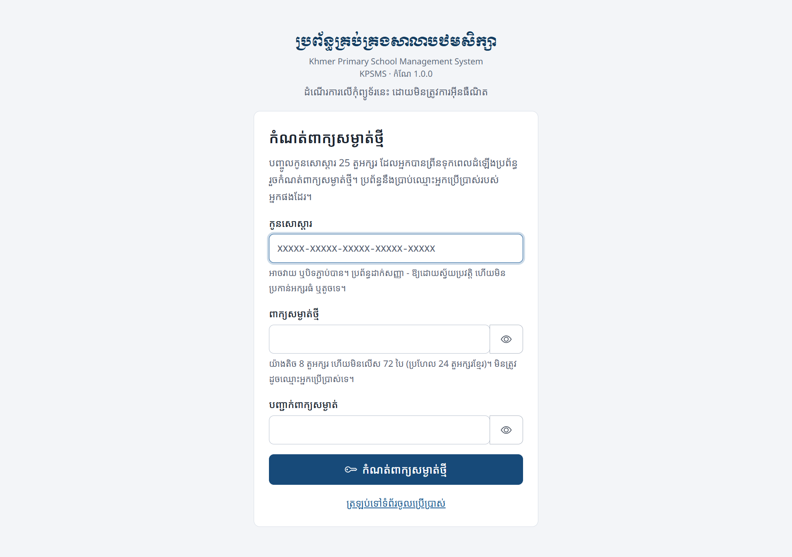

**លទ្ធផល៖** កម្មវិធីប្រាប់ឈ្មោះអ្នកប្រើប្រាស់របស់អ្នក ហើយចេញកូនសោស្តារ**ថ្មី**មួយ។ សូមព្រីន ឬរក្សាទុកកូនសោថ្មីនេះ ធីកប្រអប់បញ្ជាក់ វាយក្រុមទីមួយ រួចចុច «បន្ត និងចូលប្រើប្រាស់» (ដូចជំហាននៃជំពូកទី២.៤)។

**ចំណាំ៖**

- កូនសោចាស់លែងប្រើបានភ្លាមៗ។ ពាក្យសម្ងាត់ចាស់ក៏លែងប្រើបាន ហើយការចូលប្រើនៅកន្លែងផ្សេងទាំងអស់ត្រូវបិទ។ ទិន្នន័យរបស់សាលាមិនបាត់ទេ។
- ប្រសិនបើអ្នកវាយកូនសោខុស កម្មវិធីប្រាប់ថា «កូនសោស្តារមិនត្រឹមត្រូវ។ សូមពិនិត្យតួអក្សរម្តងទៀត។» ការវាយកូនសោខុសក៏ត្រូវបានរាប់ និងផ្អាកដូចការវាយពាក្យសម្ងាត់ខុសដែរ។
- ប្រសិនបើពាក្យសម្ងាត់ថ្មីងាយស្មានពេក កម្មវិធីបដិសេធ ដោយមិនបំផ្លាញកូនសោទេ។ អ្នកអាចសាកល្បងម្តងទៀត។
- ការបង្កើតកូនសោថ្មីដោយមិនភ្លេចពាក្យសម្ងាត់ អាចធ្វើបាននៅ «ការកំណត់» → «សុវត្ថិភាព» (ជំពូកទី១៧)។

# ជំពូកទី៣៖ ការកំណត់ព័ត៌មានសាលារៀន

ព័ត៌មានសាលាត្រូវបានប្រើនៅលើក្បាលទំព័រ ផ្ទាំងគ្រប់គ្រង និងក្បាលក្រដាសដែលអ្នកព្រីន (ដូចជាសន្លឹកពិន្ទុ បង្កាន់ដៃ និងរបាយការណ៍)។ ឈ្មោះនាយក/នាយិកាត្រូវបានប្រើនៅខាងក្រោមក្រដាសជាកន្លែងចុះហត្ថលេខា។

## ៣.១ បំពេញព័ត៌មានសាលា

**គោលបំណង៖** បញ្ចូលឈ្មោះ អាសយដ្ឋាន និងនិមិត្តសញ្ញារបស់សាលា។

**ជំហានទី១៖** ចុច «ការកំណត់» → «ព័ត៌មានសាលា» នៅម៉ឺនុយខាងឆ្វេង (ឬបំពេញនៅជំហានទី៤ នៃអ្នកដំឡើង)។

**ជំហានទី២៖** បំពេញប្រអប់ទាំងនេះ៖

| ប្រអប់ | តម្រូវការ | ការពន្យល់ |
|---|---|---|
| «ឈ្មោះសាលា (ភាសាខ្មែរ)» | ចាំបាច់ | ត្រូវបំពេញ។ វែងបំផុត ២០០ តួអក្សរ។ នេះជាប្រអប់តែមួយគត់ដែលចាំបាច់។ |
| «ឈ្មោះសាលា (ភាសាអង់គ្លេស)» | មិនចាំបាច់ | វែងបំផុត ២០០ តួអក្សរ។ |
| «អាសយដ្ឋាន» | មិនចាំបាច់ | សរសេរបានច្រើនបន្ទាត់។ វែងបំផុត ៥០០ តួអក្សរ។ |
| «លេខទូរស័ព្ទ» | មិនចាំបាច់ | វែងបំផុត ៥០ តួអក្សរ។ |
| «ឈ្មោះនាយក/នាយិកា» | មិនចាំបាច់ | វែងបំផុត ១៥០ តួអក្សរ។ ឈ្មោះនេះបង្ហាញនៅក្រោមក្រដាសព្រីន។ |

**ជំហានទី៣៖** ចុចប៊ូតុង «រក្សាទុក»។

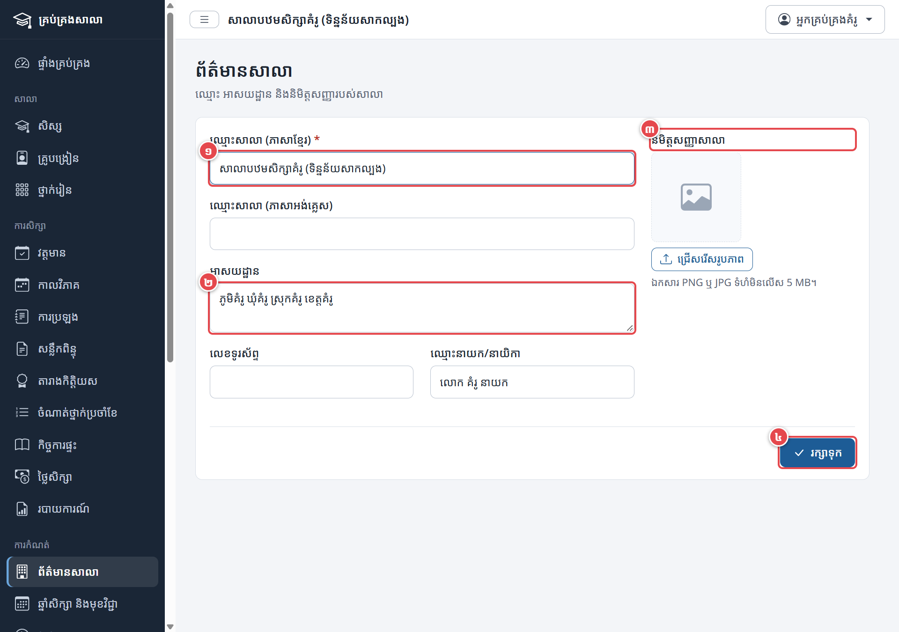

**លទ្ធផល៖** កម្មវិធីបង្ហាញសារ «បានរក្សាទុកព័ត៌មានសាលា។» ហើយឈ្មោះសាលាបង្ហាញនៅរបារខាងលើ។

**ចំណាំ៖**

- ប្រសិនបើអ្នកទុកឈ្មោះសាលាទទេ កម្មវិធីមិនរក្សាទុកទេ ហើយបង្ហាញ «ត្រូវបំពេញព័ត៌មាននេះ»។
- ប្រសិនបើមិនទាន់មានឈ្មោះសាលា នៅរបារខាងលើបង្ហាញតំណ «មិនទាន់មានឈ្មោះសាលា» ហើយនៅផ្ទាំងគ្រប់គ្រងមាន «កិច្ចការដែលត្រូវបំពេញ» ឱ្យបំពេញ។
- ប្រសិនបើមានអ្នកផ្សេងកែព័ត៌មាននេះពីកន្លែងផ្សេងព្រមគ្នា កម្មវិធីបង្ហាញសារថា «ព័ត៌មានសាលាត្រូវបានកែប្រែពីកន្លែងផ្សេង។…» សូមពិនិត្យ ហើយរក្សាទុកម្តងទៀត។

## ៣.២ ដាក់ ឬប្តូរនិមិត្តសញ្ញា

**គោលបំណង៖** ដាក់រូបនិមិត្តសញ្ញាសាលា ដើម្បីឱ្យបង្ហាញលើក្បាលទំព័រ និងក្រដាសព្រីន។

**ជំហានទី១៖** នៅផ្នែក «និមិត្តសញ្ញាសាលា» (ខាងស្តាំ) ចុច «ជ្រើសរើសរូបភាព» (ឬ «ប្តូររូបភាព» ពេលមានរូបរួចហើយ)។

**ជំហានទី២៖** ជ្រើសឯកសាររូបភាពពីកុំព្យូទ័រ។ ឯកសារត្រូវជា PNG ឬ JPG ហើយមានទំហំមិនលើស ៥ MB។

**លទ្ធផល៖** កម្មវិធីរក្សាទុករូបភាពភ្លាមៗ (មិនចាំបាច់ចុច «រក្សាទុក» ទេ) ហើយបង្ហាញសារ «បានរក្សាទុកនិមិត្តសញ្ញា។»។ កម្មវិធីបង្រួមរូបដោយខ្លួនឯង ឱ្យជ្រុងវែងជាងគេមិនលើស ៥១២ ភីកសែល។

**ការដកនិមិត្តសញ្ញាចេញ៖** ចុច «ដកចេញ» រួចចុចបញ្ជាក់នៅក្នុងប្រអប់ «ដកនិមិត្តសញ្ញាចេញ?»។ អ្នកអាចដាក់ម្តងទៀតនៅពេលក្រោយបាន។

**ចំណាំ៖** ប្រសិនបើឯកសារមិនមែន PNG ឬ JPG កម្មវិធីប្រាប់ថា «ទទួលតែរូបភាព PNG ឬ JPG ប៉ុណ្ណោះ»។ ប្រសិនបើធំជាង ៥ MB វាប្រាប់ថា «ឯកសារធំពេក (មិនលើស 5 MB)»។ ប្រសិនបើឯកសារខូច ឬមិនមែនរូបភាពពិត វាប្រាប់ថា «ឯកសារនេះមិនមែនជារូបភាពត្រឹមត្រូវទេ»។

# ជំពូកទី៤៖ ការគ្រប់គ្រងឆ្នាំសិក្សា

ឆ្នាំសិក្សាគឺជាឆ្នាំរៀនមួយ ដូចជា ២០២៦-២០២៧។ ថ្នាក់រៀន វត្តមាន ការប្រឡង និងកាលវិភាគ សុទ្ធតែជាកម្មសិទ្ធិរបស់ឆ្នាំសិក្សាមួយ។ សាលាមាន «ឆ្នាំសិក្សាបច្ចុប្បន្ន» តែមួយ ដែលជាឆ្នាំដែលកម្មវិធីបង្ហាញមុនគេ។ អ្នកត្រូវមានឆ្នាំសិក្សាបច្ចុប្បន្ន មុននឹងចុះឈ្មោះសិស្សចូលថ្នាក់។

ទំព័រគ្រប់គ្រងឆ្នាំសិក្សានៅ «ការកំណត់» → «ឆ្នាំសិក្សា និងមុខវិជ្ជា»។ ផ្នែកខាងលើគឺឆ្នាំសិក្សា ហើយផ្នែកខាងក្រោមគឺមុខវិជ្ជា (ជំពូកទី៥)។

## ៤.១ បង្កើតឆ្នាំសិក្សាថ្មី

**គោលបំណង៖** បន្ថែមឆ្នាំសិក្សាមួយ។

**ជំហានទី១៖** នៅទំព័រ «ឆ្នាំសិក្សា និងមុខវិជ្ជា» ចុច «បន្ថែមឆ្នាំសិក្សា» (ប្រសិនបើមិនទាន់មានឆ្នាំសិក្សាសោះ ទម្រង់នឹងបើកស្រាប់)។

**ជំហានទី២៖** បំពេញប្រអប់ទាំងបី៖

- «ឈ្មោះឆ្នាំសិក្សា» ជាអក្សរ ឬលេខអ្វីក៏បាន វែងបំផុត ៥០ តួអក្សរ ហើយមិនត្រូវដូចឆ្នាំផ្សេងទេ។ អ្នកអាចចុចតំណ «ប្រើឈ្មោះ …» ដើម្បីឱ្យកម្មវិធីស្នើឈ្មោះតាមកាលបរិច្ឆេទកុំព្យូទ័រ។
- «ថ្ងៃចាប់ផ្តើម» ត្រូវតែបំពេញ។ កម្មវិធីមិនបំពេញឱ្យទេ ព្រោះវាមិនដឹងប្រតិទិនរបស់សាលា។
- «ថ្ងៃបញ្ចប់» ត្រូវតែបំពេញ ហើយត្រូវនៅក្រោយថ្ងៃចាប់ផ្តើម។

ប្រអប់ធីក «កំណត់ជាឆ្នាំសិក្សាបច្ចុប្បន្ន» ត្រូវបានធីកស្រាប់ **តែពេលមិនទាន់មានឆ្នាំបច្ចុប្បន្ន**។ ប្រសិនបើអ្នកបង្កើតឆ្នាំសិក្សាថ្មីសម្រាប់ឆ្នាំក្រោយ ខណៈឆ្នាំនេះនៅដំណើរការ សូមកុំធីកវា។

**ជំហានទី៣៖** ចុច «បង្កើតឆ្នាំសិក្សា»។

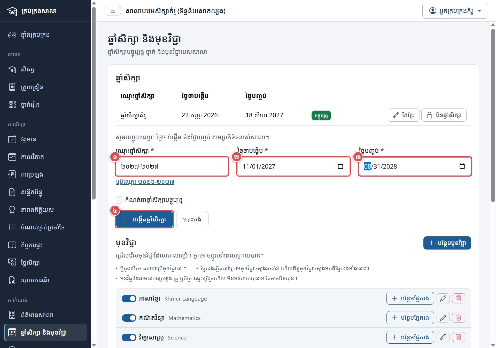

**លទ្ធផល៖** កម្មវិធីបង្ហាញសារ «បានបង្កើតឆ្នាំសិក្សា។» ហើយឆ្នាំថ្មីបង្ហាញក្នុងតារាង។

**ចំណាំ៖**

- ប្រសិនបើឈ្មោះដូចឆ្នាំដែលមានរួចហើយ អ្នកឃើញ «មានរួចហើយ» ក្រោមប្រអប់ឈ្មោះ។ ប្រសិនបើថ្ងៃបញ្ចប់មិននៅក្រោយថ្ងៃចាប់ផ្តើម អ្នកឃើញ «ថ្ងៃបញ្ចប់ត្រូវនៅក្រោយថ្ងៃចាប់ផ្តើម»។
- ឆ្នាំសិក្សាថ្មីនីមួយៗទទួលបាន «វគ្គវត្តមាន» ឈ្មោះ ពេញមួយថ្ងៃ មួយដោយស្វ័យប្រវត្តិ (ជំពូកទី៨)។ ថ្នាក់ គ្រូប្រចាំមុខវិជ្ជា និងកាលវិភាគ **មិន**ត្រូវបានចម្លងមកឆ្នាំថ្មីដោយស្វ័យប្រវត្តិទេ។

## ៤.២ មើលបញ្ជីឆ្នាំសិក្សា

តារាងបង្ហាញឈ្មោះឆ្នាំសិក្សា ថ្ងៃចាប់ផ្តើម ថ្ងៃបញ្ចប់ និងស្ថានភាព។ ឆ្នាំដែលមានថ្ងៃចាប់ផ្តើមថ្មីបំផុតនៅខាងលើ។ ឆ្នាំបច្ចុប្បន្នមានស្លាកពណ៌បៃតង «បច្ចុប្បន្ន» ហើយឆ្នាំដែលបានបិទមានស្លាកពណ៌ប្រផេះ «បានបិទ»។

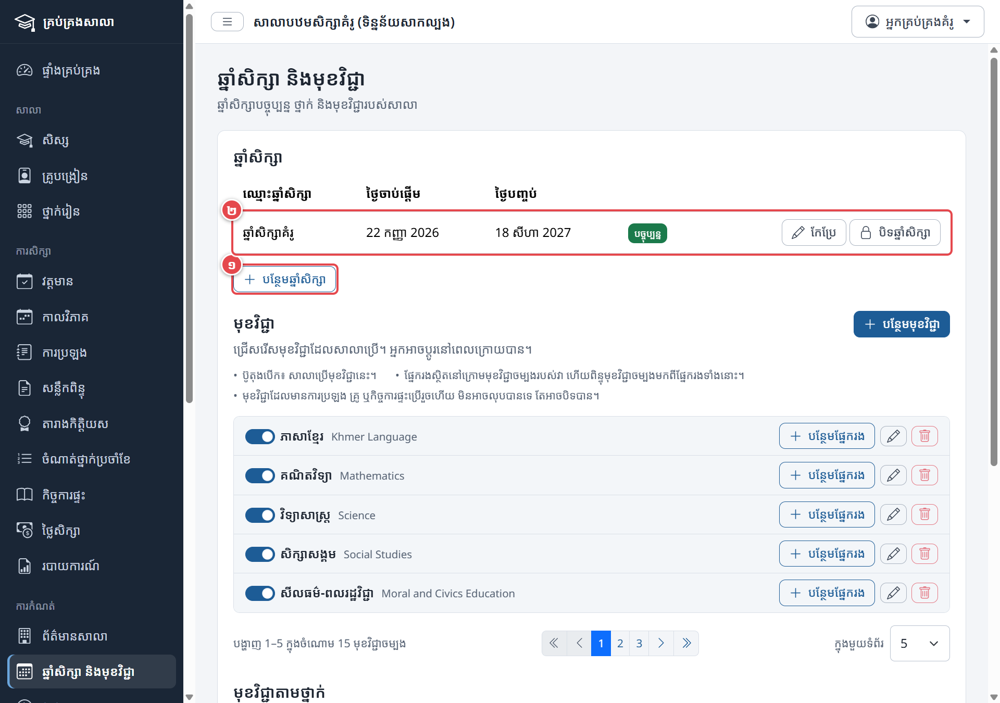

## ៤.៣ កែប្រែ ឬកំណត់ឆ្នាំបច្ចុប្បន្ន

**គោលបំណង៖** កែឈ្មោះ ឬកាលបរិច្ឆេទ ឬប្តូរឆ្នាំបច្ចុប្បន្ន។

**ជំហានទី១៖** នៅជួរនៃឆ្នាំសិក្សាដែលបើកស្រាប់ ចុច «កែប្រែ» ដើម្បីកែ (ប្រអប់ដូចពេលបង្កើត ប៉ុន្តែគ្មានប្រអប់ធីក) ហើយចុច «រក្សាទុក»។ ឬចុច «កំណត់ជាឆ្នាំបច្ចុប្បន្ន» ដើម្បីប្តូរឆ្នាំបច្ចុប្បន្ន។

**លទ្ធផល៖** កម្មវិធីបង្ហាញសារ «បានកែប្រែឆ្នាំសិក្សា។» ឬ «បានកំណត់ជាឆ្នាំសិក្សាបច្ចុប្បន្ន។»។

**ចំណាំ៖** ពេលអ្នកកំណត់ឆ្នាំថ្មីជាបច្ចុប្បន្ន ឆ្នាំចាស់មិនត្រូវបានបិទទេ។ វានៅបើកនៅឡើយ ប៉ុន្តែលែងមានស្លាក «បច្ចុប្បន្ន»។

## ៤.៤ បិទឆ្នាំសិក្សា

ពេលឆ្នាំសិក្សាចប់ អ្នកអាចបិទវា។ ឆ្នាំដែលបានបិទអាចមើល និងព្រីនបាន ប៉ុន្តែមិនអាចកែប្រែបានទេ។ នេះការពារកុំឱ្យទិន្នន័យឆ្នាំចាស់ត្រូវបានកែដោយចៃដន្យ។

**គោលបំណង៖** បិទឆ្នាំសិក្សាដែលបានបញ្ចប់។

**ជំហានទី១៖** នៅជួរនៃឆ្នាំនោះ ចុច «បិទឆ្នាំសិក្សា»។

**ជំហានទី២៖** អានសារ រួចចុច «បិទឆ្នាំសិក្សា» ក្នុងប្រអប់បញ្ជាក់ (ឬ «បោះបង់» ប្រសិនបើមិនចង់បិទ)។

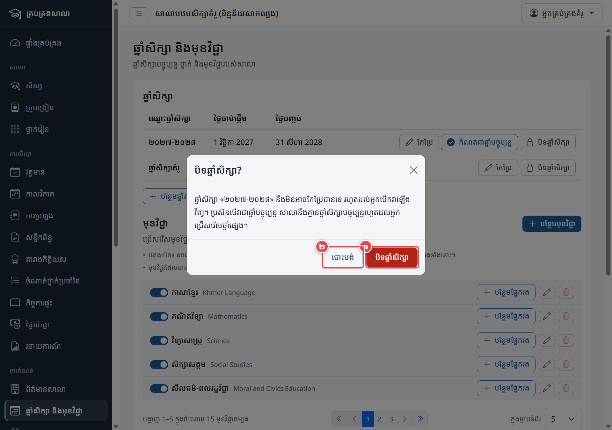

**លទ្ធផល៖** កម្មវិធីបង្ហាញសារ «បានបិទឆ្នាំសិក្សា។» ហើយឆ្នាំនោះមានស្លាក «បានបិទ»។ ប្រសិនបើវាជាឆ្នាំបច្ចុប្បន្ន សាលាគ្មានឆ្នាំបច្ចុប្បន្នរហូតដល់អ្នកជ្រើសឆ្នាំផ្សេង។

### អ្វីដែលមិនអាចកែក្នុងឆ្នាំដែលបានបិទ

- ឆ្នាំសិក្សានោះផ្ទាល់ (មិនអាចកែ ឬកំណត់ជាបច្ចុប្បន្ន)
- ថ្នាក់រៀន (មិនអាចបន្ថែម កែ ឬលុប) និងគ្រូប្រចាំមុខវិជ្ជារបស់ថ្នាក់
- ការចុះឈ្មោះសិស្សចូលថ្នាក់ ការប្តូរថ្នាក់ និងការដកសិស្ស
- សន្លឹកវត្តមាន និងវគ្គវត្តមាន
- ការប្រឡង ពិន្ទុ និងមតិយោបល់លើសន្លឹកពិន្ទុ
- កិច្ចការផ្ទះ និងកាលវិភាគ (ថ្ងៃ ម៉ោង និងមេរៀន)
- ថ្លៃដែលត្រូវបង់ (តែការទទួលប្រាក់ និងការលុបចោលបង្កាន់ដៃខុសនៅតែអាចធ្វើបាន)

ព័ត៌មានផ្ទាល់ខ្លួនរបស់សិស្ស (ឈ្មោះ រូបថត អាណាព្យាបាល) មិនជាប់នឹងឆ្នាំសិក្សាទេ ដូច្នេះនៅតែកែបាន។

## ៤.៥ បើកឆ្នាំសិក្សាឡើងវិញ

**គោលបំណង៖** បើកឆ្នាំសិក្សាដែលបានបិទឡើងវិញ ដើម្បីកែប្រែវាបាន។

**ជំហានទី១៖** នៅជួរនៃឆ្នាំដែលបានបិទ ចុច «បើកឡើងវិញ»។

**លទ្ធផល៖** កម្មវិធីបង្ហាញសារ «បានបើកឆ្នាំសិក្សាឡើងវិញ។» ដោយមិនសួរបញ្ជាក់។

**ចំណាំ៖** ការបើកឡើងវិញ **មិន**ធ្វើឱ្យឆ្នាំនោះក្លាយជាឆ្នាំបច្ចុប្បន្នវិញទេ។ ប្រសិនបើត្រូវការ សូមចុច «កំណត់ជាឆ្នាំបច្ចុប្បន្ន»។

## ៤.៦ អ្វីដែលមិនទាន់មាន

- **មិនអាចលុបឆ្នាំសិក្សាបានទេ**។ ការបិទគឺជាមធ្យោបាយតែមួយគត់ក្នុងការឈប់ប្រើវា។
- **មិនអាចចម្លងថ្នាក់ ឬគ្រូប្រចាំមុខវិជ្ជា** ពីឆ្នាំមួយទៅឆ្នាំមួយទៀតបានទេ។ កាលវិភាគ និងវគ្គវត្តមានអាចចម្លងបាន (ជំពូកទី៨ និងទី៩)។ សិស្សត្រូវបានផ្លាស់ទៅឆ្នាំថ្មីតាមរយៈ «ការឡើងថ្នាក់» (ជំពូកទី៧)។

**ចំណាំ៖** ការឡើងថ្នាក់មិនបង្កើតថ្នាក់ឱ្យអ្នកទេ។ ដូច្នេះនៅដើមឆ្នាំថ្មី សូមបង្កើតឆ្នាំសិក្សា រួចបង្កើតថ្នាក់នៃឆ្នាំនោះ មុននឹងឡើងថ្នាក់ឱ្យសិស្ស។

# ជំពូកទី៥៖ ការគ្រប់គ្រងថ្នាក់រៀន និងមុខវិជ្ជា

## ៥.១ មុខវិជ្ជា និងផ្នែករង

មុខវិជ្ជាត្រូវបានគ្រប់គ្រងនៅទំព័រ «ការកំណត់» → «ឆ្នាំសិក្សា និងមុខវិជ្ជា» ក្នុងផ្នែក «មុខវិជ្ជា» (ខាងក្រោមឆ្នាំសិក្សា)។ ប្រព័ន្ធមានមុខវិជ្ជាចម្បងចំនួន ៨ ជាមុន គឺ ភាសាខ្មែរ គណិតវិទ្យា វិទ្យាសាស្ត្រ សិក្សាសង្គម សីលធម៌-ពលរដ្ឋវិជ្ជា អប់រំកាយ និងកីឡា សិល្បៈ និងភាសាអង់គ្លេស។ ភាសាអង់គ្លេសត្រូវបានបិទ ដំបូង។ ឈ្មោះទាំងនេះគ្រាន់តែជាតម្លៃចាប់ផ្តើម ដែលអ្នកអាចប្តូរ បន្ថែម ឬបិទតាមសាលាខ្លួន។ ប្រព័ន្ធមិនបង្ខំឱ្យប្រើមុខវិជ្ជា ឬពិន្ទុអតិបរមាណាមួយឡើយ។

មុខវិជ្ជាមាន **ពីរកម្រិត** គឺមុខវិជ្ជាចម្បង និងផ្នែករង។ ឧទាហរណ៍ មុខវិជ្ជាចម្បង «ភាសាខ្មែរ» អាចមានផ្នែករង «អាន» និង «សរសេរ»។ មិនមានកម្រិតទីបីទេ។

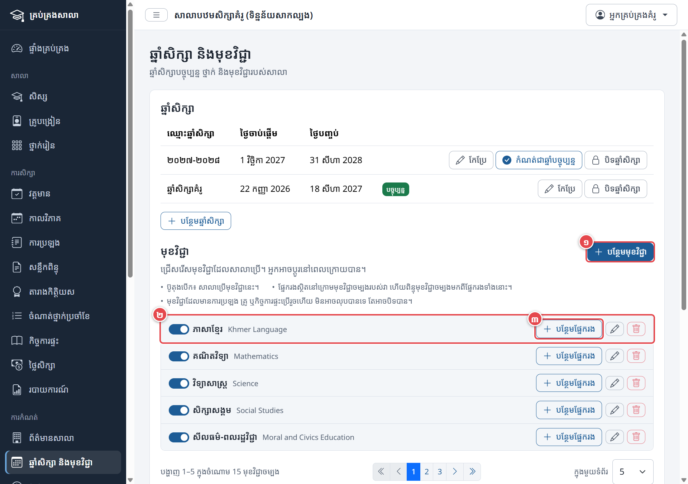

ក្នុងបញ្ជីនេះ ជួរនីមួយៗមានប៊ូតុងបើក/បិទ ឈ្មោះមុខវិជ្ជា ប៊ូតុង «បន្ថែមផ្នែករង» (សម្រាប់មុខវិជ្ជាចម្បងតែប៉ុណ្ណោះ) រូបខ្មៅដៃ «ប្តូរឈ្មោះ» និងរូបធុងសំរាម «លុប»។ ផ្នែករងត្រូវបានចូលបន្ទាត់ក្រោមមុខវិជ្ជាចម្បងរបស់វា។ បញ្ជីបង្ហាញមុខវិជ្ជាចម្បង ៥ ក្នុងមួយទំព័រ ហើយអ្នកអាចជ្រើស «ទាំងអស់» ពីប្រអប់ «ក្នុងមួយទំព័រ»។

### បន្ថែមមុខវិជ្ជាចម្បង

**គោលបំណង៖** បន្ថែមមុខវិជ្ជាថ្មីមួយ។

**ជំហានទី១៖** ចុច «បន្ថែមមុខវិជ្ជា»។

**ជំហានទី២៖** ទុកប្រអប់ «ជាផ្នែករងរបស់មុខវិជ្ជា» នៅ «— គ្មាន (នេះជាមុខវិជ្ជាចម្បង)»។ វាយ «ឈ្មោះមុខវិជ្ជា (ភាសាខ្មែរ)» (ចាំបាច់ វែងបំផុត ១០០ តួអក្សរ)។ អ្នកអាចវាយឈ្មោះភាសាអង់គ្លេសផងដែរ ប៉ុន្តែមិនចាំបាច់ទេ។

**ជំហានទី៣៖** ចុច «បង្កើត»។

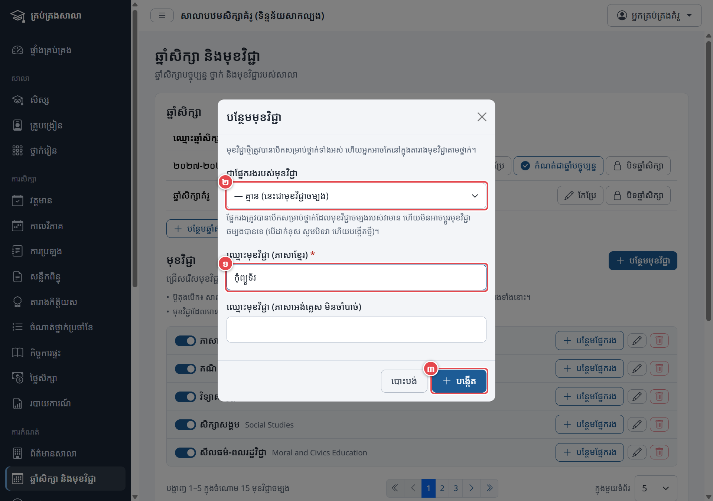

**លទ្ធផល៖** កម្មវិធីបង្ហាញសារ «បានបន្ថែមមុខវិជ្ជា។» ហើយមុខវិជ្ជាថ្មីត្រូវបានបើក និងផ្តល់ឱ្យ**ថ្នាក់ទាំងប្រាំមួយ**ស្រាប់។ អ្នកអាចដកវាចេញពីថ្នាក់ណាមួយនៅក្នុងតារាង «មុខវិជ្ជាតាមថ្នាក់» (សូមមើល ៥.២)។

### បន្ថែមផ្នែករង

**គោលបំណង៖** បន្ថែមផ្នែករងក្រោមមុខវិជ្ជាចម្បងមួយ។

**ជំហានទី១៖** នៅជួរនៃមុខវិជ្ជាចម្បង ចុច «បន្ថែមផ្នែករង»។ ឬចុច «បន្ថែមមុខវិជ្ជា» ហើយជ្រើសមុខវិជ្ជាចម្បងក្នុងប្រអប់ «ជាផ្នែករងរបស់មុខវិជ្ជា»។

**ជំហានទី២៖** វាយឈ្មោះ ហើយចុច «បង្កើត»។

**លទ្ធផល៖** ផ្នែករងថ្មីបង្ហាញក្រោមមុខវិជ្ជាចម្បង (ចូលបន្ទាត់)។

**ចំណាំ៖** ផ្នែករងត្រូវបានបើកសម្រាប់ថ្នាក់ណាដែលមុខវិជ្ជាចម្បងរបស់វារៀន។ **ផ្នែករងមិនអាចប្តូរទៅមុខវិជ្ជាចម្បងផ្សេងបានទេ**។ ប្រសិនបើអ្នកដាក់ខុស សូមបិទវា ហើយបង្កើតថ្មី។ ឈ្មោះផ្នែករងមិនអាចដូចគ្នាក្នុងមុខវិជ្ជាចម្បងតែមួយ។

### ប្តូរឈ្មោះ បិទ បើក និងលុប

- **ប្តូរឈ្មោះ៖** ចុចរូបខ្មៅដៃ វាយឈ្មោះថ្មី ហើយចុច «រក្សាទុក»។ សារ «បានកែប្រែមុខវិជ្ជា។»។ អាចប្តូរឈ្មោះបាន ទោះមុខវិជ្ជានោះត្រូវបានប្រើរួចហើយ។
- **បិទ ឬបើក៖** ចុចប៊ូតុងបើក/បិទ។ ការផ្លាស់ប្តូរត្រូវបានរក្សាទុកភ្លាមៗ ហើយមិនមានសារបញ្ជាក់ទេ។ ការបិទជាមធ្យោបាយសុវត្ថិភាព ព្រោះវារក្សាប្រវត្តិទុក។
- **លុប៖** ចុចរូបធុងសំរាម រួចចុច «ដកចេញ» ក្នុងប្រអប់បញ្ជាក់ «លុបមុខវិជ្ជា?»។ ការលុបមិនអាចត្រឡប់វិញបានទេ។

**ចំណាំ៖** ប៊ូតុងលុបមិនអាចចុចបានទេ ក្នុងករណីទាំងពីរនេះ៖ (១) មានការប្រឡង គ្រូប្រចាំមុខវិជ្ជា កិច្ចការផ្ទះ ឬមេរៀនក្នុងកាលវិភាគប្រើមុខវិជ្ជានោះរួចហើយ ហើយសារនឹងថា «មិនអាចលុបមុខវិជ្ជានេះបានទេ ព្រោះមានការប្រឡង គ្រូប្រចាំមុខវិជ្ជា ឬកិច្ចការផ្ទះប្រើវារួចហើយ។ សូមបិទវាជំនួស។» (២) មុខវិជ្ជាចម្បងនៅមានផ្នែករង ហើយអ្នកត្រូវលុបផ្នែករងមុន។ ក្នុងករណីទាំងនេះ សូមបិទមុខវិជ្ជាជំនួសវិញ។

**ចំណាំ៖** ឈ្មោះមុខវិជ្ជាត្រូវបានធ្វើឱ្យស្អាតដោយស្វ័យប្រវត្តិ (ដកឃ្លាលើស)។ ប្រសិនបើឈ្មោះមានរួចហើយ អ្នកឃើញ «មានរួចហើយ»។ ពិន្ទុតេស្តខ្លី (quiz) ក្នុងមុខវិជ្ជា **មិនទាន់មាន**ក្នុងកម្មវិធីទេ។

## ៥.២ មុខវិជ្ជាតាមថ្នាក់ទី

តារាង «មុខវិជ្ជាតាមថ្នាក់» ជាកន្លែងជ្រើសថា ថ្នាក់ទីណារៀនមុខវិជ្ជាអ្វី។

**គោលបំណង៖** ជ្រើសថាថ្នាក់ទីណាមួយរៀនមុខវិជ្ជាអ្វីខ្លះ។

**ជំហានទី១៖** ក្នុងតារាង ជួរនីមួយៗជាមុខវិជ្ជា ហើយជួរឈរនីមួយៗជាថ្នាក់ទី។ ធីកក្នុងប្រអប់ ដើម្បីឱ្យថ្នាក់ទីនោះរៀនមុខវិជ្ជានោះ។

**ជំហានទី២៖** ការផ្លាស់ប្តូរត្រូវបានរក្សាទុកភ្លាមៗ។

**លទ្ធផល៖** ប្រអប់ដែលអ្នកធីកបង្ហាញថាថ្នាក់ទីនោះរៀនមុខវិជ្ជានោះ ដោយគ្មានសារបញ្ជាក់។

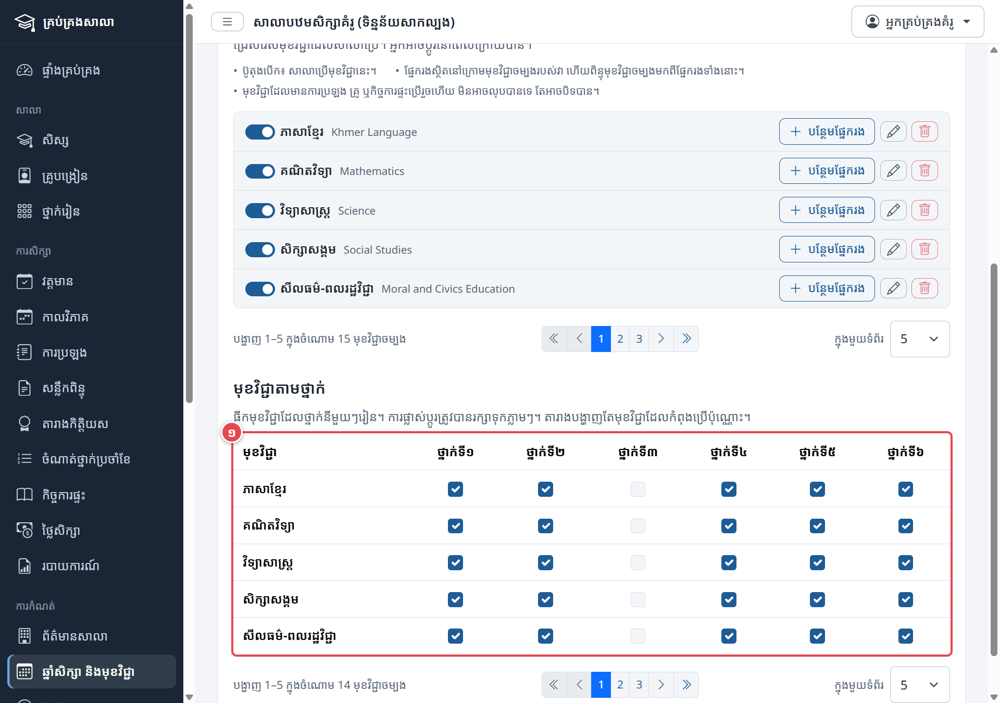

**ចំណាំ៖**

- តារាងបង្ហាញតែមុខវិជ្ជាដែលកំពុងបើក។ ប្រសិនបើអ្នកបើកមុខវិជ្ជាមួយ ដូចជា «ភាសាអង់គ្លេស» វា**មិនត្រូវបានធីកសម្រាប់ថ្នាក់ទីណាស្រាប់ទេ**។ អ្នកត្រូវធីកវាក្នុងតារាងនេះ។
- ប្រអប់ផ្នែករងចុចមិនបាន រហូតដល់អ្នកធីកមុខវិជ្ជាចម្បងរបស់វាសម្រាប់ថ្នាក់ទីនោះ។ ពេលអ្នកដកធីកមុខវិជ្ជាចម្បង ផ្នែករងរបស់វាក៏ត្រូវដកធីកដែរ។
- ថ្នាក់រៀននីមួយៗអាចជ្រើសគ្រូ ឬមេរៀនកាលវិភាគ បានតែសម្រាប់មុខវិជ្ជាដែលថ្នាក់ទីនោះរៀន។

## ៥.៣ ថ្នាក់រៀន

ថ្នាក់រៀនគឺក្រុមសិស្សមួយ ក្នុងថ្នាក់ទីមួយ ក្នុងឆ្នាំសិក្សាមួយ ដូចជា «ថ្នាក់ទី៣ ក»។ ទំព័រនៅ «សាលា» → «ថ្នាក់រៀន»។ បញ្ជីរៀបតាមថ្នាក់ទី រួចតាមឈ្មោះ ហើយបង្ហាញ ១០ ថ្នាក់ក្នុងមួយទំព័រ។

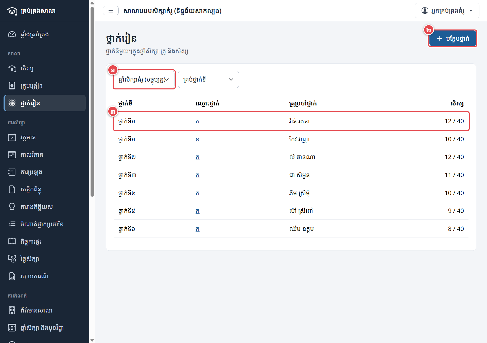

ជួរ «សិស្ស» បង្ហាញ «ចំនួនសិស្ស / ចំណុះ»។ ប្រសិនបើចំនួនសិស្សលើសចំណុះ ជួរនោះក្លាយជាពណ៌ក្រហម។

### បង្កើតថ្នាក់

**គោលបំណង៖** បន្ថែមថ្នាក់ថ្មីក្នុងឆ្នាំសិក្សាមួយ។

**ជំហានទី១៖** នៅទំព័រ «ថ្នាក់រៀន» ជ្រើសឆ្នាំសិក្សាក្នុងរបារតម្រង (ថ្នាក់នឹងត្រូវបង្កើតក្នុងឆ្នាំនោះ)។ ចុច «បន្ថែមថ្នាក់»។

**ជំហានទី២៖** បំពេញ៖

- «ថ្នាក់ទី» ជ្រើសពី ថ្នាក់ទី១ ដល់ ថ្នាក់ទី៦ (ចាំបាច់)
- «ឈ្មោះថ្នាក់» ឧទាហរណ៍ «ក» «ខ» ឬ «១ក» (ចាំបាច់ វែងបំផុត ៥០ តួអក្សរ)
- «ចំនួនសិស្សអតិបរមា» ជាលេខគត់ពី ១ ដល់ ២០០ (មិនចាំបាច់)។ ប្រសិនបើទុកទទេ កម្មវិធីប្រើ ៤០។
- «គ្រូប្រចាំថ្នាក់» ជ្រើសពីគ្រូដែលកំពុងបង្រៀន (មិនចាំបាច់)

**ជំហានទី៣៖** ចុច «រក្សាទុក»។

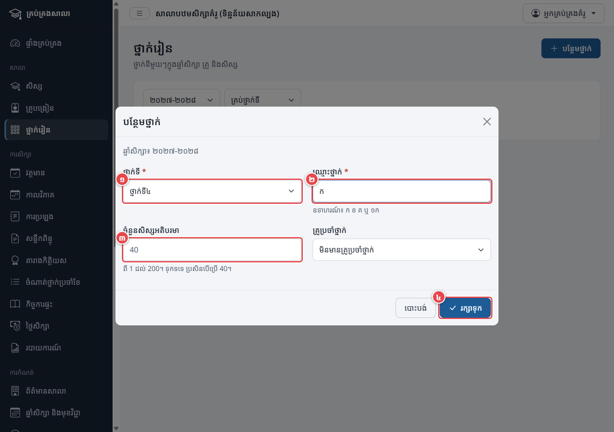

**លទ្ធផល៖** កម្មវិធីបង្ហាញសារ «បានបន្ថែមថ្នាក់។» ហើយថ្នាក់ថ្មីបង្ហាញក្នុងបញ្ជី។

**ចំណាំ៖**

- ប្រសិនបើអ្នកដាក់ថ្នាក់ទី និងឈ្មោះដូចគ្នាពីរដងក្នុងឆ្នាំតែមួយ អ្នកឃើញ «មានរួចហើយ» ក្រោមឈ្មោះ។
- ឆ្នាំសិក្សាត្រូវតែបើក។ ប្រសិនបើឆ្នាំបានបិទ ប៊ូតុង «បន្ថែមថ្នាក់» ចុចមិនបាន។
- ក្នុងប្រអប់នេះមិនមានប្រអប់បន្ទប់រៀនទេ។

### ទំព័រថ្នាក់មួយ

ចុចលើឈ្មោះថ្នាក់ក្នុងបញ្ជី ដើម្បីបើកទំព័ររបស់ថ្នាក់នោះ។

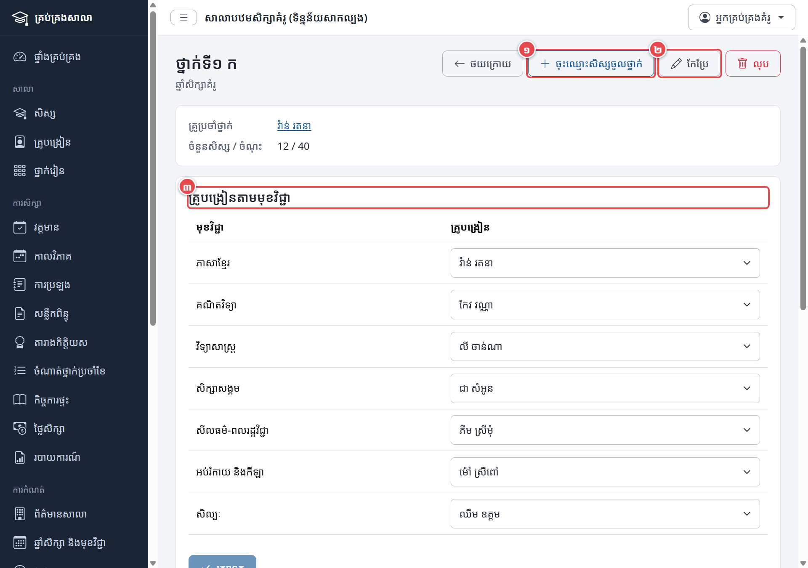

- **កែប្រែ៖** ចុច «កែប្រែ»។ ថ្នាក់ទីមិនអាចប្តូរបានទេ (ប្រអប់នោះចុចមិនបាន)។ សារ «បានរក្សាទុកថ្នាក់។»។
- **គ្រូបង្រៀនតាមមុខវិជ្ជា៖** ជួរនីមួយៗជាមុខវិជ្ជាដែលថ្នាក់ទីនេះរៀន។ ជ្រើសគ្រូក្នុងប្រអប់នីមួយៗ (ជម្រើសដំបូង «— មិនទាន់កំណត់ —») រួចចុច «រក្សាទុក»។ សារ «បានរក្សាទុកគ្រូបង្រៀនតាមមុខវិជ្ជា។»។ មុខវិជ្ជាមួយមានគ្រូតែម្នាក់ក្នុងមួយថ្នាក់ ហើយគ្រូត្រូវកំពុងបង្រៀន។
- **ចុះឈ្មោះសិស្សចូលថ្នាក់៖** ចុចប៊ូតុងនេះ ស្វែងរកសិស្សដែលមិនទាន់មានថ្នាក់ក្នុងឆ្នាំនោះ ហើយចុច «ចុះឈ្មោះ» នៅជួរសិស្ស។ សារ «បានចុះឈ្មោះ … ចូលថ្នាក់។»។ ប្រសិនបើថ្នាក់លើសចំណុះ កម្មវិធីគ្រាន់តែព្រមាន ហើយនៅតែអនុញ្ញាត។
- **លុបថ្នាក់៖** ចុច «លុប» រួចបញ្ជាក់។ លុបបានតែថ្នាក់ដែលមិនធ្លាប់មានសិស្សប៉ុណ្ណោះ (បើមិនដូច្នេះ កម្មវិធីថា «មិនអាចលុបថ្នាក់នេះបានទេ ព្រោះធ្លាប់មានសិស្សក្នុងថ្នាក់។»)។ ការលុបថ្នាក់ក៏លុបគ្រូប្រចាំមុខវិជ្ជា និងមេរៀនកាលវិភាគរបស់ថ្នាក់នោះដែរ។

**ចំណាំ៖** ក្នុងឆ្នាំសិក្សាដែលបានបិទ ប៊ូតុង «ចុះឈ្មោះសិស្សចូលថ្នាក់» «កែប្រែ» និង «លុប» មិនបង្ហាញទេ។

# ជំពូកទី៦៖ ការគ្រប់គ្រងគ្រូបង្រៀន

ទំព័រគ្រូបង្រៀននៅ «សាលា» → «គ្រូបង្រៀន»។ ទំព័រនេះរក្សាបញ្ជីគ្រូ ព័ត៌មានទំនាក់ទំនង និងថ្នាក់ដែលគ្រូបង្រៀន។ **គ្រូមិនត្រូវបានលុបទេ** គេគ្រាន់តែត្រូវបានដាក់ឱ្យឈប់បង្រៀន ដើម្បីរក្សាប្រវត្តិចាស់។

## ៦.១ មើលបញ្ជីគ្រូ

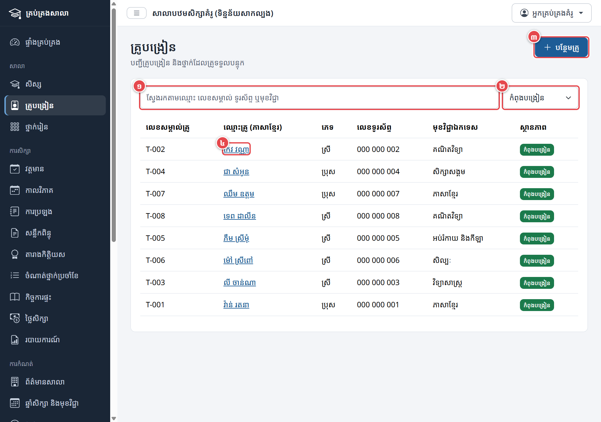

- **ការស្វែងរក៖** វាយឈ្មោះ លេខសម្គាល់ លេខទូរស័ព្ទ ឬមុខវិជ្ជាឯកទេស។ លទ្ធផលបង្ហាញបន្ទាប់ពីអ្នកឈប់វាយបន្តិច។
- **តម្រងស្ថានភាព៖** ក្នុងការកំណត់ដើម បញ្ជីបង្ហាញតែគ្រូ «កំពុងបង្រៀន»។ ដើម្បីឃើញគ្រូដែលបានឈប់ សូមប្តូរតម្រងទៅ «ឈប់បង្រៀន» ឬ «ទាំងអស់»។
- **តារាង៖** មានជួរ លេខសម្គាល់គ្រូ ឈ្មោះគ្រូ ភេទ លេខទូរស័ព្ទ មុខវិជ្ជាឯកទេស និងស្ថានភាព។ រៀបតាមឈ្មោះខ្មែរ ហើយបង្ហាញ ១០ នាក់ក្នុងមួយទំព័រ។
- ប្រសិនបើគ្មាននរណា បញ្ជីប្រាប់ថា «មិនមានគ្រូបង្រៀនទេ។»។

## ៦.២ បន្ថែមគ្រូថ្មី

**គោលបំណង៖** បន្ថែមគ្រូម្នាក់ទៅក្នុងបញ្ជី។

**ជំហានទី១៖** ចុច «បន្ថែមគ្រូ»។

**ជំហានទី២៖** បំពេញប្រអប់៖

| ប្រអប់ | តម្រូវការ |
|---|---|
| «ឈ្មោះគ្រូ (ភាសាខ្មែរ)» | ចាំបាច់ វែងបំផុត ១០០ តួអក្សរ |
| «ភេទ» | ចាំបាច់ «ប្រុស» ឬ «ស្រី» |
| «លេខទូរស័ព្ទ» | មិនចាំបាច់ វែងបំផុត ៥០ តួអក្សរ មិនមានការត្រួតពិនិត្យទម្រង់ |
| «ថ្ងៃចូលបម្រើការងារ» | មិនចាំបាច់ |
| «មុខវិជ្ជាឯកទេស» | មិនចាំបាច់ វែងបំផុត ១៥០ តួអក្សរ សរសេរដោយសេរី (មិនភ្ជាប់នឹងបញ្ជីមុខវិជ្ជាទេ) |
| «អាសយដ្ឋាន» | មិនចាំបាច់ វែងបំផុត ៥០០ តួអក្សរ |

**ជំហានទី៣៖** ចុច «រក្សាទុក»។

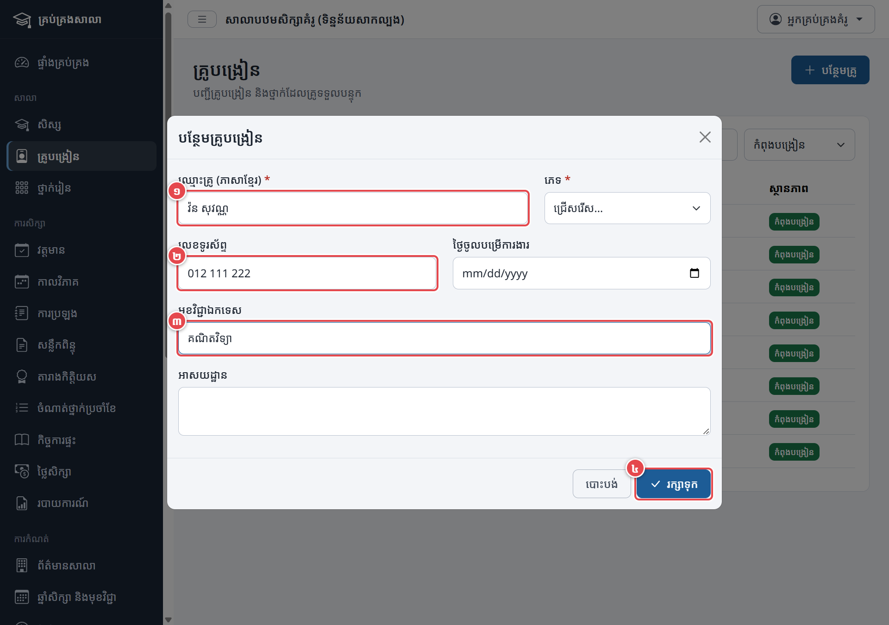

**លទ្ធផល៖** កម្មវិធីបង្ហាញសារ «បានបន្ថែមគ្រូបង្រៀន។» ហើយគ្រូថ្មីបង្ហាញក្នុងបញ្ជី។ កម្មវិធីបង្កើតលេខសម្គាល់ដោយខ្លួនឯង ដូចជា T-001 T-002។ អ្នកមិនត្រូវវាយវាទេ។

**ចំណាំ៖** កំណែនេះមិនមានប្រអប់ រូបថតគ្រូ លេខអត្តសញ្ញាណប័ណ្ណ ឬអ៊ីមែលរបស់គ្រូទេ។

## ៦.៣ ទំព័រព័ត៌មានគ្រូ

ចុចលើឈ្មោះគ្រូក្នុងបញ្ជី ដើម្បីបើកទំព័ររបស់គាត់។

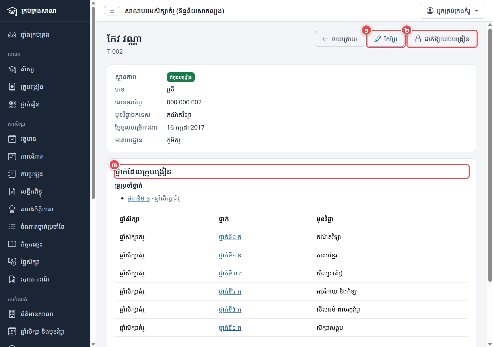

ទំព័រនេះបង្ហាញព័ត៌មានទាំងអស់របស់គ្រូ កាត «ថ្នាក់ដែលគ្រូបង្រៀន» និងកាត «កាលវិភាគបង្រៀន»។

- **កាត «ថ្នាក់ដែលគ្រូបង្រៀន»៖** បង្ហាញថ្នាក់ដែលគ្រូជាគ្រូប្រចាំថ្នាក់ និងតារាងឆ្នាំសិក្សា ថ្នាក់ និងមុខវិជ្ជាដែលគាត់បង្រៀន។ ប្រសិនបើគ្មាន វាប្រាប់ថា «គ្រូនេះមិនទាន់ទទួលបន្ទុកថ្នាក់ណាមួយទេ។»។ កាតនេះមានតែការមើល។ ការកំណត់គ្រូប្រចាំមុខវិជ្ជាធ្វើនៅទំព័រថ្នាក់ (ជំពូកទី៥)។
- **កាត «កាលវិភាគបង្រៀន»៖** បង្ហាញចំនួនមេរៀនក្នុងមួយសប្តាហ៍ និងតំណ «មើលកាលវិភាគពេញ» (ជំពូកទី៩)។

## ៦.៤ កែព័ត៌មានគ្រូ

**គោលបំណង៖** កែព័ត៌មានរបស់គ្រូម្នាក់។

**ជំហានទី១៖** ក្នុងទំព័រគ្រូ ចុច «កែប្រែ»។

**ជំហានទី២៖** កែព័ត៌មាន ហើយចុច «រក្សាទុក»។

**លទ្ធផល៖** សារ «បានរក្សាទុកព័ត៌មានគ្រូ។»។

## ៦.៥ ដាក់គ្រូឱ្យឈប់បង្រៀន និងឱ្យបង្រៀនវិញ

**គោលបំណង៖** កត់ត្រាថាគ្រូម្នាក់បានឈប់បង្រៀន ដោយរក្សាប្រវត្តិចាស់។

**ជំហានទី១៖** ក្នុងទំព័រគ្រូ ចុច «ដាក់ឱ្យឈប់បង្រៀន»។

**ជំហានទី២៖** អានសារក្នុងប្រអប់ «ដាក់គ្រូឱ្យឈប់បង្រៀន?» រួចចុច «ដាក់ឱ្យឈប់បង្រៀន»។

**លទ្ធផល៖** សារ «បានដាក់គ្រូឱ្យឈប់បង្រៀន។»។ គ្រូនោះលែងអាចត្រូវបានជ្រើសជាគ្រូប្រចាំថ្នាក់ ឬគ្រូមុខវិជ្ជាថ្មី ឬដាក់ក្នុងមេរៀនថ្មីបានទៀតទេ។ កំណត់ត្រាចាស់ ដូចជាថ្នាក់ដែលគាត់ធ្លាប់បង្រៀន នៅដដែល។

**ការដាក់ឱ្យបង្រៀនវិញ៖** ចុច «ដាក់ឱ្យបង្រៀនវិញ» (មិនសួរបញ្ជាក់ទេ)។ សារ «បានដាក់គ្រូឱ្យបង្រៀនវិញ។»។

**ចំណាំ៖** ការដាក់ឱ្យឈប់បង្រៀន មិនលុបការកំណត់គ្រូប្រចាំមុខវិជ្ជា ដែលមានស្រាប់ទេ។ ប្រសិនបើអ្នកចង់ដាក់គ្រូផ្សេងជំនួស សូមទៅទំព័រថ្នាក់ពាក់ព័ន្ធ ហើយជ្រើសគ្រូថ្មី។ កាលវិភាគដែលមានគ្រូនោះ នឹងបង្ហាញស្លាកលឿង «គ្រូឈប់បង្រៀន» (ជំពូកទី៩)។

# ជំពូកទី៧៖ ការគ្រប់គ្រងសិស្ស និងការចុះឈ្មោះចូលរៀន

ទំព័រសិស្សនៅ «សាលា» → «សិស្ស»។ ទំព័រនេះជាកន្លែងកត់ត្រាសិស្សថ្មី ចុះឈ្មោះសិស្សចូលថ្នាក់ ប្តូរថ្នាក់ កត់ត្រាការចាកចេញ និងឡើងថ្នាក់នៅចុងឆ្នាំ។

## ៧.១ មើលបញ្ជីសិស្ស

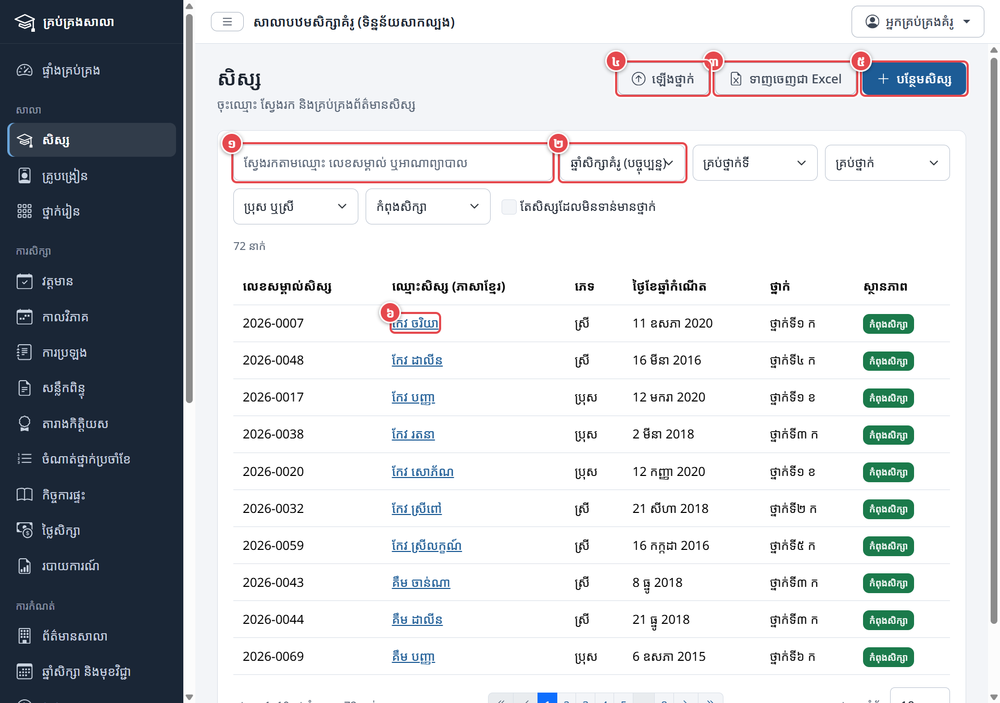

- **ការស្វែងរក៖** វាយឈ្មោះខ្មែរ ឬអង់គ្លេស លេខសម្គាល់សិស្ស ឈ្មោះអាណាព្យាបាល ឬលេខទូរស័ព្ទ។
- **តម្រង៖** ឆ្នាំសិក្សា (ក្នុងការកំណត់ដើមជាឆ្នាំបច្ចុប្បន្ន) «គ្រប់ថ្នាក់ទី» «គ្រប់ថ្នាក់» ភេទ និងស្ថានភាព។ តម្រងស្ថានភាពក្នុងការកំណត់ដើមគឺ «កំពុងសិក្សា» ដូច្នេះសិស្សដែលបានឈប់ ឬបញ្ចប់ការសិក្សាត្រូវបានលាក់។ ដើម្បីឃើញពួកគេ សូមប្តូរទៅ «ទាំងអស់»។ ប្រអប់ធីក «តែសិស្សដែលមិនទាន់មានថ្នាក់» បង្ហាញសិស្សដែលមិនទាន់ត្រូវបានដាក់ចូលថ្នាក់។
- **តារាង៖** បង្ហាញលេខសម្គាល់ ឈ្មោះ ភេទ ថ្ងៃខែឆ្នាំកំណើត ថ្នាក់ និងស្ថានភាព។ រៀបតាមឈ្មោះខ្មែរ ហើយបង្ហាញ ១០ នាក់ក្នុងមួយទំព័រ (អ្នកអាចជ្រើស ២០ ៥០ ១០០ ឬទាំងអស់)។
- ប្រសិនបើគ្មាននរណា បញ្ជីប្រាប់ថា «មិនមានសិស្សទេ។»។

### ការនាំចេញបញ្ជីសិស្សទៅ Excel

**គោលបំណង៖** រក្សាទុកបញ្ជីសិស្សជាឯកសារ Excel។

**ជំហានទី១៖** កំណត់តម្រងឱ្យបង្ហាញសិស្សដែលអ្នកចង់បាន។

**ជំហានទី២៖** ចុច «ទាញចេញជា Excel» ជ្រើសថត និងឈ្មោះឯកសារក្នុងប្រអប់រក្សាទុករបស់ Windows (ឈ្មោះដែលស្នើគឺ បញ្ជីសិស្ស.xlsx)។

**លទ្ធផល៖** សារ «បានរក្សាទុកឯកសារ Excel។»។ ឯកសារមានសិស្ស**ទាំងអស់**ដែលត្រូវនឹងតម្រង មិនមែនតែ ១០ នាក់ដែលបង្ហាញលើអេក្រង់ទេ។ វាមាន ១៦ ជួរឈរ រួមមានឈ្មោះ ភេទ ថ្ងៃខែឆ្នាំកំណើត ថ្នាក់ ស្ថានភាព អាណាព្យាបាលចម្បង និងអាសយដ្ឋាន។

**ចំណាំ៖** ប្រសិនបើតម្រងស្ថានភាពជា «កំពុងសិក្សា» សិស្សដែលបានឈប់ ឬបញ្ចប់ការសិក្សាមិនត្រូវបាននាំចេញទេ។ ការនាំចូលបញ្ជីសិស្សពី Excel **មិនទាន់មាន**។

## ៧.២ បន្ថែមសិស្សថ្មី

**គោលបំណង៖** កត់ត្រាសិស្សថ្មីម្នាក់ និងដាក់គាត់ចូលថ្នាក់ (ប្រសិនបើអាច)។

**ជំហានទី១៖** ចុច «បន្ថែមសិស្ស»។ ទំព័រ «ចុះឈ្មោះសិស្សថ្មី» បើកឡើង។

**ជំហានទី២៖** បំពេញព័ត៌មាន។ មានតែ **៣ ប្រអប់ដែលចាំបាច់** គឺ ឈ្មោះសិស្សភាសាខ្មែរ ភេទ និងថ្ងៃខែឆ្នាំកំណើត។ ប្រអប់ចាំបាច់មានសញ្ញាផ្កាយក្រហម។

| ផ្នែក | ប្រអប់ |
|---|---|
| ព័ត៌មានផ្ទាល់ខ្លួន | «ឈ្មោះសិស្ស (ភាសាខ្មែរ)» (ចាំបាច់) · «ឈ្មោះជាភាសាអង់គ្លេស» · «ភេទ» (ចាំបាច់) · «ថ្ងៃខែឆ្នាំកំណើត» (ចាំបាច់ ត្រូវនៅអតីតកាល) · «ទីកន្លែងកំណើត» |
| ទីលំនៅ | «អាសយដ្ឋាន» · «ភូមិ» · «ឃុំ/សង្កាត់» · «ស្រុក/ខណ្ឌ» · «ខេត្ត/រាជធានី» |
| ការសិក្សា | «ថ្ងៃចូលរៀន» (ទុកទទេ ប្រសិនបើជាថ្ងៃនេះ) · «ចុះឈ្មោះចូលថ្នាក់ (ឆ្នាំសិក្សាបច្ចុប្បន្ន)» (មិនចាំបាច់) |
| អាណាព្យាបាល | រហូតដល់ ៥ នាក់ (សូមមើលខាងក្រោម) |
| កំណត់ចំណាំ | «កំណត់ចំណាំ» វែងបំផុត ២០០០ តួអក្សរ |

**ជំហានទី៣៖** សម្រាប់អាណាព្យាបាល ចុច «បន្ថែមអាណាព្យាបាល» ហើយបំពេញ «ឈ្មោះអាណាព្យាបាល» (ចាំបាច់) «ទំនាក់ទំនង» (ឪពុក ម្តាយ ជីដូនជីតា បងប្អូន ពូ ឬមីង ឬផ្សេងៗ) និងលេខទូរស័ព្ទ។ អាណាព្យាបាលដំបូងដែលអ្នកបន្ថែមក្លាយជា «អាណាព្យាបាលចម្បង» ដោយស្វ័យប្រវត្តិ ហើយអ្នកអាចប្តូរបាន។ ការបំពេញអាណាព្យាបាលមិនចាំបាច់ទេ។

**ជំហានទី៤៖** ចុច «រក្សាទុក»។

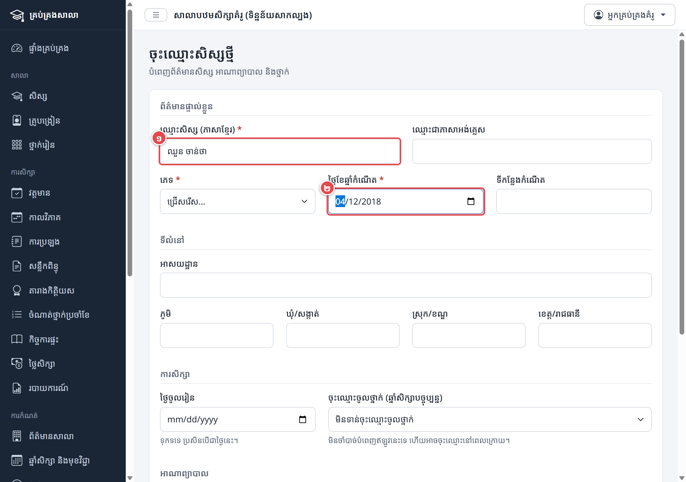

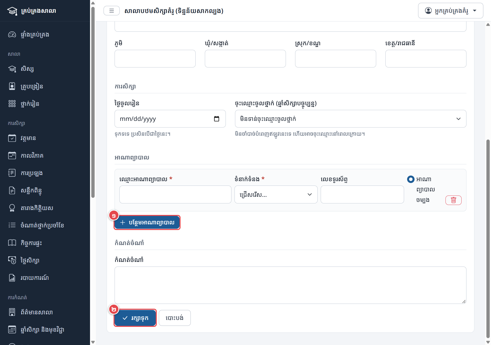

**លទ្ធផល៖** សារ «បានចុះឈ្មោះសិស្ស។» ហើយទំព័ររបស់សិស្សថ្មីបើកឡើង។ លេខសម្គាល់សិស្សត្រូវបានបង្កើតដោយស្វ័យប្រវត្តិ តាមទម្រង់ ឆ្នាំ-លេខរៀង ដូចជា 2026-0001។ អ្នកមិនត្រូវវាយវាទេ។

**ចំណាំ៖**

- **ការព្រមានសិស្សស្ទួន៖** ប្រសិនបើមានសិស្សម្នាក់ទៀតដែលមានឈ្មោះខ្មែរ និងថ្ងៃខែឆ្នាំកំណើតដូចគ្នា កម្មវិធីបង្ហាញប្រអប់ «ប្រហែលជាសិស្សដដែល?»។ ប្រសិនបើជាមនុស្សផ្សេងគ្នា (ដូចជាកូនភ្លោះ) អ្នកអាចចុច «រក្សាទុកដដែល»។ នេះគ្រាន់តែជាការព្រមាន មិនមែនការហាមឃាត់ទេ។
- **រូបថត៖** មិនអាចដាក់រូបថតនៅទំព័រនេះទេ។ អ្នកដាក់វានៅទំព័ររបស់សិស្ស ក្រោយរក្សាទុកសិស្ស។
- ប្រសិនបើមិនទាន់មានឆ្នាំសិក្សាបច្ចុប្បន្ន កម្មវិធីបង្ហាញសារថា «…អ្នកអាចចុះឈ្មោះសិស្សជាមុន ហើយដាក់ចូលថ្នាក់នៅពេលក្រោយ។»
- ប្រសិនបើអ្នកជ្រើសថ្នាក់ហើយថ្នាក់នោះលើសចំណុះ កម្មវិធីព្រមាន ប៉ុន្តែនៅតែរក្សាទុក។

## ៧.៣ ទំព័ររបស់សិស្ស

ចុចលើឈ្មោះសិស្សក្នុងបញ្ជី ដើម្បីបើកទំព័ររបស់គាត់។

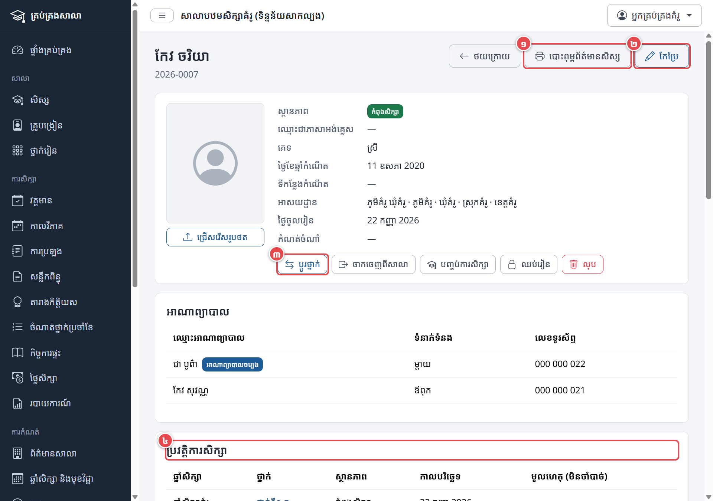

ទំព័រនេះមានកាតជាបន្តបន្ទាប់៖ ព័ត៌មានសិស្ស «អាណាព្យាបាល» «ប្រវត្តិការសិក្សា» «វត្តមាន» «លទ្ធផលប្រឡង» «កិច្ចការផ្ទះ» និង «កាលវិភាគ»។ កាតវត្តមាន លទ្ធផល កិច្ចការផ្ទះ និងកាលវិភាគមានតែការមើល។

### រូបថតសិស្ស

ក្នុងកាតព័ត៌មាន ចុច «ជ្រើសរើសរូបថត» (ឬ «ប្តូររូបថត») ហើយជ្រើសឯកសារ PNG ឬ JPG ដែលមានទំហំមិនលើស ៥ MB។ កម្មវិធីបង្រួមរូបដោយខ្លួនឯង។ សារ «បានរក្សាទុករូបថត។»។ ប៊ូតុង «ដកចេញ» ដករូបថតចេញ ដោយមិនសួរបញ្ជាក់។

### កែព័ត៌មានសិស្ស

ចុច «កែប្រែ» កែព័ត៌មាន (ទម្រង់ដូចពេលបន្ថែម តែគ្មានប្រអប់ថ្នាក់) ហើយចុច «រក្សាទុក»។ សារ «បានរក្សាទុកព័ត៌មានសិស្ស។»។

### បោះពុម្ពព័ត៌មានសិស្ស

ចុច «បោះពុម្ពព័ត៌មានសិស្ស» ដើម្បីបើកសន្លឹក A4 មានក្បាលសាលា ព័ត៌មានសិស្ស រូបថត អាណាព្យាបាល និងប្រវត្តិថ្នាក់។ ប្រើ «ព្រីន» ឬ «រក្សាទុកជា PDF»។

## ៧.៤ ចុះឈ្មោះចូលថ្នាក់ ប្តូរថ្នាក់ និងចាកចេញ

ប៊ូតុងនៅទំព័រសិស្សប្រែប្រួលតាមស្ថានភាពរបស់សិស្ស។

### ចុះឈ្មោះចូលថ្នាក់

ប្រើពេលសិស្សសកម្មមិនទាន់មានថ្នាក់ក្នុងឆ្នាំបច្ចុប្បន្ន។ ចុច «ចុះឈ្មោះចូលថ្នាក់» ជ្រើសថ្នាក់ (ក្នុងឆ្នាំបច្ចុប្បន្ន) និងកាលបរិច្ឆេទ (មិនចាំបាច់) ហើយចុច «ចុះឈ្មោះ»។ សារ «បានចុះឈ្មោះសិស្សចូលថ្នាក់។»។ អ្នកអាចចុះឈ្មោះសិស្សពីទំព័រថ្នាក់បានដែរ (ជំពូកទី៥)។

### ប្តូរថ្នាក់

**គោលបំណង៖** ផ្លាស់ទីសិស្សទៅថ្នាក់ផ្សេងក្នុងឆ្នាំសិក្សាដដែល។

ប្រើពេលសិស្សផ្លាស់ទៅថ្នាក់ផ្សេងក្នុងឆ្នាំសិក្សាដដែល។

**ជំហានទី១៖** ក្នុងទំព័រសិស្ស ចុច «ប្តូរថ្នាក់»។

**ជំហានទី២៖** ជ្រើសថ្នាក់ថ្មី (ត្រូវជាថ្នាក់ក្នុងឆ្នាំដដែល មិនមែនថ្នាក់បច្ចុប្បន្នរបស់គាត់)។ អ្នកអាចបំពេញកាលបរិច្ឆេទ និងមូលហេតុ (មិនចាំបាច់)។ ចុច «ប្តូរថ្នាក់»។

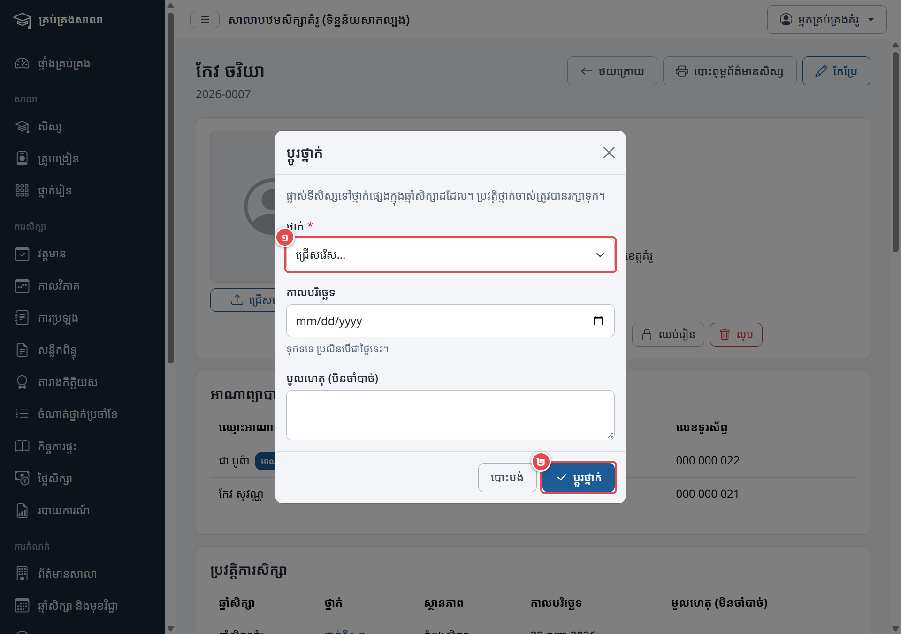

**លទ្ធផល៖** សារ «បានប្តូរថ្នាក់សិស្ស។» ហើយប្រវត្តិថ្នាក់ចាស់ត្រូវបានរក្សាទុក។

### ចាកចេញពីសាលា

ចុច «ចាកចេញពីសាលា» បំពេញកាលបរិច្ឆេទ និងមូលហេតុ រួចចុច «កត់ត្រាការចាកចេញ»។ ថ្នាក់បច្ចុប្បន្នត្រូវបានបញ្ចប់ ហើយសិស្សក្លាយជា «ឈប់រៀន»។ ប្រវត្តិនៅដដែល។

### ឈប់រៀន បញ្ចប់ការសិក្សា ត្រឡប់មកវិញ និងលុប

- **«ឈប់រៀន» និង «បញ្ចប់ការសិក្សា»៖** ចុចប៊ូតុង រួចបញ្ជាក់ក្នុងប្រអប់។ សិស្សចេញពីថ្នាក់បច្ចុប្បន្ន ហើយកំណត់ត្រាទាំងអស់នៅដដែល។
- **«ត្រឡប់មកសិក្សាវិញ»៖** កំណត់ឱ្យសិស្សសកម្មវិញ ប៉ុន្តែ**មិនដាក់ក្នុងថ្នាក់ឡើយ**។ បន្ទាប់មកសូមចុច «ចុះឈ្មោះចូលថ្នាក់»។
- **«លុប»៖** លុបជាអចិន្ត្រៃយ៍បានតែសិស្សដែលមិនទាន់មានប្រវត្តិ (មិនធ្លាប់ឡើងថ្នាក់ ប្តូរថ្នាក់ ឬចាកចេញ ហើយមិនមានវត្តមាន ឬពិន្ទុ)។ ប្រសិនបើមានប្រវត្តិ កម្មវិធីថា «មិនអាចលុបសិស្សនេះបានទេ ព្រោះមានប្រវត្តិការសិក្សា។ សូមកំណត់ថាឈប់រៀនជំនួសវិញ។»។

## ៧.៥ ការឡើងថ្នាក់ចុងឆ្នាំ

ការឡើងថ្នាក់ផ្លាស់ទីសិស្សទាំងថ្នាក់ពីឆ្នាំសិក្សាចាស់ទៅឆ្នាំថ្មី។ អ្នកធ្វើបាន**ម្តងមួយថ្នាក់**។

**គោលបំណង៖** ផ្លាស់ទីសិស្សទាំងថ្នាក់ ពីឆ្នាំសិក្សាចាស់ទៅឆ្នាំថ្មី។

**មុនចាប់ផ្តើម៖** ត្រូវមានឆ្នាំសិក្សាថ្មីដែលនៅបើក **និងថ្នាក់ក្នុងឆ្នាំថ្មី** (ការឡើងថ្នាក់មិនបង្កើតថ្នាក់ឱ្យទេ)។ លំដាប់ដែលគួរធ្វើ៖ (១) បង្កើតឆ្នាំថ្មី (២) បង្កើតថ្នាក់នៃឆ្នាំថ្មី (៣) ឡើងថ្នាក់ឱ្យសិស្សម្តងមួយថ្នាក់ (៤) កំណត់ឆ្នាំថ្មីជាឆ្នាំបច្ចុប្បន្ន (៥) បិទឆ្នាំចាស់ ប្រសិនបើចង់។

**ជំហានទី១៖** នៅទំព័រសិស្ស ចុច «ឡើងថ្នាក់»។

**ជំហានទី២៖** ជ្រើស «ពីឆ្នាំសិក្សា» «ទៅឆ្នាំសិក្សា» និង «ថ្នាក់ដែលត្រូវឡើង»។

**ជំហានទី៣៖** តារាងបង្ហាញសិស្សក្នុងថ្នាក់ ជាមួយប្រអប់ធីក «លទ្ធផល» និង «ទៅថ្នាក់»។ ថ្នាក់ទី១ ដល់ទី៥ ជ្រើស «ឡើងថ្នាក់» ឬ «ត្រួតថ្នាក់»។ ថ្នាក់ទី៦ ជ្រើស «ត្រួតថ្នាក់» ឬ «បញ្ចប់ការសិក្សា»។ ដកធីកសិស្សដែលមិនចង់ផ្លាស់ទី។

**ជំហានទី៤៖** ចុច «មើលជាមុន»។ កម្មវិធីបង្ហាញលទ្ធផលជាមុន «(មិនទាន់រក្សាទុក)» គឺ ចំនួនឡើងថ្នាក់ ត្រួតថ្នាក់ និងបញ្ចប់ការសិក្សា ព្រមទាំងចំនួនសិស្សក្នុងថ្នាក់ថ្មីធៀបនឹងចំណុះ។ មិនទាន់មានអ្វីត្រូវបានរក្សាទុកទេ។

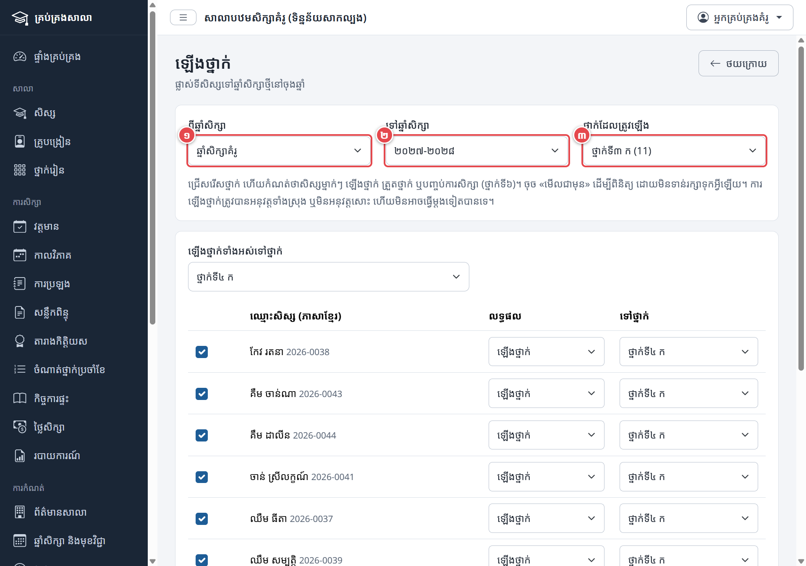

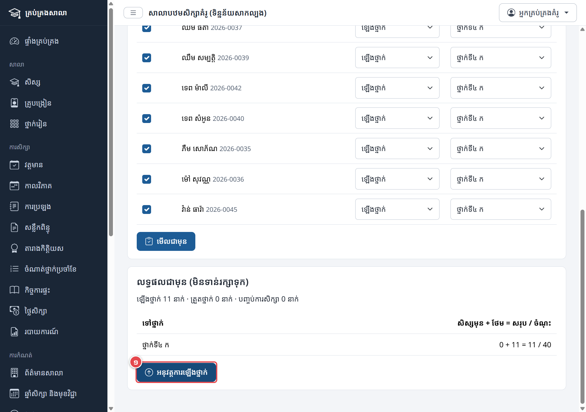

**ជំហានទី៥៖** ប្រសិនបើត្រឹមត្រូវ ចុច «អនុវត្តការឡើងថ្នាក់» ហើយបញ្ជាក់ក្នុងប្រអប់ «អនុវត្តការឡើងថ្នាក់?»។

**លទ្ធផល៖** សារ «បានអនុវត្តការឡើងថ្នាក់។» និងបន្ទាត់សង្ខេបចំនួន។ សម្រាប់សិស្សម្នាក់ៗ ថ្នាក់ចាស់ត្រូវបានបិទជាមួយលទ្ធផល ហើយថ្នាក់ថ្មីត្រូវបានបើក។ សិស្សបញ្ចប់ការសិក្សាមានស្ថានភាព «បញ្ចប់ការសិក្សា»។

**ប្រុងប្រយ័ត្ន៖** អ្នក**មិនអាចធ្វើម្តងទៀត** ឬបដិសេធការឡើងថ្នាក់សម្រាប់សិស្សទាំងនោះបានទេ។ សូមពិនិត្យមើលជាមុនឱ្យល្អ។

**ចំណាំ៖**

- កម្មវិធីពិនិត្យបញ្ហាមុនពេលរក្សាទុក។ ប្រសិនបើមានបញ្ហា ដូចជាសិស្សមានថ្នាក់ក្នុងឆ្នាំថ្មីរួចហើយ ឬថ្នាក់គោលដៅមិនត្រឹមត្រូវ វានឹងបង្ហាញសារក្រោមឈ្មោះសិស្សនោះ ហើយមិនរក្សាទុកអ្វីទាំងអស់។ សូមកែ រួចព្យាយាមម្តងទៀត។
- ការលើសចំណុះគ្រាន់តែជាការព្រមាន («លើសចំណុះ»)។
- ការឡើងថ្នាក់ **មិនកំណត់**ឆ្នាំថ្មីជាឆ្នាំបច្ចុប្បន្ន មិនបិទឆ្នាំចាស់ មិនប៉ះពាល់គ្រូប្រចាំមុខវិជ្ជា កាលវិភាគ ពិន្ទុ ឬវត្តមានទេ។
- សិស្សដែលអ្នកដកធីក នៅក្នុងថ្នាក់ចាស់។
- ការបញ្ចប់ឡើងថ្នាក់ម្តងមួយថ្នាក់ មិនមានការត្រឡប់វិញទេ។ ការឡើងថ្នាក់ទាំងសាលាម្តងទាំងអស់ **មិនទាន់មាន**។

# ជំពូកទី៨៖ ការកត់ត្រាវត្តមានសិស្ស

ទំព័រវត្តមាននៅ «ការសិក្សា» → «វត្តមាន»។ ការរៀបចំវគ្គ និងវិធីរាប់វត្តមាននៅ «ការកំណត់» → «វគ្គវត្តមាន»។

## ៨.១ ស្វែងយល់ពី «វគ្គ» ជាមុន

«វគ្គ» គឺជាផ្នែកមួយនៃថ្ងៃសិក្សា ដូចជាព្រឹក ឬរសៀល។ សាលាខ្លះមានវគ្គតែមួយក្នុងមួយថ្ងៃ ហើយសាលាខ្លះមានពីរ។

- ឆ្នាំសិក្សាថ្មីនីមួយៗចាប់ផ្តើមជាមួយវគ្គតែមួយឈ្មោះ ពេញមួយថ្ងៃ ដោយគ្មានម៉ោង។ ប្រសិនបើសាលារបស់អ្នកមានវគ្គតែមួយ អ្នកមិនចាំបាច់ធ្វើអ្វីទេ។
- ម៉ោងនៃវគ្គគឺជាព័ត៌មានប៉ុណ្ណោះ។ **កម្មវិធីមិនដែលបដិសេធការកត់ត្រាវត្តមានដោយសារម៉ោងឡើយ។**
- ឈ្មោះ និងម៉ោងនៃវគ្គទាំងនេះ **មិនទាន់ត្រូវបានបញ្ជាក់ដោយសាលា**ទេ។ ក្នុងទំព័រការកំណត់ អ្នកនឹងឃើញសារពណ៌លឿង «មិនទាន់ជាផ្លូវការ»។ វគ្គ «ព្រឹក» ម៉ោង 07:00–11:00 និង «រសៀល» ម៉ោង 13:00–17:00 ដែលអ្នកអាចឃើញក្នុងរូបភាពនៃសៀវភៅនេះ គឺជាឧទាហរណ៍ប៉ុណ្ណោះ មិនមែនកាលវិភាគពិតរបស់សាលាណាមួយទេ។ សូមបញ្ចូលវគ្គពិតរបស់សាលាអ្នក។

## ៨.២ រៀបចំវគ្គវត្តមាន

**គោលបំណង៖** បន្ថែម កែ បិទ ឬលុបវគ្គវត្តមាន។

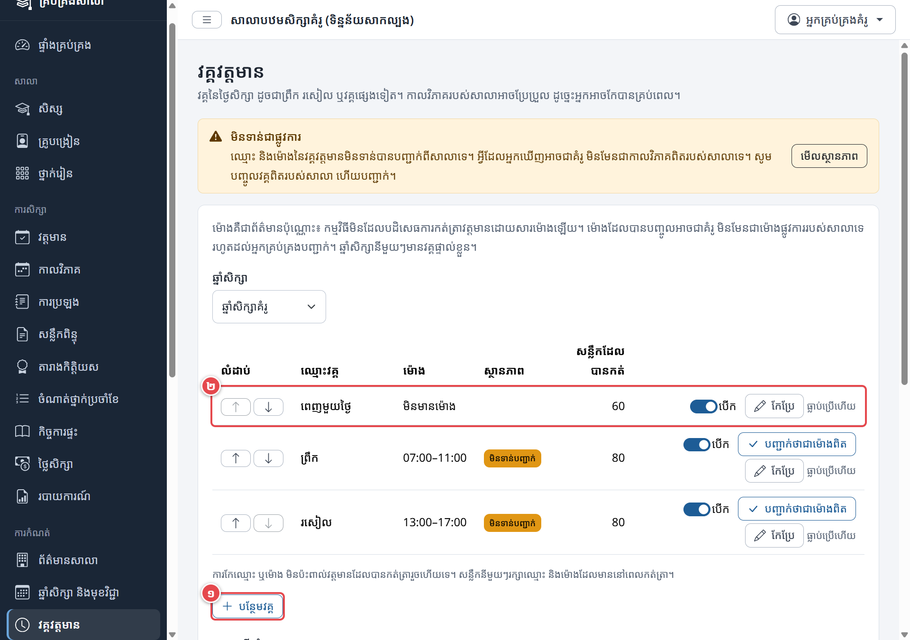

**ជំហានទី១៖** ចុច «ការកំណត់» → «វគ្គវត្តមាន» ហើយជ្រើសឆ្នាំសិក្សា (វគ្គជាកម្មសិទ្ធិរបស់ឆ្នាំសិក្សាមួយៗ)។

**ជំហានទី២៖** ចុច «បន្ថែមវគ្គ»។ បំពេញ៖

- «ឈ្មោះវគ្គ» ចាំបាច់ វែងបំផុត ៥០ តួអក្សរ ហើយមិនត្រូវដូចវគ្គផ្សេងក្នុងឆ្នាំតែមួយ។
- «ម៉ោងចាប់ផ្តើម» និង «ម៉ោងបញ្ចប់» មិនចាំបាច់ ប៉ុន្តែត្រូវបំពេញ**ទាំងពីរ ឬទុកទទេទាំងពីរ**។ វាយជាម៉ោង ២៤ ម៉ោង ដូចជា 07:00 ឬ 13:30។ ម៉ោងបញ្ចប់ត្រូវនៅក្រោយម៉ោងចាប់ផ្តើម។ វគ្គពីរអាចមានម៉ោងត្រួតគ្នាបាន។

**ជំហានទី៣៖** ចុច «រក្សាទុក»។

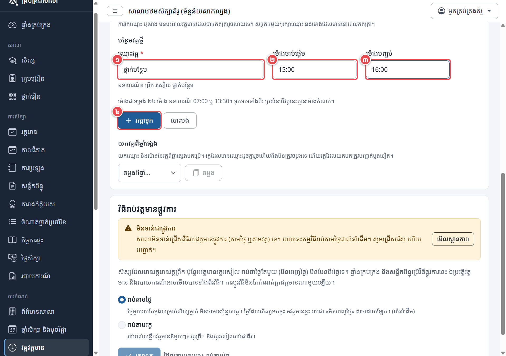

**លទ្ធផល៖** សារ «បានបន្ថែមវគ្គ។» ហើយវគ្គថ្មីបង្ហាញក្នុងតារាង។

**ចំណាំ៖** កម្មវិធីអាចកែ «7:30» ទៅជា «07:30» ដោយខ្លួនឯង។ ប្រសិនបើអ្នកវាយខុស អ្នកឃើញសារ «ម៉ោងមិនត្រឹមត្រូវ (ត្រូវជាទម្រង់ ម៉ោង:នាទី ២៤ ម៉ោង ឧទាហរណ៍ 07:30)» ឬ «ម៉ោងបញ្ចប់ត្រូវនៅក្រោយម៉ោងចាប់ផ្តើម»។

### សកម្មភាពផ្សេងទៀតលើវគ្គ

- **កែ៖** ចុចរូបកែប្រែក្នុងជួរនោះ ហើយរក្សាទុក។ ការកែឈ្មោះ ឬម៉ោង មិនប៉ះពាល់វត្តមានដែលបានកត់ត្រារួចទេ ព្រោះសន្លឹកនីមួយៗរក្សាឈ្មោះ និងម៉ោងដែលមាននៅពេលកត់ត្រា។
- **បិទ/បើក៖** ប្រើប្រអប់បើក/បិទក្នុងជួរ។ វគ្គដែលបានបិទមិនអាចចាប់ផ្តើមសន្លឹកថ្មីបានទេ ប៉ុន្តែសន្លឹកចាស់នៅតែមាន។ **វគ្គដែលបើកចុងក្រោយគេមិនអាចបិទបានទេ** (ត្រូវមានយ៉ាងហោចណាស់មួយបើក)។
- **លំដាប់៖** ប្រើព្រួញឡើងលើ ឬចុះក្រោម។
- **លុប៖** ប៊ូតុង «លុប» បង្ហាញតែវគ្គដែលមិនធ្លាប់មានសន្លឹកវត្តមាន។ វគ្គដែលធ្លាប់ប្រើបង្ហាញពាក្យ «ធ្លាប់ប្រើហើយ» ហើយអាចបិទបានតែប៉ុណ្ណោះ។
- **បញ្ជាក់ម៉ោង៖** វគ្គដែលមានម៉ោង ហើយមិនទាន់បញ្ជាក់ បង្ហាញស្លាកលឿង «មិនទាន់បញ្ជាក់»។ ពេលម៉ោងត្រូវនឹងកាលវិភាគពិតរបស់សាលា សូមចុច «បញ្ជាក់ថាជាម៉ោងពិត»។ ការកែឈ្មោះ ឬម៉ោងក្រោយមក លុបការបញ្ជាក់នោះចោល។
- **យកវគ្គពីឆ្នាំផ្សេង៖** ក្នុងផ្នែក «យកវគ្គពីឆ្នាំផ្សេង» ជ្រើសឆ្នាំ រួចចុច «ចម្លង»។ វគ្គដែលមានឈ្មោះដូចគ្នារួចហើយមិនត្រូវចម្លងទេ ហើយវគ្គដែលចម្លងមកត្រូវបញ្ជាក់ម្តងទៀត។

## ៨.៣ វិធីរាប់វត្តមានផ្លូវការ

វត្តមានអាចរាប់បានពីរតាមវិធី។ ក្នុងកាតខាងក្រោមនៃទំព័រ «វគ្គវត្តមាន» ឈ្មោះ «វិធីរាប់វត្តមានផ្លូវការ» អ្នកជ្រើសវិធីមួយ។

- **«រាប់តាមថ្ងៃ»៖** ថ្ងៃមួយរាប់តែម្តងសម្រាប់សិស្សម្នាក់ ទោះមានប៉ុន្មានវគ្គក៏ដោយ។ សិស្សដែលមកព្រឹក ប៉ុន្តែអវត្តមានរសៀល រាប់ជា «មិនពេញថ្ងៃ» ដាច់ដោយឡែក មិនមែនជាពីរថ្ងៃទេ។ នេះជាវិធីលំនាំដើម។
- **«រាប់តាមវគ្គ»៖** រាប់រាល់សន្លឹកវត្តមាននីមួយៗ។ ព្រឹក និងរសៀលរាប់ជាពីរ។

**គោលបំណង៖** ជ្រើសវិធីរាប់វត្តមានផ្លូវការរបស់សាលា។

**ជំហានទី១៖** ជ្រើសវិធីមួយ។

**ជំហានទី២៖** ចុច «រក្សាទុក»។

**លទ្ធផល៖** សារ «បានរក្សាទុកវិធីរាប់វត្តមានផ្លូវការ។»។

**ចំណាំ៖** ផ្ទាំងគ្រប់គ្រង និងសន្លឹកពិន្ទុប្រើវិធីផ្លូវការនេះ។ ប្រវត្តិវត្តមាន និងរបាយការណ៍អាចមើលបានទាំងពីរវិធី។ ការប្តូរវិធីមិនកែកំណត់ត្រាវត្តមានណាមួយឡើយ។ សារពណ៌លឿងនៅកាតនេះ មានន័យថាសាលាមិនទាន់ជ្រើសវិធីផ្លូវការ ហើយកម្មវិធីរាប់តាមថ្ងៃសិន។ ថ្ងៃដែលមិនមានកំណត់ត្រា មិនត្រូវបានរាប់ជាថ្ងៃសម្រាប់សិស្សនោះទេ។

## ៨.៤ កត់ត្រាវត្តមានប្រចាំថ្ងៃ

**គោលបំណង៖** កត់ត្រាវត្តមានសិស្សក្នុងថ្នាក់មួយ សម្រាប់ថ្ងៃមួយ។

**ជំហានទី១៖** ចុច «ការសិក្សា» → «វត្តមាន»។ ផ្ទាំង «កត់ត្រាវត្តមាន» បើកស្រាប់។ ជ្រើសឆ្នាំសិក្សា និងថ្នាក់។ កម្មវិធីជ្រើសឆ្នាំបច្ចុប្បន្ន និងថ្នាក់ដំបូងស្រាប់។

**ជំហានទី២៖** ពិនិត្យកាលបរិច្ឆេទ។ ក្នុងការកំណត់ដើម វាជាថ្ងៃនេះ។ ប្រសិនបើអ្នកចង់កែវត្តមានថ្ងៃមុន សូមជ្រើសថ្ងៃនោះ។ មិនអាចជ្រើសថ្ងៃអនាគតបានទេ។

**ជំហានទី៣៖** ប្រសិនបើសាលាមានវគ្គច្រើនជាងមួយបើក សូមជ្រើសវគ្គ ដោយចុចប៊ូតុងវគ្គ (សញ្ញាធីក មានន័យថាថ្នាក់នេះបានកត់ត្រាវគ្គនោះរួចហើយក្នុងថ្ងៃនេះ)។ ប្រសិនបើមានវគ្គតែមួយ នឹងមិនមានប៊ូតុងវគ្គទេ។

**ជំហានទី៤៖** ចុច «កំណត់ទាំងអស់ថាមានវត្តមាន» ដើម្បីកំណត់សិស្សទាំងអស់ជា «មានវត្តមាន» ក្នុងពេលតែមួយ។ បន្ទាប់មកចុចស្ថានភាពសម្រាប់សិស្សដែលមិនមក។

ស្ថានភាពមានបួន៖ «មានវត្តមាន» (បៃតង) «អវត្តមាន» (ក្រហម) «មកយឺត» (លឿង) និង «សុំច្បាប់» (ខៀវ)។ ក្នុងជួរនីមួយៗ អ្នកអាចសរសេរ «កំណត់សម្គាល់» (វែងបំផុត ២០០ តួអក្សរ)។ ប្រអប់ «កំណត់ចំណាំសម្រាប់ថ្ងៃនេះ (មិនចាំបាច់)» ខាងក្រោម គឺសម្រាប់ទាំងសន្លឹក។

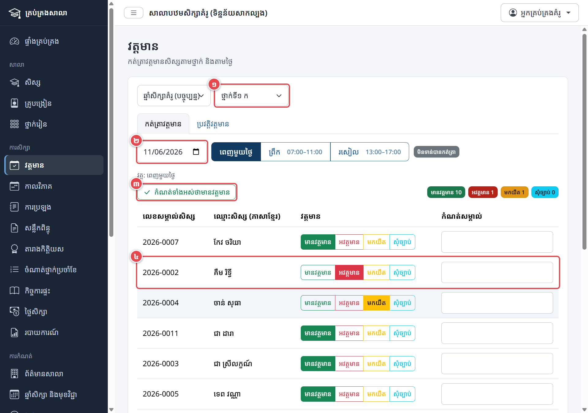

**ជំហានទី៥៖** មើលចំនួនក្នុងស្លាក៖ «មានវត្តមាន» «អវត្តមាន» «មកយឺត» «សុំច្បាប់» និង «មិនទាន់កត់ត្រា … នាក់»។

**ជំហានទី៦៖** ចុច «រក្សាទុក»។

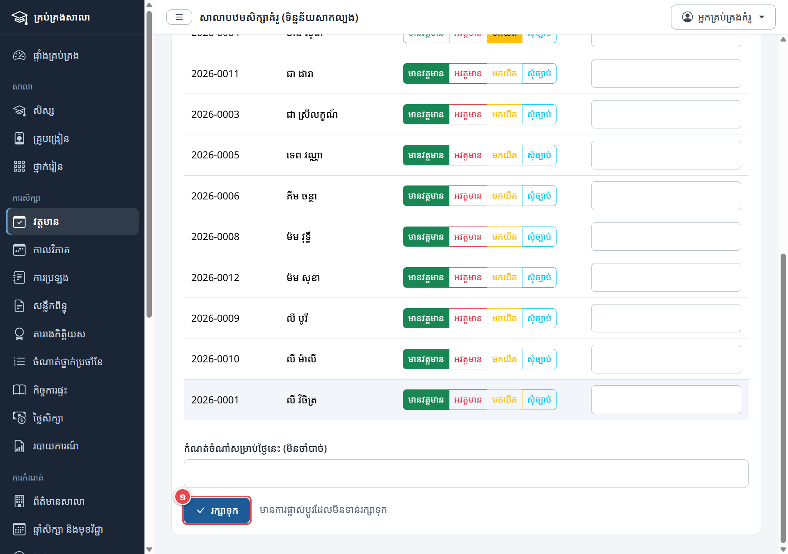

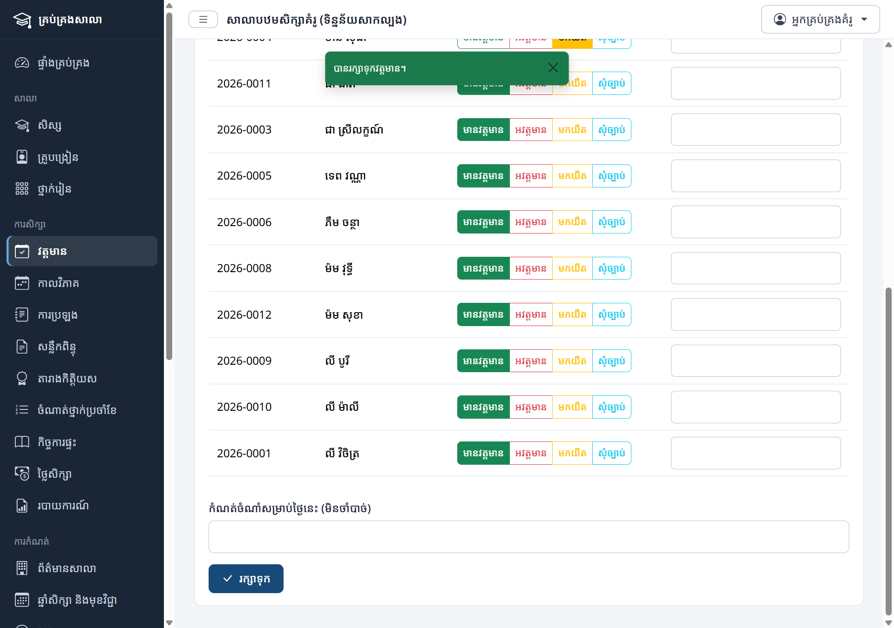

**លទ្ធផល៖** សារ «បានរក្សាទុកវត្តមាន។» ហើយស្លាកនៅខាងលើប្តូរទៅជាពណ៌បៃតង «បានកត់ត្រារួចហើយ»។

**ចំណាំ៖**

- សិស្សដែលអ្នកមិនបានចុចស្ថានភាព **មិនត្រូវបានកត់ត្រា**ទេ (កម្មវិធីមិនព្រមានពេលរក្សាទុកទេ)។ សិស្សនោះគ្មានកំណត់ត្រាសម្រាប់ថ្ងៃនោះ ដូច្នេះថ្ងៃនោះមិនត្រូវបានរាប់សម្រាប់គាត់។ «មិនទាន់កត់ត្រា» មិនស្មើនឹង «អវត្តមាន» ទេ។ ប៊ូតុង «រក្សាទុក» ចុចមិនបានទេ ប្រសិនបើអ្នកមិនទាន់កំណត់សិស្សណាម្នាក់។
- បញ្ជីបង្ហាញសិស្សដែលបានចុះឈ្មោះក្នុងថ្នាក់នៅថ្ងៃនោះ ព្រមទាំងអ្នកណាដែលមានកំណត់ត្រារួចហើយ។
- ប្រសិនបើអ្នកប្តូរថ្នាក់ កាលបរិច្ឆេទ ឬវគ្គ ខណៈមានការជ្រើសរើសមិនទាន់រក្សាទុក កម្មវិធីសួរ «បោះបង់ការផ្លាស់ប្តូរ?»។ ប៊ូតុង «បោះបង់ការផ្លាស់ប្តូរ» បោះចោលអ្វីដែលអ្នកជ្រើស ហើយប៊ូតុង «បោះបង់» ត្រឡប់ទៅថ្នាក់ ថ្ងៃ ឬវគ្គដើមវិញ។
- ក្រៅពីនេះ ប្រសិនបើថ្ងៃដែលអ្នកជ្រើសនៅក្រៅឆ្នាំសិក្សា កម្មវិធីព្រមានលឿងថា អាចកត់ត្រាបាន ប៉ុន្តែមិនត្រូវរាប់ក្នុងសន្លឹកពិន្ទុទេ។
- ក្នុងឆ្នាំសិក្សាដែលបានបិទ គ្រប់ប្រអប់ត្រូវបានចាក់សោ។
- សិស្សម្នាក់អាចមានកំណត់ត្រាតែមួយក្នុងមួយថ្ងៃ និងមួយវគ្គ។ ប្រសិនបើមានស្ទួន (ឧទាហរណ៍ សិស្សបានប្តូរថ្នាក់ ហើយមានកំណត់ត្រាក្នុងថ្នាក់ចាស់) កម្មវិធីព្រមានថា «សិស្សម្នាក់ ឬច្រើននាក់ក្នុងបញ្ជីនេះ មានវត្តមានក្នុងវគ្គនេះនៅថ្ងៃនេះរួចហើយ…»។

### កែសន្លឹកវត្តមានចាស់

ជ្រើសថ្ងៃ (និងវគ្គ) ដែលបានកត់ត្រារួច ប្តូរស្ថានភាព ហើយចុច «រក្សាទុក»។ តម្លៃដើមត្រូវបានរក្សាទុកក្នុង «ប្រវត្តិសកម្មភាព» (ជំពូកទី១៧)។ **មិនមានវិធីលុបសន្លឹក ឬដកស្ថានភាពរបស់សិស្សម្នាក់ចេញបានទេ** មានតែផ្លាស់ប្តូរបាន។

### ចម្លងពីវគ្គមួយទៅវគ្គមួយទៀត

ប្រសិនបើសន្លឹកនេះមិនទាន់ត្រូវបានកត់ត្រា ហើយថ្នាក់មានសន្លឹកក្នុងវគ្គផ្សេងនៅថ្ងៃដដែល ប្រអប់ «ចម្លងពីវគ្គ…» ជួយបំពេញស្ថានភាពជាមុន។ ចុច «ចម្លង» រួចត្រួតពិនិត្យ ហើយ «រក្សាទុក»។ ការចម្លងមិនរក្សាទុកអ្វីឡើយ។

## ៨.៥ មើលប្រវត្តិ និងព្រីន

ចុចផ្ទាំង «ប្រវត្តិវត្តមាន»។ ជ្រើសកាលបរិច្ឆេទ «ចាប់ពី» និង «ដល់» (លំនាំដើម គឺថ្ងៃទី១ នៃខែ ដល់ថ្ងៃនេះ) និងជ្រើសវិធី «រាប់តាមថ្ងៃ» ឬ «រាប់តាមវគ្គ»។ តារាងទីមួយសង្ខេបតាមសិស្ស ហើយតារាងទីពីរបង្ហាញតាមថ្ងៃ។ ក្នុងវិធី «រាប់តាមថ្ងៃ» មានជួរ «មិនពេញថ្ងៃ»។

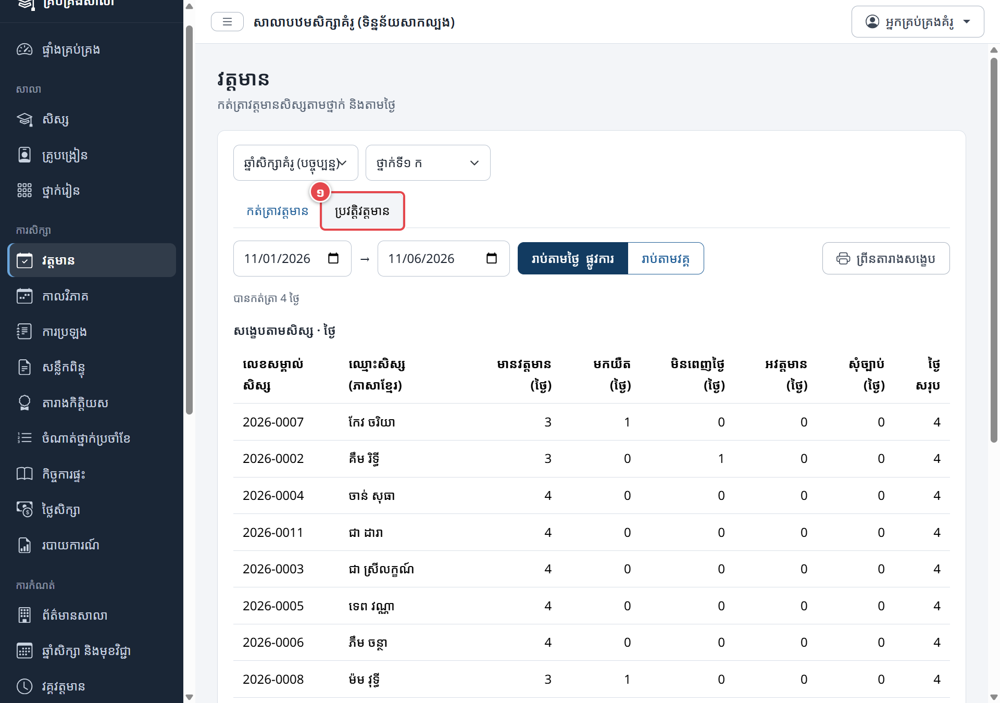

ចុច «ព្រីនតារាងសង្ខេប» ដើម្បីបើកសន្លឹក A4 (ក្បាលសាលា ឈ្មោះថ្នាក់ ចន្លោះកាលបរិច្ឆេទ តារាង និងបន្ទាត់ចុះហត្ថលេខា «គ្រូប្រចាំថ្នាក់»)។ ប្រើ «ព្រីន» ឬ «រក្សាទុកជា PDF»។

**ចំណាំ៖** ផ្ទាំងប្រវត្តិមិនមានប៊ូតុង Excel ទេ។ ឯកសារ Excel របស់វត្តមានមាននៅទំព័រ «របាយការណ៍» ក្រោម «សង្ខេបវត្តមាន» (ជំពូកទី១៤)។ សិស្សម្នាក់ៗក៏មានកាត «វត្តមាន» ក្នុងទំព័ររបស់គាត់ (ជំពូកទី៧)។

## ៨.៦ អ្វីដែលមិនទាន់មាន

- ប៊ូតុង អវត្តមានទាំងអស់ ឬគ្រាប់ចុចរហ័សលើក្តារចុច
- ការលុបសន្លឹកវត្តមាន ឬការដកស្ថានភាពរបស់សិស្សម្នាក់ (មានតែប្តូរបាន)
- ប៊ូតុង Excel នៅផ្ទាំង «ប្រវត្តិវត្តមាន»
- ការភ្ជាប់វត្តមានទៅនឹងកាលវិភាគមេរៀន (ពីរមិនពាក់ព័ន្ធគ្នាទេ)

# ជំពូកទី៩៖ ការរៀបចំកាលវិភាគសិក្សា

កាលវិភាគប្រចាំសប្តាហ៍បង្ហាញថា ថ្នាក់ណាមួយរៀនមុខវិជ្ជាអ្វី ជាមួយគ្រូណា ក្នុងម៉ោងណា នៃថ្ងៃណា។ កម្មវិធីមានទិដ្ឋភាពបី គឺកាលវិភាគរបស់ថ្នាក់ កាលវិភាគរបស់គ្រូ និងកាលវិភាគរបស់សិស្ស។

**ចំណុចសំខាន់៖ កម្មវិធី**មិនបំពេញ**ថ្ងៃ ឬម៉ោងឱ្យអ្នកទេ។** សាលាត្រូវវាយដោយខ្លួនឯងតាមកាលវិភាគពិតរបស់សាលា។ ម៉ោងនីមួយៗក្នុងរូបភាពនៃជំពូកនេះ (ដូចជា «ម៉ោងទី១» 07:00–07:45) ជាឧទាហរណ៍ដែលបានវាយសម្រាប់ថតរូប មិនមែនកាលវិភាគពិតទេ។ ក្នុងទំព័រការកំណត់ អ្នកនឹងឃើញសារពណ៌លឿង «មិនទាន់ជាផ្លូវការ» រហូតដល់អ្នកគ្រប់គ្រងបញ្ជាក់នៅ «អំពីប្រព័ន្ធ» (ជំពូកទី១៧)។

## ៩.១ កំណត់ថ្ងៃសិក្សា និងម៉ោងសិក្សា

ទំព័រនៅ «ការកំណត់» → «ម៉ោងកាលវិភាគ»។ ជ្រើសឆ្នាំសិក្សា (ម៉ោងជាកម្មសិទ្ធិរបស់ឆ្នាំសិក្សាមួយៗ)។

### ថ្ងៃសិក្សា

នៅផ្នែក «ថ្ងៃសិក្សា» មានប្រអប់ធីក ៧ គឺ ច័ន្ទ អង្គារ ពុធ ព្រហស្បតិ៍ សុក្រ សៅរ៍ អាទិត្យ។ ប្រសិនបើអ្នកមិនទាន់រក្សាទុក កម្មវិធីប្រើថ្ងៃច័ន្ទដល់សុក្រជាជម្រើសចាប់ផ្តើម (ដែលមិនទាន់ត្រូវបានរក្សាទុក)។ ដើម្បីរក្សាទុក សូមប្តូរប្រអប់ណាមួយ (ត្រូវមានយ៉ាងតិចមួយថ្ងៃ) រួចចុច «រក្សាទុកថ្ងៃសិក្សា»។ សារ «បានរក្សាទុកថ្ងៃសិក្សា»។ ការដកថ្ងៃដែលមានមេរៀនមិនអាចធ្វើបានទេ ហើយកម្មវិធីថា «មិនអាចដកថ្ងៃនេះចេញបានទេ ព្រោះមានមេរៀនក្នុងថ្ងៃនេះ។ សូមដកមេរៀនចេញជាមុន។»។

### ម៉ោងសិក្សា

ពេលមិនទាន់មានម៉ោងសោះ អ្នកឃើញប្រអប់ខៀវ «មិនទាន់មានម៉ោងសិក្សាទេ» ដែលប្រាប់ថាសាលាមិនទាន់បញ្ចូលម៉ោង ហើយកម្មវិធីមិនបំពេញដោយខ្លួនឯងឡើយ។ នេះជាស្ថានភាពធម្មតា មិនមែនជាកំហុសទេ។

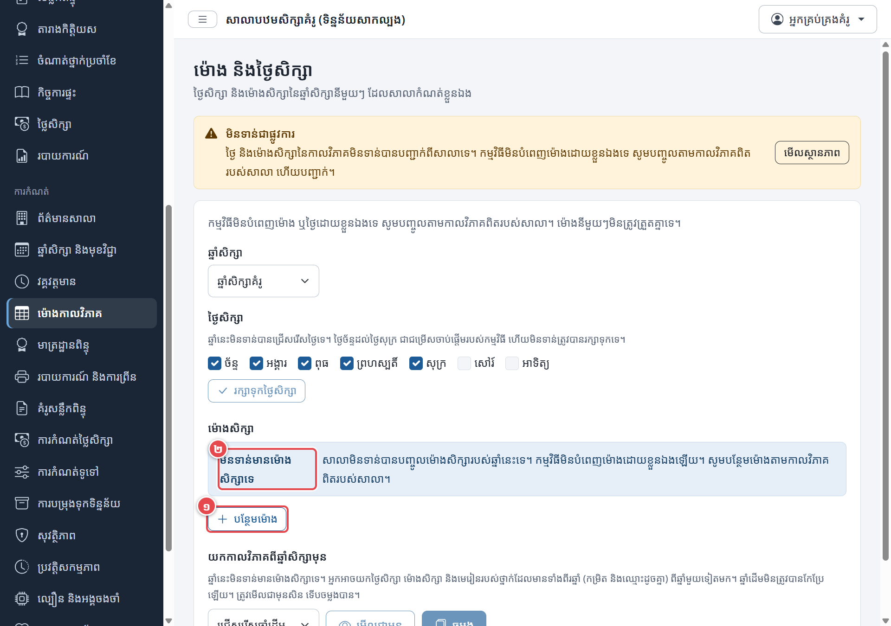

**គោលបំណង៖** បន្ថែមម៉ោងសិក្សា ឬម៉ោងសម្រាកមួយ។

**ជំហានទី១៖** ចុច «បន្ថែមម៉ោង»។

**ជំហានទី២៖** បំពេញ៖

- «ឈ្មោះម៉ោង» ចាំបាច់ វែងបំផុត ៥០ តួអក្សរ មិនត្រូវដូចម៉ោងផ្សេងក្នុងឆ្នាំតែមួយ (សាលាប្រើឈ្មោះអ្វីក៏បាន ឧទាហរណ៍ ម៉ោងទី១ ឬ ម៉ោងសម្រាក)
- «ម៉ោងចាប់ផ្តើម» និង «ម៉ោងបញ្ចប់» ចាំបាច់ទាំងពីរ ជាទម្រង់ ២៤ ម៉ោង
- ប្រអប់ធីក «នេះជាម៉ោងសម្រាក (មិនមានមេរៀនទេ)» ប្រសិនបើជាម៉ោងសម្រាក

**ជំហានទី៣៖** ចុច «រក្សាទុក»។

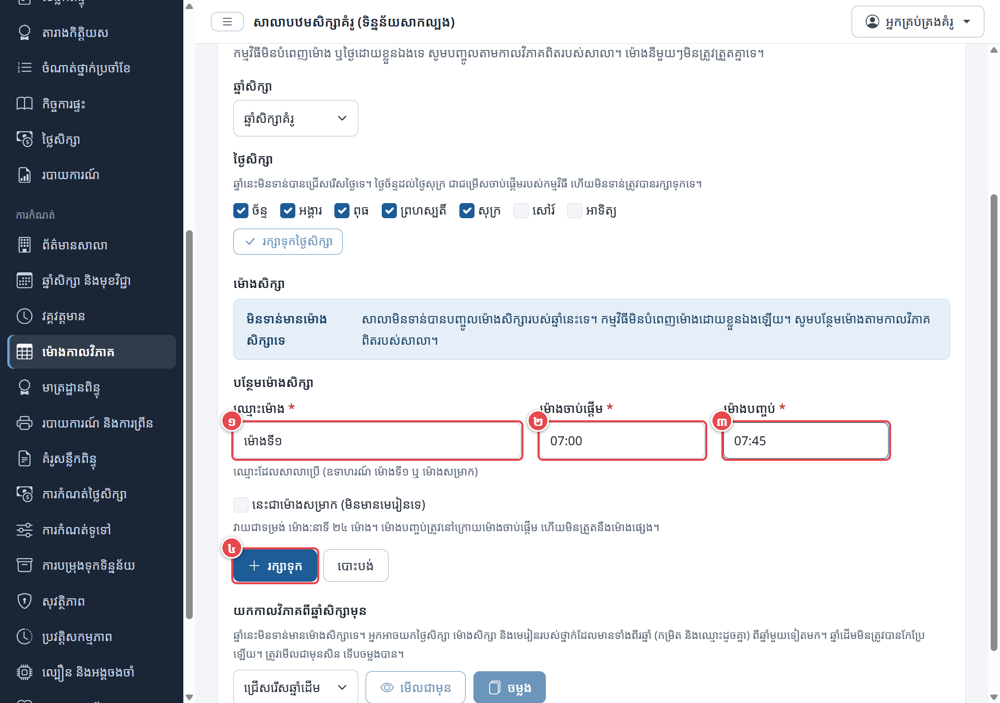

**លទ្ធផល៖** សារ «បានបន្ថែមម៉ោងសិក្សា» ហើយម៉ោងបង្ហាញក្នុងតារាង តាមលំដាប់ម៉ោងចាប់ផ្តើម (មិនមានប៊ូតុងរៀបលំដាប់ទេ)។

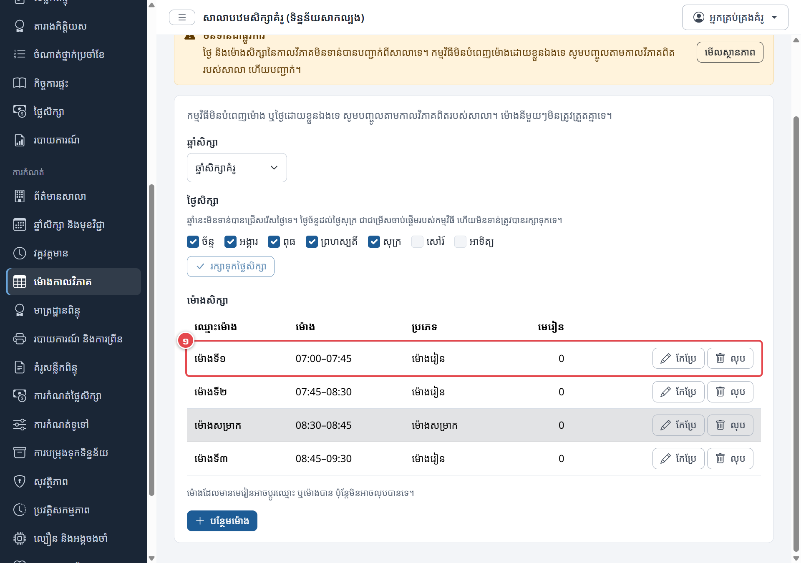

**ចំណាំ៖**

- ម៉ោងពីរមិនអាចត្រួតគ្នាបានទេ (ម៉ោងសម្រាកក៏រាប់ដែរ) ហើយកម្មវិធីថា «ម៉ោងនេះត្រួតនឹងម៉ោងផ្សេងរបស់ឆ្នាំនេះ»។ ម៉ោងដែលបញ្ចប់ពេលម៉ោងមួយទៀតចាប់ផ្តើម (ឧទាហរណ៍ 07:45 ដូចគ្នា) មិនរាប់ជាត្រួតទេ។
- ម៉ោងដែលមានមេរៀនអាចកែឈ្មោះ ឬម៉ោងបាន ប៉ុន្តែ**មិនអាចលុប** ឬប្តូរទៅជាម៉ោងសម្រាកបានទេ។ ជួរនោះបង្ហាញ «មានមេរៀន» ជំនួសប៊ូតុង «លុប»។
- ម៉ោងសម្រាកមិនអាចមានមេរៀនបានទេ។
- ប្រសិនបើឆ្នាំសិក្សាបានបិទ ទំព័រនេះអាចមើលបានប៉ុណ្ណោះ។

### យកកាលវិភាគពីឆ្នាំមុន

ក្នុងឆ្នាំសិក្សាថ្មីដែលមិនទាន់មានម៉ោងសិក្សា ផ្នែក «យកកាលវិភាគពីឆ្នាំសិក្សាមុន» បង្ហាញ។ ជ្រើស «ជ្រើសរើសឆ្នាំដើម» ហើយចុច «មើលជាមុន» (ដែលមិនប្តូរអ្វីទាំងអស់) ដើម្បីឃើញថាមេរៀនណាត្រូវចម្លង និងមេរៀនណាត្រូវរំលងព្រមទាំងមូលហេតុ។ បន្ទាប់មកចុច «ចម្លង»។ កម្មវិធីចម្លងថ្ងៃ ម៉ោង និងមេរៀនរបស់ថ្នាក់ដែលមានទាំងពីរឆ្នាំ (កម្រិត និងឈ្មោះដូចគ្នា)។ ឆ្នាំដើមមិនត្រូវបានកែទេ។ ចម្លងបានតែក្នុងឆ្នាំដែលមិនទាន់មានម៉ោង ឬមេរៀនសោះ។

## ៩.២ រៀបចំកាលវិភាគរបស់ថ្នាក់

ទំព័រ «កាលវិភាគ» នៅ «ការសិក្សា» → «កាលវិភាគ»។ វាមានផ្ទាំងពីរ គឺ «តាមថ្នាក់» (កែបាន) និង «តាមគ្រូ» (មើលបានប៉ុណ្ណោះ)។

**គោលបំណង៖** ដាក់មេរៀនក្នុងប្រអប់មួយនៃកាលវិភាគថ្នាក់។

**ជំហានទី១៖** ជ្រើសឆ្នាំសិក្សា និងថ្នាក់ក្នុងផ្ទាំង «តាមថ្នាក់»។ តារាងមានជួរឈរជាថ្ងៃសិក្សា និងជួរដេកជាម៉ោងសិក្សា។ ម៉ោងសម្រាកជាបន្ទាត់ពណ៌ប្រផេះពេញទទឹង។

**ជំហានទី២៖** ចុចសញ្ញា + នៅប្រអប់ទទេមួយ។

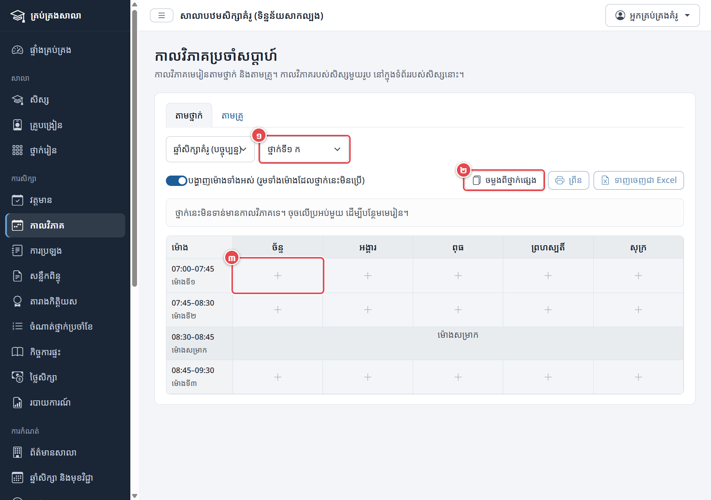

**ជំហានទី៣៖** ក្នុងប្រអប់ដែលលេចឡើង ជ្រើស «មុខវិជ្ជា» (មានតែមុខវិជ្ជាចម្បងដែលថ្នាក់ទីនោះរៀន) ហើយជ្រើស «គ្រូ»។ ពេលជ្រើសមុខវិជ្ជា កម្មវិធីជ្រើសគ្រូប្រចាំមុខវិជ្ជានៃថ្នាក់នោះស្រាប់ ហើយអ្នកអាចប្តូរបាន។ ក្នុងការកំណត់ដើម បញ្ជីគ្រូបង្ហាញតែគ្រូដែលត្រូវបានកំណត់ឱ្យថ្នាក់នេះ។ បើចង់ឃើញគ្រូទាំងអស់ សូមបើក «បង្ហាញគ្រូដែលកំពុងបង្រៀនទាំងអស់»។

**ជំហានទី៤៖** ចុច «រក្សាទុក»។

**លទ្ធផល៖** សារ «បានរក្សាទុកមេរៀន» ហើយប្រអប់បង្ហាញមុខវិជ្ជា និងគ្រូ។

**ចំណាំ៖**

- **ត្រូវមានទាំងមុខវិជ្ជា និងគ្រូ**។ ប៊ូតុង «រក្សាទុក» ចុចមិនបានរហូតដល់ជ្រើសទាំងពីរ ហើយកម្មវិធីបង្ហាញ «ត្រូវជ្រើសរើសទាំងមុខវិជ្ជា និងគ្រូ ទើបអាចរក្សាទុកបាន។»។
- **គ្រូមិនអាចនៅពីរថ្នាក់ក្នុងពេលតែមួយបានទេ**។ ប្រសិនបើគ្រូមានមេរៀននៅថ្នាក់ផ្សេងរួចហើយ ក្នុងថ្ងៃ និងម៉ោងនោះ កម្មវិធីបដិសេធ ហើយបង្ហាញឈ្មោះថ្នាក់នោះ ដូចជា «គ្រូនេះមានមេរៀននៅថ្នាក់ … រួចហើយ ថ្ងៃ… …។»។
- មេរៀនរក្សាគ្រូរបស់ខ្លួន។ ប្រសិនបើអ្នកប្តូរគ្រូប្រចាំមុខវិជ្ជានៅទំព័រថ្នាក់ក្រោយមក កាលវិភាគដែលបានរៀបរួចមិនត្រូវបានកែទេ។ ប្រសិនបើគ្រូនោះបានឈប់បង្រៀន មេរៀននោះបង្ហាញស្លាកលឿង «គ្រូឈប់បង្រៀន»។
- **ប្តូរមេរៀន៖** ចុចលើប្រអប់ដែលមានមេរៀន ជ្រើសមុខវិជ្ជា ឬគ្រូផ្សេង ហើយចុច «រក្សាទុក»។ **ដកមេរៀនចេញ៖** ចុចប្រអប់នោះ ហើយចុច «ដកមេរៀនចេញ» (មិនសួរបញ្ជាក់ទេ ហើយសារ «បានដកមេរៀនចេញ»)។ «បោះបង់» បិទប្រអប់ ដោយមិនកែអ្វី។
- នៅឆ្នាំសិក្សាដែលបានបិទ អ្នកអាចមើលបានប៉ុណ្ណោះ ហើយគ្មានប្រអប់ណាចុចបានទេ។
- ប្រសិនបើថ្នាក់មិនមានមុខវិជ្ជា កម្មវិធីប្រាប់ឱ្យកំណត់មុខវិជ្ជារបស់ថ្នាក់ទីនោះនៅ «ឆ្នាំសិក្សា និងមុខវិជ្ជា»។

### ចម្លងកាលវិភាគពីថ្នាក់មួយទៅថ្នាក់មួយទៀត

**គោលបំណង៖** ចម្លងកាលវិភាគមេរៀនពីថ្នាក់មួយទៅថ្នាក់មួយទៀត ក្នុងថ្នាក់ទី និងឆ្នាំដូចគ្នា។

**ជំហានទី១៖** ចុច «ចម្លងពីថ្នាក់ផ្សេង»។ ជ្រើស «ចម្លងពីថ្នាក់» (មានតែថ្នាក់ក្នុងថ្នាក់ទី និងឆ្នាំដូចគ្នា)។ ប្រសិនបើចង់ជំនួសមេរៀនដែលមានស្រាប់ សូមធីកប្រអប់ជំនួស បើមិនដូច្នេះទេ កម្មវិធីបំពេញតែប្រអប់ទទេ។

**ជំហានទី២៖** ចុច «មើលជាមុន»។ កម្មវិធីបង្ហាញមេរៀនដែលនឹងចម្លង និងមេរៀនដែលនឹងរំលងជាមួយមូលហេតុ ឧទាហរណ៍ «គ្រូមានមេរៀននៅថ្នាក់ … រួចហើយក្នុងម៉ោងនេះ» ឬ «ថ្នាក់នេះមិនទាន់មានគ្រូប្រចាំមុខវិជ្ជានេះ»។

**ជំហានទី៣៖** ចុច «ចម្លង»។

**លទ្ធផល៖** សារ «បានចម្លងកាលវិភាគ» ហើយកាលវិភាគថ្នាក់នេះមានមេរៀនថ្មី។

**ចំណាំ៖** គ្រូនៃមេរៀនដែលបានចម្លង គឺជាគ្រូប្រចាំមុខវិជ្ជារបស់ថ្នាក់នេះ មិនមែនគ្រូរបស់ថ្នាក់ដើមទេ។ ប៊ូតុង «ចម្លង» ចុចបានតែក្រោយ «មើលជាមុន»។

## ៩.៣ កាលវិភាគរបស់គ្រូ និងរបស់សិស្ស

- **កាលវិភាគគ្រូ៖** ក្នុងផ្ទាំង «តាមគ្រូ» ជ្រើសគ្រូ។ អ្នកឃើញកាលវិភាគមួយសប្តាហ៍ និងចំនួនមេរៀន។ ប្រសិនបើគ្រូមិនទាន់មានមេរៀន កម្មវិធីប្រាប់ថា «គ្រូនេះមិនទាន់មានមេរៀនក្នុងឆ្នាំនេះទេ។»។
- **កាលវិភាគសិស្ស៖** នៅទំព័ររបស់សិស្ស កាត «កាលវិភាគ» បង្ហាញកាលវិភាគរបស់ថ្នាក់បច្ចុប្បន្នរបស់សិស្ស។ មើលបានតែប៉ុណ្ណោះ។

## ៩.៤ ព្រីន និងនាំចេញជា Excel

នៅផ្ទាំងថ្នាក់ និងផ្ទាំងគ្រូ មានប៊ូតុង «ព្រីន» និង «ទាញចេញជា Excel»។ ប៊ូតុង «ព្រីន» បើកទំព័រ A4។ ក្នុងការកំណត់ដើម វាជាទម្រង់បញ្ឈរ។ ប្រើប្រអប់ «បោះពុម្ពតាមទទឹង (A4 ផ្តេក)» ដើម្បីព្រីនតាមទទឹង។ ជួរដែលព្រីនមានតែម៉ោងដែលមានមេរៀន និងម៉ោងសម្រាកនៅចន្លោះ។ ចុច «ថយក្រោយ» ដើម្បីត្រឡប់មកទំព័រកាលវិភាគវិញ។

## ៩.៥ អ្វីដែលមិនទាន់មាន

- កាលវិភាគជាក់ស្តែងរបស់សាលា មិនមាននៅក្នុងកម្មវិធីទេ អ្នកត្រូវវាយខ្លួនឯង
- ការអូសទម្លាក់មេរៀន ឬការរៀបលំដាប់ម៉ោងដោយដៃ
- មេរៀនដែលគ្មានមុខវិជ្ជា ឬគ្មានគ្រូ
- ការសួរបញ្ជាក់ពេលដកមេរៀន
- ផ្នែក មេរៀនថ្ងៃនេះ ក្នុងផ្ទាំងគ្រប់គ្រង

# ជំពូកទី១០៖ ការគ្រប់គ្រងការប្រឡង និងការបញ្ចូលពិន្ទុ

ទំព័រការប្រឡងនៅ «ការសិក្សា» → «ការប្រឡង»។ អ្នកបង្កើតការប្រឡងមួយ (ឧទាហរណ៍ ប្រឡងប្រចាំខែ) កំណត់ពិន្ទុអតិបរមានៃមុខវិជ្ជា បញ្ចូលពិន្ទុសិស្ស ហើយមើលលទ្ធផលជាមួយចំណាត់ថ្នាក់។ មាត្រដ្ឋានពិន្ទុ (និទ្ទេស និងពិន្ទុជាប់) នៅ «ការកំណត់» → «មាត្រដ្ឋានពិន្ទុ»។

**សំខាន់៖ ច្បាប់ពិន្ទុពិតរបស់សាលាមិនទាន់ស្គាល់ទេ។** ពិន្ទុអតិបរមាលំនាំដើម (១០០) មេគុណលំនាំដើម (១) និងនិទ្ទេសក្នុងមាត្រដ្ឋានលំនាំដើម (A ដល់ F ជាមួយពិន្ទុជាប់ ៥០%) ជាតម្លៃបណ្តោះអាសន្ន **មិនមែនជាច្បាប់ផ្លូវការរបស់សាលាទេ**។ កម្មវិធីបង្ហាញសារពណ៌លឿង «មិនទាន់ជាផ្លូវការ» រហូតដល់អ្នកគ្រប់គ្រងបញ្ជាក់។ សូមកំណត់តម្លៃទាំងនេះតាមច្បាប់ពិតរបស់សាលា មុនបញ្ចូលពិន្ទុ។

## ១០.១ បង្កើតការប្រឡង

**គោលបំណង៖** បង្កើតការប្រឡងថ្មីក្នុងឆ្នាំសិក្សាមួយ។

**ជំហានទី១៖** ជ្រើសឆ្នាំសិក្សា (ក្នុងការកំណត់ដើម គឺឆ្នាំបច្ចុប្បន្ន) ហើយចុច «បន្ថែមការប្រឡង»។

**ជំហានទី២៖** បំពេញ៖

- «ឈ្មោះការប្រឡង» ចាំបាច់ វែងបំផុត ១០០ តួអក្សរ មិនត្រូវដូចការប្រឡងផ្សេងក្នុងឆ្នាំតែមួយ
- «ប្រភេទ» ចាំបាច់ «ប្រចាំខែ» «កណ្តាលឆមាស» «ចុងឆមាស» ឬ «ផ្សេងៗ» (លំនាំដើម «ប្រចាំខែ»)
- «លេខរៀង (ខែ ឬឆមាស)» មិនចាំបាច់ ជាលេខគត់ពី ១ ដល់ ១២
- «ថ្ងៃចាប់ផ្តើម» និង «ថ្ងៃបញ្ចប់» មិនចាំបាច់

**ជំហានទី៣៖** ចុច «រក្សាទុក»។

**លទ្ធផល៖** សារ «បានបន្ថែមការប្រឡង។»។ ការប្រឡងថ្មីមានមុខវិជ្ជាចម្បងសកម្មទាំងអស់ នៃថ្នាក់ទីទាំងអស់ ដោយស្វ័យប្រវត្តិ ជាមួយពិន្ទុអតិបរមា ១០០ និងមេគុណ ១ ព្រមទាំងផ្នែករងនៃមុខវិជ្ជានីមួយៗ (ផ្នែករងក៏ ១០០ ដែរ)។ ទាំងនេះជាតម្លៃបណ្តោះអាសន្ន។

**ចំណាំ៖** ឆ្នាំសិក្សាត្រូវតែបើក។ ប្រសិនបើឆ្នាំបានបិទ ប៊ូតុង «បន្ថែមការប្រឡង» ចុចមិនបាន។ ការប្រឡងរក្សាឈ្មោះ និងលំដាប់មុខវិជ្ជារបស់ខ្លួន ដូច្នេះការប្តូរឈ្មោះ ឬការបិទមុខវិជ្ជានៅពេលក្រោយ មិនប៉ះពាល់ការប្រឡងចាស់ទេ។

ចុចលើឈ្មោះការប្រឡងក្នុងបញ្ជី ដើម្បីបើកវា។ ទំព័រនេះមានប៊ូតុង «ថយក្រោយ» «សន្លឹកពិន្ទុ» «កែប្រែ» «លុប» និងផ្ទាំងបី គឺ «បញ្ចូលពិន្ទុ» «លទ្ធផល» និង «មុខវិជ្ជា និងពិន្ទុអតិបរមា»។ ប៊ូតុង «កែប្រែ» និង «លុប» មិនបង្ហាញក្នុងឆ្នាំដែលបានបិទ។

## ១០.២ កំណត់ពិន្ទុអតិបរមា មុនពិន្ទុដំបូង

ចុចផ្ទាំង «មុខវិជ្ជា និងពិន្ទុអតិបរមា»។

**គោលបំណង៖** កំណត់ពិន្ទុអតិបរមា និងមេគុណនៃមុខវិជ្ជានីមួយៗ តាមច្បាប់របស់សាលា មុនពិន្ទុដំបូងត្រូវបានបញ្ចូល។

**ជំហានទី១៖** ជ្រើសថ្នាក់ទី។ តារាងបង្ហាញមុខវិជ្ជារបស់ថ្នាក់ទីនោះជាមួយ «ពិន្ទុអតិបរមា» និង «មេគុណ»។

**ជំហានទី២៖** កែតម្លៃតាមច្បាប់ពិតរបស់សាលា (ជាលេខវិជ្ជមាន ទសភាគមិនលើស ២ ខ្ទង់) ហើយចុច «រក្សាទុក» ក្នុងជួរនោះ។ សារ «បានរក្សាទុកមុខវិជ្ជា។»។

**ជំហានទី៣៖** ប្រសិនបើត្រូវ អ្នកអាច «ដកមុខវិជ្ជាចេញ» ឬ «បន្ថែមមុខវិជ្ជា» ឬ «បន្ថែមផ្នែករង»។ មេគុណធំជាងមានឥទ្ធិពលលើភាគរយសរុបច្រើនជាង។

**លទ្ធផល៖** សារ «បានរក្សាទុកមុខវិជ្ជា។» ហើយតារាងបង្ហាញតម្លៃថ្មី។

**ចំណាំ៖**

- មុខវិជ្ជាចម្បងដែលមានផ្នែករង ពិន្ទុអតិបរមារបស់វាជាផលបូកនៃផ្នែករង ហើយអ្នកកែនៅបន្ទាត់ផ្នែករង។ ក្នុងកំណែដំបូង ផ្នែករងមានពិន្ទុអតិបរមា ១០០ ជាតម្លៃបណ្តោះអាសន្ន ហើយកម្មវិធីព្រមានលឿងឱ្យកំណត់តម្លៃពិតមុនពិន្ទុដំបូង។
- **ពេលពិន្ទុដំបូងត្រូវបានបញ្ចូល (ពិន្ទុរបស់សិស្សណាម្នាក់ ឬអវត្តមានណាមួយ) រចនាសម្ព័ន្ធត្រូវបានចាក់សោ។** អ្នកមិនអាចបន្ថែម ឬដកមុខវិជ្ជា និងផ្នែករងទៀតបានទេ ហើយប្រអប់ខៀវប្រាប់ថា «មានពិន្ទុបានបញ្ចូលរួចហើយ ដូច្នេះរចនាសម្ព័ន្ធមុខវិជ្ជា … ត្រូវបានចាក់សោ …»។ អ្នកនៅតែអាចកែពិន្ទុអតិបរមា និងមេគុណបាន ប៉ុន្តែមិនឱ្យទាបជាងពិន្ទុដែលបានបញ្ចូលរួចហើយ។ ការប្តូរបញ្ជីមុខវិជ្ជានៅពេលក្រោយមិនប៉ះពាល់ការប្រឡងនេះទេ។
- ជាមួយពិន្ទុដំបូង ការប្រឡងក៏ចងភ្ជាប់នឹងមាត្រដ្ឋានពិន្ទុដែលជាលំនាំដើមនៅពេលនោះ ហើយវាមិនប្តូរតទៅទៀតទេ (សូមមើល ១០.៥)។

## ១០.៣ បញ្ចូលពិន្ទុ

**គោលបំណង៖** បញ្ចូលពិន្ទុនៃមុខវិជ្ជាមួយ សម្រាប់សិស្សទាំងថ្នាក់។

**ជំហានទី១៖** បើកការប្រឡង ហើយជ្រើសផ្ទាំង «បញ្ចូលពិន្ទុ»។ ជ្រើសថ្នាក់ និងមុខវិជ្ជាពីប្រអប់ពីរ។ មុខវិជ្ជាចម្បងដែលមានផ្នែករង មិនបង្ហាញខ្លួនវាទេ គឺអ្នកត្រូវបញ្ចូលពិន្ទុនៅផ្នែករងនីមួយៗ ដែលបង្ហាញជាក្រុមក្រោមឈ្មោះមុខវិជ្ជាចម្បង។

**ជំហានទី២៖** ក្នុងតារាង វាយពិន្ទុរបស់សិស្សម្នាក់ៗក្នុងប្រអប់ «ពិន្ទុ»។ ចុច Enter ដើម្បីទៅប្រអប់ពិន្ទុបន្ទាប់ខាងក្រោម។ Enter មិនរក្សាទុកទេ។

**ជំហានទី៣៖** សម្រាប់សិស្សដែលមិនបានប្រឡង ធីក «អវត្តមាន»។ ប្រអប់ពិន្ទុនឹងរលាយ ហើយសិស្សនោះរាប់ជា ០ ក្នុងពិន្ទុសរុប។

**ជំហានទី៤៖** ចុច «រក្សាទុក»។

**លទ្ធផល៖** សារ «បានរក្សាទុកពិន្ទុ។»។

**ចំណាំ៖**

- **ប្រអប់ទទេ មានន័យថា មិនទាន់បញ្ចូល មិនមែនសូន្យទេ។** សូន្យពិតត្រូវវាយ «0»។ កម្មវិធីបង្ហាញសារថា ទុកប្រអប់ទទេប្រសិនបើមិនទាន់បានបញ្ចូល (មិនមែនសូន្យទេ) ហើយសិស្សអវត្តមានត្រូវគិតជា 0 ក្នុងពិន្ទុសរុប។
- ពិន្ទុអាចមានទសភាគរហូតដល់ ២ ខ្ទង់ (ឧទាហរណ៍ 8.5)។ ទាំងសញ្ញាចុច និងសញ្ញាក្បៀស ទទួលយកបាន ហើយលេខខ្មែរក៏ទទួលយកដែរ។ ពិន្ទុលើសពិន្ទុអតិបរមា ឬមិនមែនជាលេខ ត្រូវសារក្រហម «តម្លៃនៅក្រៅដែនកំណត់» ឬ «សូមបញ្ចូលលេខឱ្យបានត្រឹមត្រូវ» ហើយ «រក្សាទុក» ចុចមិនបាន។
- កំពុងមានការផ្លាស់ប្តូរមិនទាន់រក្សាទុក ប្រអប់ថ្នាក់ និងមុខវិជ្ជាត្រូវចាក់សោ។ ចុច «បោះបង់ការផ្លាស់ប្តូរ» ដើម្បីផ្ទុកឡើងវិញ។ **កម្មវិធីមិនសួរពេលអ្នកចាកចេញពីទំព័រនេះតាមម៉ឺនុយទេ** ដូច្នេះសូមរក្សាទុកមុនចាកចេញ។
- ការកែពិន្ទុដែលបានរក្សាទុកហើយ គឺជា «ការកែ» ហើយតម្លៃដើមត្រូវបានរក្សាទុកក្នុង «ប្រវត្តិសកម្មភាព»។ ការសម្អាតប្រអប់វិញ ធ្វើឱ្យវាត្រឡប់ជា មិនទាន់បញ្ចូល។
- ពិន្ទុរបស់ផ្នែករងត្រូវបានបញ្ចូលដោយឡែក ហើយមុខវិជ្ជាចម្បងគិតពិន្ទុជាផលបូកនៃផ្នែករង។ ផ្នែករងដែលអវត្តមានរាប់ជា ០ ហើយផ្នែករងដែលមិនទាន់បញ្ចូល ធ្វើឱ្យមុខវិជ្ជាចម្បងមិនទាន់គ្រប់។
- ក្នុងឆ្នាំដែលបានបិទ ប្រអប់ទាំងអស់ត្រូវបានចាក់សោ។

## ១០.៤ មើលលទ្ធផល

ចុចផ្ទាំង «លទ្ធផល» ហើយជ្រើសថ្នាក់។ កម្មវិធីបង្ហាញមាត្រដ្ឋាន និងពិន្ទុជាប់ដែលកំពុងប្រើ។

តារាងមានជួរ ចំណាត់ថ្នាក់ ឈ្មោះសិស្ស មុខវិជ្ជានីមួយៗ ពិន្ទុសរុប ភាគរយ និទ្ទេស និង «លទ្ធផល» («ជាប់» «ធ្លាក់» ឬ «មិនទាន់គ្រប់»)។ ជួរសិស្សរៀបតាមឈ្មោះខ្មែរ ហើយជួរ «ចំណាត់ថ្នាក់» បង្ហាញលំដាប់ពិន្ទុ។

- **ការគណនា៖** ភាគរយ គឺពិន្ទុដែលគុណមេគុណ ចែកនឹងពិន្ទុអតិបរមាដែលគុណមេគុណ ហើយបង្គត់មកទសភាគ ២ ខ្ទង់។ និទ្ទេសគឺកម្រិតខ្ពស់បំផុតដែលភាគរយដល់។ សិស្សជាប់ ប្រសិនបើភាគរយស្មើ ឬលើសពិន្ទុជាប់។ សិស្សដែលមានភាគរយស្មើគ្នាទទួលចំណាត់ថ្នាក់ដូចគ្នា ហើយចំណាត់ថ្នាក់បន្ទាប់រំលង (ឧទាហរណ៍ ១ ២ ២ ៤)។
- **សិស្សដែលមិនទាន់គ្រប់ពិន្ទុ៖** សិស្សដែលមានមុខវិជ្ជាណាមួយមិនទាន់បញ្ចូលពិន្ទុ **មិនមាន**ភាគរយ និទ្ទេស ជាប់/ធ្លាក់ ឬចំណាត់ថ្នាក់ទេ (បង្ហាញ «—» និងស្លាកប្រផេះ «មិនទាន់គ្រប់») ហើយមានសារខាងលើតារាងប្រាប់ចំនួនសិស្សដែលមិនទាន់គ្រប់។
- សិស្សដែលអវត្តមានក្នុងមុខវិជ្ជាណាមួយ ត្រូវបានគិតជា ០ ក្នុងពិន្ទុសរុប ហើយមានសញ្ញាផ្កាយ (*) ជាមួយកំណត់សម្គាល់ខាងក្រោមតារាង។
- ផ្ទាំងនេះមិនបង្ហាញពិន្ទុផ្នែករងទេ បង្ហាញតែពិន្ទុមុខវិជ្ជាចម្បង។ ទំព័រការប្រឡងមិនមានប៊ូតុងព្រីន ឬ Excel ទេ។ សូមព្រីនតាមរយៈ «សន្លឹកពិន្ទុ» (ជំពូកទី១១) ឬ «របាយការណ៍» (ជំពូកទី១៤)។

## ១០.៥ មាត្រដ្ឋានពិន្ទុ

ទំព័រ «ការកំណត់» → «មាត្រដ្ឋានពិន្ទុ» កំណត់ថា ភាគរយប៉ុន្មានជាអក្សរ និងពាក្យអ្វី និងពិន្ទុជាប់ប៉ុន្មាន។

- កម្មវិធីមានមាត្រដ្ឋានលំនាំដើមមួយ «មាត្រដ្ឋានពិន្ទុលំនាំដើម» ពិន្ទុជាប់ ៥០% និងនិទ្ទេស A (≥៩០) B (≥៨០) C (≥៧០) D (≥៦០) E (≥៥០) និង F (ក្រោមនោះ) ដែលជាតម្លៃបណ្តោះអាសន្ន **មិនមែនជាច្បាប់ផ្លូវការរបស់សាលាទេ**។ ក្នុងទំព័រមានសារលឿង «មិនទាន់ជាផ្លូវការ»។
- ប៊ូតុង «កែប្រែ» បើកទម្រង់៖ «ឈ្មោះមាត្រដ្ឋាន» (ចាំបាច់) «ពិន្ទុជាប់ (%)» (០ ដល់ ១០០) និងជួរនិទ្ទេសនីមួយៗ គឺ «ចាប់ពីភាគរយ» «ឈ្មោះនិទ្ទេស» និង «អក្សរ»។ អ្នកអាចបន្ថែមនិទ្ទេសបាន «បន្ថែមនិទ្ទេស» (រហូតដល់ ១២) ឬដកចេញ។ ត្រូវមាននិទ្ទេសមួយចាប់ផ្តើមពី ០ ដើម្បីឱ្យគ្រប់ពិន្ទុមាននិទ្ទេស។ សារ «បានរក្សាទុកមាត្រដ្ឋានពិន្ទុ។»។
- ប៊ូតុង «កំណត់ជាលំនាំដើម» ផ្លាស់ប្តូរមាត្រដ្ឋានដែលប្រើសម្រាប់ការប្រឡងថ្មីៗ។
- **ការប្រឡងមួយប្រើមាត្រដ្ឋានដែលជាលំនាំដើម នៅពេលពិន្ទុដំបូងត្រូវបានវាយ ហើយវាមិនប្តូរតទៅទៀតទេ។** ប្រសិនបើអ្នកកែមាត្រដ្ឋានដែលការប្រឡងបានប្រើរួចហើយ កម្មវិធីបង្កើតជំនាន់ថ្មី ហើយការប្រឡងមុនៗនៅតែប្រើមាត្រដ្ឋានដើមរបស់វា។ លទ្ធផល និងសន្លឹកពិន្ទុចាស់មិនប្តូរទេ។
- មិនមានមធ្យោបាយលុបមាត្រដ្ឋានទេ ហើយក៏មិនមានមាត្រដ្ឋានតាមថ្នាក់ទីដែរ។

## ១០.៦ លុបការប្រឡង

ចុច «លុប» នៅក្បាលទំព័រការប្រឡង រួចបញ្ជាក់។ លុបបានតែការប្រឡងដែលមិនទាន់មានពិន្ទុ (និងមិនទាន់មានមតិយោបល់លើសន្លឹកពិន្ទុ)។ ប្រសិនបើមិនដូច្នេះទេ កម្មវិធីថា «មិនអាចលុបការប្រឡងនេះបានទេ ព្រោះមានពិន្ទុបានបញ្ចូលរួចហើយ។»។

## ១០.៧ អ្វីដែលមិនទាន់មាន

- ពិន្ទុតេស្តខ្លី (quiz) ក្នុងមុខវិជ្ជា និងរូបមន្តរួមបញ្ចូលវាជាមួយពិន្ទុប្រឡង (សាលាមិនទាន់ផ្តល់ច្បាប់)
- ការបន្ធូរសោរចនាសម្ព័ន្ធ ក្រោយមានពិន្ទុដំបូង
- ប្រអប់កំណត់សម្គាល់ក្នុងពិន្ទុនីមួយៗ
- ការលុបមាត្រដ្ឋានពិន្ទុ

# ជំពូកទី១១៖ ការបង្កើតបណ្ណរបាយការណ៍សិក្សា

ក្នុងកម្មវិធី បណ្ណរបាយការណ៍សិក្សាមានឈ្មោះថា **«សន្លឹកពិន្ទុ»**។ ទំព័រនេះនៅ «ការសិក្សា» → «សន្លឹកពិន្ទុ»។ សន្លឹកពិន្ទុយកលទ្ធផលដូចគ្នានឹងផ្ទាំង «លទ្ធផល» របស់ការប្រឡង (ជំពូកទី១០) ដូច្នេះតួលេខតែងតែត្រូវគ្នា។

**សំខាន់៖** ដរាបណាច្បាប់ពិន្ទុមិនទាន់ត្រូវបានបញ្ជាក់ដោយអ្នកគ្រប់គ្រង (ជំពូកទី១០ និងទី១៧) សន្លឹកពិន្ទុនីមួយៗព្រីនបន្ទាត់តូចមួយ «ច្បាប់ពិន្ទុនេះជាតម្លៃបណ្តោះអាសន្ន មិនទាន់ជាផ្លូវការ»។ សូមកុំយកវាជាឯកសារផ្លូវការ រហូតដល់សាលាបញ្ជាក់ច្បាប់ពិតប្រាកដ។

## ១១.១ មើល សរសេរមតិ និងព្រីនសន្លឹកពិន្ទុ

**គោលបំណង៖** ព្រីន ឬរក្សាទុកជា PDF នូវសន្លឹកពិន្ទុរបស់សិស្សទាំងថ្នាក់ ឬសិស្សម្នាក់។

**ជំហានទី១៖** ចុច «សន្លឹកពិន្ទុ»។ ជ្រើសឆ្នាំសិក្សា និងថ្នាក់ រួចជ្រើសការប្រឡងក្នុងប្រអប់ទីបី (កម្មវិធីជ្រើសការប្រឡងចុងក្រោយគេស្រាប់)។

**ជំហានទី២៖** មើលតារាង។ វាមានជួរ ឈ្មោះសិស្ស ភាគរយ និទ្ទេស ចំណាត់ថ្នាក់ (បង្ហាញជា ៣ / ៤០) និង «មតិយោបល់របស់គ្រូ»។ ខាងលើតារាង មានបន្ទាត់ប្រាប់ថាសិស្សប៉ុន្មាននាក់មានលទ្ធផលពេញលេញ។ សិស្សដែលមានមុខវិជ្ជាមិនទាន់បញ្ចូលពិន្ទុ បង្ហាញស្លាកប្រផេះ «មិនទាន់គ្រប់» ជំនួសភាគរយ។

**ជំហានទី៣ (មតិយោបល់ មិនចាំបាច់)៖** ចុច «មតិយោបល់» នៅជួរសិស្ស សរសេរមតិរបស់គ្រូក្នុងប្រអប់ ហើយចុច «រក្សាទុក»។ មតិវែងបំផុត ១០០០ តួអក្សរ ហើយនៅក្រោមប្រអប់មានចំនួនតួអក្សរ។ លើសចំនួននោះ ប្រអប់ក្លាយជាក្រហម ហើយ «រក្សាទុក» ចុចមិនបាន។ ប្រសិនបើអ្នករក្សាទុកប្រអប់ទទេ មតិនោះត្រូវបានលុប។ មតិត្រូវបានរក្សាទុកសម្រាប់ការប្រឡងមួយ និងសិស្សមួយ។

**ជំហានទី៤៖** ដើម្បីព្រីនសិស្សម្នាក់ សូមចុច «ព្រីន» នៅជួររបស់គាត់។ ដើម្បីព្រីនទាំងថ្នាក់ ចុច «ព្រីនទាំងថ្នាក់»។ ទំព័រមើលជាមុនបើកឡើង។ សន្លឹកនីមួយៗចាប់ផ្តើមទំព័រថ្មី។

**ជំហានទី៥៖** ចុច «ព្រីន» (ប្រអប់ព្រីនរបស់ Windows បើកឡើង ហើយអ្នកជ្រើសម៉ាស៊ីនព្រីននៅទីនោះ) ឬចុច «រក្សាទុកជា PDF» (ប្រអប់រក្សាទុករបស់ Windows បើកឡើង ដោយថត «ឯកសារ» ជាលំនាំដើម ហើយទំព័រជា A4)។ ចុច «ថយក្រោយ» ដើម្បីត្រឡប់មកទំព័រសន្លឹកពិន្ទុ។

**លទ្ធផល៖** សារ «បានរក្សាទុកឯកសារ PDF។» ពេលរក្សាទុកជា PDF។ ប៊ូតុង «ព្រីន» និង «រក្សាទុកជា PDF» ចុចមិនបាន រហូតដល់សន្លឹក និងរូបថតផ្ទុករួច។

**ចំណាំ៖**

- សូមព្រីនសាកល្បងមួយសន្លឹកជាមុនសិន។ ការព្រីនលើក្រដាសពិតមិនទាន់ត្រូវបានសាកល្បងជាមួយម៉ាស៊ីនព្រីនរបស់សាលាទេ មានតែការរក្សាទុកជា PDF ប៉ុណ្ណោះ។ ប្រសិនបើព្រីនមិនបាន កម្មវិធីថា «មិនអាចព្រីនបានទេ។ សូមពិនិត្យម៉ាស៊ីនព្រីន ឬរក្សាទុកជា PDF ជំនួស។»។
- ប្រសិនបើសន្លឹកវែងជាង A4 (ឧទាហរណ៍ មានមុខវិជ្ជាច្រើន) កម្មវិធីបន្ថយទំហំអក្សរបន្តិចដោយខ្លួនឯង ដើម្បីឱ្យនៅក្នុងមួយទំព័រ។ សន្លឹកនេះត្រូវបានរចនាឱ្យដាក់បានមុខវិជ្ជា ១២ ក្នុងមួយទំព័រ A4។
- ក្នុងឆ្នាំសិក្សាដែលបានបិទ អ្នកមិនអាចកែមតិបានទេ (ប៊ូតុងចុចមិនបាន) ប៉ុន្តែនៅតែព្រីនបាន។

### អ្វីដែលមាននៅលើសន្លឹកពិន្ទុ

ពីលើទៅក្រោម៖ ក្បាលសាលា (និមិត្តសញ្ញា ឈ្មោះ អាសយដ្ឋាន និងក្បាលទំព័រជាតិ ប្រសិនបើបើក) ចំណងជើង «សន្លឹកពិន្ទុ» ឈ្មោះការប្រឡង ព័ត៌មានសិស្ស តារាង «ពិន្ទុតាមមុខវិជ្ជា» (ពិន្ទុអតិបរមា មេគុណ និងពិន្ទុ) តារាងសង្ខេប (ពិន្ទុសរុប ភាគរយ និទ្ទេស ចំណាត់ថ្នាក់ និងលទ្ធផល) តារាងវត្តមាន ប្រអប់មតិយោបល់ កាលបរិច្ឆេទ និងប្រអប់ហត្ថលេខា។ ផ្នែកខ្លះបើក ឬបិទបាន នៅ «គំរូសន្លឹកពិន្ទុ» (ខាងក្រោម)។

- សិស្សដែលអវត្តមានក្នុងមុខវិជ្ជាណាមួយ បង្ហាញ «អវត្តមាន» ហើយរាប់ជា ០ ក្នុងពិន្ទុសរុប។
- ប្រសិនបើលទ្ធផលមិនពេញលេញ សន្លឹកបង្ហាញ «មិនទាន់មានលទ្ធផលពេញលេញ» ហើយភាគរយ និទ្ទេស និងចំណាត់ថ្នាក់ជា «—»។
- តារាងវត្តមានរាប់ពីដើមឆ្នាំសិក្សា រហូតដល់ថ្ងៃនេះ (ឬចុងឆ្នាំ) តាមវិធីរាប់វត្តមានផ្លូវការ (ជំពូកទី៨)។
- **កិច្ចការផ្ទះមិនត្រូវបានរាប់ ឬបង្ហាញលើសន្លឹកពិន្ទុទេ** (ជំពូកទី១២)។

## ១១.២ កែប្រែគំរូសន្លឹកពិន្ទុ

ទំព័រ «ការកំណត់» → «គំរូសន្លឹកពិន្ទុ» ជួយសាលាជ្រើសថាអ្វីបង្ហាញលើសន្លឹក។ ក្នុងទំព័រនេះមានសារលឿង «មិនទាន់ជាផ្លូវការ» ព្រោះសាលាមិនទាន់ផ្តល់សន្លឹកពិន្ទុពិតរបស់សាលា។

**គោលបំណង៖** ជ្រើសថាអ្វីបង្ហាញលើសន្លឹកពិន្ទុ។

**ជំហានទី១៖** បើក ឬបិទផ្នែកនីមួយៗ។ ក្នុងការកំណត់ដើម បើក៖ «និមិត្តសញ្ញា (Logo) របស់សាលា» «អក្សរក្បាលទំព័រជាតិ» «វត្តមាន» «ចំណាត់ថ្នាក់» និង «មតិយោបល់របស់គ្រូ»។ បិទ៖ «រូបថតសិស្ស» និង «បង្ហាញផ្នែករងក្រោមមុខវិជ្ជា»។

**ជំហានទី២៖** ក្នុងផ្នែក «ហត្ថលេខា» ជ្រើស «ចំនួនប្រអប់ហត្ថលេខា» (០ ដល់ ៣ លំនាំដើម ១) ហើយសរសេរ «ឈ្មោះក្រោមប្រអប់ទី…» ឈ្មោះណាដែលទុកទទេ ប្រើឈ្មោះលំនាំដើម («នាយក/នាយិកា» «គ្រូប្រចាំថ្នាក់» «មាតាបិតា ឬអាណាព្យាបាល»)។

**ជំហានទី៣៖** ក្នុងផ្នែក «ផ្សេងៗ» អ្នកអាចសរសេរ «កំណត់សម្គាល់នៅខាងក្រោម (មិនចាំបាច់)» (វែងបំផុត ២០០ តួអក្សរ) និងជ្រើស «លំដាប់មុខវិជ្ជា» (តាមបញ្ជីមុខវិជ្ជា ឬតាមអក្ខរក្រម)។

**ជំហានទី៤៖** ចុច «រក្សាទុក» (ចុចបានតែពេលមានការផ្លាស់ប្តូរ)។ ប៊ូតុង «ត្រឡប់ទៅលំនាំដើម» គ្រាន់តែបំពេញទម្រង់ឡើងវិញ ដោយមិនរក្សាទុក។

**លទ្ធផល៖** សារ «បានរក្សាទុកគំរូសន្លឹកពិន្ទុ។» ហើយទិដ្ឋភាពមើលជាមុនខាងស្តាំបង្ហាញសន្លឹកថ្មីភ្លាមៗ។

**ចំណាំ៖** «អក្សរក្បាលទំព័រជាតិ» លើសន្លឹកពិន្ទុ បង្ហាញលុះត្រាតែអ្នកបានបើកវានៅ «របាយការណ៍ និងការព្រីន» ផងដែរ (ខាងក្រោម)។

## ១១.៣ ការកំណត់របាយការណ៍ និងការព្រីន

ទំព័រ «ការកំណត់» → «របាយការណ៍ និងការព្រីន» ប្រើជាមួយគ្រប់ឯកសារដែលអ្នកព្រីន។

- «បង្ហាញលេខជាអក្សរខ្មែរ (០១២៣…) លើក្រដាសព្រីន»៖ បិទជាលំនាំដើម។
- «បង្ហាញក្បាលសំបុត្រជាតិ ពីលើឈ្មោះសាលា»៖ បិទជាលំនាំដើម។ ប្រសិនបើបើក អ្នកអាចកែបន្ទាត់ទី១ ទី២ និងទី៣ (វែងបំផុត ១០០ តួអក្សរ)។ លំនាំដើម៖ «ព្រះរាជាណាចក្រកម្ពុជា» និង «ជាតិ សាសនា ព្រះមហាក្សត្រ»។
- ចុច «រក្សាទុក» → សារ «បានរក្សាទុកជម្រើសរបាយការណ៍។»។

**ប្រុងប្រយ័ត្ន៖** ពាក្យក្នុងក្បាលទំព័រជាតិត្រូវបានវាយតាមការចងចាំ។ សូមផ្ទៀងផ្ទាត់ជាមួយឯកសារផ្លូវការមុនព្រីនប្រើ។ កម្មវិធីបង្ហាញសារលឿងដូច្នេះដែរ។

## ១១.៤ តារាងកិត្តិយស

ទំព័រ «ការសិក្សា» → «តារាងកិត្តិយស» ព្រីនកិត្តិបត្រ A4 សម្រាប់សិស្ស ៥ ឬ ១០ នាក់ដំបូងក្នុងថ្នាក់មួយ ក្នុងការប្រឡងមួយ។

- ជ្រើសឆ្នាំ ថ្នាក់ និងការប្រឡង (ឬធីក «គ្រប់ថ្នាក់ក្នុងឆ្នាំសិក្សានេះ» ដើម្បីព្រីនមួយទំព័រក្នុងមួយថ្នាក់)។ កាលបរិច្ឆេទលំនាំដើមគឺថ្ងៃនេះ ហើយមិនត្រូវបានរក្សាទុកទេ។
- ជ្រើស «ចំនួនឈ្មោះ» (៥ ឬ ១០ នាក់ដំបូង) និងរចនាបថមួយក្នុងចំណោម ២០។
- ប្រអប់អត្ថបទទាំងប្រាំ (ប្រអប់ខាងឆ្វេងលើ ចំណងជើងរង ខ្សែថ្ងៃខែ ហត្ថលេខាខាងស្តាំ និងខាងឆ្វេង) ជាអត្ថបទរបស់សាលា។ អ្នកអាចប្រើពាក្យក្នុងដង្កៀប ដូចជា {school} {class} {exam} {date} ដែលកម្មវិធីបំពេញឱ្យនៅពេលព្រីន។ ថ្ងៃខែតាមច័ន្ទគតិមិនអាចគណនាបានទេ សូមវាយដោយខ្លួនឯង។
- ចុច «មើលជាមុន និងព្រីន»។ ចុច «រក្សាទុកជាទម្រង់ដើម» ដើម្បីរក្សាទុកការជ្រើសទាំងនេះ (មិនរួមកាលបរិច្ឆេទ ឬថ្នាក់)។
- ឈ្មោះសិស្សគឺសិស្សដែលមានចំណាត់ថ្នាក់ក្នុង ៥ ឬ ១០ (សិស្សស្មើគ្នាត្រង់ព្រំដែនមិនត្រូវកាត់ទេ ហើយសិស្សដែលលទ្ធផលមិនទាន់គ្រប់មិនត្រូវដាក់ឈ្មោះទេ)។ **ក្បាលទំព័រជាតិត្រូវបានព្រីនជានិច្ច** លើតារាងនេះ។

## ១១.៥ ចំណាត់ថ្នាក់ប្រចាំខែ

ទំព័រ «ការសិក្សា» → «ចំណាត់ថ្នាក់ប្រចាំខែ» ព្រីនបញ្ជីសិស្សទាំងអស់ក្នុងថ្នាក់ តាមលំដាប់ចំណាត់ថ្នាក់ ជាមួយពិន្ទុសរុប មធ្យមភាគ និទ្ទេស និងសម្គាល់។

- សិស្សដែលលទ្ធផលមិនទាន់គ្រប់ ត្រូវដាក់នៅខាងចុងបញ្ជី ដោយគ្មានពិន្ទុសរុប មធ្យមភាគ ចំណាត់ថ្នាក់ ឬនិទ្ទេស ហើយមានសម្គាល់ «មិនទាន់គ្រប់ពិន្ទុ»។ គ្មាននរណាត្រូវបានលុបចេញពីបញ្ជីទេ។
- «មធ្យមភាគ» គឺភាគរយចែកនឹង ១០។ កម្មវិធីបង្កើតវាតាមការយល់ពីរូបគំរូ ដូច្នេះសូមផ្ទៀងផ្ទាត់ជាមួយនិយមន័យរបស់សាលា។
- មានប្រអប់អត្ថបទរបស់សាលា និងចំណងជើងជួរ អ្នកអាចកែបាន ហើយអាចធីកដាក់ពណ៌ ឬគ្មានពណ៌ (សន្សំទឹកប្រឹក)។ ចុច «មើលជាមុន និងព្រីន» ឬ «រក្សាទុកជាទម្រង់ដើម»។
- **មិនទាន់មានឯកសារ Excel សម្រាប់បញ្ជីនេះទេ។**

# ជំពូកទី១២៖ ការគ្រប់គ្រងកិច្ចការផ្ទះ

ទំព័រកិច្ចការផ្ទះនៅ «ការសិក្សា» → «កិច្ចការផ្ទះ»។ គ្រូកត់ត្រាកិច្ចការផ្ទះដែលបានឱ្យសិស្ស ហើយសម្រាប់សិស្សម្នាក់ៗ កត់ត្រាថាបានប្រគល់ឬអត់ ព្រមទាំងពិន្ទុ (ប្រសិនបើមាន)។

**ក្បួនសំខាន់របស់សាលា៖ ពិន្ទុកិច្ចការផ្ទះមិនដែលត្រូវបានរាប់ក្នុងពិន្ទុប្រឡង ពិន្ទុសរុប មធ្យមភាគ ចំណាត់ថ្នាក់ ឬសន្លឹកពិន្ទុឡើយ។** កម្មវិធីបង្ហាញសារនេះក្នុងសន្លឹកកត់ត្រា ក្នុងប្រវត្តិរបស់សិស្ស និងក្នុងរបាយការណ៍កិច្ចការផ្ទះទាំងអស់។

## ១២.១ បន្ថែមកិច្ចការផ្ទះ

**គោលបំណង៖** កត់ត្រាកិច្ចការផ្ទះថ្មីមួយសម្រាប់ថ្នាក់មួយ។

**ជំហានទី១៖** ចុច «បន្ថែមកិច្ចការផ្ទះ»។ (ប៊ូតុងនេះចុចមិនបានទេ ប្រសិនបើឆ្នាំសិក្សាគ្មានថ្នាក់ ឬបានបិទ។)

**ជំហានទី២៖** បំពេញទម្រង់៖

- «ថ្នាក់រៀន» ចាំបាច់
- «មុខវិជ្ជា» ចាំបាច់ អាចជាមុខវិជ្ជាចម្បង ឬផ្នែករង (មានតែមុខវិជ្ជាដែលកំពុងបើក)
- «ចំណងជើងកិច្ចការ» ចាំបាច់ វែងបំផុត ២០០ តួអក្សរ
- «ពណ៌នា» មិនចាំបាច់ វែងបំផុត ២០០០ តួអក្សរ
- «ថ្ងៃឱ្យ» (លំនាំដើមថ្ងៃនេះ) និង «ថ្ងៃកំណត់ត្រូវធ្វើរួច» ចាំបាច់ ហើយថ្ងៃកំណត់មិនអាចមុនថ្ងៃឱ្យបានទេ (ថ្ងៃដូចគ្នាបាន)
- ប្តូរ «កិច្ចការនេះមានពិន្ទុ» (បិទជាលំនាំដើម) ប្រសិនបើអ្នកចង់បញ្ចូលពិន្ទុសិស្សម្នាក់ៗ។ បើបើក ត្រូវបំពេញ «ពិន្ទុអតិបរមា» (លេខវិជ្ជមាន ទសភាគមិនលើស ២ ខ្ទង់ មិនលើស ១០០០០០)។ បើមិនបើកទេ កិច្ចការនេះជាការកត់ត្រាតែប៉ុណ្ណោះ។
- «កំណត់សម្គាល់» មិនចាំបាច់ វែងបំផុត ៥០០ តួអក្សរ

**ជំហានទី៣៖** ចុច «រក្សាទុក»។

**លទ្ធផល៖** សារ «បានបន្ថែមកិច្ចការផ្ទះ។» ហើយកិច្ចការបង្ហាញក្នុងបញ្ជី តាមលំដាប់ថ្ងៃកំណត់ ដែលនៅជិតបំផុតមុន។

**ចំណាំ៖** បញ្ជីអាចត្រងតាមឆ្នាំ ថ្នាក់ ស្ថានភាព («បានឱ្យ» «រួចរាល់» «បានបោះបង់») និងមុខវិជ្ជា។ កិច្ចការដែលនៅ «បានឱ្យ» ហើយហួសថ្ងៃកំណត់ បង្ហាញថ្ងៃក្រហម និងស្លាក «ហួសកំណត់»។ ជួរចុងក្រោយបង្ហាញ «បានប្រគល់ …/…» និង «មានពិន្ទុ …/…» ព្រមទាំង «មធ្យម …%» ឬ «គ្មានពិន្ទុ»។ ប្រសិនបើគ្មានកិច្ចការ បញ្ជីប្រាប់ថា «មិនទាន់មានកិច្ចការផ្ទះទេ។ ចុច «បន្ថែមកិច្ចការផ្ទះ»។»។

### កែ បិទ ឬបោះបង់កិច្ចការ

- **កែ៖** ចុចរូបខ្មៅដៃ («កែប្រែ») ហើយ «រក្សាទុក»។ សារ «បានរក្សាទុកកិច្ចការផ្ទះ។»។ ថ្នាក់មិនអាចប្តូរបានទេ ពេលមានសិស្សណាម្នាក់មានស្ថានភាព ឬពិន្ទុរួចហើយ។ ពិន្ទុអតិបរមាមិនអាចទាបជាងពិន្ទុដែលបានបញ្ចូលរួចហើយ។ ការបិទ «កិច្ចការនេះមានពិន្ទុ» មិនអាចធ្វើបានទេ ពេលមានពិន្ទុរួចហើយ។
- **ស្ថានភាព៖** សម្រាប់កិច្ចការ «បានឱ្យ» អ្នកអាចចុច «រួចរាល់» ឬ «បោះបង់»។ ក្រោយនោះប៊ូតុងជា «បើកឡើងវិញ»។ សារ «បានប្តូរស្ថានភាពកិច្ចការ។»។
- **មិនអាចលុបកិច្ចការផ្ទះបានទេ** មានតែបោះបង់បាន។

## ១២.២ កត់ត្រាសិស្សម្នាក់ៗ

**គោលបំណង៖** កត់ត្រាថាសិស្សម្នាក់ៗបានប្រគល់កិច្ចការឬអត់ និងពិន្ទុ។

**ជំហានទី១៖** នៅជួរកិច្ចការ ចុច «កត់ត្រាសិស្ស»។ សន្លឹកធំមួយបើកឡើង។

**ជំហានទី២៖** សម្រាប់សិស្សម្នាក់ៗ ជ្រើសក្នុងប្រអប់ «ការប្រគល់»។ ជម្រើសមាន ៥ គឺ «មិនទាន់កត់ត្រា» (លំនាំដើម) «បានប្រគល់» «ប្រគល់យឺត» «មិនបានប្រគល់» និង «បានលើកលែង»។ **គ្រូជាអ្នកជ្រើស ហើយនាឡិកាមិនដែលជ្រើសជំនួសទេ។**

**ជំហានទី៣៖** ប្រសិនបើកិច្ចការមានពិន្ទុ សូមវាយពិន្ទុក្នុងប្រអប់ «ពិន្ទុ»។ ចុច Enter ដើម្បីទៅប្រអប់ពិន្ទុបន្ទាប់។ អ្នកអាចសរសេរ «កំណត់សម្គាល់» ក្នុងជួរនីមួយៗ។

**ជំហានទី៤៖** ចុច «រក្សាទុក» ហើយ «បិទ»។

**លទ្ធផល៖** សារ «បានរក្សាទុកកំណត់ត្រាកិច្ចការផ្ទះ។»។ ខាងលើសន្លឹកបង្ហាញសេចក្តីសង្ខេប គឺចំនួនសិស្សដែលបានប្រគល់ ចំនួនដែលមានពិន្ទុ ពិន្ទុមធ្យម និងចំនួនសិស្សដែលមិនទាន់កត់ត្រា។

**ក្បួនដែលត្រូវដឹង៖**

- **ពិន្ទុត្រូវការ «បានប្រគល់» ឬ «ប្រគល់យឺត»។** សម្រាប់ «មិនបានប្រគល់» ឬ «បានលើកលែង» ប្រអប់ពិន្ទុចុចមិនបាន ហើយពិន្ទុណាមួយត្រូវលុប។ បើអ្នកវាយពិន្ទុឱ្យសិស្សដែលមិនទាន់មានស្ថានភាព កម្មវិធីកំណត់ «បានប្រគល់» ឱ្យដោយខ្លួនឯង។
- **ប្រអប់ពិន្ទុទទេ មានន័យថា «មិនទាន់កត់ត្រា» មិនមែនសូន្យទេ**។ សិស្សដែលមិនបានប្រគល់ មិនដែលត្រូវរាប់ជា ០ ទេ។ មធ្យមភាគ គឺពិន្ទុដែលបានទទួល ចែកនឹងពិន្ទុដែលអាចទទួលបាន តែលើកិច្ចការដែលមានពិន្ទុប៉ុណ្ណោះ។
- ពិន្ទុលើសពិន្ទុអតិបរមា ឬមិនមែនជាលេខ ត្រូវសារ «តម្លៃនៅក្រៅដែនកំណត់» ឬ «សូមបញ្ចូលលេខឱ្យបានត្រឹមត្រូវ» ហើយ «រក្សាទុក» ចុចមិនបាន។
- ជួរដែលគ្មានស្ថានភាព គ្មានពិន្ទុ និងគ្មានកំណត់សម្គាល់ មិនត្រូវបានរក្សាទុកទេ។
- ប៊ូតុង «បិទ» ពេលមានការផ្លាស់ប្តូរមិនទាន់រក្សាទុក បិទសន្លឹកដោយ**មិនសួរ**ទេ។ សូមរក្សាទុកជាមុន ឬចុច «បោះបង់ការផ្លាស់ប្តូរ»។
- ក្នុងឆ្នាំសិក្សាដែលបានបិទ ប្រអប់ក្នុងសន្លឹកត្រូវចាក់សោ ហើយ «រក្សាទុក» ចុចមិនបាន។ ប៊ូតុង «រួចរាល់» «បោះបង់» «បើកឡើងវិញ» និង «កែប្រែ» នៅក្នុងបញ្ជី នៅតែអាចចុចបាន ប៉ុន្តែការប្រើវានឹងបង្ហាញកំហុស «ឆ្នាំសិក្សានេះបានបិទហើយ។ សូមបើកវាឡើងវិញ ប្រសិនបើចង់កែប្រែ។»។

## ១២.៣ ប្រវត្តិ និងរបាយការណ៍

- **ប្រវត្តិរបស់សិស្ស៖** នៅទំព័ររបស់សិស្ស កាត «កិច្ចការផ្ទះ» បង្ហាញប្រវត្តិកិច្ចការផ្ទះរបស់សិស្សនោះ ជាមួយសេចក្តីសង្ខេប និងតារាង (ថ្ងៃកំណត់ ចំណងជើង មុខវិជ្ជា ស្ថានភាព ពិន្ទុ និងកំណត់សម្គាល់)។ កាតនេះមានសារ «ប្រវត្តិកិច្ចការផ្ទះរបស់សិស្សនេះ។ មិនត្រូវបានរាប់ក្នុងលទ្ធផលប្រឡងទេ។»។
- **របាយការណ៍៖** ទំព័រ «របាយការណ៍» មានក្រុម «កិច្ចការផ្ទះ (ឯករាជ្យពីលទ្ធផលប្រឡង)» ដែលមានរបាយការណ៍បី គឺ «បញ្ជីកិច្ចការផ្ទះរបស់ថ្នាក់» «ពិន្ទុកិច្ចការផ្ទះមួយ» និង «សង្ខេបកិច្ចការផ្ទះរបស់សិស្ស» (ជំពូកទី១៤)។

## ១២.៤ អ្វីដែលមិនទាន់មាន

- ការលុបកិច្ចការផ្ទះ
- បន្ទាត់កិច្ចការផ្ទះនៅលើសន្លឹកពិន្ទុ
- ប៊ូតុង កំណត់ទាំងអស់ថាបានប្រគល់ ឬសន្លឹកពិន្ទុទទេសម្រាប់ព្រីន

# ជំពូកទី១៣៖ ការគ្រប់គ្រងថ្លៃសិក្សា ប្រសិនបើមុខងារនេះត្រូវបានបើក

**មុខងារថ្លៃសិក្សាជាជម្រើស ហើយត្រូវបានបិទជាលំនាំដើម។** ប្រសិនបើសាលារបស់អ្នកមិនប្រើវា អ្នកអាចរំលងជំពូកនេះបាន។ ប្រសិនបើបិទ មិនមានធាតុ «ថ្លៃសិក្សា» នៅក្នុងម៉ឺនុយទេ។

**ក្បួនសំខាន់៖ ប្រាក់រៀល និងប្រាក់ដុល្លារមិនដែលត្រូវបានបូកបញ្ចូលគ្នា ឬបម្លែងឡើយ។** សរុបទាំងអស់បង្ហាញដាច់ដោយឡែកតាមរូបិយប័ណ្ណនីមួយៗ ហើយការទូទាត់នីមួយៗនៅក្នុងរូបិយប័ណ្ណរបស់ថ្លៃនោះ។

## ១៣.១ បើក និងកំណត់មុខងារថ្លៃសិក្សា

**គោលបំណង៖** បើកមុខងារថ្លៃសិក្សា ជ្រើសរូបិយប័ណ្ណ និងបង្កើតប្រភេទថ្លៃ។

**ជំហានទី១៖** ចុច «ការកំណត់» → «ការកំណត់ថ្លៃសិក្សា» (ធាតុនេះនៅតែបង្ហាញជានិច្ច)។

**ជំហានទី២៖** បើកប្រអប់ «ប្រើថ្លៃសិក្សា»។ ការផ្លាស់ប្តូរទាំងអស់ក្នុងទំព័រនេះត្រូវបានរក្សាទុកភ្លាមៗ (គ្មានប៊ូតុង «រក្សាទុក» ទេ) ហើយបង្ហាញសារ «បានរក្សាទុកការកំណត់ថ្លៃសិក្សា។»។

**ជំហានទី៣៖** ជ្រើស «រូបិយប័ណ្ណ»៖ «រៀល (៛)» (លំនាំដើម) «ដុល្លារ» ឬ «រៀល និងដុល្លារ»។ បើអនុញ្ញាតទាំងពីរ អ្នកអាចជ្រើស «រូបិយប័ណ្ណដែលពេញនិយម» ដែលកំណត់រូបិយប័ណ្ណចាប់ផ្តើមសម្រាប់ប្រភេទថ្លៃថ្មី និងបង្ហាញវាមុន។ វាមិនប្តូរប្រាក់ដែលបានកត់ត្រារួចទេ។

**ជំហានទី៤៖** ក្នុងកាត «ប្រភេទថ្លៃ» ចុច «បន្ថែមប្រភេទថ្លៃ» ហើយបំពេញ៖ «ឈ្មោះប្រភេទថ្លៃ» (ចាំបាច់ វែងបំផុត ១០០ តួអក្សរ ឧទាហរណ៍ ថ្លៃសិក្សាប្រចាំខែ ថ្លៃសៀវភៅ) «រូបិយប័ណ្ណ» (ចាំបាច់) និង «ចំនួនទឹកប្រាក់លំនាំដើម» (មិនចាំបាច់ ទុកទទេ ឬ ០ មានន័យថា «សួរម្តងៗ»)។ រៀលជាលេខគត់ ហើយដុល្លារអាចមានទសភាគ ២ ខ្ទង់។

**លទ្ធផល៖** សារ «បានបន្ថែមប្រភេទថ្លៃ។» ហើយប្រភេទថ្លៃបង្ហាញក្នុងតារាង (កំពុងប្រើ)។ ម៉ឺនុយមានធាតុ «ថ្លៃសិក្សា» ក្នុង «ការសិក្សា»។

**ចំណាំ៖**

- ប្រភេទថ្លៃមិនត្រូវបានលុបទេ គឺប្រើ «ឈប់ប្រើ» (និង «ប្រើឡើងវិញ»)។ រូបិយប័ណ្ណរបស់ប្រភេទថ្លៃមិនអាចប្តូរបានទេ ពេលមានថ្លៃដែលកត់ត្រារួចហើយ។
- ការបិទមុខងារ គ្រាន់តែលាក់ទំព័រ និងម៉ឺនុយ ទិន្នន័យដែលបានកត់ត្រាមិនបាត់ទេ។
- សារពណ៌លឿងក្នុងទំព័រនេះ ប្រាប់ថារូបិយប័ណ្ណ (រៀល ឬដុល្លារ) រង់ចាំសាលាជ្រើស។

## ១៣.២ ដាក់ថ្លៃឱ្យសិស្ស

ទំព័រ «ថ្លៃសិក្សា» នៅ «ការសិក្សា» → «ថ្លៃសិក្សា»។ ជ្រើសឆ្នាំ និងថ្នាក់។ តារាងបង្ហាញសិស្សនីមួយៗ ជាមួយ «ត្រូវបង់» «បានបង់» និង «នៅជំពាក់» (ដាច់ដោយឡែកតាមរូបិយប័ណ្ណ)។ ចំនួននៅជំពាក់ដែលលើសសូន្យ ជាពណ៌ក្រហម។ ជួរចុងក្រោយ «សរុបថ្នាក់» សរុបតាមរូបិយប័ណ្ណ។

**ដាក់ថ្លៃឱ្យទាំងថ្នាក់៖**

**គោលបំណង៖** ដាក់ថ្លៃតែមួយឱ្យសិស្សទាំងអស់ក្នុងថ្នាក់។

**ជំហានទី១៖** ចុច «ដាក់ថ្លៃឱ្យទាំងថ្នាក់»។

**ជំហានទី២៖** ជ្រើសប្រភេទថ្លៃ។ អ្នកអាចវាយ «ចំនួនទឹកប្រាក់» (ទុកទទេ ដើម្បីប្រើចំនួនលំនាំដើមនៃប្រភេទ) «ថ្ងៃកំណត់បង់» និង «កំណត់ចំណាំ» (មិនចាំបាច់)។ ប្រសិនបើទុកចំនួនទទេ ហើយប្រភេទគ្មានចំនួនលំនាំដើម កម្មវិធីនឹងបដិសេធ។

**ជំហានទី៣៖** បញ្ជាក់។ **លទ្ធផល៖** សារ «បានដាក់ថ្លៃឱ្យសិស្ស … នាក់ (រំលង … នាក់ដែលមានរួចហើយ)។»។ ថ្លៃតែមួយត្រូវបានដាក់ឱ្យសិស្សទាំងអស់ដែលកំពុងរៀនក្នុងថ្នាក់ ហើយសិស្សដែលមានថ្លៃនោះរួចហើយ (ប្រភេទ និងថ្ងៃកំណត់ដូចគ្នា) ត្រូវបានរំលង។

## ១៣.៣ គណនីរបស់សិស្សម្នាក់ និងការទទួលប្រាក់

ចុចលើឈ្មោះសិស្សក្នុងតារាង ដើម្បីបើកគណនីរបស់គាត់។ ទំព័រនេះបង្ហាញថ្លៃនីមួយៗ ជាមួយការទូទាត់ក្រោមវា។ ប៊ូតុង «បន្ថែមថ្លៃ» ដាក់ថ្លៃឱ្យសិស្សនេះតែម្នាក់ (ចុចមិនបាន ពេលឆ្នាំបានបិទ ឬសិស្សលែងក្នុងថ្នាក់)។

**គោលបំណង៖** កត់ត្រាការទទួលប្រាក់ពីសិស្ស។

**ជំហានទី១៖** នៅថ្លៃដែលនៅជំពាក់ ចុច «ទទួលប្រាក់»។

**ជំហានទី២៖** បំពេញ៖ «ចំនួនទឹកប្រាក់ដែលបានបង់» (កម្មវិធីបំពេញចំនួនដែលនៅជំពាក់ទាំងអស់ស្រាប់ ហើយអ្នកអាចកែ)។ ចំនួននេះក្នុងរូបិយប័ណ្ណរបស់ថ្លៃនោះ។ «ថ្ងៃបង់» (លំនាំដើមថ្ងៃនេះ មិនអាចជាអនាគតទេ) «វិធីបង់» («សាច់ប្រាក់» «ធនាគារ» ឬ «ផ្សេងៗ») និង «លេខយោង» (មិនចាំបាច់)។

**ជំហានទី៣៖** ចុច «កត់ត្រាការទូទាត់»។

**លទ្ធផល៖** សារ «បានកត់ត្រាការទូទាត់ (…)។»។ លេខបង្កាន់ដៃមានទម្រង់ដូចជា R-2026-00001 រាប់ឡើងជាបន្តបន្ទាប់ដោយមិនរំលង ក្នុងមួយឆ្នាំប្រតិទិនតាមថ្ងៃបង់។

**ចំណាំ៖** ការទូទាត់លើសចំនួនដែលនៅជំពាក់ត្រូវបានបដិសេធ («ចំនួនទឹកប្រាក់លើសពីអ្វីដែលនៅជំពាក់»)។ បង្កាន់ដៃមិនបើកដោយខ្លួនឯងទេ។ ចុច «បង្កាន់ដៃ» នៅជួរការទូទាត់ ដើម្បីបើកវា។

បង្កាន់ដៃមាន លេខបង្កាន់ដៃ ថ្ងៃបង់ ឈ្មោះសិស្ស ថ្នាក់ ប្រភេទថ្លៃ ចំនួនទឹកប្រាក់ វិធីបង់ ចំនួនដែលនៅជំពាក់ក្រោយការបង់នេះ និងបន្ទាត់ហត្ថលេខាពីរ។ ប្រើ «ព្រីន» ឬ «រក្សាទុកជា PDF»។

## ១៣.៤ លុបចោលការទូទាត់ ដែលកត់ខុស

ការទូទាត់**មិនត្រូវបានលុបទេ**។ ប្រសិនបើកត់ខុស អ្នកអាច «លុបចោល» វា។

**គោលបំណង៖** លុបចោលការទូទាត់ដែលកត់ខុស ដោយរក្សាលេខបង្កាន់ដៃទុក។

**ជំហានទី១៖** នៅជួរការទូទាត់ ចុច «លុបចោល» (ប៊ូតុងក្រហម)។

**ជំហានទី២៖** សរសេរ «មូលហេតុ» (ចាំបាច់ វែងបំផុត ២០០ តួអក្សរ) ហើយចុច «លុបចោល»។

**លទ្ធផល៖** សារ «បានលុបចោលបង្កាន់ដៃ …»។ ប្រាក់នោះត្រឡប់ជាប្រាក់ជំពាក់វិញ។ ការទូទាត់នៅបង្ហាញក្នុងបញ្ជី ជាមួយស្លាកក្រហម «បានលុបចោល» និងមូលហេតុ ហើយលេខបង្កាន់ដៃនៅតែមាន។ ការលុបចោលម្តងទៀតមិនអាចធ្វើបានទេ។

## ១៣.៥ ថ្លៃក្នុងឆ្នាំសិក្សាដែលបានបិទ

ពេលឆ្នាំសិក្សាបានបិទ អ្នកមិនអាចបន្ថែម កែ ឬលុបថ្លៃបានទេ។ ប៉ុន្តែអ្នកនៅតែអាចទទួលប្រាក់ និងលុបចោលការទូទាត់ខុសបាន។ ថ្លៃដែលមានការទូទាត់រួចមិនអាចលុបបានទេ។ ចំនួនទឹកប្រាក់នៃថ្លៃមួយមិនអាចកែឱ្យតិចជាងអ្វីដែលបានបង់ហើយទេ។

## ១៣.៦ អ្វីដែលមិនទាន់មាន

- ទំព័រ បញ្ជីអ្នកជំពាក់ ដាច់ដោយឡែក។ អ្នកអាចមើលនៅតារាងថ្នាក់ (ចំនួនក្រហម) នៅ «របាយការណ៍ថ្លៃសិក្សា» (ជំពូកទី១៤) ឬនៅក្នុងកាត «ថ្លៃសិក្សាដែលនៅជំពាក់» ក្នុងផ្ទាំងគ្រប់គ្រង។
- ការបម្លែងរវាងរៀល និងដុល្លារ (ដោយចេតនា)

# ជំពូកទី១៤៖ ការមើល និងនាំចេញរបាយការណ៍

ទំព័រ «របាយការណ៍» នៅ «ការសិក្សា» → «របាយការណ៍»។ ពីទីនេះអ្នកអាចមើល ព្រីនជាក្រដាស A4 រក្សាទុកជា PDF ឬរក្សាទុកជាឯកសារ Excel។ របាយការណ៍នីមួយៗជាតារាងតែមួយ ដូច្នេះអ្វីដែលអ្នកឃើញ ព្រីន និងនាំចេញទៅ Excel គឺដូចគ្នា។

## ១៤.១ បញ្ជីរបាយការណ៍

ខាងឆ្វេងជាបញ្ជី «ជ្រើសរបាយការណ៍» ហើយខាងស្តាំជាប្រអប់ជម្រើសរបស់របាយការណ៍ដែលបានជ្រើស។ របាយការណ៍មានដូចខាងក្រោម៖

| របាយការណ៍ | ពិពណ៌នា | ជម្រើស |
|---|---|---|
| «បញ្ជីឈ្មោះសិស្ស» | សិស្សតាមឆ្នាំ ថ្នាក់ ឬស្ថានភាព | ឆ្នាំ ថ្នាក់ (អាច «គ្រប់ថ្នាក់») ស្ថានភាព |
| «បញ្ជីឈ្មោះសិស្សក្នុងថ្នាក់» | សិស្សទាំងអស់ក្នុងថ្នាក់មួយ | ថ្នាក់ (ចាំបាច់) |
| «សង្ខេបវត្តមាន» | ចំនួនថ្ងៃមក អវត្តមាន យឺត ច្បាប់ ក្នុងរយៈពេលមួយ | ថ្នាក់ «ចាប់ពីថ្ងៃ» «ដល់ថ្ងៃ» និង «វិធីរាប់វត្តមាន» (តាមថ្ងៃ ឬតាមវគ្គ) |
| «តារាងលទ្ធផលប្រឡង» | ពិន្ទុ ភាគរយ និងចំណាត់ថ្នាក់នៃថ្នាក់មួយ | ថ្នាក់ ការប្រឡង លំដាប់ (តាមចំណាត់ថ្នាក់ ឬតាមអក្ខរក្រម) |
| «បញ្ជីគ្រូបង្រៀន» | គ្រូទាំងអស់ ឬតែគ្រូដែលកំពុងបង្រៀន | ស្ថានភាព |
| «របាយការណ៍ថ្លៃសិក្សា» | ថ្លៃត្រូវបង់ បានបង់ និងនៅជំពាក់ តាមសិស្សក្នុងថ្នាក់ (បង្ហាញតែពេលបើកមុខងារថ្លៃសិក្សា) | ថ្នាក់ |
| «បញ្ជីកិច្ចការផ្ទះរបស់ថ្នាក់» «ពិន្ទុកិច្ចការផ្ទះមួយ» «សង្ខេបកិច្ចការផ្ទះរបស់សិស្ស» | រាយការណ៍កិច្ចការផ្ទះ (ក្រុម «កិច្ចការផ្ទះ (ឯករាជ្យពីលទ្ធផលប្រឡង)») | ថ្នាក់ មុខវិជ្ជា រយៈពេល ឬកិច្ចការមួយ |

កាលវិភាគត្រូវបានព្រីនពីទំព័រកាលវិភាគផ្ទាល់ (ជំពូកទី៩) ហើយសន្លឹកពិន្ទុមានទំព័រផ្ទាល់ខ្លួន (ជំពូកទី១១)។

## ១៤.២ មើល ព្រីន និងនាំចេញ

**គោលបំណង៖** បង្កើត និងព្រីន ឬនាំចេញរបាយការណ៍មួយ។

**ជំហានទី១៖** ចុចរបាយការណ៍ក្នុងបញ្ជីខាងឆ្វេង។

**ជំហានទី២៖** បំពេញជម្រើសនៅខាងស្តាំ។ ប៊ូតុងទាំងពីរចុចមិនបាន រហូតដល់អ្នកបំពេញជម្រើសចាំបាច់ ហើយកម្មវិធីប្រាប់ «សូមជ្រើសរើសជម្រើសចាំបាច់ខាងលើ។»។

**ជំហានទី៣៖** ចុច «មើលជាមុន និងព្រីន» ដើម្បីបើកសន្លឹក A4។ សន្លឹកនោះមានក្បាលសាលា ចំណងជើង ចំណងជើងរង តារាង កាលបរិច្ឆេទ និងបន្ទាត់ហត្ថលេខា «នាយក/នាយិកា»។ ប្រសិនបើគ្មានទិន្នន័យ តារាងបង្ហាញ «មិនមានទិន្នន័យ»។

**ជំហានទី៤៖** ចុច «ព្រីន» ឬ «រក្សាទុកជា PDF» (សូមមើលជំពូកទី១១) ឬចុច «ទាញចេញជា Excel» ដើម្បីរក្សាទុកជាឯកសារ Excel (ជ្រើសថត និងឈ្មោះក្នុងប្រអប់រក្សាទុករបស់ Windows ដោយឈ្មោះដែលស្នើគឺឈ្មោះរបាយការណ៍)។ ចុច «ថយក្រោយ» ដើម្បីត្រឡប់មកទំព័រ «របាយការណ៍»។

**លទ្ធផល៖** សារ «បានរក្សាទុកឯកសារ Excel។» ឬ «បានរក្សាទុកឯកសារ PDF។»។

## ១៤.៣ អំពីឯកសារ Excel

- ឯកសារ Excel មានតារាងដូចគ្នានឹងអេក្រង់ និងក្រដាសព្រីន។ ជួរខាងលើមានឈ្មោះសាលា ចំណងជើង និងចំណងជើងរង រួចជួរក្បាលតារាងពណ៌ប្រផេះ។ ក្បាលតារាងត្រូវបានចាក់សោមិនរមៀលទៅ ហើយមានកម្រងតម្រង។ លេខជាលេខពិត កាលបរិច្ឆេទជាកាលបរិច្ឆេទពិត ហើយលេខទូរស័ព្ទនៅជាអក្សរ (សូន្យខាងមុខមិនបាត់ទេ)។
- របាយការណ៍មួយអាចមានជួរឈរបំផុត ៦០ ហើយជួរដេកបំផុត ៥០០០។ ប្រសិនបើលើស កម្មវិធីបង្ហាញកំហុស។
- ការនាំចេញនីមួយៗត្រូវបានកត់ក្នុង «ប្រវត្តិសកម្មភាព» (ជំពូកទី១៧)។
- ឯកសារ Excel ត្រូវបានអានត្រឡប់មកវិញដោយកម្មវិធីតែប៉ុណ្ណោះ មិនទាន់ត្រូវបានសាកល្បងបើកក្នុង Microsoft Excel ពិតនៅឡើយទេ។ សូមពិនិត្យឯកសារដំបូងដែលអ្នកបង្កើតឱ្យបានល្អ។

**ចំណាំ៖** ឯកសារ Excel នៃបញ្ជីសិស្ស ត្រូវបាននាំចេញពីទំព័រ «សិស្ស» (ជំពូកទី៧) ហើយមានសិស្ស ១៦ ជួរឈរ ដោយត្រង់តាមតម្រងដែលអ្នកបានកំណត់។

## ១៤.៤ របាយការណ៍វត្តមាន

របាយការណ៍ «សង្ខេបវត្តមាន» មានជម្រើស «វិធីរាប់វត្តមាន»។ វិធីដែលជាវិធីផ្លូវការរបស់សាលា មានសម្គាល់ «ផ្លូវការ»។

- **រាប់តាមថ្ងៃ៖** ជួរ «មានវត្តមាន» «មកយឺត» «មិនពេញថ្ងៃ» «អវត្តមាន» «សុំច្បាប់» (រាល់ជួរមានពាក្យ ថ្ងៃ នៅក្នុងវង់ក្រចក) និង «ថ្ងៃសរុប»។ ថ្ងៃមួយរាប់តែម្តងសម្រាប់សិស្សម្នាក់។
- **រាប់តាមវគ្គ៖** ជួរ «មានវត្តមាន» «អវត្តមាន» «មកយឺត» «សុំច្បាប់» (រាល់ជួរមានពាក្យ វគ្គ នៅក្នុងវង់ក្រចក) និង «វគ្គសរុប»។

ចំណងជើងរងនៃរបាយការណ៍ប្រាប់ពីរយៈពេល ចំនួនថ្ងៃ (ឬវគ្គ) ដែលបានកត់ត្រា និងវិធីរាប់។ ប្រសិនបើកាលបរិច្ឆេទ «ចាប់ពី» ក្រោយ «ដល់» កម្មវិធីថា «ថ្ងៃចាប់ផ្តើមត្រូវមិនក្រោយថ្ងៃបញ្ចប់ ហើយត្រូវជាកាលបរិច្ឆេទត្រឹមត្រូវ។»។

# ជំពូកទី១៥៖ ការបម្រុងទុក និងស្ដារទិន្នន័យ

ទិន្នន័យទាំងអស់របស់សាលាស្ថិតនៅលើកុំព្យូទ័រតែមួយ។ ការបម្រុងទុកគឺជាឯកសារចម្លងទិន្នន័យទាំងអស់ (មូលដ្ឋានទិន្នន័យ រូបថតសិស្ស និងនិមិត្តសញ្ញា) សម្រាប់ស្តារវិញ ពេលមានការលុបខុស ការកែខុស ឬទិន្នន័យខូច។ ទំព័រនេះនៅ «ការកំណត់» → «ការបម្រុងទុកទិន្នន័យ»។

## ១៥.១ ត្រូវដឹងមុនគេ៖ ដែនកំណត់នៃការបម្រុងទុកលើកុំព្យូទ័រតែមួយ

**ប្រុងប្រយ័ត្ន៖ ការបម្រុងទុកដែលរក្សាទុកនៅលើកុំព្យូទ័រតែមួយនេះ មិនការពារទិន្នន័យទេ ប្រសិនបើ៖**

- **ថាស SSD របស់កុំព្យូទ័រខូច**
- **កុំព្យូទ័រត្រូវបានលួច ឬបាត់**
- **កុំព្យូទ័រខូចខាតរូបវន្ត (ធ្លាក់ ទឹក ភ្លើង …)** ដែលបំផ្លាញកុំព្យូទ័រ

ក្នុងករណីទាំងនេះ ការបម្រុងទុកនឹងបាត់ជាមួយកុំព្យូទ័រ។ ដូច្នេះ យើងណែនាំឱ្យចម្លងការបម្រុងទុកទៅ USB ឬថតផ្សេងដែលមិននៅក្នុងកុំព្យូទ័រនេះ ម្តងម្កាល ហើយរក្សា USB នោះក្នុងកន្លែងសុវត្ថិភាព។ ការចម្លងទៅ USB ជាជម្រើសបន្ថែម មិនចាំបាច់សម្រាប់ការប្រើធម្មតាទេ ប៉ុន្តែវាជួយក្នុងករណីខាងលើ។ ការបម្រុងទុក**មិនត្រូវបានអ៊ិនគ្រីបទេ** ដូច្នេះអ្នកណាមាន USB អាចអានទិន្នន័យបាន សូមរក្សាវាឱ្យមានសុវត្ថិភាព។

កម្មវិធីមិនមានការបម្រុងទុកតាមអ៊ីនធឺណិត ឬ ពពក ទេ ហើយមិនចម្លងទៅ USB ដោយស្វ័យប្រវត្តិទេ។ ការចម្លងទៅ USB ធ្វើដោយអ្នកចុចប៊ូតុងតែប៉ុណ្ណោះ។

## ១៥.២ ស្ថានភាពនៃការបម្រុងទុក

ខាងលើទំព័រ និងនៅលើផ្ទាំងគ្រប់គ្រង កម្មវិធីបង្ហាញស្ថានភាពនៃការបម្រុងទុកនៅលើកុំព្យូទ័រនេះ។ ក្បួនគឺ៖

- **បៃតង៖** ការបម្រុងទុកល្អចុងក្រោយ ចាស់តិចជាង ២៤ ម៉ោង។ («ល្អ» មានន័យថា កម្មវិធីបានអានវាមកវិញទាំងស្រុង ហើយឃើញថាត្រឹមត្រូវ។)
- **លឿង «ការបម្រុងទុកចុងក្រោយចាស់ជាង ២៤ ម៉ោង»៖** ការបម្រុងទុកល្អចុងក្រោយ ចាស់ ២៤ ម៉ោង ឬច្រើនជាង។
- **លឿង «មិនទាន់មានការបម្រុងទុកដែលបានពិនិត្យថាត្រឹមត្រូវ»៖** មិនទាន់មានការបម្រុងទុកល្អសោះ (សាលាថ្មីឃើញនេះរហូតដល់មានការបម្រុងទុកដំបូង)។

នៅលើផ្ទាំងគ្រប់គ្រង ស្ថានភាពបៃតងគឺជាបន្ទាត់ស្ងប់ស្ងាត់មួយ។ ប៊ូតុង «ដែនកំណត់នៃការបម្រុងទុកនេះ» នៅលើបន្ទាត់នោះ បើកអត្ថបទពេញលេញអំពីអ្វីដែលការបម្រុងទុកលើកុំព្យូទ័រតែមួយមិនការពារ (ដូចក្នុង ១៥.១)។ ចុចម្តងទៀតដើម្បីបិទ។ ស្ថានភាពលឿងជាប្រអប់ពេញ ដែលមានអត្ថបទនោះបង្ហាញជានិច្ច និងប៊ូតុង «បម្រុងទុកឥឡូវនេះ»។

## ១៥.៣ ការបម្រុងទុកដោយខ្លួនឯង

**គោលបំណង៖** បង្កើតការបម្រុងទុកភ្លាមៗ។

**ជំហានទី១៖** ចុច «ការកំណត់» → «ការបម្រុងទុកទិន្នន័យ»។

**ជំហានទី២៖** ចុច «បម្រុងទុកឥឡូវនេះ» (ក្នុងបញ្ជីក៏បានដែរ)។

**លទ្ធផល៖** សារ «បានបម្រុងទុក ហើយពិនិត្យឃើញថាត្រឹមត្រូវ។» ហើយប្រអប់ស្ថានភាពប្តូរទៅបៃតង។ ការបម្រុងទុកថ្មីបង្ហាញក្នុងបញ្ជី «ការបម្រុងទុកនៅលើកុំព្យូទ័រនេះ» ជាមួយស្លាក «ត្រឹមត្រូវ»។ កម្មវិធីអានឯកសារត្រឡប់មកវិញទាំងស្រុងមុនឱ្យឈ្មោះចុងក្រោយ។

**ចំណាំ៖** ឯកសារមានឈ្មោះដូចជា SchoolBackup_ថ្ងៃ_ម៉ោង.zip ហើយស្ថិតក្នុងថតទិន្នន័យរបស់កម្មវិធី ក្នុងថត `backups`។ ចុច «បើកថតបម្រុងទុក» ដើម្បីមើលវាក្នុង Windows។ ប្រសិនបើទំហំទំនេរលើថាសមិនគ្រប់ កម្មវិធីបដិសេធ ហើយទិន្នន័យមិនបាត់ទេ។

### ការបម្រុងទុកដោយស្វ័យប្រវត្តិ

កម្មវិធីបម្រុងទុកដោយខ្លួនឯងតែក្នុងករណីទាំងបីនេះ៖

- **ពេលអ្នកបិទកម្មវិធីតាមធម្មតា** ប្រសិនបើមិនមានការបម្រុងទុកល្អ ឬការបម្រុងទុកល្អចុងក្រោយចាស់ ២៤ ម៉ោង ឬច្រើនជាង។ ពេលនោះអេក្រង់បង្ហាញ «កំពុងបម្រុងទុកទិន្នន័យ…» ហើយកម្មវិធីបិទដោយខ្លួនឯងពេលរួចរាល់។ សូមកុំបិទកុំព្យូទ័រនៅពេលនេះ។
- **មុនពេលដំឡើងកំណែថ្មីប្តូរមូលដ្ឋានទិន្នន័យ**។
- **មុនពេលស្តារទិន្នន័យ** (សូមមើលខាងក្រោម)។

**មិនមានការបម្រុងទុកតាមកាលកំណត់ (ម៉ោង) ទេ។** នោះមានន័យថា ប្រសិនបើអ្នកមិនបិទកម្មវិធីតាមធម្មតា (ឧទាហរណ៍ កុំព្យូទ័រត្រូវកាត់ភ្លើង) ការបម្រុងទុកដោយស្វ័យប្រវត្តិមិនធ្វើទេ។ ដូច្នេះសូមចុច «បម្រុងទុកឥឡូវនេះ» ដោយខ្លួនឯង ក្រោយការងារសំខាន់ៗ។

កម្មវិធីរក្សាការបម្រុងទុកស្វ័យប្រវត្តិតែចំនួនថ្មីៗប៉ុណ្ណោះ (១០ ពេលបិទកម្មវិធី ៥ មុនការដំឡើងកំណែ និង ៣ មុនការស្តារ)។ **ការបម្រុងទុកដែលអ្នកបង្កើតខ្លួនឯង និងការបម្រុងទុកល្អចុងក្រោយ មិនត្រូវបានលុបដោយស្វ័យប្រវត្តិទេ។**

## ១៥.៤ មើលបញ្ជី ពិនិត្យ ចម្លងទៅ USB និងលុប

បញ្ជី «ការបម្រុងទុកនៅលើកុំព្យូទ័រនេះ» មានជួរ កាលបរិច្ឆេទ ប្រភេទ («ធ្វើដោយខ្លួនឯង» «ស្វ័យប្រវត្តិ (ពេលបិទកម្មវិធី)» «មុនការធ្វើបច្ចុប្បន្នភាព» «មុនការស្តារ») ទំហំ ស្ថានភាព («ត្រឹមត្រូវ» «ខូច» «មិនទាន់ពិនិត្យ») និង «ចម្លងទៅកន្លែងផ្សេង»។

- **«ពិនិត្យ»៖** អានឯកសារមកវិញទាំងស្រុង។ សារ «ការបម្រុងទុកនេះត្រឹមត្រូវ និងអាចស្តារបាន។» ឬ «ការបម្រុងទុកនេះខូច មិនអាចប្រើបានទេ។ សូមបង្កើតការបម្រុងទុកថ្មី។»។
- **«ចម្លងទៅ USB»៖** ជ្រើស**ថត**ក្នុង USB (ប្រអប់ជ្រើសថតជារបស់ Windows)។ កម្មវិធីចម្លងឯកសារ ហើយបញ្ជាក់ថាច្បាប់ចម្លងដូចដើមទាំងស្រុង។ សារ «បានចម្លងទៅ «…» ហើយពិនិត្យឃើញថាដូចដើមទាំងស្រុង។»។ ប្រសិនបើថតនោះនៅលើថាសដូចគ្នានឹងទិន្នន័យ (អក្សរថាសដូចគ្នា) កម្មវិធីព្រមាន ហើយមិនរាប់ថាជាច្បាប់ចម្លងនៅកន្លែងផ្សេងទេ ព្រោះវាមិនការពារពេលថាសខូច។ ប្រសិនបើ USB មិនត្រូវបានភ្ជាប់ មិនអាចសរសេរបាន ឬពេញ កម្មវិធីប្រាប់មូលហេតុ។ កម្មវិធីមិនសរសេរជាន់ឯកសារដែលមានឈ្មោះដូចគ្នានៅទីនោះទេ។
- **«លុប»៖** ចុច រួចបញ្ជាក់។ ប៊ូតុងនេះចុចមិនបាន សម្រាប់ការបម្រុងទុកល្អចុងក្រោយ (កម្មវិធីថា «នេះជាការបម្រុងទុកល្អចុងក្រោយដែលបានពិនិត្យ មិនអាចលុបបានទេ។»)។ ការលុបដកតែឯកសារនៅលើកុំព្យូទ័រនេះ មិនដកច្បាប់ចម្លងក្នុង USB ទេ។

**ការរំលឹកចម្លងទៅ USB (ជម្រើស)៖** ក្នុង «ការកំណត់ទូទៅ» អ្នកអាចកំណត់ «រំលឹកឱ្យចម្លងការបម្រុងទុកទៅ USB រៀងរាល់ (ថ្ងៃ)» ពី ១ ដល់ ៩០។ លំនាំដើមគឺ ០ (បិទ)។ ពេលបើក ហើយការចម្លងចុងក្រោយទៅកន្លែងផ្សេងចាស់ជាងចំនួនថ្ងៃនោះ ផ្ទាំងគ្រប់គ្រងបង្ហាញប្រអប់លឿងទីពីរ «ដល់ពេលចម្លងការបម្រុងទុកទៅ USB» ហើយពេលអ្នកបិទបង្អួចកម្មវិធី កម្មវិធីសួរ «ចម្លងការបម្រុងទុកទៅ USB មុនបិទ?» ដោយមានប៊ូតុង «ចម្លងទៅ USB ឥឡូវនេះ» «បិទដោយមិនចម្លង» និង «នៅក្នុងកម្មវិធី»។ ពេលការរំលឹកបិទ (លំនាំដើម) ការបិទកម្មវិធីមិនសួរអ្វីទេ។

## ១៥.៥ ស្តារទិន្នន័យ

ការស្តារជំនួសទិន្នន័យបច្ចុប្បន្ន**ទាំងអស់**ដោយទិន្នន័យក្នុងការបម្រុងទុក។ ប្រើវា តែពេលចាំបាច់ ឧទាហរណ៍ ពេលទិន្នន័យខូច ឬក្នុងកុំព្យូទ័រថ្មី។

**គោលបំណង៖** ស្តារទិន្នន័យពីការបម្រុងទុកមួយ។

**ជំហានទី១៖** ក្នុងបញ្ជី ចុច «ស្តារ» នៅជួរការបម្រុងទុកដែលអ្នកចង់បាន (ប៊ូតុងនេះចុចមិនបានសម្រាប់ការបម្រុងទុកដែលខូច)។ ឬចុច «ស្តារពីឯកសារ…» ដើម្បីជ្រើសឯកសារ .zip ពី USB (ឈ្មោះឯកសារមានទម្រង់ SchoolBackup_ថ្ងៃ_ម៉ោង.zip)។ ក្នុងកុំព្យូទ័រថ្មី អ្នកអាចចុច «ស្តារពីទិន្នន័យបម្រុងទុក» នៅជំហានទី១ នៃអ្នកដំឡើង។

**ជំហានទី២៖** ចាំកម្មវិធីពិនិត្យឯកសារឱ្យពេញលេញ («កំពុងពិនិត្យការបម្រុងទុកនេះឱ្យពេញលេញ…»)។ បន្ទាប់មកអ្នកឃើញអ្វីដែលវាមាន (បង្កើតនៅ ចំនួនសិស្ស គ្រូ ថ្នាក់ រូបថត និងទំហំ ដោយមិនបង្ហាញឈ្មោះ) និងប្រអប់លឿងដែលមានព័ត៌មានសំខាន់ៗ។

**ជំហានទី៣៖** អានប្រអប់លឿងឱ្យបានល្អ។ ប្រសិនបើប្រាកដ ចុច «ស្តារទិន្នន័យ»។ ប្រសិនបើមិនប្រាកដ ចុច «បោះបង់» (ដោយមិនប្តូរអ្វី)។

**ជំហានទី៤៖** ចាំ «កំពុងស្តារទិន្នន័យ… សូមកុំបិទកម្មវិធី។»។ កម្មវិធីចាប់ផ្តើមឡើងវិញ ហើយបើកទំព័រចូលប្រើ។

**លទ្ធផល៖** ទំព័រចូលប្រើបង្ហាញសារបៃតង «ការស្តារទិន្នន័យបានជោគជ័យ។ សូមចូលដោយប្រើឈ្មោះអ្នកប្រើ និងពាក្យសម្ងាត់ដែលមានក្នុងការបម្រុងទុកនោះ។»។

**ប្រុងប្រយ័ត្ន ហើយសូមអាន៖**

- **ទិន្នន័យទាំងអស់ដែលបានបន្ថែមក្រោយថ្ងៃនៃការបម្រុងទុកនោះ នឹងបាត់ពីកម្មវិធី។**
- **ឈ្មោះអ្នកប្រើ ពាក្យសម្ងាត់ និងកូនសោស្តារ ត្រឡប់ទៅជាអ្វីដែលមានក្នុងការបម្រុងទុកនោះ។** ប្រសិនបើអ្នកបានប្តូរពាក្យសម្ងាត់ ឬបង្កើតកូនសោថ្មី ក្រោយថ្ងៃនោះ សូមប្រើពាក្យសម្ងាត់ និងកូនសោចាស់។
- អ្វីដែលត្រូវជំនួស៖ មូលដ្ឋានទិន្នន័យទាំងមូល (រួមទាំងគណនីអ្នកគ្រប់គ្រង និងការកំណត់) រូបថតសិស្ស និងនិមិត្តសញ្ញាសាលា។ ថតបម្រុងទុក និងការកំណត់បង្អួច មិនត្រូវបានជំនួសទេ។
- មុនជំនួស កម្មវិធីបម្រុងទុកទិន្នន័យបច្ចុប្បន្នទុកសិន (ប្រភេទ «មុនការស្តារ») ដើម្បីឱ្យអ្នកអាចត្រឡប់វិញបាន។
- ប្រសិនបើអ្នកបិទ ឬបោះបង់ប្រអប់មុនចុច «ស្តារទិន្នន័យ» គ្មានអ្វីប្តូរទេ។ ប្រសិនបើកុំព្យូទ័របិទភ្លើងពាក់កណ្តាលការស្តារ កម្មវិធីបញ្ចប់ការស្តារ ឬដាក់ឯកសារដើមត្រឡប់មកវិញពេលចាប់ផ្តើមលើកក្រោយ។

**ប្រសិនបើឯកសារមិនត្រឹមត្រូវ** កម្មវិធីប្រាប់ ដូចជា «ឯកសារនេះមិនមែនជាឯកសារ ZIP ទេ។» «ឯកសារនេះមិនមែនជាការបម្រុងទុកដែលបង្កើតដោយកម្មវិធីនេះទេ។» «ឯកសារនេះខូច ឬមិនពេញលេញ មិនអាចបើកបានទេ។» «ការបម្រុងទុកនេះបង្កើតដោយកម្មវិធីកំណែថ្មីជាងនេះ។ សូមដំឡើងកម្មវិធីកំណែថ្មីបំផុតសិន។» ឬ «ទំហំទំនេរលើថាសមិនគ្រប់គ្រាន់ដើម្បីស្តារទេ។»។ គ្មានអ្វីប្តូរទេ។

### ត្រឡប់ក្រោយការស្តារ

ប្រសិនបើអ្នកស្តារខុស ចូលម្តងទៀត ហើយចូលទំព័រការបម្រុងទុក។ ការបម្រុងទុកប្រភេទ «មុនការស្តារ» ចេញក្នុងបញ្ជី។ ចុច «ស្តារ» នៅលើវា ហើយបញ្ជាក់ ដើម្បីត្រឡប់ទៅទិន្នន័យដូចមុនពេលស្តារ។ ប្រសិនបើទិន្នន័យចាស់មិនអាចបម្រុងទុកបាន (ឧទាហរណ៍ វាខូច) ឯកសាររបស់វាត្រូវបានរក្សាក្នុងថតមួយឈ្មោះ `replaced_…` ក្នុងថតបម្រុងទុក។

## ១៥.៦ អ្វីដែលមិនទាន់មាន

- ការបម្រុងទុកតាមកាលកំណត់ ឬការចម្លងទៅ USB ដោយស្វ័យប្រវត្តិ
- ការបម្រុងទុកតាមអ៊ីនធឺណិត ឬពពក
- ការបិទការបម្រុងទុកដោយពាក្យសម្ងាត់ (ការអ៊ិនគ្រីប)
- ការស្តារតែផ្នែកខ្លះ (ឧទាហរណ៍ តែថ្នាក់មួយ ឬសិស្សម្នាក់) មានតែការស្តារទាំងសាលា
- កម្មវិធីមិនទាន់ត្រូវបានសាកល្បងជាមួយ USB ពិត (ដូចជា ការដកចេញពាក់កណ្តាលការចម្លង) នៅឡើយទេ

# ជំពូកទី១៦៖ ការដោះស្រាយបញ្ហាដែលជួបប្រទះញឹកញាប់

ជំពូកនេះរាយបញ្ហាដែលអ្នកអាចជួប ជាមួយមូលហេតុ និងអ្វីដែលត្រូវធ្វើ។ ភាគច្រើនជាសារដែលកម្មវិធីបង្ហាញខ្លួនឯង។ ទិន្នន័យដែលបានរក្សាទុករួច ជាធម្មតាមិនបាត់ទេ។

## ១៦.១ ការចូលប្រើ និងគណនី

| បញ្ហា | មូលហេតុ និងអ្វីដែលត្រូវធ្វើ |
|---|---|
| ភ្លេចពាក្យសម្ងាត់ | ប្រើ «ភ្លេចពាក្យសម្ងាត់?» នៅទំព័រចូលប្រើ ហើយវាយកូនសោស្តារ ២៥ តួអក្សរ (ជំពូកទី២.៧)។ |
| ភ្លេចទាំងពាក្យសម្ងាត់ និងបាត់កូនសោស្តារ | គ្មាននរណាអាចជួយបានទេ ព្រោះមិនមានពាក្យសម្ងាត់សម្ងាត់ក្រោយខ្នង។ ប្រសិនបើអ្នកមានឯកសារបម្រុងទុកចាស់ ដែលអ្នកស្គាល់ពាក្យសម្ងាត់ក្នុងនោះ អាចស្តារវាបាន (ជំពូកទី១៥) ប៉ុន្តែទិន្នន័យក្រោយថ្ងៃនោះនឹងបាត់។ |
| «ឈ្មោះអ្នកប្រើប្រាស់ ឬពាក្យសម្ងាត់មិនត្រឹមត្រូវ។» | ពិនិត្យអក្សរ (មិនប្រកាន់អក្សរធំតូចសម្រាប់ឈ្មោះអ្នកប្រើ ប៉ុន្តែប្រកាន់សម្រាប់ពាក្យសម្ងាត់)។ ពិនិត្យថាក្តារចុចមិនស្ថិតក្នុងរបៀបភាសាខុស។ |
| «ការចូលត្រូវបានផ្អាកជាបណ្តោះអាសន្ន» | អ្នកបានវាយខុសច្រើនដង។ សូមរង់ចាំតាមនាឡិកាថយក្រោយ (១ នាទី ៥ នាទី ឬ ១៥ នាទី) ។ ការបិទបើកកម្មវិធីមិនកាត់ចេញទេ។ |
| «សម័យប្រើប្រាស់របស់អ្នកបានផុតកំណត់។» | កម្មវិធីបិទសម័យដោយខ្លួនឯង ក្រោយមិនប្រើយូរ។ គ្រាន់តែចូលប្រើម្តងទៀត។ អ្វីដែលបានរក្សាទុកនៅដដែល។ |
| អេក្រង់ចាក់សោ | វាយពាក្យសម្ងាត់ ហើយចុច «ដោះសោ»។ |
| ទំព័រដែលកំពុងបើក បាត់ ក្រោយការបើកទំព័រឡើងវិញ | ការផ្ទុកទំព័រឡើងវិញធ្វើឱ្យអ្នកចាកចេញ។ សូមចូលម្តងទៀត ហើយចុចតាមម៉ឺនុយ។ |

## ១៦.២ ពេលចាប់ផ្តើមកម្មវិធី

| បញ្ហា | អ្វីដែលត្រូវធ្វើ |
|---|---|
| ផ្ទាំង «កម្មវិធីមិនអាចចាប់ផ្តើមបានទេ» ដែលប្រាប់ថា «ទិន្នន័យរបស់អ្នកមិនបាត់បង់ទេ។» | ចុច «ព្យាយាមម្តងទៀត»។ ប្រសិនបើនៅតែមិនបាន ចុច «បើកថតកំណត់ហេតុ» ហើយប្រាប់អ្នកបច្ចេកទេស។ |
| «មិនអាចភ្ជាប់ទៅសេវាទិន្នន័យបានទេ» (ពេលកំពុងប្រើ) | ចុច «ចាប់ផ្តើមឡើងវិញ»។ ទិន្នន័យដែលបានរក្សាទុករួចមិនបាត់ទេ។ |
| ការចាប់ផ្តើមលើកដំបូងយឺត | កម្មវិធីថ្មីអាចយឺតនៅលើកដំបូង ដោយសារកម្មវិធីការពារមេរោគស្កេនវា។ សូមរង់ចាំ។ |

## ១៦.៣ ការងារប្រចាំថ្ងៃ

| បញ្ហា | មូលហេតុ និងអ្វីដែលត្រូវធ្វើ |
|---|---|
| មិនអាចចុះឈ្មោះសិស្សចូលថ្នាក់ | ត្រូវមានឆ្នាំសិក្សាបច្ចុប្បន្នដែលនៅបើក និងថ្នាក់ក្នុងឆ្នាំនោះ (ជំពូកទី៤ និងទី៥)។ ប្រសិនបើសិស្សមិនមែន «កំពុងសិក្សា» សូមចុច «ត្រឡប់មកសិក្សាវិញ»។ |
| ប៊ូតុង «បន្ថែមថ្នាក់» ឬ «បន្ថែមការប្រឡង» ចុចមិនបាន | មិនទាន់មានឆ្នាំសិក្សា ឬឆ្នាំដែលបានជ្រើសបានបិទ។ ជ្រើសឆ្នាំដែលបើក ឬបើកឆ្នាំនោះឡើងវិញ។ |
| «ឆ្នាំសិក្សានេះបានបិទហើយ។ សូមបើកវាឡើងវិញ ប្រសិនបើចង់កែប្រែ។» | ឆ្នាំបានបិទ។ ចុច «បើកឡើងវិញ» នៅ «ឆ្នាំសិក្សា និងមុខវិជ្ជា» (ជំពូកទី៤)។ |
| មិនអាចលុបមុខវិជ្ជា ថ្នាក់ ឬសិស្ស | វាត្រូវបានប្រើរួចហើយ (ការប្រឡង ប្រវត្តិ ។ល។)។ សូមបិទមុខវិជ្ជា ឬកំណត់សិស្សថា «ឈប់រៀន» ជំនួសវិញ។ |
| «ទិន្នន័យនេះត្រូវបានកែប្រែពីកន្លែងផ្សេង។…» | ទិន្នន័យបានប្តូរពីកន្លែងមួយទៀត។ កម្មវិធីបានផ្ទុកឡើងវិញ។ សូមពិនិត្យ រួចព្យាយាមម្តងទៀត។ |
| ទំព័រទទេ ឬបញ្ជីទទេ | ជាញឹកញាប់វាជាស្ថានភាពធម្មតាសម្រាប់សាលាថ្មី (ឧទាហរណ៍ «មិនទាន់មានម៉ោងសិក្សាទេ» «មិនមានសិស្សទេ។»)។ សូមអានសារនៅក្នុងទំព័រ ហើយធ្វើតាម។ ពិនិត្យតម្រងផងដែរ (ឧទាហរណ៍ តម្រងស្ថានភាព «កំពុងសិក្សា» លាក់សិស្សដែលបានឈប់)។ |

## ១៦.៤ វត្តមាន កាលវិភាគ និងពិន្ទុ

| បញ្ហា | មូលហេតុ និងអ្វីដែលត្រូវធ្វើ |
|---|---|
| «រក្សាទុក» វត្តមានចុចមិនបាន | អ្នកមិនទាន់កំណត់ស្ថានភាពសិស្សណាម្នាក់។ ចុច «កំណត់ទាំងអស់ថាមានវត្តមាន» ឬជ្រើសស្ថានភាព។ |
| វត្តមានមិនត្រូវបានរាប់ក្នុងសន្លឹកពិន្ទុ | ថ្ងៃដែលបានជ្រើសនៅក្រៅឆ្នាំសិក្សា។ ពិនិត្យថ្ងៃ ឬកាលបរិច្ឆេទនៃឆ្នាំសិក្សា។ |
| «សិស្សម្នាក់ ឬច្រើននាក់ក្នុងបញ្ជីនេះ មានវត្តមានក្នុងវគ្គនេះនៅថ្ងៃនេះរួចហើយ…» | សិស្សមានកំណត់ត្រាតែមួយក្នុងមួយថ្ងៃ និងមួយវគ្គ (សូម្បីក្នុងថ្នាក់ផ្សេង)។ ពិនិត្យថ្នាក់ និងវគ្គ។ |
| ពិន្ទុមិនអាចរក្សាទុក | ពិន្ទុលើសពិន្ទុអតិបរមា ឬមិនមែនជាលេខ។ មើលសារក្រហមក្រោមប្រអប់។ |
| មិនអាចបន្ថែម ឬដកមុខវិជ្ជាក្នុងការប្រឡង | ពិន្ទុដំបូងត្រូវបានបញ្ចូលរួច រចនាសម្ព័ន្ធត្រូវបានចាក់សោ (ជំពូកទី១០.២)។ |
| សិស្សមិនមានភាគរយ ឬចំណាត់ថ្នាក់ | មានមុខវិជ្ជាមួយ ឬច្រើនមិនទាន់បញ្ចូលពិន្ទុ («មិនទាន់គ្រប់»)។ បញ្ចូលពិន្ទុដែលខ្វះ។ |
| សន្លឹកពិន្ទុមានបន្ទាត់ «ច្បាប់ពិន្ទុនេះជាតម្លៃបណ្តោះអាសន្ន…» | សាលាមិនទាន់បញ្ជាក់ច្បាប់ពិន្ទុនៅ «អំពីប្រព័ន្ធ» (ជំពូកទី១៧.៧)។ |
| មេរៀនក្នុងកាលវិភាគមិនអាចរក្សាទុក | ត្រូវជ្រើសទាំងមុខវិជ្ជា និងគ្រូ ហើយគ្រូមិនអាចមានមេរៀននៅថ្នាក់ផ្សេងក្នុងម៉ោងដូចគ្នា (ជំពូកទី៩)។ |

## ១៦.៥ ការព្រីន និងឯកសារ

| បញ្ហា | អ្វីដែលត្រូវធ្វើ |
|---|---|
| «មិនអាចព្រីនបានទេ។ សូមពិនិត្យម៉ាស៊ីនព្រីន ឬរក្សាទុកជា PDF ជំនួស។» | ពិនិត្យថាម៉ាស៊ីនព្រីនបើក និងភ្ជាប់។ ឬចុច «រក្សាទុកជា PDF» ហើយព្រីនឯកសារ PDF ពីកុំព្យូទ័រផ្សេង។ |
| ក្រដាសព្រីនមិនត្រូវ (ទំហំ ឬទីតាំង) | របាយការណ៍ត្រូវបានរចនាសម្រាប់ A4។ សូមព្រីនសាកល្បងមួយសន្លឹក ហើយប្រាប់អ្នកទទួលបន្ទុកពីបញ្ហា។ ការព្រីនលើក្រដាសពិតមិនទាន់ត្រូវបានសាកល្បងនៅឡើយទេ។ |
| «ទំហំទំនេរលើថាសមិនគ្រប់គ្រាន់ទេ។» | លុបឯកសារធំៗដែលមិនចាំបាច់ចេញពីថាស C: រួចព្យាយាមម្តងទៀត។ |
| ឯកសារ Excel មិនបើកត្រឹមត្រូវ | ឯកសារ Excel មិនទាន់ត្រូវបានសាកល្បងក្នុង Microsoft Excel ពិតទេ។ សូមប្រាប់អ្នកទទួលបន្ទុក។ |

## ១៦.៦ ការបម្រុងទុក

| បញ្ហា | អ្វីដែលត្រូវធ្វើ |
|---|---|
| ប្រអប់លឿងនៅផ្ទាំងគ្រប់គ្រង «ដល់ពេលបម្រុងទុកទិន្នន័យ» | ចុច «បម្រុងទុកឥឡូវនេះ» (ជំពូកទី១៥)។ |
| ការបម្រុងទុកមិនបានជោគជ័យ | «ទិន្នន័យរបស់អ្នកមិនបាត់បង់ទេ។ សូមព្យាយាមម្តងទៀត។» ពិនិត្យទំហំទំនេរលើថាស។ |
| ចម្លងទៅ USB មិនបាន | ពិនិត្យថា USB ត្រូវបានភ្ជាប់ ហើយអាចសរសេរបាន មិនពេញ ហើយមិនមែនជាថតក្នុងថតទិន្នន័យរបស់កម្មវិធី។ |
| ស្តារមិនបាន | មើលសារ ហើយសូមមើលជំពូកទី១៥.៥។ ប្រសិនបើមិនដឹងពីមូលហេតុ សូមកុំលុប ឬប្តូរឈ្មោះឯកសារបម្រុងទុកណាមួយ។ |

## ១៦.៧ ពេលនៅតែមានបញ្ហា

ប្រើទំព័រ «សុខភាពប្រព័ន្ធ» (ជំពូកទី១៧.៤) ដើម្បីពិនិត្យថាកម្មវិធី និងកុំព្យូទ័រដំណើរការបានល្អ។ ចុច «រក្សាទុករបាយការណ៍ពិនិត្យ» ដើម្បីរក្សាទុកឯកសារ .txt ដែលមានតែលេខកូដ និងលេខប៉ុណ្ណោះ (មិនមានឈ្មោះ ឬព័ត៌មានផ្ទាល់ខ្លួនទេ) ហើយផ្ញើឱ្យអ្នកបច្ចេកទេស។ ចុច «បើកថតកំណត់ហេតុ» ដើម្បីបើកថតកំណត់ហេតុរបស់កម្មវិធី។

# ជំពូកទី១៧៖ ការណែនាំអំពីសុវត្ថិភាព និងការថែរក្សាទិន្នន័យ

ទិន្នន័យសិស្សជាព័ត៌មានផ្ទាល់ខ្លួនរបស់កុមារ។ ជំពូកនេះពន្យល់ពីរបៀបការពារវា និងរក្សាកម្មវិធីឱ្យដំណើរការបានល្អ។

## ១៧.១ ពាក្យសម្ងាត់

**គោលបំណង៖** ប្តូរពាក្យសម្ងាត់របស់អ្នកគ្រប់គ្រង។

**ជំហានទី១៖** ចុច «ការកំណត់» → «សុវត្ថិភាព» (ឬ «ប្តូរពាក្យសម្ងាត់» ក្នុងម៉ឺនុយអ្នកប្រើប្រាស់)។

**ជំហានទី២៖** ក្នុងកាត «ប្តូរពាក្យសម្ងាត់» វាយ «ពាក្យសម្ងាត់បច្ចុប្បន្ន» «ពាក្យសម្ងាត់ថ្មី» និង «បញ្ជាក់ពាក្យសម្ងាត់»។ ក្បួនរបស់ពាក្យសម្ងាត់ថ្មីដូចដែលបានពន្យល់ក្នុងជំពូកទី២.៣។

**ជំហានទី៣៖** ចុច «ប្តូរពាក្យសម្ងាត់»។

**លទ្ធផល៖** សារ «បានប្តូរពាក្យសម្ងាត់។ ការចូលប្រើនៅកន្លែងផ្សេងត្រូវបានបិទ។» ហើយអ្នកនៅតែចូលប្រើស្រាប់។ ប្រសិនបើវាយពាក្យសម្ងាត់បច្ចុប្បន្នខុស អ្នកឃើញ «ពាក្យសម្ងាត់មិនត្រឹមត្រូវ» ហើយការវាយខុសត្រូវបានរាប់ដូចពេលចូលប្រើ។

**គន្លឹះ៖**

- ជ្រើសពាក្យសម្ងាត់ដែលអ្នកដទៃស្មានមិនបាន ហើយមិនប្រើពាក្យសម្ងាត់ដូចគ្នាទៅនឹងកន្លែងផ្សេង។
- កុំបង្ហាញពាក្យសម្ងាត់ឱ្យអ្នកដែលមិនទទួលខុសត្រូវទិន្នន័យ។ មិនមានគណនីដាច់ដោយឡែកសម្រាប់គ្រូទេ ដូច្នេះអ្នកដែលដឹងពាក្យសម្ងាត់ អាចធ្វើអ្វីបានទាំងអស់។
- ពេលចាកចេញពីកុំព្យូទ័រ សូមចុច «ចាក់សោអេក្រង់» ឬ «ចាកចេញ»។

## ១៧.២ កូនសោស្តារ

កូនសោស្តារ**មិនអាចមើលម្តងទៀតបានទេ** (កម្មវិធីរក្សាទុកតែលេខកូដបំប្លែងរបស់វា) ។ ប្រសិនបើអ្នកបាត់ ឬបារម្ភថាអ្នកដទៃបានឃើញ អ្នកអាចបង្កើតកូនសោថ្មីបាន ហើយកូនសោចាស់លែងប្រើបានភ្លាមៗ។

**គោលបំណង៖** បង្កើតកូនសោស្តារថ្មី ប្រសិនបើបាត់ ឬបារម្ភថាអ្នកដទៃបានឃើញកូនសោចាស់។

**ជំហានទី១៖** ក្នុងទំព័រ «សុវត្ថិភាព» ក្នុងកាត «កូនសោស្តារ» វាយ «ពាក្យសម្ងាត់បច្ចុប្បន្ន» ហើយចុច «បង្កើតកូនសោថ្មី»។

**ជំហានទី២៖** ព្រីន ឬរក្សាទុកកូនសោថ្មី ធីកប្រអប់បញ្ជាក់ វាយក្រុមទីមួយ ហើយចុច «បញ្ជាក់ ហើយបន្ត» (ដូចជំពូកទី២.៤)។

**លទ្ធផល៖** សារ «បានបញ្ជាក់ថារក្សាទុកកូនសោរួចរាល់។»។

**ចំណាំ៖** រហូតដល់អ្នករក្សាទុក និងបញ្ជាក់កូនសោថ្មី ទំព័រផ្សេងទៀតត្រូវបានបិទ។ សូមរក្សាក្រដាសកូនសោក្នុងកន្លែងសុវត្ថិភាព ឆ្ងាយពីកុំព្យូទ័រនេះ ព្រោះអ្នកណាមានវា អាចកំណត់ពាក្យសម្ងាត់ថ្មី និងចូលប្រើប្រព័ន្ធបាន។

## ១៧.៣ ការកំណត់ទូទៅ

ទំព័រ «ការកំណត់» → «ការកំណត់ទូទៅ» មានប្រអប់ពីរ។

- «រំលឹកឱ្យចម្លងការបម្រុងទុកទៅ USB រៀងរាល់ (ថ្ងៃ) — ជម្រើស»៖ វាយ ០ ដើម្បីមិនរំលឹក (លំនាំដើម) ឬពី ១ ដល់ ៩០ ថ្ងៃ។ សូមមើលជំពូកទី១៥។
- «ចាក់សោអេក្រង់ក្រោយពេលមិនប្រើប្រាស់ (នាទី)»៖ ពី ១ ដល់ ១២០ នាទី (លំនាំដើម ១០)។ ពេលចាក់សោ ត្រូវវាយពាក្យសម្ងាត់ដើម្បីបន្ត ហើយអ្វីដែលកំពុងវាយនៅដដែល។

ចុច «រក្សាទុក»។ សារ «បានរក្សាទុកការកំណត់។»។ ប្រសិនបើអ្នកវាយខុស អ្នកឃើញ «សូមបញ្ចូលលេខឱ្យបានត្រឹមត្រូវ» ឬ «តម្លៃនៅក្រៅដែនកំណត់»។ **ចំណាំ៖** ក្រៅពីការចាក់សោអេក្រង់ សម័យប្រើប្រាស់របស់កម្មវិធី ក៏ផុតកំណត់ក្រោយមិនមានសកម្មភាពយូរជាង ៣០ នាទីដែរ ដូច្នេះតម្លៃខ្ពស់ជាង ៣០ នាទីអាចមិនមានអានុភាពជាក់ស្តែងទេ។

## ១៧.៤ សុខភាពប្រព័ន្ធ

ទំព័រ «ការកំណត់» → «សុខភាពប្រព័ន្ធ» ពិនិត្យថាកម្មវិធី និងកុំព្យូទ័រដំណើរការបានល្អ។

បញ្ជីបង្ហាញការពិនិត្យនីមួយៗ ជាមួយសញ្ញាបៃតង លឿង ក្រហម ឬខៀវ និងប្រយោគមួយ។ ការពិនិត្យរួមមាន ថតទិន្នន័យ ទំហំថាស (ព្រមានពេលទំនេរតិចជាង ១ GB) មូលដ្ឋានទិន្នន័យ ការបិទកម្មវិធីលើកមុន ការបម្រុងទុកចុងក្រោយ អង្គចងចាំ នាឡិការបស់កុំព្យូទ័រ ឆ្នាំសិក្សាបច្ចុប្បន្ន ពុម្ពអក្សរខ្មែរ និងម៉ាស៊ីនព្រីន។ ប៊ូតុង «ពិនិត្យម្តងទៀត» ពិនិត្យលឿន។ ប៊ូតុង «ពិនិត្យស៊ីជម្រៅ» ពិនិត្យភាពត្រឹមត្រូវនៃទិន្នន័យ និងថាការបម្រុងទុកចុងក្រោយអាចបើកបាន (អាចចំណាយពេលមួយសន្ទុះ)។ «រក្សាទុករបាយការណ៍ពិនិត្យ» និង «បើកថតកំណត់ហេតុ» ជួយអ្នកបច្ចេកទេស។ ប្រសិនបើរកឃើញទិន្នន័យខូច កម្មវិធីប្រាប់ឱ្យស្តារពីការបម្រុងទុក។

## ១៧.៥ ល្បឿន និងអង្គចងចាំ

ទំព័រ «ការកំណត់» → «ល្បឿន និងអង្គចងចាំ» ជ្រើស «របៀបប្រើអង្គចងចាំ»៖ «ធម្មតា (ណែនាំ)» (លំនាំដើម) ឬ «សន្សំអង្គចងចាំ» ព្រមទាំងប្រអប់ «បន្ថយឥទ្ធិពលក្រាហ្វិក»។ ទំព័រប្រាប់ត្រង់ៗថា ការសន្សំមានតែប្រហែល ២០ ដល់ ៧០ MB ហើយកម្មវិធីអាចយឺតជាងប្រហែល ២០% ពេលដំណើរការធ្ងន់ ដូច្នេះរក្សាលំនាំដើមល្អជាង លុះត្រាតែកុំព្យូទ័រមានអង្គចងចាំតិចណាស់។ ការផ្លាស់ប្តូរមានប្រសិទ្ធភាពពេលកម្មវិធីចាប់ផ្តើមឡើងវិញ (ការងារមិនទាន់រក្សាទុកនឹងបាត់ ហើយអ្នកត្រូវចូលម្តងទៀត)។ ទិន្នន័យរបស់អ្នកមិនរងផលប៉ះពាល់ទេ។

## ១៧.៦ ប្រវត្តិសកម្មភាព

ទំព័រ «ការកំណត់» → «ប្រវត្តិសកម្មភាព» បង្ហាញអ្វីៗដែលត្រូវបានបន្ថែម កែ ឬលុបក្នុងកម្មវិធី តាមលំដាប់ថ្មីបំផុតមុន។ **ទំព័រនេះមានតែការមើល** មិនអាចកែ ឬលុបអ្វីបានទេ។

ប្រើតម្រង «ចាប់ពីថ្ងៃ» «ដល់ថ្ងៃ» «សកម្មភាព» «អំពី» និង «អ្នកធ្វើ» ហើយចុច «ស្វែងរក» (ឬ «សម្អាត» ដើម្បីដកតម្រង)។ តារាងមានជួរ «ពេលវេលា» «អ្នកធ្វើ» «សកម្មភាព» «អំពី» និង «ព័ត៌មានលម្អិត»។ «ព័ត៌មានលម្អិត» មានតែលេខកូដ និងលេខប៉ុណ្ណោះ មិនមានឈ្មោះសិស្សទេ។ ទំព័រមួយបង្ហាញ ៥០ ជួរ ហើយប៊ូតុង «បង្ហាញបន្ថែម» បង្ហាញបន្ត។

## ១៧.៧ អំពីប្រព័ន្ធ និងការទទួលយករបស់សាលា

ទំព័រ «ការកំណត់» → «អំពីប្រព័ន្ធ» បង្ហាញឈ្មោះ និងកំណែកម្មវិធី (KPSMS កំណែ ១.០.០) អ្នកអភិវឌ្ឍន៍ និងព័ត៌មានបច្ចេកទេស។ វាក៏មានផ្នែក «ការត្រៀមខ្លួនសម្រាប់ការទទួលយករបស់សាលា» ផងដែរ។

ផ្នែកនេះរាយព័ត៌មានដែលសាលាត្រូវផ្តល់ (ដូចជា វគ្គវត្តមាន វិធីរាប់វត្តមាន ថ្ងៃ និងម៉ោងនៃកាលវិភាគ ច្បាប់ពិន្ទុ ទម្រង់សន្លឹកពិន្ទុ រូបិយប័ណ្ណថ្លៃសិក្សា អក្សរក្បាលទំព័រជាតិ និងអត្ថបទភាសាខ្មែរ) និងការពិនិត្យលើឧបករណ៍ពិត (ដូចជា USB ការព្រីនលើក្រដាសពិត)។ **មានតែអ្នកគ្រប់គ្រងសាលាប៉ុណ្ណោះដែលអាចចុះហត្ថលេខាទទួលយក**ចំណុចនីមួយៗ។ «ការបញ្ចប់ការអភិវឌ្ឍមិនមែនមានន័យថាសាលាបានទទួលយកទេ»។

- ចុច «ចុះហត្ថលេខាទទួលយក» នៅចំណុចមួយ អានការពន្យល់ ធីកប្រអប់បញ្ជាក់ «ខ្ញុំបានពិនិត្យចំណុចនេះជាមួយព័ត៌មាន ឬឧបករណ៍ពិតរបស់សាលា» ហើយចុច «ចុះហត្ថលេខា»។ សារ «បានកត់ត្រាការទទួលយក។»។ ចំណុចនោះបង្ហាញ «ទទួលយកដោយ … នៅ …» ហើយមានប៊ូតុង «ដកហត្ថលេខាវិញ» (សារ «បានដកហត្ថលេខាវិញ។»)។ ទាំងពីរត្រូវបានកត់ក្នុង «ប្រវត្តិសកម្មភាព»។
- **ផលប៉ះពាល់៖** សារពណ៌លឿង «មិនទាន់ជាផ្លូវការ» នៅលើអេក្រង់ដែលពឹងលើព័ត៌មានមិនទាន់បញ្ជាក់ (ច្បាប់ពិន្ទុ ក្បាលទំព័រជាតិ រូបិយប័ណ្ណថ្លៃសិក្សា គំរូសន្លឹកពិន្ទុ វគ្គវត្តមាន និងកាលវិភាគ) នឹងបាត់ ពេលចំណុចត្រូវគ្នាត្រូវបានចុះហត្ថលេខា។ គ្មានអ្វីត្រូវបានហាមឃាត់ទោះបីមិនទាន់ចុះហត្ថលេខាក៏ដោយ។
- សូមកុំចុះហត្ថលេខាទទួលយក លុះត្រាតែអ្នកបានផ្ទៀងផ្ទាត់ព័ត៌មាននោះពិតប្រាកដ។

## ១៧.៨ កន្លែងទុកទិន្នន័យ និងការថែរក្សា

- ទិន្នន័យទាំងអស់ត្រូវបានរក្សាទុកក្នុងថតមួយនៅលើកុំព្យូទ័រនេះ (ក្នុង %LOCALAPPDATA%\RuralSchoolManagement)។ សូមកុំលុប ប្តូរឈ្មោះ ឬបើកឯកសារក្នុងថតនោះដោយដៃ ព្រោះវាអាចធ្វើឱ្យទិន្នន័យខូច។ ប្រសិនបើអ្នកត្រូវការចម្លងទិន្នន័យ សូមប្រើការបម្រុងទុក (ជំពូកទី១៥)។
- ការធ្វើបច្ចុប្បន្នភាពកម្មវិធីមិនលុប ឬសរសេរជាន់លើទិន្នន័យសាលា និងការកំណត់របស់អ្នកទេ ព្រោះទិន្នន័យស្ថិតក្នុងថតដាច់ដោយឡែក។ មុនពេលដំឡើងកំណែថ្មីប្តូរមូលដ្ឋានទិន្នន័យ កម្មវិធីបម្រុងទុកទិន្នន័យទុកសិន។
- កម្មវិធីមិនប្រើអ៊ីនធឺណិតទេ។ ដូច្នេះទិន្នន័យសិស្សមិនចេញពីកុំព្យូទ័រនេះ លុះត្រាតែអ្នកចម្លងវាចេញដោយខ្លួនឯង (ឧទាហរណ៍ ការបម្រុងទុកទៅ USB ការរក្សាទុក PDF ឬ Excel)។ ឯកសារដែលអ្នកចម្លងចេញ គឺអ្នកត្រូវទទួលខុសត្រូវក្នុងការការពារវា។
- ការការពារកុំព្យូទ័រផ្ទាល់ក៏សំខាន់ដែរ៖ ទុកវានៅកន្លែងមានសោ ពេលអ្នកចាកចេញ ហើយកុំឱ្យអ្នកផ្សេងប្រើកុំព្យូទ័រនេះដោយគ្មានការត្រួតពិនិត្យ។

## ១៧.៩ ទម្លាប់ល្អដែលត្រូវធ្វើ

- ចុច «បម្រុងទុកឥឡូវនេះ» ក្រោយការងារសំខាន់ៗ (ដូចជាបញ្ចូលពិន្ទុទាំងថ្នាក់ ឬឡើងថ្នាក់)។
- ម្តងម្កាល ចម្លងការបម្រុងទុកទៅ USB ហើយរក្សាក្នុងកន្លែងសុវត្ថិភាព ឆ្ងាយពីកុំព្យូទ័រ។
- រក្សាក្រដាសកូនសោស្តារ នៅកន្លែងសុវត្ថិភាព។
- បិទកម្មវិធីតាមធម្មតា (កុំបិទភ្លើងដោយផ្ទាល់) ដើម្បីឱ្យវាបម្រុងទុកដោយស្វ័យប្រវត្តិ។
- ពិនិត្យទំព័រ «សុខភាពប្រព័ន្ធ» ម្តងម្កាល។

# ឧបសម្ព័ន្ធ ក៖ បញ្ជីពិនិត្យការងារតាមរដូវ

បញ្ជីនេះគ្រាន់តែជាការណែនាំ ដើម្បីរៀបចំការងារតាមលំដាប់ដែលកម្មវិធីតម្រូវ។ វាមិនមែនជាច្បាប់របស់សាលាទេ។ សូមកែតាមសាលារបស់អ្នក។

## ដើមឆ្នាំសិក្សា

1. បង្កើតឆ្នាំសិក្សាថ្មី (ជំពូកទី៤) ហើយកំណត់ជាឆ្នាំបច្ចុប្បន្ននៅពេលសមស្រប។
2. ពិនិត្យមុខវិជ្ជា និងតារាង «មុខវិជ្ជាតាមថ្នាក់» (ជំពូកទី៥)។
3. បង្កើតថ្នាក់នៃឆ្នាំថ្មី ហើយកំណត់គ្រូប្រចាំថ្នាក់ និងគ្រូប្រចាំមុខវិជ្ជា (ជំពូកទី៥ និងទី៦)។
4. ឡើងថ្នាក់ឱ្យសិស្សពីឆ្នាំចាស់ ម្តងមួយថ្នាក់ (ជំពូកទី៧) ហើយចុះឈ្មោះសិស្សថ្មី។
5. ពិនិត្យវគ្គវត្តមាន និងវិធីរាប់វត្តមាន (ជំពូកទី៨)។
6. បញ្ចូលថ្ងៃ និងម៉ោងកាលវិភាគ ហើយរៀបចំកាលវិភាគថ្នាក់ (ជំពូកទី៩)។
7. ពិនិត្យការកំណត់ថ្លៃសិក្សា ប្រសិនបើប្រើ (ជំពូកទី១៣)។
8. ចុច «បម្រុងទុកឥឡូវនេះ» (ជំពូកទី១៥)។

## រាល់ថ្ងៃ

1. កត់ត្រាវត្តមាន (ជំពូកទី៨)។
2. កត់ត្រាកិច្ចការផ្ទះដែលបានឱ្យ (ជំពូកទី១២)។
3. ពេលបិទកម្មវិធី សូមបិទតាមធម្មតា។

## ខែ ឬឆមាសនីមួយៗ (ពេលមានការប្រឡង)

1. បង្កើតការប្រឡង ហើយពិនិត្យពិន្ទុអតិបរមា **មុន**បញ្ចូលពិន្ទុដំបូង (ជំពូកទី១០)។
2. បញ្ចូលពិន្ទុតាមថ្នាក់ និងមុខវិជ្ជា។
3. ពិនិត្យផ្ទាំង «លទ្ធផល» (សិស្សដែល «មិនទាន់គ្រប់» ត្រូវការពិន្ទុបន្ថែម)។
4. សរសេរមតិយោបល់ ហើយព្រីនសន្លឹកពិន្ទុ (ជំពូកទី១១)។
5. ចុច «បម្រុងទុកឥឡូវនេះ»។

## ចុងឆ្នាំសិក្សា

1. បញ្ចប់ការប្រឡងចុងក្រោយ និងព្រីនសន្លឹកពិន្ទុ។
2. បង្កើតឆ្នាំសិក្សាថ្មី និងថ្នាក់របស់វា (ជំពូកទី៤ និងទី៥)។
3. ឡើងថ្នាក់ឱ្យសិស្ស ម្តងមួយថ្នាក់ (ជំពូកទី៧) ហើយកំណត់ឆ្នាំថ្មីជាបច្ចុប្បន្ន។
4. បិទឆ្នាំចាស់ (ជំពូកទី៤.៤) ដើម្បីការពារទិន្នន័យ។
5. ចម្លងការបម្រុងទុកទៅ USB ហើយទុកក្នុងកន្លែងសុវត្ថិភាព។

# ឧបសម្ព័ន្ធ ខ៖ អ្វីដែលមិនទាន់មានក្នុងកំណែនេះ

ដើម្បីកុំឱ្យមានការយល់ច្រឡំ នេះជាបញ្ជីសង្ខេបនៃអ្វីដែលមិនទាន់មាន ឬមិនទាន់ត្រូវបានសាកល្បងក្នុងកំណែនេះ។

## មិនទាន់មានមុខងារ

- ការប្រើតាមអ៊ីនធឺណិត ការធ្វើសមកាលកម្ម ឬការបម្រុងទុកតាមពពក
- អ្នកប្រើប្រាស់ច្រើននាក់ ឬតួនាទីផ្សេងៗ
- ការលុបឆ្នាំសិក្សា ឬការចម្លងថ្នាក់ និងគ្រូប្រចាំមុខវិជ្ជាពីឆ្នាំមួយទៅឆ្នាំមួយទៀត
- ការនាំចូលបញ្ជីសិស្សពី Excel
- ការមើលកូនសោស្តារម្តងទៀត
- ការបម្រុងទុកតាមកាលកំណត់ ការចម្លងទៅ USB ដោយស្វ័យប្រវត្តិ ការអ៊ិនគ្រីបការបម្រុងទុក និងការស្តារតែផ្នែកខ្លះ
- ពិន្ទុតេស្តខ្លី (quiz) ក្នុងមុខវិជ្ជា
- ឯកសារ Excel នៃបញ្ជីចំណាត់ថ្នាក់ប្រចាំខែ និងប៊ូតុង Excel នៅផ្ទាំងប្រវត្តិវត្តមាន
- ការលុបសន្លឹកវត្តមាន ការលុបកិច្ចការផ្ទះ និងការលុបមាត្រដ្ឋានពិន្ទុ
- មេរៀនថ្ងៃនេះ ក្នុងផ្ទាំងគ្រប់គ្រង

## មិនទាន់ត្រូវបានសាកល្បងក្នុងពិភពពិត

- កាលវិភាគពិតរបស់សាលា ច្បាប់ពិន្ទុពិតរបស់សាលា និងសន្លឹកពិន្ទុផ្លូវការ (កម្មវិធីប្រើតម្លៃបណ្តោះអាសន្នរហូតដល់សាលាបញ្ជាក់)
- ការព្រីនលើក្រដាសពិតជាមួយម៉ាស៊ីនព្រីនរបស់សាលា
- ឯកសារ Excel ក្នុង Microsoft Excel ពិត
- ការប្រើជាមួយ USB ពិត
- ការវាយអក្សរខ្មែរដោយក្តារចុចពិត
- ការដំឡើង និងប្រើលើកុំព្យូទ័រ Dell របស់សាលា
- អត្ថបទភាសាខ្មែរទាំងអស់ មិនទាន់ត្រូវបានអ្នកជំនាញភាសាខ្មែរពិនិត្យទាំងស្រុង
